# CodeAtlas

<p align="center">
  <strong>AI-Augmented Monorepo Onboarding Engine</strong><br />
  <em>Turn any codebase into an interactive living architecture graph, query it with RAG, and map GitHub issues to exact source code locations.</em>
</p>

<p align="center">
  <a href="https://github.com/Inkesk-Dozing/CodeAtlas/actions/workflows/ci.yml"></a>
  <a href="https://opensource.org/licenses/Apache-2.0"></a>
  <a href="https://www.python.org/downloads/release/python-3110/"></a>
  <a href="https://nextjs.org/"></a>
  <a href="https://reactflow.dev/"></a>
  <a href="https://github.com/pgvector/pgvector"></a>
  <a href="https://turbo.build/repo"></a>
  <a href="https://github.com/Inkesk-Dozing/CodeAtlas/blob/main/CONTRIBUTING.md"></a>
  <a href="https://github.com/astral-sh/ruff"></a>
</p>

<p align="center">
  <a href="#quick-start">Quick Start</a> •
  <a href="#core-features">Features</a> •
  <a href="#api-surface-29-routes">API Surface</a> •
  <a href="docs/README.md">Full Documentation</a> •
  <a href="docs/issues/README.md">Engineering Issue Backlog (300 Issues across Phases 0–9)</a> •
  <a href="docs/roadmap/unified-platform-roadmap.md">CodeAtlas Prime Roadmap</a>
</p>

---

## 🏷️ GitHub Discoverability & Topics

`codebase-visualization` • `architecture-graph` • `monorepo` • `developer-tools` • `react-flow` • `ast-parser` • `tree-sitter` • `rag` • `pgvector` • `fastapi` • `nextjs` • `turborepo` • `code-search` • `issue-mapping` • `onboarding` • `knowledge-graph` • `software-architecture` • `ollama` • `code-intelligence` • `celery`

---

```
┌──────────────┐   GitHub App    ┌──────────────────┐    pgvector    ┌───────────────┐
│   GitHub     │ ──────────────▶ │  Ingestion API   │ ─────────────▶ │  PostgreSQL   │
│  webhooks    │                 │  (FastAPI+Celery)│                │  + pgvector   │
└──────────────┘                 └────────┬─────────┘                └───────┬───────┘
                                          │ clone → parse → extract → embed   │
                                          ▼                                   │
                                 ┌──────────────────┐                         │
                                 │  Ollama (LLM +   │◀────────────────────────┘
                                 │  embeddings)     │        retrieval
                                 └────────┬─────────┘
                                          │
┌──────────────┐    REST/WebSocket  ┌─────▼───────────┐   React Flow   ┌──────────┐
│   Next.js    │ ◀───────────────── │   API Gateway   │ ◀───────────── │  Graph   │
│   Frontend   │                   │  rate-limited   │                │  Engine  │
└──────────────┘                   └─────────────────┘                └──────────┘
```

## Monorepo layout

```
CodeAtlas/
├── apps/
│   ├── api/                 FastAPI backend (Python 3.11)
│   │   ├── routers/         auth, repos, graph, chronos, omniquery,
│   │   │                    search, ingestion, issues, summaries, chat, webhooks
│   │   ├── services/
│   │   │   ├── auth.py      JWT (RS256/HS256), GitHub OAuth
│   │   │   ├── mapping/     5-signal issue → code ranker
│   │   │   ├── ai/          LLM client, summaries, RAG chat
│   │   │   └── ingestion/   clone → parse → graph extraction
│   │   ├── parsers/         regex-based JS/TS + Python parsers
│   │   ├── tasks/           Celery app + ingestion pipeline
│   │   ├── migrations/      Alembic (0001_initial, 15 tables)
│   │   └── tests/           55 unit/integration tests
│   └── web/                 Next.js 14 + React Flow + Zustand
├── packages/shared/         shared TS types + design tokens
├── infra/docker-compose.yml postgres·pgvector, redis, minio, ollama
├── docs/                    full planning documentation (01–15)
└── .github/workflows/ci.yml lint → typecheck → test → build → push
```

## Quick start

```bash
# 1. Infrastructure
cp .env.example .env
docker compose -f infra/docker-compose.yml up -d

# 2. Backend
cd apps/api
python -m venv .venv && source .venv/bin/activate    # Windows: .venv\Scripts\activate
pip install -r requirements.txt -r requirements-dev.txt
alembic upgrade head
uvicorn main:app --reload                             # http://localhost:8000/docs

# 3. Frontend (new terminal)
pnpm install
pnpm dev                                                # or: pnpm --filter @codeatlas/web dev
```

> `pnpm dev` runs API + web together via Turborepo (backend deps must be
> installed in your active Python environment).

## Commands

| Command | Description |
| --- | --- |
| `pnpm install` | install all workspace dependencies |
| `pnpm dev` | start API (`:8000`) + web (`:3000`) together |
| `pnpm --filter @codeatlas/web dev` | start Next.js dev server only |
| `pnpm lint` / `pnpm typecheck` / `pnpm test` | run checks across the monorepo |
| `pnpm build` | production build of web + shared |
| `pnpm db:migrate` | apply database migrations |
| `python -m pytest tests/ -q` | backend test suite (in `apps/api`) |
| `alembic upgrade head` | apply database migrations |
| `alembic revision --autogenerate -m "msg"` | create a new migration |

## Core features

- **Interactive Architecture Graph (CodeAtlas)** — React Flow canvas with BFS layered layout, node/edge
  filtering, semantic search, subgraph exploration, and minimap.
- **Software Time Machine (Chronos)** — Interactive commit timeline scrubber, hotspot velocity heatmaps,
  architectural archaeology ("Why was this changed?"), and what-if refactor mutation simulations.
- **Conversational Database Time Machine (OmniQuery)** — Discovered ORM models (Prisma, SQLAlchemy, Django),
  natural-language to SQL translation, cross-engine breaking route analysis, and sandboxed transactions with rollback plans.
- **CodeAtlas Flight Simulator** — In-browser virtual Git shell, automated PR bot reviews, and merge conflict resolution challenges.
- **Holopin-Style Verifiable Profile Badges** — Dynamic vector SVG badges with Ed25519 tamper-proof digital signatures and public verification portal.
- **OpenSourceMapper** — AST subgraph isolation scoring for Good First Issues, 3-step contributor blueprints, and prerequisite mental model checklists.
- **Active Editor Telemetry & CFI** — WakaTime-compatible heartbeat stream mapping focus minutes to AST nodes and detecting Cognitive Friction Index (CFI) hotspots.
- **GitReverse & AI Context Packager** — Hierarchical token-budgeted prompt optimizer generating `AGENTS.md`, `.cursorrules`, and `llms.txt`.
- **6-Signal Issue Mapping** — Semantic (pgvector), structural (pg_trgm),
  topological (1-hop propagation), historical (reviewer feedback), and temporal churn decay
  → weighted confidence with high/medium/low tiers and suggested actions.
- **RAG Chat & Summaries** — Question answering grounded in retrieved code with
  `[path]` citations; node/repo/architecture summaries with hash-based caching.
- **Ingestion Pipeline** — Clone → parse → extract → embed → persist, with
  per-stage progress, timings, and incremental mode.
- **Production Concerns** — Request IDs, sliding-window rate limiting, HMAC
  webhook verification, CORS, health/ready probes, Prometheus metrics,
  structured logs, GitHub OAuth, RS256/HS256 JWT.

## API surface (40 routes)

All routes are under `/api/v1`; interactive docs at `/docs`.

| Area | Endpoints |
| --- | --- |
| Auth | `POST /auth/callback`, `POST /auth/refresh`, `GET /auth/me` |
| Repos | `GET/POST /repos`, `GET/PATCH/DELETE /repos/{id}`, `GET /repos/{id}/stats` |
| Graph | `GET /repos/{id}/graph`, `POST /repos/{id}/graph/subgraph`, `GET /repos/{id}/nodes/{id}` |
| Chronos | `GET .../chronos/timeline`, `GET .../chronos/diff`, `POST .../chronos/simulate`, `GET .../chronos/archaeology/{node_id}` |
| OmniQuery | `GET .../omniquery/models`, `POST .../omniquery/explain`, `POST .../omniquery/simulate`, `POST .../omniquery/execute` |
| Search | `POST /repos/{id}/search/{semantic,structural,hybrid}` |
| Ingestion | `POST /repos/{id}/ingest/trigger`, `GET /repos/{id}/ingest/status` |
| Issues | `GET /repos/{id}/issues`, `POST .../{n}/analyze`, `GET .../{n}/mapping`, `POST .../{n}/feedback` |
| Summaries | `GET /repos/{id}/summary`, `GET /repos/{id}/architecture`, `GET /repos/{id}/nodes/{id}/summary` |
| Chat | `POST /repos/{id}/chat`, `GET /repos/{id}/chat/sessions[/{id}]` |
| Webhooks | `POST /webhooks/github` (HMAC-verified) |

## Verification status

```
backend   55 tests passed (pytest, ~14s)
frontend  10 tests passed (vitest)
typecheck tsc --noEmit clean (web + shared)
lint      next lint clean (warnings only)
build     next build production build OK
openapi   37 paths / 42 schemas generated
```

## Documentation & Roadmap
 

### 14-Phase Engineering Architecture & Roadmap (500 Production Specifications)

```mermaid
flowchart LR
    P0["P0: Foundation"] --> P1["P1: Ingestion"]
    P1 --> P2["P2: Canvas UX"]
    P2 --> P3["P3: AI & RAG"]
    P3 --> P4["P4: SaaS Polish"]
    P4 --> P5["P5: Prime Convergence"]
    P5 --> P6["P6: Flight Simulator & Badges"]
    P6 --> P7["P7: IDE Extensions & Sidecars"]
    P7 --> P8["P8: Autonomous SWE Agents"]
    P8 --> P9["P9: Enterprise Governance & Air-Gap"]
    P9 --> P10["P10: Hyperscale Observability"]
    P10 --> P11["P11: WebGPU Canvas & CRDT"]
    P11 --> P12["P12: Neural AST & Quantization"]
    P12 --> P13["P13: Enterprise Federation & Golden Master"]
```



Full planning and engineering docs live in [`docs/`](docs/README.md):
- [Master System Overview](docs/01-project-overview.md)
- [Chronos Engine Specification](docs/components/chronos-engine.md) — Software Time Machine, timeline scrubber, what-if AST mutation, archaeology
- [OmniQuery Lens Specification](docs/components/omniquery-lens.md) — Conversational Database Time Machine, NL-to-SQL, multi-stage safety, rollback plan
- [Flight Simulator Specification](docs/components/flight-simulator.md) — In-browser virtual Git shell, simulated PR bot, merge conflict sandbox
- [Verifiable Badges Specification](docs/components/verifiable-badges.md) — Dynamic SVG generator, Ed25519 digital signatures, public proof verification
- [GitHub Achievement Tracker & AI Context API](docs/api/achievements-tracker-ai-spec.md) — Live badge forecasting (Pull Shark, Starstruck, etc.), GitBadgeCheck mirror, token-budgeted AI prompt cards
- [Active Telemetry Specification](docs/components/active-telemetry.md) — WakaTime heartbeat ingestion, focus time AST mapping, Cognitive Friction Index
- [GitReverse Engine Specification](docs/components/gitreverse-engine.md) — AST-to-prompt packager, `AGENTS.md`, `.cursorrules`, and `llms.txt`
- [OpenSourceMapper Specification](docs/components/opensource-mapper.md) — Contributor blueprints, isolation scoring, prerequisite checklists
- [Component Interaction Map](docs/architecture/component-interaction-map.md) — Asynchronous architecture, sequence diagrams, tri-engine interaction map
- [Unified Platform Roadmap (CodeAtlas Prime)](docs/roadmap/unified-platform-roadmap.md) — 48-week, 14-phase master convergence specification
- [Complete Engineering Issue Backlog (500 Issues across Phases 0–13)](docs/.issues/README.md) — 500 granular specifications with Mermaid architecture suites covering foundation through hyperscale federation
- [Phase Implementation Plan](docs/03-phases.md)
- [Ingestion Pipeline Engine](docs/04-ingestion-pipeline.md)
- [6-Signal Issue-to-Code Mapping](docs/05-issue-mapping.md)
- [REST API Specification (40 Routes)](docs/06-api-spec.md)
- [Frontend Architecture & Canvas UX](docs/07-frontend-architecture.md)
- [Database Schema & Migrations](docs/08-database-schema.md)
- [Security Threat Model & Policies](docs/11-security.md)
