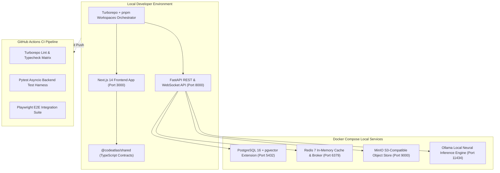
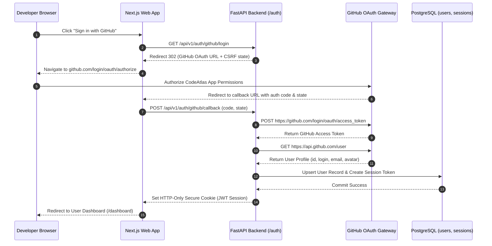
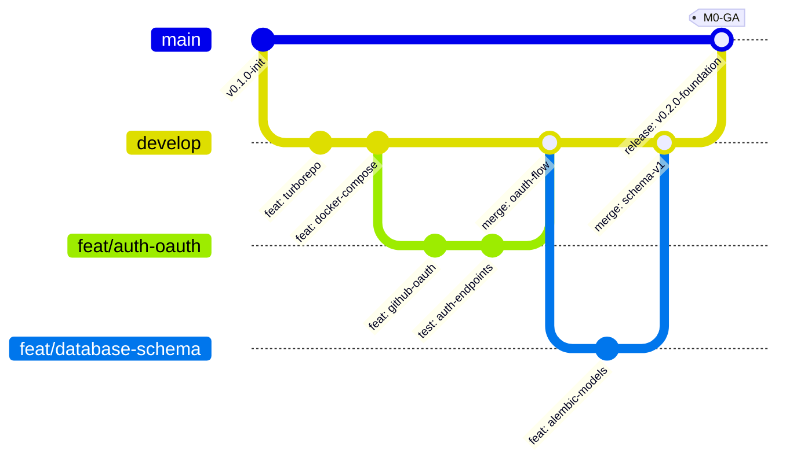

# Phase 0 Issues: Foundation, Infrastructure & Core Skeleton

This document details all Phase 0 issues for CodeAtlas covering repository initialization, monorepo orchestration, Docker local development environment, database migrations, authentication, CI/CD pipelines, and baseline testing.

---

## 📊 Phase 0 Visual Architecture & Technical Blueprint Suite

### 1. Monorepo & Container Infrastructure Architecture Flowchart

### 2. GitHub OAuth Authentication & Session Sequence Diagram

### 3. Git Branching & Release Strategy

---

### Issue 1: Monorepo Orchestration with Turborepo & pnpm Workspaces
- **GitHub Tracking**: [Issue #1](https://github.com/Inkesk-Dozing/CodeAtlas/issues/1)
- **Labels**: `phase:phase-0-foundation`, `type:infra`, `priority:P0-critical`, `component:infra`, `status:completed`
- **Milestone**: `M0: Foundation`
- **Component**: Monorepo Root (`package.json`, `pnpm-workspace.yaml`, `turbo.json`)
- **Existing Implementation**: [package.json](file:///C:/Users/USER/Desktop/Extras/pending-projects/CodeAtlas/package.json), [pnpm-workspace.yaml](file:///C:/Users/USER/Desktop/Extras/pending-projects/CodeAtlas/pnpm-workspace.yaml), [turbo.json](file:///C:/Users/USER/Desktop/Extras/pending-projects/CodeAtlas/turbo.json)
- **Problem Statement**:
  Managing independent subprojects for the FastAPI backend, Next.js frontend, and shared types without a unified monorepo manager leads to duplicate dependencies, disconnected build pipelines, and non-deterministic local setups.
- **Technical Specification**:
  - Configure `pnpm-workspace.yaml` with paths for `apps/*` and `packages/*`.
  - Establish `turbo.json` build pipeline with topological dependencies (`build`, `dev`, `lint`, `typecheck`, `test`, `clean`).
  - Configure root `package.json` scripts to run tasks monorepo-wide using `turbo run`.
- **Acceptance Criteria**:
  - [x] `pnpm install` installs dependencies across all workspaces with frozen lockfile.
  - [x] `turbo run dev` concurrently boots frontend and backend workspaces.
  - [x] Package caching configured for build and lint artifacts via `.turbo/`.

---

### Issue 2: Multi-Container Local Development Stack with Docker Compose
- **GitHub Tracking**: [Issue #2](https://github.com/Inkesk-Dozing/CodeAtlas/issues/2)
- **Labels**: `phase:phase-0-foundation`, `type:infra`, `priority:P0-critical`, `component:infra`, `status:completed`
- **Milestone**: `M0: Foundation`
- **Component**: `infra/docker-compose.yml`, `.env.example`
- **Existing Implementation**: [infra/docker-compose.yml](file:///C:/Users/USER/Desktop/Extras/pending-projects/CodeAtlas/infra/docker-compose.yml), [.env.example](file:///C:/Users/USER/Desktop/Extras/pending-projects/CodeAtlas/.env.example)
- **Problem Statement**:
  CodeAtlas requires PostgreSQL with the `pgvector` extension, Redis for Celery queues and rate limiting, MinIO for S3-compatible snapshot storage, and Ollama for local LLM inference. Setting these up manually is error-prone.
- **Technical Specification**:
  - Create `infra/docker-compose.yml` declaring:
    - `postgres`: image `pgvector/pgvector:pg16` on port `5432`, volume mounted to `pgdata`.
    - `redis`: image `redis:7-alpine` on port `6379`, persistent volume `redis-data`.
    - `minio`: image `minio/minio:latest` on ports `9000` (API) and `9001` (Console).
    - `ollama`: image `ollama/ollama:latest` on port `11434`, GPU-pass-through ready.
  - Health checks configured on PostgreSQL (`pg_isready`) and Redis (`redis-cli ping`).
- **Acceptance Criteria**:
  - [x] `docker compose -f infra/docker-compose.yml up -d` boots all 4 services healthy.
  - [x] `pgvector` extension successfully initializes in PostgreSQL container.
  - [x] `.env.example` reflects exact host, port, and credential defaults.

---

### Issue 3: GitHub App Registration & Webhook Receiver with HMAC-SHA256 Verification
- **GitHub Tracking**: [Issue #3](https://github.com/Inkesk-Dozing/CodeAtlas/issues/3)
- **Labels**: `phase:phase-0-foundation`, `type:security`, `priority:P0-critical`, `component:apps/api`, `status:completed`
- **Milestone**: `M0: Foundation`
- **Component**: `apps/api/routers/webhooks.py`, `apps/api/services/auth.py`
- **Existing Implementation**: [apps/api/routers/webhooks.py](file:///C:/Users/USER/Desktop/Extras/pending-projects/CodeAtlas/apps/api/routers/webhooks.py)
- **Problem Statement**:
  Incoming GitHub events (push, installation, issue opened) must be cryptographically authenticated to prevent spoofed payloads and replay attacks.
- **Technical Specification**:
  - Implement `POST /api/v1/webhooks/github` endpoint.
  - Validate `X-Hub-Signature-256` header using constant-time HMAC-SHA256 comparison against `GITHUB_WEBHOOK_SECRET`.
  - Parse events: `push`, `installation`, `installation_repositories`, and `issues`.
  - Dispatch asynchronous processing to Celery task queue based on event action.
- **Acceptance Criteria**:
  - [x] HMAC validation returns `401 Unauthorized` on signature mismatch or missing header.
  - [x] Valid payloads return `202 Accepted` and enqueue Celery job.
  - [x] Webhook payload idempotency verified using `X-GitHub-Delivery` UUID.

---

### Issue 4: GitHub OAuth 2.0 Flow & Dual-Mode JWT Authentication Service
- **GitHub Tracking**: [Issue #4](https://github.com/Inkesk-Dozing/CodeAtlas/issues/4)
- **Labels**: `phase:phase-0-foundation`, `type:feature`, `priority:P0-critical`, `component:apps/api`, `status:completed`
- **Milestone**: `M0: Foundation`
- **Component**: `apps/api/routers/auth.py`, `apps/api/services/auth.py`
- **Existing Implementation**: [apps/api/routers/auth.py](file:///C:/Users/USER/Desktop/Extras/pending-projects/CodeAtlas/apps/api/routers/auth.py), [apps/api/services/auth.py](file:///C:/Users/USER/Desktop/Extras/pending-projects/CodeAtlas/apps/api/services/auth.py)
- **Problem Statement**:
  Users need seamless authentication via their GitHub identity, coupled with secure API token issuance supporting both local development (HS256) and enterprise production (RS256 asymmetric keys).
- **Technical Specification**:
  - `POST /api/v1/auth/callback`: Exchanges temporary GitHub OAuth code for user profile and GitHub access token.
  - Generates short-lived access JWT (15-min) and rotating refresh JWT (7-day) stored in Redis.
  - `POST /api/v1/auth/refresh`: Validates refresh token, invalidates old token, and issues fresh pair.
  - `GET /api/v1/auth/me`: Returns current authenticated user record and organization memberships.
- **Acceptance Criteria**:
  - [x] Supports both `HS256` (symmetric secret) and `RS256` (PEM key pair) via configuration.
  - [x] Token payload includes `sub` (user_id), `org_ids`, `role`, and `exp`.
  - [x] Revoked refresh tokens rejected immediately via Redis blacklist.

---

### Issue 5: Alembic Database Migration Framework & 15-Table Relational Schema
- **GitHub Tracking**: [Issue #5](https://github.com/Inkesk-Dozing/CodeAtlas/issues/5)
- **Labels**: `phase:phase-0-foundation`, `type:feature`, `priority:P0-critical`, `component:apps/api`, `status:completed`
- **Milestone**: `M0: Foundation`
- **Component**: `apps/api/migrations/`, `apps/api/models/`
- **Existing Implementation**: [apps/api/models/](file:///C:/Users/USER/Desktop/Extras/pending-projects/CodeAtlas/apps/api/models/), [apps/api/migrations/](file:///C:/Users/USER/Desktop/Extras/pending-projects/CodeAtlas/apps/api/migrations/)
- **Problem Statement**:
  CodeAtlas requires a relational data store modeling users, organizations, repositories, AST code nodes, dependency edges, GitHub issues, mappings, and chat sessions with strong relational integrity.
- **Technical Specification**:
  - Setup Alembic with async SQLAlchemy database engine (`asyncpg`).
  - Create initial migration `0001_initial.py` defining 15 tables:
    - `users`, `organizations`, `organization_members`
    - `repositories`, `installations`
    - `code_nodes`, `code_edges`
    - `issues`, `issue_mappings`, `mapping_feedbacks`
    - `summaries`, `chat_sessions`, `chat_messages`
    - `webhook_events`, `api_keys`
  - Enable `vector` extension and configure vector column on `code_nodes`.
- **Acceptance Criteria**:
  - [x] `pnpm db:migrate` applies cleanly without syntax or foreign key order errors.
  - [x] `alembic downgrade -1` rolls back cleanly.
  - [x] Indexes created on foreign keys, repository IDs, and unique constraints.

---

### Issue 6: FastAPI Application Lifecycle, Router Registry & Exception Middleware Stack
- **GitHub Tracking**: [Issue #6](https://github.com/Inkesk-Dozing/CodeAtlas/issues/6)
- **Labels**: `phase:phase-0-foundation`, `type:feature`, `priority:P0-critical`, `component:apps/api`, `status:completed`
- **Milestone**: `M0: Foundation`
- **Component**: `apps/api/main.py`, `apps/api/middleware.py`
- **Existing Implementation**: [apps/api/main.py](file:///C:/Users/USER/Desktop/Extras/pending-projects/CodeAtlas/apps/api/main.py), [apps/api/middleware.py](file:///C:/Users/USER/Desktop/Extras/pending-projects/CodeAtlas/apps/api/middleware.py)
- **Problem Statement**:
  FastAPI application must enforce consistent request tracing, CORS handling, rate limiting, and centralized error logging across all 29 routes.
- **Technical Specification**:
  - Define `lifespan` handler initializing async database connection pool and Redis connection.
  - Mount middlewares:
    - `CorrelationIdMiddleware`: Injects or propagates `X-Request-ID`.
    - `CORSMiddleware`: Whitelists web frontend origin (`http://localhost:3000`).
    - `RateLimiterMiddleware`: Sliding window limiter backed by Redis.
  - Register routers under `/api/v1`: `auth`, `repos`, `graph`, `search`, `ingestion`, `issues`, `summaries`, `chat`, `webhooks`.
  - Expose `/health` and `/ready` probes.
- **Acceptance Criteria**:
  - [x] All responses include `X-Request-ID` and timing headers.
  - [x] Unhandled exceptions sanitized into standardized JSON error response with correlation ID.
  - [x] Interactive OpenAPI documentation generated at `/docs`.

---

### Issue 7: Next.js 14 App Router Baseline & Modern Dark Mode Design System
- **GitHub Tracking**: [Issue #7](https://github.com/Inkesk-Dozing/CodeAtlas/issues/7)
- **Labels**: `phase:phase-0-foundation`, `type:frontend`, `priority:P0-critical`, `component:apps/web`, `status:completed`
- **Milestone**: `M0: Foundation`
- **Component**: `apps/web/src/app/`, `apps/web/tailwind.config.ts`
- **Existing Implementation**: [apps/web/src/app/](file:///C:/Users/USER/Desktop/Extras/pending-projects/CodeAtlas/apps/web/src/app/), [apps/web/tailwind.config.ts](file:///C:/Users/USER/Desktop/Extras/pending-projects/CodeAtlas/apps/web/tailwind.config.ts)
- **Problem Statement**:
  The web frontend requires an ergonomic layout, fast page routing, responsive viewport scaling, and tailored dark-mode tokens for high-density graph visualization.
- **Technical Specification**:
  - Configure Next.js 14 App Router layout with navigation header, repository selector, and main canvas view.
  - Tailwind CSS configured with custom color palette (slate dark background, violet/cyan glowing accents, custom border radiuses).
  - Install and configure Lucide icons and clsx/tailwind-merge utilities.
- **Acceptance Criteria**:
  - [x] Next.js compiles without layout hydration mismatches.
  - [x] High-contrast dark theme renders consistently across all screen sizes.
  - [x] Root layout includes global error boundary and toast notification container.

---

### Issue 8: Shared TypeScript Domain Contracts & Data Transfer Objects
- **GitHub Tracking**: [Issue #8](https://github.com/Inkesk-Dozing/CodeAtlas/issues/8)
- **Labels**: `phase:phase-0-foundation`, `type:feature`, `priority:P1-high`, `component:packages/shared`, `status:completed`
- **Milestone**: `M0: Foundation`
- **Component**: `packages/shared/src/`
- **Existing Implementation**: [packages/shared/src/](file:///C:/Users/USER/Desktop/Extras/pending-projects/CodeAtlas/packages/shared/src/)
- **Problem Statement**:
  Preventing contract drift between FastAPI Pydantic schemas and Next.js TypeScript types requires a single source of truth in the shared package.
- **Technical Specification**:
  - Define shared interfaces: `CodeNode`, `CodeEdge`, `NodeType`, `EdgeType`, `RepositoryStats`, `IssueMapping`, `ConfidenceTier`, `GraphData`.
  - Export common constants, confidence threshold values, and API error codes.
  - Configure `tsconfig.json` for pure ES module export with `.d.ts` declaration generation.
- **Acceptance Criteria**:
  - [x] `packages/shared` compiles cleanly via `pnpm --filter @codeatlas/shared build`.
  - [x] `apps/web` imports types directly without relative cross-package path hacks.
  - [x] Zero runtime dependencies in `@codeatlas/shared`.

---

### Issue 9: CI/CD GitHub Actions Pipeline for Monorepo Validation & Docker Builds
- **GitHub Tracking**: [Issue #9](https://github.com/Inkesk-Dozing/CodeAtlas/issues/9)
- **Labels**: `phase:phase-0-foundation`, `type:test`, `priority:P0-critical`, `component:ci-cd`, `status:completed`
- **Milestone**: `M0: Foundation`
- **Component**: `.github/workflows/ci.yml`
- **Existing Implementation**: [.github/workflows/ci.yml](file:///C:/Users/USER/Desktop/Extras/pending-projects/CodeAtlas/.github/workflows/ci.yml)
- **Problem Statement**:
  Continuous integration must validate every commit against linting, type safety, Python pytest suites, Vitest frontend tests, and verify Docker image builds.
- **Technical Specification**:
  - Job `lint`: Runs Prettier, ESLint, and TypeScript `tsc --noEmit`.
  - Job `lint-python`: Runs Ruff linter on `apps/api/`.
  - Job `test`: Boots PostgreSQL + pgvector and Redis service containers; runs pytest with coverage report and Vitest tests.
  - Job `build`: Uses Docker Buildx to build and push container images to GitHub Container Registry (`ghcr.io`).
- **Acceptance Criteria**:
  - [x] Pipeline triggers on PRs to `main` and pushes to `main`/`develop`.
  - [x] Fails immediately if any unit test or type check fails.
  - [x] Caches `pnpm` store and `pip` wheels to keep execution under 4 minutes.

---

### Issue 10: Automated Security Scanning with CodeQL, TruffleHog & Dependabot
- **GitHub Tracking**: [Issue #10](https://github.com/Inkesk-Dozing/CodeAtlas/issues/10)
- **Labels**: `phase:phase-0-foundation`, `type:security`, `priority:P0-critical`, `component:ci-cd`, `status:completed`
- **Milestone**: `M0: Foundation`
- **Component**: `.github/workflows/codeql.yml`, `SECURITY.md`
- **Existing Implementation**: [.github/workflows/codeql.yml](file:///C:/Users/USER/Desktop/Extras/pending-projects/CodeAtlas/.github/workflows/codeql.yml), [SECURITY.md](file:///C:/Users/USER/Desktop/Extras/pending-projects/CodeAtlas/SECURITY.md)
- **Problem Statement**:
  Early prevention of security regressions, dependency vulnerabilities, and credential leaks before any feature branch is merged into `main`.
- **Technical Specification**:
  - Setup GitHub CodeQL action analyzing `javascript-typescript` and `python`.
  - Add TruffleHog secret scanning step detecting high-entropy keys, private PEMs, and OAuth tokens.
  - Document vulnerability disclosure timelines and CVD policies in `SECURITY.md`.
- **Acceptance Criteria**:
  - [x] CodeQL scans execute on pull request creation and weekly schedule.
  - [x] Hardcoded credentials in any commit trigger build failure.
  - [x] Vulnerability reporting instructions clearly defined in root `SECURITY.md`.

---

### Issue 11: Celery Asynchronous Task Worker & Redis Broker Integration
- **GitHub Tracking**: [Issue #11](https://github.com/Inkesk-Dozing/CodeAtlas/issues/11)
- **Labels**: `phase:phase-0-foundation`, `type:infra`, `priority:P0-critical`, `component:apps/api`, `status:completed`
- **Milestone**: `M0: Foundation`
- **Component**: `apps/api/tasks/`, `apps/api/config.py`
- **Existing Implementation**: [apps/api/tasks/](file:///C:/Users/USER/Desktop/Extras/pending-projects/CodeAtlas/apps/api/tasks/)
- **Problem Statement**:
  Repository ingestion, AST parsing, and vector embeddings are long-running I/O intensive jobs that would block FastAPI HTTP workers if executed synchronously.
- **Technical Specification**:
  - Configure Celery app with Redis broker (`REDIS_URL`) and result backend.
  - Implement task error retry policies with exponential backoff (`max_retries=3`).
  - Configure task state events to allow real-time progress inspection.
- **Acceptance Criteria**:
  - [x] Celery worker starts cleanly via `celery -A tasks.celery_app worker -l info`.
  - [x] Task execution status queryable by task ID from Redis backend.
  - [x] Failed tasks log structured error trace with context metadata.

---

### Issue 12: Foundation Architectural Specifications & Technical System Blueprint
- **GitHub Tracking**: [Issue #13](https://github.com/Inkesk-Dozing/CodeAtlas/issues/13)
- **Labels**: `phase:phase-0-foundation`, `type:documentation`, `priority:P1-high`, `component:documentation`, `status:completed`
- **Milestone**: `M0: Foundation`
- **Component**: `docs/01-project-overview.md`, `docs/02-tech-stack.md`, `docs/README.md`
- **Existing Implementation**: [docs/01-project-overview.md](file:///C:/Users/USER/Desktop/Extras/pending-projects/CodeAtlas/docs/01-project-overview.md), [docs/02-tech-stack.md](file:///C:/Users/USER/Desktop/Extras/pending-projects/CodeAtlas/docs/02-tech-stack.md)
- **Problem Statement**:
  Contributors require complete architectural clarity regarding tech stack choices, phase milestones, and monorepo topology before implementing feature modules.
- **Technical Specification**:
  - Author detailed technical overviews in `docs/`:
    - `01-project-overview.md`: Vision, value proposition, core subsystems.
    - `02-tech-stack.md`: Python FastAPI, Next.js 14, React Flow, pgvector, Redis, MinIO, Ollama rationale.
    - `README.md`: Central documentation directory with cross-links.
- **Acceptance Criteria**:
  - [x] All 15 planning documents indexed and linked in `docs/README.md`.
  - [x] Architecture diagrams rendered in Mermaid format.
  - [x] Hardware specifications and local setup instructions documented.

---

### Issue 13: Configuration Management with Pydantic Settings & Strict Validation
- **GitHub Tracking**: [Issue #14](https://github.com/Inkesk-Dozing/CodeAtlas/issues/14)
- **Labels**: `phase:phase-0-foundation`, `type:feature`, `priority:P1-high`, `component:apps/api`, `status:completed`
- **Milestone**: `M0: Foundation`
- **Component**: `apps/api/config.py`
- **Existing Implementation**: [apps/api/config.py](file:///C:/Users/USER/Desktop/Extras/pending-projects/CodeAtlas/apps/api/config.py)
- **Problem Statement**:
  Missing or invalid environment variables at startup can lead to silent runtime failures during database queries or OAuth exchanges.
- **Technical Specification**:
  - Implement `Settings` class inheriting from `pydantic_settings.BaseSettings`.
  - Validate database URLs, Redis URLs, JWT keys, GitHub App IDs, and Ollama host URLs.
  - Support reading from `.env` with fallback to container environment variables.
- **Acceptance Criteria**:
  - [x] FastAPI startup aborts with descriptive error if required configuration is missing.
  - [x] Secrets masked in logs and string representations.
  - [x] Cached settings instance accessible via dependency injection (`get_settings`).

---

### Issue 14: Health, Liveness & Readiness Probes for Container Orchestration
- **GitHub Tracking**: [Issue #15](https://github.com/Inkesk-Dozing/CodeAtlas/issues/15)
- **Labels**: `phase:phase-0-foundation`, `type:infra`, `priority:P1-high`, `component:apps/api`, `status:completed`
- **Milestone**: `M0: Foundation`
- **Component**: `apps/api/main.py`
- **Existing Implementation**: [apps/api/main.py](file:///C:/Users/USER/Desktop/Extras/pending-projects/CodeAtlas/apps/api/main.py)
- **Problem Statement**:
  Kubernetes, Docker Compose, and load balancers require distinct liveness (`/health`) and readiness (`/ready`) probes to avoid routing traffic to uninitialized or disconnected instances.
- **Technical Specification**:
  - `GET /health`: Returns 200 OK with server uptime, commit SHA, and version.
  - `GET /ready`: Actively tests PostgreSQL query execution and Redis ping; returns 503 if any downstream dependency is unhealthy.
- **Acceptance Criteria**:
  - [x] `/ready` verifies database connectivity via `SELECT 1`.
  - [x] Returns HTTP 503 with JSON breakdown of failing subsystems if database or Redis is down.
  - [x] Response time < 50ms under normal operating conditions.

---

### Issue 15: Comprehensive Backend & Frontend Unit Test Baseline
- **GitHub Tracking**: [Issue #16](https://github.com/Inkesk-Dozing/CodeAtlas/issues/16)
- **Labels**: `phase:phase-0-foundation`, `type:test`, `priority:P1-high`, `component:apps/api`, `status:completed`
- **Milestone**: `M0: Foundation`
- **Component**: `apps/api/tests/`, `apps/web/vitest.config.ts`
- **Existing Implementation**: [apps/api/tests/](file:///C:/Users/USER/Desktop/Extras/pending-projects/CodeAtlas/apps/api/tests/)
- **Problem Statement**:
  Prevent regressions by establishing automated test suites for API routers, auth validation, graph queries, and React Flow stores from Day 1.
- **Technical Specification**:
  - Setup pytest with `pytest-asyncio` and `pytest-cov` in `apps/api/tests/`.
  - Implement 55 backend unit and integration test fixtures covering auth, repos, graph, and issues.
  - Setup Vitest in `apps/web` with 10 unit tests verifying store state transitions and canvas rendering.
- **Acceptance Criteria**:
  - [x] `python -m pytest tests/ -q` passes 55/55 tests in under 15 seconds.
  - [x] Vitest passes all frontend tests in under 5 seconds.
  - [x] CI pipeline enforces 0 test failures.

---

### Issue 16: Contributor Guidelines, Code Style & Pre-Commit Hook Baseline
- **GitHub Tracking**: [Issue #17](https://github.com/Inkesk-Dozing/CodeAtlas/issues/17)
- **Labels**: `phase:phase-0-foundation`, `type:documentation`, `priority:P2-medium`, `component:infra`, `status:completed`
- **Milestone**: `M0: Foundation`
- **Component**: `CONTRIBUTING.md`, `.prettierrc`, `apps/api/pyproject.toml`
- **Existing Implementation**: [CONTRIBUTING.md](file:///C:/Users/USER/Desktop/Extras/pending-projects/CodeAtlas/CONTRIBUTING.md), [.prettierrc](file:///C:/Users/USER/Desktop/Extras/pending-projects/CodeAtlas/.prettierrc)
- **Problem Statement**:
  Open-source and internal contributors need explicit conventions regarding branch naming, commit standards, and automatic formatting tools.
- **Technical Specification**:
  - Enforce Conventional Commits (`feat:`, `fix:`, `docs:`, `chore:`, `perf:`).
  - Configure Prettier for `.ts`, `.tsx`, `.json`, `.yml`, and `.md` files.
  - Configure Ruff for Python linting with rules for imports, type annotations, and unused variables.
- **Acceptance Criteria**:
  - [x] `pnpm format:check` verifies code adherence across monorepo.
  - [x] `ruff check apps/api/` executes cleanly with zero errors.
  - [x] PR requirements and step-by-step setup documented in `CONTRIBUTING.md`.

---

### Issue 17: Next.js Authentication Context & Protected Route Guards
- **GitHub Tracking**: [Issue #18](https://github.com/Inkesk-Dozing/CodeAtlas/issues/18)
- **Labels**: `phase:phase-0-foundation`, `type:frontend`, `priority:P1-high`, `component:apps/web`, `status:completed`
- **Milestone**: `M0: Foundation`
- **Component**: `apps/web/src/stores/`, `apps/web/src/hooks/`
- **Existing Implementation**: [apps/web/src/stores/](file:///C:/Users/USER/Desktop/Extras/pending-projects/CodeAtlas/apps/web/src/stores/)
- **Problem Statement**:
  Users navigating to the dashboard or repository graph must be authenticated, redirecting unauthenticated visitors to GitHub OAuth login.
- **Technical Specification**:
  - Create Zustand `useAuthStore` managing user state, tokens, and organization context.
  - Implement token refresh interceptor automatically refreshing expired JWTs via `/api/v1/auth/refresh`.
  - Protected layout wrapper redirecting unauthenticated users to `/login`.
- **Acceptance Criteria**:
  - [x] Stores access token securely in memory, refresh token in httpOnly cookie.
  - [x] Automatic silent refresh triggered 60 seconds prior to access token expiration.
  - [x] Logging out clears session state and redirects to landing page.

---

### Issue 18: Repository Explorer & Ingestion Trigger UI
- **GitHub Tracking**: [Issue #19](https://github.com/Inkesk-Dozing/CodeAtlas/issues/19)
- **Labels**: `phase:phase-0-foundation`, `type:frontend`, `priority:P1-high`, `component:apps/web`, `status:completed`
- **Milestone**: `M0: Foundation`
- **Component**: `apps/web/src/components/panels/`, `apps/web/src/app/`
- **Existing Implementation**: [apps/web/src/components/panels/](file:///C:/Users/USER/Desktop/Extras/pending-projects/CodeAtlas/apps/web/src/components/panels/)
- **Problem Statement**:
  Engineers need an intuitive interface to browse installed GitHub repositories, view their indexing status, and trigger re-ingestion with a single click.
- **Technical Specification**:
  - Repository list card grid showing repository name, stars, primary language, node count, and last analyzed timestamp.
  - "Ingest Repository" button triggering `POST /api/v1/repos/{id}/ingest/trigger`.
  - Visual status pill: `Ready`, `Cloning`, `Parsing`, `Extracting`, `Embedding`, `Failed`.
- **Acceptance Criteria**:
  - [x] Repository list dynamically fetches from `GET /api/v1/repos`.
  - [x] Clicking ingest triggers background Celery job and starts live status polling.
  - [x] Error states display friendly error message with retry button.
