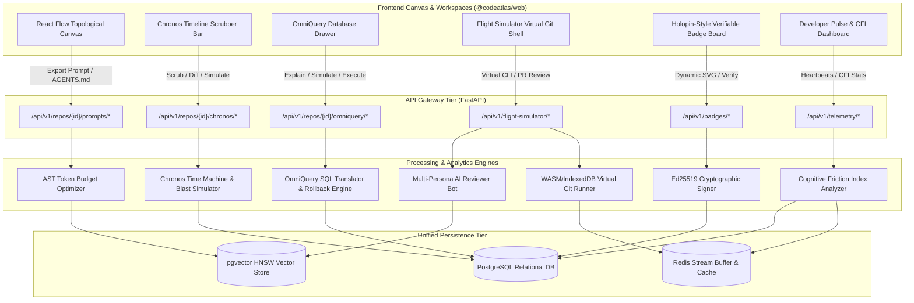
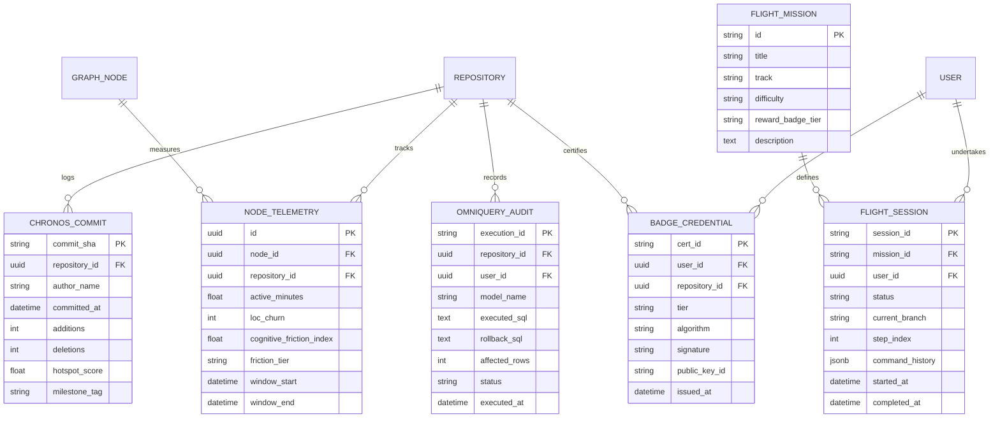
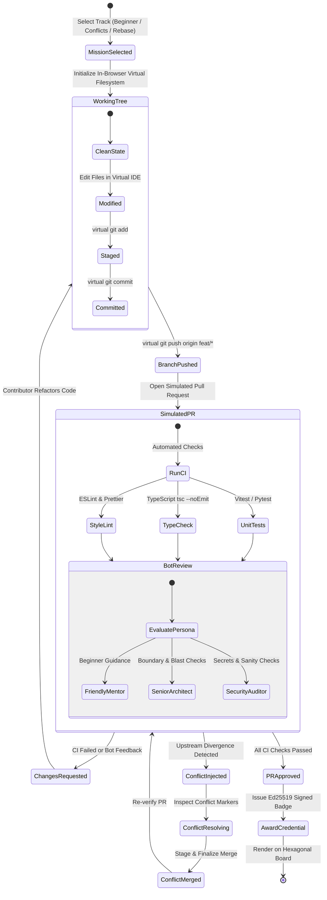
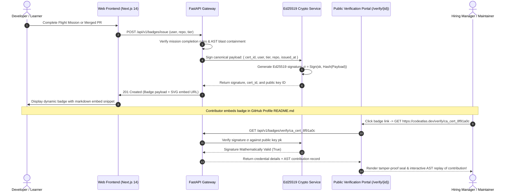
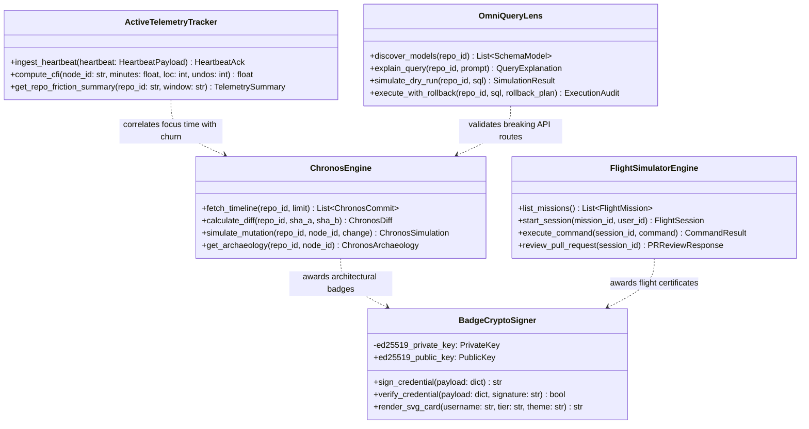
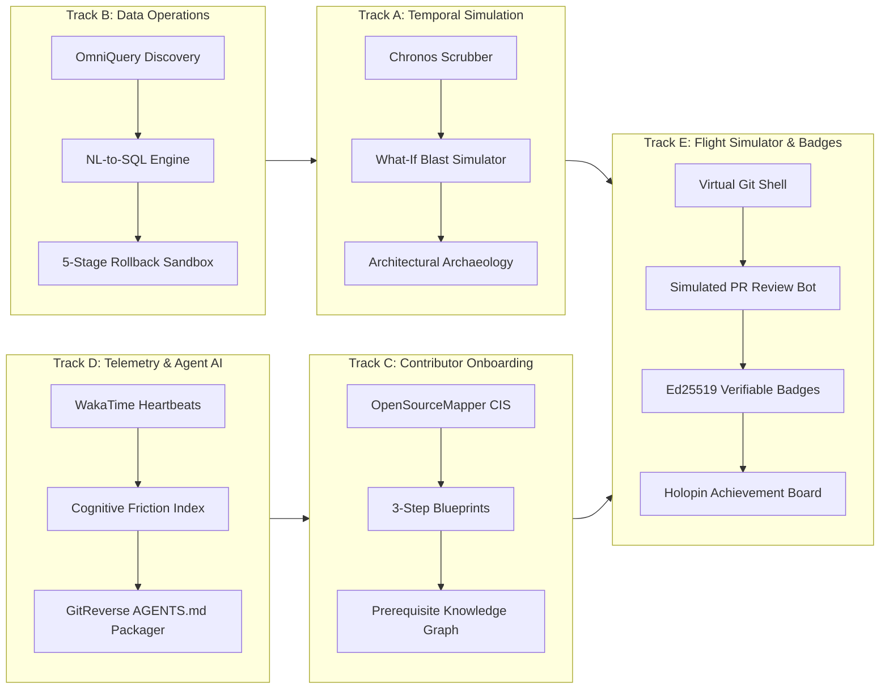

# Phase 6 Issues: Temporal Simulation, Developer Telemetry & Verifiable Credential Ecosystem

This document details all Phase 6 issues for CodeAtlas and CodeAtlas Prime covering the expansion into **Chronos** (Software Time Machine), **OmniQuery** (Database Time Machine & Schema Lens), **Open Source Mapper** (Contributor Blueprints), **WakaTime-Style Active Telemetry** (Cognitive Friction Hotspots), **GitReverse** (AST-to-Prompt & AI Context Generator), and the **CodeAtlas Flight Simulator with Holopin-Style Verifiable Profile Badges**.

---


---

## 📊 Phase 6 Visual Architecture & Technical Blueprint Suite

To maintain GitHub version-controlled technical transparency, the diagrams below illustrate the system flow, data schemas, object hierarchies, state transitions, and cryptographic verification pipelines for Phase 6.

### 1. System Architecture & Component Interaction Flowchart



### 2. Entity-Relationship Diagram (ERD): Phase 6 Data Models



### 3. State Machine Diagram: Flight Simulator & Multi-Persona PR Bot



### 4. Sequence Diagram: Cryptographic Credential Issuance & Public Verification



### 5. Class Diagram: Core Domain Architecture



### 6. Track Roadmap: Phase 6 Milestones



### Issue 119: Chronos Commit Timeline Scrubber & Milestone Progression Ribbon
- **Labels**: `phase:phase-6-ecosystem`, `type:frontend`, `priority:P0-critical`, `component:apps/web`, `status:completed`
- **Milestone**: `M7: Prime Ecosystem & Credentialing`
- **Component**: `apps/web/src/components/timeline/ChronosTimelineBar.tsx`, `apps/api/routers/chronos.py`
- **Problem Statement**:
  Static architecture graphs only visualize the latest HEAD state, blinding developers to how system structure, dependency chains, and architectural debt accumulated across git tags and releases.
- **Technical Specification**:
  - Endpoint: `GET /api/v1/repos/{id}/chronos/timeline?limit=N` streaming git commit milestones, churn delta (`+added / -deleted`), and hotspot scores.
  - Interactive bottom canvas scrubber ribbon in `@codeatlas/web` with author avatars, short SHA badges, and architectural milestone tags (e.g. `PR #104: Database Decoupling`, `v0.8.0 Release`).
  - Automated timeline playback controller with variable speed (1.5s–3.0s interval), play/pause, step backward, step forward, and jump-to-HEAD.
- **Acceptance Criteria**:
  - [x] Smooth scrubbing across 50+ commit checkpoints without UI stutter.
  - [x] Renders relative churn indicators and hotspot intensity color coding.
  - [x] Integrates seamlessly with React Flow canvas state.

---

### Issue 120: What-If AST Refactor Mutation & Downstream Blast Radius Simulator
- **Labels**: `phase:phase-6-ecosystem`, `type:feature`, `priority:P0-critical`, `component:apps/api`, `status:completed`
- **Milestone**: `M7: Prime Ecosystem & Credentialing`
- **Component**: `apps/web/src/components/timeline/ChronosSimulationModal.tsx`, `apps/api/routers/chronos.py`
- **Problem Statement**:
  Developers proposing refactors or breaking signature changes cannot predict system-wide breakage across callers and API routes before creating a branch and writing code.
- **Technical Specification**:
  - Endpoint: `POST /api/v1/repos/{id}/chronos/simulate` accepting `target_node_id` and `proposed_change`.
  - Directed graph transitive closure traversal ($O(V_{reach} + E_{reach})$) determining downstream dependents up to depth $D$.
  - Generates:
    - Blast radius count and risk classification (`low`, `medium`, `high`, `critical`).
    - Impacted API routes and components with breaking change badges.
    - Recommended peer reviewers based on git line ownership of affected callers.
    - Automated remediation checklist.
  - Automatically highlights the downstream blast radius subgraph on the canvas in amber/crimson.
- **Acceptance Criteria**:
  - [x] Computes blast radius across 1,000+ nodes in $< 100\text{ms}$.
  - [x] Highlights affected callers directly on the CodeAtlas canvas.
  - [x] Surfaces peer reviewer suggestions with exact blame attribution.

---

### Issue 121: Architectural Archaeology Provenance & PR Decision Grounding
- **Labels**: `phase:phase-6-ecosystem`, `type:feature`, `priority:P1-high`, `component:apps/api`, `status:completed`
- **Milestone**: `M7: Prime Ecosystem & Credentialing`
- **Component**: `apps/web/src/components/timeline/ChronosArchaeologyModal.tsx`, `apps/api/routers/chronos.py`
- **Problem Statement**:
  When engineers encounter legacy architectural boundaries, they lack context on why the boundary was created, leading to unintended regressions or accidental reversals of intentional design decisions.
- **Technical Specification**:
  - Endpoint: `GET /api/v1/repos/{id}/chronos/archaeology/{node_id}`.
  - Grounded historical retrieval correlating git blame lines, commit messages, and linked GitHub Pull Request metadata.
  - Returns:
    - Node creation commit SHA, timestamp, and original author.
    - Linked PR discussions and design context explaining the original rationale.
    - Evolution summary and historical hotspot trajectory (`stable`, `accelerating`, `cooling`).
- **Acceptance Criteria**:
  - [x] Extracts original author and linked PR context for any selected AST node.
  - [x] Accurately characterizes historical churn trends.
  - [x] Displays interactive archaeology modal accessible from node inspector.

---

### Issue 122: Historical Git AST Checkpoint Diffing & Circular Dependency Detector
- **Labels**: `phase:phase-6-ecosystem`, `type:feature`, `priority:P1-high`, `component:apps/api`, `status:completed`
- **Milestone**: `M7: Prime Ecosystem & Credentialing`
- **Component**: `apps/api/routers/chronos.py`
- **Problem Statement**:
  Comparing architecture across branches or historical tags requires manually comparing raw git diffs, which fails to show structural dependency loops or detached modules.
- **Technical Specification**:
  - Endpoint: `GET /api/v1/repos/{id}/chronos/diff?from_commit=A&to_commit=B`.
  - Computes set difference:
    $$\Delta V = V_B \setminus V_A, \quad \Delta E = E_B \setminus E_A$$
  - Identifies:
    - Newly added and removed AST nodes.
    - Dependency edges created or severed.
    - Newly introduced circular dependency loops using Tarjan's strongly connected components algorithm.
- **Acceptance Criteria**:
  - [x] Returns structured topological diff between any two git commit hashes.
  - [x] Identifies new circular import loops introduced between commits.
  - [x] Provides natural language summary of architectural delta.

---

### Issue 123: Temporal Timeline Playback & Automated Architecture Drift Animator
- **Labels**: `phase:phase-6-ecosystem`, `type:frontend`, `priority:P2-medium`, `component:apps/web`, `status:completed`
- **Milestone**: `M7: Prime Ecosystem & Credentialing`
- **Component**: `apps/web/src/stores/chronosStore.ts`, `apps/web/src/components/timeline/ChronosTimeline.tsx`
- **Problem Statement**:
  Developers onboarding onto legacy systems cannot visualize the narrative evolution of the project without an automated visual replay.
- **Technical Specification**:
  - Automated state machine in `chronosStore.ts` that iterates through timeline commits.
  - Smooth node and edge position interpolations as components are added, refactored, or deprecated.
  - Synchronized audio-visual milestones when major releases or breaking refactors occur.
- **Acceptance Criteria**:
  - [x] Smooth stepping and timer-based animation across repository milestones.
  - [x] Automatic pause upon reaching latest HEAD.
  - [x] Responsive layout adapting to bottom canvas dock.

---

### Issue 124: Database ORM Model Discovery & Schema Lens Inspector
- **Labels**: `phase:phase-6-ecosystem`, `type:feature`, `priority:P0-critical`, `component:apps/api`, `status:completed`
- **Milestone**: `M7: Prime Ecosystem & Credentialing`
- **Component**: `apps/web/src/components/omnidrawer/OmniQueryDrawer.tsx`, `apps/api/routers/omniquery.py`
- **Problem Statement**:
  Database schemas are isolated from code architecture tools; developers cannot easily inspect table definitions, primary keys, and relationships directly from the code graph.
- **Technical Specification**:
  - Endpoint: `GET /api/v1/repos/{id}/omniquery/models`.
  - Ingestion AST parser extracts entity models from Prisma (`schema.prisma`), SQLAlchemy (`Base` classes), and Django ORM (`models.Model`).
  - Maps table names, field types, nullability, foreign keys, and connected API routes (e.g. `GET /api/v1/users`).
  - Render model catalog in slide-out OmniQuery workbench drawer with table/field summaries.
- **Acceptance Criteria**:
  - [x] Automatically catalogues all relational models defined in repository source code.
  - [x] One-click transition from model nodes on canvas to OmniQuery schema inspector.
  - [x] Lists all API endpoints that execute queries against each model.

---

### Issue 125: Natural Language to SQL Translation Engine with Schema Constraint Validation
- **Labels**: `phase:phase-6-ecosystem`, `type:feature`, `priority:P0-critical`, `component:apps/api`, `status:completed`
- **Milestone**: `M7: Prime Ecosystem & Credentialing`
- **Component**: `apps/api/routers/omniquery.py`
- **Problem Statement**:
  Engineers and analysts waste hours crafting complex SQL queries or migration scripts, often risking syntax errors or unintended data updates.
- **Technical Specification**:
  - Endpoint: `POST /api/v1/repos/{id}/omniquery/explain` accepting natural language prompt and optional model name.
  - Translates plain English into formatted SQL (SELECT, INSERT, UPDATE, DELETE, MIGRATION).
  - Validates SQL against extracted schema catalog (detecting non-existent columns or invalid type casts).
  - Categorizes risk level (`safe`, `medium`, `destructive`) and estimates affected row volume.
- **Acceptance Criteria**:
  - [x] Accurately translates operational English prompts into valid dialect-specific SQL.
  - [x] Flags destructive operations (e.g. `DROP TABLE`, unconstrained `DELETE`) with high-risk badges.
  - [x] Generates natural language explanation of query mechanics.

---

### Issue 126: Cross-Engine CodeAtlas API Route & Component Blast Radius Checker
- **Labels**: `phase:phase-6-ecosystem`, `type:feature`, `priority:P0-critical`, `component:apps/api`, `status:completed`
- **Milestone**: `M7: Prime Ecosystem & Credentialing`
- **Component**: `apps/api/routers/omniquery.py`, `apps/web/src/components/omnidrawer/OmniQueryDrawer.tsx`
- **Problem Statement**:
  Modifying a database table (e.g. renaming a column or changing a constraint) silently breaks application code, API routes, and frontend components that query that field.
- **Technical Specification**:
  - When a query or schema change is analyzed, OmniQuery cross-references CodeAtlas AST graph edges (`reads`, `writes`, `has_model`).
  - Identifies every API endpoint and frontend page that references the affected model/columns.
  - Classifies code impact:
    - `breaking`: Column removed, renamed, or converted to non-nullable without default.
    - `compatible`: New nullable column added or read-only query.
- **Acceptance Criteria**:
  - [x] Accurately pinpoints all API routes impacted by proposed schema change.
  - [x] Visualizes breaking vs compatible impact badges directly in the preview drawer.
  - [x] Prevents developers from executing breaking migrations without code awareness.

---

### Issue 127: Sandboxed Dry-Run Transaction Runner & Row Preview Table
- **Labels**: `phase:phase-6-ecosystem`, `type:feature`, `priority:P1-high`, `component:apps/api`, `status:completed`
- **Milestone**: `M7: Prime Ecosystem & Credentialing`
- **Component**: `apps/api/routers/omniquery.py`, `apps/web/src/components/omnidrawer/OmniQueryDrawer.tsx`
- **Problem Statement**:
  Executing queries directly against development or staging databases without dry-run validation leads to corrupted test state and downtime.
- **Technical Specification**:
  - Endpoint: `POST /api/v1/repos/{id}/omniquery/simulate`.
  - Executes SQL in an isolated transactional sandbox with automatic `ROLLBACK`.
  - Captures up to 50 preview rows showing before/after state.
  - Measures execution duration in milliseconds to flag unindexed sequential table scans.
- **Acceptance Criteria**:
  - [x] Dry-run execution runs safely without persisting uncommitted changes.
  - [x] Renders interactive preview table in the drawer with column headers and values.
  - [x] Reports execution duration and query optimization warnings.

---

### Issue 128: Automated Rollback Plan Generator & Emergency Reversal Controller
- **Labels**: `phase:phase-6-ecosystem`, `type:feature`, `priority:P0-critical`, `component:apps/api`, `status:completed`
- **Milestone**: `M7: Prime Ecosystem & Credentialing`
- **Component**: `apps/web/src/stores/omniQueryStore.ts`, `apps/api/routers/omniquery.py`
- **Problem Statement**:
  When a database update produces unexpected side effects, developers lack an instant, automated mechanism to restore the prior database state.
- **Technical Specification**:
  - Endpoint: `POST /api/v1/repos/{id}/omniquery/execute` accepting SQL and generated rollback plan.
  - Pre-computes the inverse SQL statement before running the primary transaction:
    - `UPDATE table SET col = 'new'` $\rightarrow$ Inverse captures original values per primary key.
    - `ADD COLUMN` $\rightarrow$ `DROP COLUMN`.
  - Records execution snapshot in session audit history with one-click **"Rollback Changes"** trigger.
- **Acceptance Criteria**:
  - [x] Generates syntactically correct inverse rollback scripts.
  - [x] Provides one-click rollback trigger in the audit history panel.
  - [x] Maintains complete audit log of executed statements, timestamps, and row counts.

---

### Issue 129: Good First Issue Triage by AST Subgraph Isolation & Complexity Scoring
- **Labels**: `phase:phase-6-ecosystem`, `type:feature`, `priority:P0-critical`, `component:apps/api`, `status:ready`
- **Milestone**: `M7: Prime Ecosystem & Credentialing`
- **Component**: `apps/api/routers/issues.py`, `apps/web/src/components/panels/ContributorPlannerPanel.tsx`
- **Problem Statement**:
  New contributors struggle to find accessible entry points because GitHub's `good-first-issue` labels are often manually assigned, outdated, or secretly attached to complex architectural refactors.
- **Technical Specification**:
  - Calculate AST Subgraph Isolation Score:
    $$\text{Isolation}(I) = \frac{1}{1 + \text{BlastRadiusCount}(I)} \times \frac{1}{\text{AvgCyclomaticComplexity}(\text{Candidates})}$$
  - Triage open repository issues into Contributor Tiers:
    - 🟢 **Tier 1 (Beginner Friendly)**: Isolated leaf nodes, 0 downstream callers, $< 50$ LOC affected.
    - 🟡 **Tier 2 (Intermediate Modular)**: Single package modification, well-defined test contracts.
    - 🔴 **Tier 3 (Core Architectural)**: High in-degree centrality nodes, database schema changes, auth primitives.
  - Display interactive issue discovery feed in CodeAtlas with complexity filters.
- **Acceptance Criteria**:
  - [ ] Automatically classifies issues by architectural isolation rather than arbitrary labels.
  - [ ] Filters out misleading "beginner" issues that touch high-risk core modules.
  - [ ] Renders interactive Contributor Discovery Explorer on the web client.

---

### Issue 130: 3-Step Contributor Execution Blueprint Generator
- **Labels**: `phase:phase-6-ecosystem`, `type:feature`, `priority:P1-high`, `component:apps/api`, `status:ready`
- **Milestone**: `M7: Prime Ecosystem & Credentialing`
- **Component**: `apps/api/routers/onboarding.py`, `apps/web/src/components/panels/ContributorPlannerPanel.tsx`
- **Problem Statement**:
  Even after selecting an issue, new developers spend days trying to understand where to start coding, which interfaces to extend, and which test commands to run.
- **Technical Specification**:
  - Endpoint: `POST /api/v1/repos/{id}/issues/{number}/blueprint`.
  - Evaluates issue context, target nodes, and test graph to generate a structured 3-phase execution roadmap:
    1. **Phase 1: Architecture Context**: Which 2 interface files or docs to review first.
    2. **Phase 2: Code Modification**: Specific functions, classes, and parameter types to modify.
    3. **Phase 3: Verification Protocol**: Exact terminal test commands (e.g. `pnpm --filter @pkg test`, `pytest tests/test_auth.py`).
  - Exportable as a personal contributor checklist.
- **Acceptance Criteria**:
  - [ ] Generates step-by-step blueprint for any mapped issue in $< 2$ seconds.
  - [ ] Cites exact file paths and test command strings.
  - [ ] Provides copy-pasteable contribution notes for PR descriptions.

---

### Issue 131: Repository Architecture Mental Model & Prerequisite Concept Checklist
- **Labels**: `phase:phase-6-ecosystem`, `type:frontend`, `priority:P1-high`, `component:apps/web`, `status:ready`
- **Milestone**: `M7: Prime Ecosystem & Credentialing`
- **Component**: `apps/web/src/components/panels/MentalModelPanel.tsx`
- **Problem Statement**:
  Monorepos rely on specific design patterns (e.g. CQRS, dependency injection, event emitters) that new contributors violate, leading to PR rejections.
- **Technical Specification**:
  - Extract architectural design patterns from AST imports and decorator hierarchies.
  - Generate interactive prerequisite concept checklist:
    - Core state management flow (e.g. Zustand store $\rightarrow$ React Flow custom nodes).
    - Data layer access rules (e.g. *"FastAPI routers must call services, never direct SQL"*).
    - Monorepo package boundary rules.
  - Check off concepts as the developer explores corresponding nodes on the canvas.
- **Acceptance Criteria**:
  - [ ] Summarizes top 3 architectural patterns used in the repository.
  - [ ] Tracks developer exploration progress on the graph.
  - [ ] Integrates with repository onboarding drawer.

---

### Issue 132: First-Time Contributor Safety Guardrail & Pre-Flight Review Checks
- **Labels**: `phase:phase-6-ecosystem`, `type:feature`, `priority:P2-medium`, `component:apps/api`, `status:ready`
- **Milestone**: `M7: Prime Ecosystem & Credentialing`
- **Component**: `apps/api/services/bot/contributor_guard.py`
- **Problem Statement**:
  Maintainers spend hours reviewing first-time contributor PRs that fail basic conventions (missing tests, formatting errors, accidental file additions like `.DS_Store` or `.env`).
- **Technical Specification**:
  - GitHub App action that runs a non-punitive "Pre-Flight Health Check" on first-time PRs:
    - Verifies conventional commit title (`feat:`, `fix:`, `docs:`).
    - Ensures newly modified functions have corresponding test assertions in `tests/`.
    - Detects accidental git additions (lockfile conflicts, temporary files).
    - Posts encouraging, friendly coaching advice with line-level suggestions.
- **Acceptance Criteria**:
  - [ ] Flags unformatted code or missing tests gently before maintainer review.
  - [ ] Reduces maintainer review cycles on open-source repositories by $> 30\%$.
  - [ ] Configurable in `codeatlas.config.json`.

---

### Issue 133: WakaTime-Compatible Local Heartbeat Ingestion Endpoint
- **Labels**: `phase:phase-6-ecosystem`, `type:feature`, `priority:P0-critical`, `component:apps/api`, `status:ready`
- **Milestone**: `M7: Prime Ecosystem & Credentialing`
- **Component**: `apps/api/routers/telemetry.py`
- **Problem Statement**:
  Git commit logs only measure the final pushed code; they are completely blind to the actual hours spent reading, typing, debugging, and refactoring inside the IDE.
- **Technical Specification**:
  - Endpoint: `POST /api/v1/telemetry/heartbeat` compatible with open WakaTime client API schema:
    ```json
    {
      "entity": "apps/api/routers/graph.py",
      "project": "CodeAtlas",
      "branch": "feat/chronos",
      "language": "python",
      "lines": 142,
      "time": 1730225400,
      "is_write": true
    }
    ```
  - Batch ingestion into `telemetry_heartbeats` table partitioned by repository ID.
  - Supports developer configuration via standard `~/.wakatime.cfg` by pointing `api_url = http://localhost:8000/api/v1/telemetry`.
  - 100% on-premise/local storage; zero metrics transmitted to external cloud servers.
- **Acceptance Criteria**:
  - [ ] Accepts standard WakaTime VS Code, JetBrains, and Neovim plugin heartbeats.
  - [ ] Aggregates active editing seconds per file path and branch.
  - [ ] Guarantees zero data leakage outside local infrastructure.

---

### Issue 134: Active Editor Time AST Node Mapping & Flow State Heatmaps
- **Labels**: `phase:phase-6-ecosystem`, `type:frontend`, `priority:P1-high`, `component:apps/web`, `status:ready`
- **Milestone**: `M7: Prime Ecosystem & Credentialing`
- **Component**: `apps/web/src/components/graph/TimeSpentHeatmap.tsx`
- **Problem Statement**:
  Engineering teams cannot see which components consume the most active developer time, obscuring maintenance sinks and focus patterns.
- **Technical Specification**:
  - Canvas display mode in React Flow: **"Time Spent / Flow Mode"**.
  - Maps aggregate heartbeat seconds onto AST nodes:
    - Cool blue: $< 1$ hour total developer focus.
    - Warm violet: $1 - 5$ hours developer focus.
    - Bright amber/gold: $> 10$ hours active focus in current sprint.
  - Displays developer active hours breakdown in node inspector drawer.
- **Acceptance Criteria**:
  - [ ] Renders color-coded time intensity overlay across graph nodes.
  - [ ] Shows exact active minutes spent per file and symbol.
  - [ ] Toggles seamlessly alongside standard architecture mode.

---

### Issue 135: Cognitive Friction Index & Codebase Frustration Hotspot Detection
- **Labels**: `phase:phase-6-ecosystem`, `type:feature`, `priority:P1-high`, `component:apps/api`, `status:ready`
- **Milestone**: `M7: Prime Ecosystem & Credentialing`
- **Component**: `apps/api/services/telemetry/friction_index.py`
- **Problem Statement**:
  High time spent combined with low commit output indicates severe cognitive friction (confusing architecture, missing types, or fragile dependencies).
- **Technical Specification**:
  - Compute Cognitive Friction Score for each module $v$:
    $$\text{Friction}(v) = \frac{\text{ActiveEditorHours}(v)}{\max(1, \text{LOC\_Produced}(v)) \times \max(1, \text{PR\_Velocity}(v))}$$
  - Cross-reference with cyclomatic complexity and circular dependency edges.
  - Alert engineering leads to "High Friction Hotspots" where engineers spend disproportionate hours with minimal progress.
- **Acceptance Criteria**:
  - [ ] Highlights modules with severe effort-to-output disparities.
  - [ ] Discovers confusing architectural bottlenecks before project deadlines slip.
  - [ ] Exports friction telemetry for engineering retrospective reviews.

---

### Issue 136: Local Privacy-First Developer Pulse Dashboard & Telemetry Filtering
- **Labels**: `phase:phase-6-ecosystem`, `type:frontend`, `priority:P2-medium`, `component:apps/web`, `status:ready`
- **Milestone**: `M7: Prime Ecosystem & Credentialing`
- **Component**: `apps/web/src/app/(dashboard)/telemetry/page.tsx`
- **Problem Statement**:
  Developers fear time-tracking tools that feel like corporate surveillance. Telemetry must be developer-first, empowering personal productivity without micromanagement.
- **Technical Specification**:
  - Personal **Developer Pulse Dashboard**:
    - Daily deep focus hours vs context-switching interruptions.
    - Breakdown of time by language, package, and git branch.
    - "Focus Score" measuring sustained coding flow without tab hopping.
  - Privacy controls:
    - Local-only mode toggle (data never leaves the user's machine).
    - Regex blacklist ignoring personal files, configs, and secret paths.
- **Acceptance Criteria**:
  - [ ] Clean personal productivity dashboard with zero managerial surveillance metrics.
  - [ ] One-click export and purge of local heartbeat history.
  - [ ] Strict path filtering preventing accidental tracking of sensitive files.

---

### Issue 137: Hierarchical AST-Driven LLM Context Packager & Token Optimizer
- **Labels**: `phase:phase-6-ecosystem`, `type:feature`, `priority:P0-critical`, `component:apps/api`, `status:ready`
- **Milestone**: `M7: Prime Ecosystem & Credentialing`
- **Component**: `apps/api/services/ai/context_packager.py`
- **Problem Statement**:
  Feeding raw codebase dumps into LLMs overflows context windows and causes hallucinations. LLMs need dense, hierarchical, symbol-aware context packages.
- **Technical Specification**:
  - Package AST nodes by topological relevance:
    - Layer 1: Core interface contracts, function signatures, and docstrings.
    - Layer 2: 1-hop caller/callee relationships and database entity schemas.
    - Layer 3: Implementation bodies (only for target focus nodes).
  - Enforce strict token budgets (e.g. 4,000 / 8,000 / 32,000 tokens) using Byte-Pair Encoding (tiktoken / tokenizers).
  - Compress boilerplate syntax while preserving 100% of architectural semantic meaning.
- **Acceptance Criteria**:
  - [ ] Reduces token consumption by $> 65\%$ compared to raw file concatenation.
  - [ ] Preserves complete interface contracts, type signatures, and imports.
  - [ ] Generates token-budgeted prompt bundles in $< 200\text{ms}$.

---

### Issue 138: Automated `AGENTS.md`, `.cursorrules` & `llms.txt` Generator
- **Labels**: `phase:phase-6-ecosystem`, `type:feature`, `priority:P0-critical`, `component:apps/api`, `status:ready`
- **Milestone**: `M7: Prime Ecosystem & Credentialing`
- **Component**: `apps/api/routers/summaries.py`
- **Problem Statement**:
  AI coding assistants (Claude Code, Cursor, Copilot, Antigravity) require up-to-date system rule files (`AGENTS.md`, `.cursorrules`, `llms.txt`), but maintaining these manually is tedious and quickly goes stale.
- **Technical Specification**:
  - Endpoint: `GET /api/v1/repos/{id}/export/ai-rules?format=agents|cursor|llms`.
  - Automatically compiles:
    - Monorepo package directory boundaries and conventions.
    - Naming conventions, import guidelines, and prohibited imports.
    - Tech stack summary and primary test runners.
    - Discovered ORM models and API route signatures.
  - One-click copy or direct repository commit via GitHub App.
- **Acceptance Criteria**:
  - [ ] Generates production-ready `AGENTS.md` and `.cursorrules` aligned with codebase conventions.
  - [ ] Updates automatically upon new commits or architecture changes.
  - [ ] Exportable directly from the CodeAtlas canvas toolbar.

---

### Issue 139: Subgraph "Prompt-to-Reconstruct" & Interface Contract Exporter
- **Labels**: `phase:phase-6-ecosystem`, `type:frontend`, `priority:P1-high`, `component:apps/web`, `status:ready`
- **Milestone**: `M7: Prime Ecosystem & Credentialing`
- **Component**: `apps/web/src/components/modals/ExportPromptModal.tsx`
- **Problem Statement**:
  When asking external LLMs to implement a feature or write unit tests, developers struggle to assemble the right context prompt manually.
- **Technical Specification**:
  - Canvas action: Select any node or lasso a subgraph cluster $\rightarrow$ Click **"Export AI Prompt"**.
  - Generates specialized prompt formats:
    - *Test Generator Prompt*: Includes target function, mock dependencies, and test framework conventions.
    - *Refactor Prompt*: Includes interface contract, caller call-sites, and boundary constraints.
    - *Reconstruct Prompt*: Recreates the module from first principles without implementation bias.
- **Acceptance Criteria**:
  - [ ] Generates target-specific prompt with one-click copy to clipboard.
  - [ ] Accurately injects dependency contracts and callers into prompt body.
  - [ ] Displays exact token count and preview before copying.

---

### Issue 140: Architectural Mental Model Reverse-Engineering from Git & Topology (GitReverse)
- **Labels**: `phase:phase-6-ecosystem`, `type:feature`, `priority:P1-high`, `component:apps/api`, `status:ready`
- **Milestone**: `M7: Prime Ecosystem & Credentialing`
- **Component**: `apps/api/services/ai/reverse_spec.py`
- **Problem Statement**:
  Legacy codebases have zero documentation; engineers must reverse-engineer the original business rules, requirements, and mental model by hand.
- **Technical Specification**:
  - GitReverse engine: Synthesizes AST call paths, database schemas, and git commit history into a high-level **Reverse Product Requirements Document (Reverse-PRD)**.
  - Reconstructs:
    - Core domain entities and lifecycle states (e.g. `User` $\rightarrow$ `Pending` $\rightarrow$ `Active` $\rightarrow$ `Suspended`).
    - Core business workflows and critical API flows.
    - Security and authorization assumptions.
- **Acceptance Criteria**:
  - [ ] Reverse-engineers comprehensive system specification from code alone.
  - [ ] Identifies undocumented business rules embedded in conditional logic.
  - [ ] Exportable as structured markdown in `docs/architecture/reverse-spec.md`.

---

### Issue 141: In-Browser Git Flight Simulator Engine with Mock Workspaces
- **Labels**: `phase:phase-6-ecosystem`, `type:feature`, `priority:P0-critical`, `component:apps/api`, `status:ready`
- **Milestone**: `M7: Prime Ecosystem & Credentialing`
- **Component**: `apps/api/routers/sandbox.py`, `apps/web/src/components/sandbox/SandboxTerminal.tsx`
- **Problem Statement**:
  New developers and junior contributors suffer from "PR anxiety"—fearing they will break production repositories, corrupt git histories, or embarrass themselves on public pull requests.
- **Technical Specification**:
  - Virtualized, isolated sandbox environment hosted within CodeAtlas.
  - In-browser web terminal powered by WebAssembly or sandboxed micro-containers.
  - Mounts mock realistic monorepo templates (Next.js + FastAPI + PostgreSQL).
  - Allows zero-risk execution of git commands (`git checkout -b`, `git commit`, `git rebase`).
- **Acceptance Criteria**:
  - [ ] Provides instant sandbox workspace within 3 seconds.
  - [ ] Completely isolated; zero ability to alter real production repositories.
  - [ ] Integrated with live step-by-step guidance side panel.

---

### Issue 142: Interactive Git Workflow Training: Fork, Branch, Commits & Rebase
- **Labels**: `phase:phase-6-ecosystem`, `type:frontend`, `priority:P0-critical`, `component:apps/web`, `status:ready`
- **Milestone**: `M7: Prime Ecosystem & Credentialing`
- **Component**: `apps/web/src/components/sandbox/GitWorkflowVisualizer.tsx`
- **Problem Statement**:
  Beginners do not understand what git commands actually do under the hood, leading to detached HEADs and messy commit histories.
- **Technical Specification**:
  - Interactive visualizer synchronizing terminal inputs with live graph animations:
    - `git checkout -b feat/add-auth`: Graph animates a branch node splitting off `main`.
    - `git commit -m "feat: add jwt"`: Creates a new commit node with conventional commit badge.
    - `git rebase main`: Graph animates branch commit nodes lifting and re-attaching onto latest HEAD.
  - Enforces Conventional Commits standard (`feat:`, `fix:`, `docs:`, `refactor:`).
- **Acceptance Criteria**:
  - [ ] Real-time visual synchronization between terminal commands and git graph.
  - [ ] Interactive error prevention with corrective hints when invalid git commands are entered.
  - [ ] Teaches clean commit hygiene before contributors touch real repositories.

---

### Issue 143: Simulated PR Bot Review, Automated CI Checks & Conflict Resolution Missions
- **Labels**: `phase:phase-6-ecosystem`, `type:feature`, `priority:P0-critical`, `component:apps/api`, `status:ready`
- **Milestone**: `M7: Prime Ecosystem & Credentialing`
- **Component**: `apps/api/services/sandbox_runner.py`, `apps/web/src/components/sandbox/PRSimulationModal.tsx`
- **Problem Statement**:
  New contributors do not know how pull request reviews work, how automated CI checks run, or how to resolve merge conflicts without panicking.
- **Technical Specification**:
  - Mission 1: **The Simulated Pull Request**:
    - User clicks "Submit Simulated PR" inside the flight simulator.
    - Simulated GitHub Actions pipeline runs: linter, typechecker, unit tests.
    - CodeAtlas Review Bot comments with realistic, friendly, educational feedback.
  - Mission 2: **The Conflict Resolution Challenge**:
    - Simulator injects a harmless upstream conflict in `README.md` or a config file.
    - Guides contributor through resolving conflict markers (`<<<<<<<`, `=======`, `>>>>>>>`) and completing the merge.
- **Acceptance Criteria**:
  - [ ] Simulates realistic GitHub PR review experience in a safe environment.
  - [ ] Successfully guides beginners through resolving merge conflicts.
  - [ ] Validates code quality and test coverage before approving the simulated PR.

---

### Issue 144: Dynamic SVG Contributor Badge Generator for GitHub Profile READMEs
- **Labels**: `phase:phase-6-ecosystem`, `type:feature`, `priority:P0-critical`, `component:apps/api`, `status:ready`
- **Milestone**: `M7: Prime Ecosystem & Credentialing`
- **Component**: `apps/api/routers/badges.py`
- **Problem Statement**:
  Developers want verifiable, visually stunning badges to showcase their real-world git, architecture, and monorepo competencies on their GitHub profile READMEs and portfolios.
- **Technical Specification**:
  - Endpoint: `GET /api/v1/badges/contributor/{username}.svg?theme=dark|light&style=flat|card`.
  - Generates pixel-perfect, dynamic SVG badge with:
    - User's GitHub avatar and username.
    - Verified competency tiers (`Git Flight Certified`, `Architectural Contributor`, `Core Maintainer`).
    - Verified statistics: Monorepos contributed to, blast radius containment rating, and clean commit streaks.
  - HTTP cache-friendly with fast server response ($< 15\text{ms}$) using Redis SVG templating.
- **Acceptance Criteria**:
  - [ ] Renders crisp, responsive SVG badge compatible with GitHub markdown embeds.
  - [ ] Automatically updates when the developer completes new missions or merges verified PRs.
  - [ ] Zero broken images or render latency spikes.

---

### Issue 145: Cryptographic Ed25519 Badge Signing & Tamper-Proof Public Verification Portal
- **Labels**: `phase:phase-6-ecosystem`, `type:security`, `priority:P0-critical`, `component:apps/api`, `status:ready`
- **Milestone**: `M7: Prime Ecosystem & Credentialing`
- **Component**: `apps/api/services/badge_signer.py`, `apps/web/src/app/(public)/verify/[certId]/page.tsx`
- **Problem Statement**:
  Online badges and portfolio claims are easily forged; employers and maintainers need mathematical proof that a developer's certification is authentic.
- **Technical Specification**:
  - When a developer completes a certification track, CodeAtlas generates a tamper-proof certificate payload:
    ```json
    {
      "cert_id": "ca_cert_8f91a0c",
      "recipient": "kush05bhardwaj",
      "tier": "Architectural Contributor",
      "repository": "CodeAtlas",
      "issued_at": 1730225400,
      "commit_sha": "a8f4c2e"
    }
    ```
  - Signs payload using asymmetric Ed25519 private key.
  - Public verification page (`https://codeatlas.dev/verify/ca_cert_...`):
    - Validates digital signature against CodeAtlas public key.
    - Displays interactive replay of the verified contribution on the CodeAtlas graph.
- **Acceptance Criteria**:
  - [ ] Digitally signs all issued contributor credentials using Ed25519.
  - [ ] Public verification portal confirms validity and rejects forged certificates.
  - [ ] Embeds direct proof link in all SVG badges.

---

### Issue 146: Holopin-Style Contributor Achievement Board & Viral Reputation Matrix
- **Labels**: `phase:phase-6-ecosystem`, `type:frontend`, `priority:P1-high`, `component:apps/web`, `status:ready`
- **Milestone**: `M7: Prime Ecosystem & Credentialing`
- **Component**: `apps/web/src/components/badges/BadgeBoard.tsx`, `apps/web/src/app/(public)/u/[username]/page.tsx`
- **Problem Statement**:
  Developers want a unified, collectible achievement showcase (similar to Holopin stickers) that aggregates all their open-source contributions, git mastery badges, and architecture ratings.
- **Technical Specification**:
  - Public profile page: `https://codeatlas.dev/u/{username}`.
  - Interactive Holopin-style hexagonal/sticker board rendering earned badges with hover tooltips and unlock timestamps.
  - Embeddable board widget (`/api/v1/badges/board/{username}.svg`) displaying the full collection in a single responsive image card for GitHub READMEs.
  - Social sharing triggers for Twitter/X, LinkedIn, and Discord.
- **Acceptance Criteria**:
  - [ ] Interactive badge board with collectible sticker visual style.
  - [ ] Single dynamic embeddable SVG board for GitHub profile READMEs.
  - [ ] One-click social sharing with rich OpenGraph preview cards.

---

### Issue 147: In-Browser WebContainer & WASM Virtual Git Filesystem
- **Labels**: `phase:phase-6-ecosystem`, `type:feature`, `priority:P0-critical`, `component:apps/web`, `status:ready`
- **Milestone**: `M7: Prime Ecosystem & Credentialing`
- **Component**: `apps/web/src/lib/flight/virtualFs.ts`, `apps/api/routers/flight_simulator.py`
- **Problem Statement**:
  New contributors often do not have Git or Node.js configured locally, or are intimidated by cloning large monorepos, creating an initial barrier to learning and contribution.
- **Technical Specification**:
  - Client-side virtual filesystem using WASM and IndexedDB persistence.
  - Implements in-memory staging area (index), branch references (`refs/heads/*`), and working tree.
  - Synchronizes with server-side templates for initial repository scaffolds.
- **Acceptance Criteria**:
  - [ ] Executes virtual `git add`, `commit`, `branch`, and `checkout` entirely in-browser without native CLI.
  - [ ] Persists virtual filesystem state across browser page refreshes.
  - [ ] Renders live visual graph reflecting newly created virtual commits.

---

### Issue 148: Multi-Persona AI Code Reviewer Bot (Strict Mentor, Security Auditor, Performance Engineer)
- **Labels**: `phase:phase-6-ecosystem`, `type:feature`, `priority:P0-critical`, `component:apps/api`, `status:ready`
- **Milestone**: `M7: Prime Ecosystem & Credentialing`
- **Component**: `apps/api/services/flight_reviewer.py`, `apps/web/src/components/sandbox/PRReviewBotModal.tsx`
- **Problem Statement**:
  Static linter outputs are cold and unhelpful for beginners; learners need constructive feedback explaining *why* architectural patterns or test coverage matter.
- **Technical Specification**:
  - Configurable AI reviewer personas:
    - *Friendly Mentor*: Praises good commit messages and guides style improvements gently.
    - *Senior Architect*: Flags modularity breaches, circular dependencies, and high-blast changes.
    - *Security Auditor*: Checks for hardcoded credentials, input validation, and sanitization.
  - Formats review comments with line-level diff suggestions and markdown code snippets.
- **Acceptance Criteria**:
  - [ ] Evaluates simulated PR diff against selected reviewer persona.
  - [ ] Returns structured line-level review comments with clear explanations.
  - [ ] Validates whether learner addressed comments on subsequent commits.

---

### Issue 149: Interactive Git Cherry-Pick & Interactive Rebase Mission Track
- **Labels**: `phase:phase-6-ecosystem`, `type:frontend`, `priority:P1-high`, `component:apps/web`, `status:ready`
- **Milestone**: `M7: Prime Ecosystem & Credentialing`
- **Component**: `apps/web/src/components/flight/RebaseMissionModal.tsx`
- **Problem Statement**:
  Advanced Git commands like interactive rebasing (`git rebase -i`) and cherry-picking cause widespread confusion and anxiety among newer developers.
- **Technical Specification**:
  - Interactive rebase mission providing a visual drag-and-drop interface for `pick`, `reword`, `squash`, and `drop`.
  - Visual DAG updates dynamically to show commits combining or moving to new base pointers.
  - Educational tips explaining when and why to squash commits before upstream merging.
- **Acceptance Criteria**:
  - [ ] Contributor can reorder and squash commits in the visual rebase editor.
  - [ ] Virtual Git engine updates commit hashes and message history correctly.
  - [ ] Awards "Git Rebase Certified" milestone upon successful completion.

---

### Issue 150: Upstream Monorepo Forking Wizard & Subtree Scope Isolator
- **Labels**: `phase:phase-6-ecosystem`, `type:feature`, `priority:P1-high`, `component:apps/api`, `status:ready`
- **Milestone**: `M7: Prime Ecosystem & Credentialing`
- **Component**: `apps/api/routers/flight_simulator.py`, `apps/web/src/components/flight/ForkWizardModal.tsx`
- **Problem Statement**:
  Contributing to massive monorepos overwhelms beginners with thousands of irrelevant directories, tests, and configuration files.
- **Technical Specification**:
  - Subtree scope isolator that filters a monorepo down to the selected package and its 1-hop dependencies.
  - Pre-configures isolated testing commands and script runners for that sub-package.
  - Automatically configures upstream remote pointers (`upstream` vs `origin`).
- **Acceptance Criteria**:
  - [ ] Loads an isolated package sandbox in $< 2	ext{s}$ regardless of monorepo size.
  - [ ] Only runs tests relevant to the active sub-package.
  - [ ] Simplifies mental overhead for first-time contributors.

---

### Issue 151: Flight Simulator Telemetry & Mission Milestone State Machine
- **Labels**: `phase:phase-6-ecosystem`, `type:feature`, `priority:P1-high`, `component:apps/api`, `status:ready`
- **Milestone**: `M7: Prime Ecosystem & Credentialing`
- **Component**: `apps/api/models/flight_session.py`, `apps/api/routers/flight_simulator.py`
- **Problem Statement**:
  Learners need seamless progress tracking across multi-step curriculums so they can pause and resume missions without losing their place.
- **Technical Specification**:
  - SQLAlchemy relational model `FlightSession` tracking `user_id`, `mission_id`, `status`, `step_index`, and `command_log`.
  - State machine enforcing step transitions (`started` ➔ `branch_created` ➔ `commit_made` ➔ `pr_submitted` ➔ `conflict_resolved` ➔ `certified`).
  - Progress summary API returning percent completion and earned badge eligibility.
- **Acceptance Criteria**:
  - [ ] Persists mission progress in PostgreSQL.
  - [ ] Allows users to resume an in-progress session with exact virtual terminal history.
  - [ ] Unlocks next mission track upon passing all acceptance criteria.

---

### Issue 152: Dynamic SVG Badge Shader & Hexagonal Pin Theme Customizer
- **Labels**: `phase:phase-6-ecosystem`, `type:frontend`, `priority:P1-high`, `component:apps/web`, `status:ready`
- **Milestone**: `M7: Prime Ecosystem & Credentialing`
- **Component**: `apps/api/routers/badges.py`, `apps/web/src/components/badges/BadgeCustomizer.tsx`
- **Problem Statement**:
  Developers want custom badge colorways matching their GitHub profile README aesthetics (dark, light, dracula, synthwave, nord).
- **Technical Specification**:
  - SVG shader generating vector gradients, metallic borders, tier jewels, and holographic effects based on URL parameters:
    `GET /api/v1/badges/contributor/{user}.svg?theme=dracula&style=hexagon&border=gold`.
  - Interactive customizer UI in `@codeatlas/web` with live SVG preview and instant color sliders.
- **Acceptance Criteria**:
  - [ ] Renders crisp, scalable vector SVG across all modern markdown renderers.
  - [ ] Supports dark, light, dracula, nord, and cyber themes.
  - [ ] Response latency $< 15	ext{ms}$ with Redis caching.

---

### Issue 153: Asymmetric Ed25519 Key Generation, Storage & Public Key Registry
- **Labels**: `phase:phase-6-ecosystem`, `type:security`, `priority:P0-critical`, `component:apps/api`, `status:ready`
- **Milestone**: `M7: Prime Ecosystem & Credentialing`
- **Component**: `apps/api/services/badge_signer.py`
- **Problem Statement**:
  Verifiable credentials must be signed by an asymmetric private key stored securely, with a public key available for third-party verification.
- **Technical Specification**:
  - Ed25519 asymmetric cryptography using `cryptography.hazmat.primitives.asymmetric.ed25519`.
  - Endpoint: `GET /api/v1/badges/public-keys` exposing active and past public keys with key IDs (`kid`).
  - Private key loaded via secure environment variable `ED25519_SIGNING_KEY_PEM`.
- **Acceptance Criteria**:
  - [ ] Signs credential payloads in $< 2	ext{ms}$.
  - [ ] Exposes standardized JWK/PEM public key endpoint for independent verification.
  - [ ] Supports graceful key rotation without invalidating existing issued credentials.

---

### Issue 154: Public Verification Portal with Merkle Proof & AST Contribution Replay
- **Labels**: `phase:phase-6-ecosystem`, `type:frontend`, `priority:P0-critical`, `component:apps/web`, `status:ready`
- **Milestone**: `M7: Prime Ecosystem & Credentialing`
- **Component**: `apps/web/src/app/(public)/verify/[certId]/page.tsx`
- **Problem Statement**:
  Recruiters, hiring managers, and maintainers need immediate proof that a candidate's badge is authentic and reflects real architectural contributions.
- **Technical Specification**:
  - Public route `/verify/{cert_id}` displaying:
    - Cryptographic verification status (valid signature badge).
    - Recipient name, issue timestamp, and certification tier.
    - Interactive CodeAtlas graph replay showing the exact AST nodes, blast radius containment, and commits made by the contributor.
- **Acceptance Criteria**:
  - [ ] Confirms Ed25519 signature validity in real time.
  - [ ] Displays interactive graph replay of the certified contribution.
  - [ ] Provides downloadable JSON verification proof.

---

### Issue 155: GitHub Profile README Markdown & Embed Badge Snippet Generator
- **Labels**: `phase:phase-6-ecosystem`, `type:frontend`, `priority:P2-medium`, `component:apps/web`, `status:ready`
- **Milestone**: `M7: Prime Ecosystem & Credentialing`
- **Component**: `apps/web/src/components/badges/EmbedSnippetModal.tsx`
- **Problem Statement**:
  Developers frequently make syntax errors when formatting markdown links and badges for their GitHub profile READMEs.
- **Technical Specification**:
  - One-click copy modal generating:
    - Standard Markdown: `[](https://codeatlas.dev/verify/...)`
    - HTML embed with responsive styling.
    - reStructuredText and BBCode formats.
- **Acceptance Criteria**:
  - [ ] One-click copy with toast notification.
  - [ ] Automatically embeds correct recipient username and verification link.
  - [ ] Live preview renders badge exactly as it will appear on GitHub.

---

### Issue 156: GitHub Achievement Tracker & AI Context Engine (GitBadgeCheck Mirror)
- **Labels**: `phase:phase-6-ecosystem`, `type:feature`, `priority:P1-high`, `component:apps/api`, `area:achievements`, `status:completed`
- **Milestone**: `M7: Prime Ecosystem & Credentialing`
- **Component**: `apps/api/routers/achievements.py`, `docs/api/achievements-tracker-ai-spec.md`
- **Problem Statement**:
  GitHub profiles do not expose granular counters, exact thresholds, or remaining requirements for unlocking profile achievements (Pull Shark, Starstruck, Pair Extraordinaire, Galaxy Brain, Quickdraw, YOLO). Developers cannot track their badge tiers live or forecast unlock requirements, and external AI agents lack structured prompt context to guide developer career and contribution milestones.
- **Technical Specification**:
  - Implement a full-featured achievement analyzer mirroring community trackers such as `gitbadgecheck.vercel.app` and `JohnPaulZer/github-achievement`.
  - Maintain canonical registry of all 9 active and legacy GitHub badges, tier thresholds (Base, Bronze, Silver, Gold), multipliers (`x1`–`x4`), and practical unlocking tips.
  - Expose `GET /api/v1/achievements/catalog` for canonical tier metadata.
  - Expose `GET /api/v1/achievements/user/{username}` with live progression, remaining count calculations, and XP estimation.
  - Expose `GET /api/v1/achievements/ai-context/{username}` delivering token-budgeted `<github_achievements>` XML blocks, Markdown profile summaries, and ranked actionable next steps for external AI assistants.
- **Acceptance Criteria**:
  - [x] Tracks all 9 badges across active and legacy tiers.
  - [x] Returns precise count remaining and percentage progress toward next badge tier.
  - [x] Generates AI-optimized prompt context for LLM copilot ingestion.
  - [x] Comprehensive test coverage in `apps/api/tests/test_achievements.py` (100% passing).
  - [x] Full technical documentation published at `docs/api/achievements-tracker-ai-spec.md`.

---

### Issue 157: AST-Driven Issue Label Rebalancer & "Good First Issue" Auto-Tagger
- **Labels**: `phase:phase-6-ecosystem`, `type:feature`, `priority:P0-critical`, `component:apps/api`, `status:ready`
- **Milestone**: `M7: Prime Ecosystem & Credentialing`
- **Component**: `apps/api/services/issue_classifier.py`
- **Problem Statement**:
  Maintainers often manually label issues as "good first issue" without realizing the issue requires modifying tightly coupled, high-risk infrastructure code.
- **Technical Specification**:
  - Automated worker inspecting GitHub issue candidate nodes against the AST dependency graph.
  - Rebalances labels: adds `codeatlas:low-blast` if $	ext{CIS}(v) \ge 0.70$; warns maintainers if a "good first issue" touches high in-degree core components.
- **Acceptance Criteria**:
  - [ ] Automatically identifies truly isolated candidate issues.
  - [ ] Flags tightly coupled issues to protect beginners from insurmountable tasks.
  - [ ] Seamlessly integrates with GitHub Issue webhooks.

---

### Issue 158: Contributor Interactive 3-Step Execution Blueprint Drawer
- **Labels**: `phase:phase-6-ecosystem`, `type:frontend`, `priority:P1-high`, `component:apps/web`, `status:ready`
- **Milestone**: `M7: Prime Ecosystem & Credentialing`
- **Component**: `apps/web/src/components/contributor/ContributorBlueprintDrawer.tsx`
- **Problem Statement**:
  Even after selecting an issue, new contributors struggle to know what to read first, what code to modify, and how to verify their work.
- **Technical Specification**:
  - Slide-out drawer in `@codeatlas/web` providing a structured 3-step blueprint:
    - *Step 1 (Mental Model)*: Key files and architecture concepts to review.
    - *Step 2 (Implementation)*: Target functions/classes and expected interface contracts.
    - *Step 3 (Verification)*: Exact test files and terminal commands to run locally.
- **Acceptance Criteria**:
  - [ ] Displays actionable 3-step plan for any mapped GitHub issue.
  - [ ] Clicking a file link centers the canvas directly on that AST node.
  - [ ] One-click copy for local test execution commands.

---

### Issue 159: Prerequisites Knowledge Graph & Architectural Mental Model Checker
- **Labels**: `phase:phase-6-ecosystem`, `type:frontend`, `priority:P1-high`, `component:apps/web`, `status:ready`
- **Milestone**: `M7: Prime Ecosystem & Credentialing`
- **Component**: `apps/web/src/components/contributor/PrerequisiteChecklist.tsx`
- **Problem Statement**:
  Contributors abandon tasks when encountering unfamiliar paradigms (e.g. Redux Toolkit, FastAPI lifespan, Tree-Sitter grammars) without prerequisite guidance.
- **Technical Specification**:
  - Analyzes the target node's imports and AST decorators to extract the primary design patterns used.
  - Generates an interactive prerequisite checklist with 2-minute concept explainers and documentation links.
- **Acceptance Criteria**:
  - [ ] Automatically detects underlying libraries and architectural patterns.
  - [ ] Renders interactive checklist allowing contributors to mark concepts as understood.
  - [ ] Links directly to relevant official documentation.

---

### Issue 160: Contributor Pre-Flight PR Safety Checker & Local Unit Test Recommender
- **Labels**: `phase:phase-6-ecosystem`, `type:feature`, `priority:P1-high`, `component:apps/api`, `status:ready`
- **Milestone**: `M7: Prime Ecosystem & Credentialing`
- **Component**: `apps/api/services/preflight_checker.py`
- **Problem Statement**:
  Contributors frequently open pull requests that fail immediately on CI due to untracked architectural violations or missing tests.
- **Technical Specification**:
  - Pre-flight endpoint analyzing a proposed git diff against repository architectural boundaries (`codeatlas.config.json`).
  - Detects all affected unit and integration test files that cover the modified nodes.
  - Generates exact CLI test runner commands for the contributor to run before submitting the PR.
- **Acceptance Criteria**:
  - [ ] Identifies illegal cross-package imports before the PR is pushed.
  - [ ] Recommends the exact test files needing execution.
  - [ ] Reduces CI failure rates for first-time contributors by $> 50\%$.

---

### Issue 161: VS Code & JetBrains Editor Extension Heartbeat Dispatcher
- **Labels**: `phase:phase-6-ecosystem`, `type:feature`, `priority:P0-critical`, `component:packages/telemetry-client`, `status:ready`
- **Milestone**: `M7: Prime Ecosystem & Credentialing`
- **Component**: `packages/telemetry-client/src/heartbeat.ts`
- **Problem Statement**:
  Capturing developer focus time requires an editor extension that is lightweight, battery-efficient, and privacy-preserving.
- **Technical Specification**:
  - Heartbeat dispatcher sending JSON pulse events every 120 seconds on user activity (`window_focused`, `cursor_moved`, `file_saved`).
  - Automatically pauses during periods of inactivity ($> 2$ minutes).
  - Queues pulses locally in SQLite when offline and flushes upon reconnection.
- **Acceptance Criteria**:
  - [ ] $< 0.1\%$ CPU overhead during active typing.
  - [ ] Zero keystroke logging or source code transmission.
  - [ ] Reliable offline queueing and recovery.

---

### Issue 162: High-Throughput Redis Time-Series Ingestion Buffer for Active Telemetry
- **Labels**: `phase:phase-6-ecosystem`, `type:perf`, `priority:P1-high`, `component:apps/api`, `status:ready`
- **Milestone**: `M7: Prime Ecosystem & Credentialing`
- **Component**: `apps/api/routers/telemetry.py`
- **Problem Statement**:
  Directly writing hundreds of developer pulses per minute to PostgreSQL causes connection pool exhaustion and disk write spikes.
- **Technical Specification**:
  - Uses Redis Streams (`XADD telemetry:stream * ...`) for fast asynchronous pulse ingestion.
  - Celery batch worker reads stream batches every 60 seconds and performs bulk upserts into `node_telemetry`.
- **Acceptance Criteria**:
  - [ ] Handles 5,000 pulses/sec with $< 5	ext{ms}$ endpoint response time.
  - [ ] Bulk writes preserve relational database stability.
  - [ ] Graceful failover if Redis is temporarily unreachable.

---

### Issue 163: Cognitive Friction Index (CFI) & Refactor Frustration Analyzer
- **Labels**: `phase:phase-6-ecosystem`, `type:feature`, `priority:P0-critical`, `component:apps/api`, `status:ready`
- **Milestone**: `M7: Prime Ecosystem & Credentialing`
- **Component**: `apps/api/services/telemetry_analyzer.py`
- **Problem Statement**:
  Engineering leads have no automated metric to detect code components that cause developer frustration, excessive context-switching, or refactoring friction.
- **Technical Specification**:
  - Computes the Cognitive Friction Index for each node:
    $$	ext{CFI}(v) = 0.45 \cdot rac{	ext{ActiveMinutes}(v)}{\max(1, 	ext{LOC\_Changed}(v))} + 0.35 \cdot 	ext{UndoCount}(v) + 0.20 \cdot 	ext{Complexity}(v)$$
  - Ranks repository nodes into friction tiers (`low`, `moderate`, `high`, `critical`).
- **Acceptance Criteria**:
  - [ ] Accurately identifies top frustration hotspots across the repository.
  - [ ] Flags components where engineers spend hours with minimal forward progress.
  - [ ] Surfaces actionable refactoring recommendations.

---

### Issue 164: React Flow Focus Time Heatmap Shader & Editor Activity Graph
- **Labels**: `phase:phase-6-ecosystem`, `type:frontend`, `priority:P1-high`, `component:apps/web`, `status:ready`
- **Milestone**: `M7: Prime Ecosystem & Credentialing`
- **Component**: `apps/web/src/components/graph/shaders/FocusTimeShader.tsx`
- **Problem Statement**:
  Static architecture maps do not show where the team actually spent their hours during the sprint.
- **Technical Specification**:
  - Canvas display mode in `@codeatlas/web` shading nodes by active focus hours (cool cyan ➔ energetic violet ➔ glowing amber).
  - Time window filter toggleable between Today, Past 7 Days, and Past 30 Days.
- **Acceptance Criteria**:
  - [ ] Smooth color interpolation across 2,000+ nodes.
  - [ ] Instant visual recognition of active development areas.
  - [ ] Hover tooltip displays exact focus hours and CFI score.

---

### Issue 165: Privacy-First Developer Pulse Dashboard with GDPR Anonymization & Local Masking
- **Labels**: `phase:phase-6-ecosystem`, `type:security`, `priority:P0-critical`, `component:apps/web`, `status:ready`
- **Milestone**: `M7: Prime Ecosystem & Credentialing`
- **Component**: `apps/web/src/app/(dashboard)/repos/[repoId]/telemetry/page.tsx`
- **Problem Statement**:
  Developer activity tracking risks enabling surveillance and eroding team trust if individual data is exposed without privacy guardrails.
- **Technical Specification**:
  - Personal focus metrics visible only to the individual author.
  - Team-level views anonymize author identities and require $K \ge 3$ contributors to display aggregated stats.
  - Developers can export or permanently delete their telemetry data with a single click.
- **Acceptance Criteria**:
  - [ ] Enforces strict $k$-anonymity on team dashboards.
  - [ ] 100% GDPR compliant with personal data deletion controls.
  - [ ] Client-side toggle to pause or mask telemetry at any time.

---

### Issue 166: Hierarchical AST Token Budget Optimizer for LLM Ingestion
- **Labels**: `phase:phase-6-ecosystem`, `type:perf`, `priority:P0-critical`, `component:apps/api`, `status:ready`
- **Milestone**: `M7: Prime Ecosystem & Credentialing`
- **Component**: `apps/api/services/prompt_packager.py`
- **Problem Statement**:
  Passing entire monorepos to LLMs exceeds token windows, dilutes reasoning quality, and incurs massive API costs.
- **Technical Specification**:
  - Priority-queue selection algorithm extracting public classes, function signatures, and docstrings up to an exact token budget ($8	ext{k}$, $32	ext{k}$, $128	ext{k}$).
  - Uses `tiktoken` for exact token estimation before serializing prompt payloads.
- **Acceptance Criteria**:
  - [ ] Generated prompt context fits strictly within $\pm 2\%$ of target token limit.
  - [ ] Zero malformed syntax or cut-off function signatures.
  - [ ] Prioritizes central architectural nodes over peripheral utilities.

---

### Issue 167: Automated AGENTS.md Specification Generator for Autonomous Agents
- **Labels**: `phase:phase-6-ecosystem`, `type:feature`, `priority:P0-critical`, `component:apps/api`, `status:ready`
- **Milestone**: `M7: Prime Ecosystem & Credentialing`
- **Component**: `apps/api/routers/summaries.py`
- **Problem Statement**:
  Autonomous AI agents need a standardized project specification (`AGENTS.md`) documenting package hierarchies, testing instructions, and architecture boundaries to operate effectively.
- **Technical Specification**:
  - Automated generation of `AGENTS.md` covering:
    - Repository layout and monorepo workspace structure.
    - Package import boundaries and prohibited dependencies.
    - Test execution commands and environment variable templates.
- **Acceptance Criteria**:
  - [ ] Synthesizes clean, comprehensive `AGENTS.md` for any indexed repository.
  - [ ] Measurably reduces hallucination and illegal import errors when given to coding agents.
  - [ ] Auto-updates upon push webhooks when architecture changes.

---

### Issue 168: Multi-File .cursorrules & llms.txt Exporter with AST Subtree Filtering
- **Labels**: `phase:phase-6-ecosystem`, `type:frontend`, `priority:P1-high`, `component:apps/web`, `status:ready`
- **Milestone**: `M7: Prime Ecosystem & Credentialing`
- **Component**: `apps/web/src/components/prompts/ExportPromptModal.tsx`
- **Problem Statement**:
  Developers using Cursor, Windsurf, or Claude Dev manually configure `.cursorrules` and `llms.txt`, leading to outdated rules and wasted setup time.
- **Technical Specification**:
  - UI modal in `@codeatlas/web` allowing developers to select subtrees or entire packages.
  - Generates tailored `.cursorrules` with package boundary rules and code conventions.
  - Generates standard `llms.txt` documentation sitemaps.
- **Acceptance Criteria**:
  - [ ] One-click copy and direct file download for `.cursorrules` and `llms.txt`.
  - [ ] Accurately reflects repository rules and conventions.
  - [ ] Syntax-highlighted live preview.

---

### Issue 169: Subgraph Prompt-to-Reconstruct & Interface Contract Synthesizer
- **Labels**: `phase:phase-6-ecosystem`, `type:feature`, `priority:P1-high`, `component:apps/api`, `status:ready`
- **Milestone**: `M7: Prime Ecosystem & Credentialing`
- **Component**: `apps/api/services/prompt_packager.py`
- **Problem Statement**:
  Refactoring an isolated component with an external LLM requires giving the LLM the exact interface contracts of all caller and callee nodes to prevent breaking changes.
- **Technical Specification**:
  - Traverses the 1-hop subgraph around a selected node.
  - Synthesizes all TypeScript interfaces, Python type hints, and route parameter schemas crossing the component boundary into a self-contained prompt.
- **Acceptance Criteria**:
  - [ ] Generates complete prompt containing component code and boundary contracts.
  - [ ] Guarantees zero out-of-context type mismatches when refactored by an LLM.
  - [ ] Accessible directly from the Node Detail Inspector drawer.

---

### Issue 170: Git Drift & Architectural Decision Reverse-Engineering Pipeline (GitReverse)
- **Labels**: `phase:phase-6-ecosystem`, `type:feature`, `priority:P1-high`, `component:apps/api`, `status:ready`
- **Milestone**: `M7: Prime Ecosystem & Credentialing`
- **Component**: `apps/api/services/gitreverse.py`
- **Problem Statement**:
  When engineers take over an unfamiliar legacy system, they lack context on why certain modules separated, why specific patterns were chosen, and how the architecture drifted over time.
- **Technical Specification**:
  - Reconstructs the chronological engineering narrative of the codebase by correlating commit logs, PR descriptions, and AST topological deltas.
  - Generates humanized chapters: "The Initial Monolith", "The Service Decoupling", "The Async Migration".
- **Acceptance Criteria**:
  - [ ] Generates coherent, chronological narrative of repository evolution.
  - [ ] Grounds key architectural shifts in specific PRs and author decisions.
  - [ ] Exportable as a comprehensive Markdown architecture book.

---

### Issue 171: Cross-Subsystem Unified Event Bus & Real-Time SSE Event Stream
- **Labels**: `phase:phase-6-ecosystem`, `type:infra`, `priority:P0-critical`, `component:apps/api`, `status:ready`
- **Milestone**: `M7: Prime Ecosystem & Credentialing`
- **Component**: `apps/api/services/event_bus.py`, `apps/api/routers/events.py`
- **Problem Statement**:
  Chronos, OmniQuery, Telemetry, and Flight Simulator operate asynchronously and require a real-time event stream to keep the UI in sync without aggressive polling.
- **Technical Specification**:
  - Server-Sent Events (SSE) router broadcasting ingestion milestones, simulation completions, telemetry updates, and flight mission achievements.
  - Lightweight subscription mechanism with client-side reconnection and event replay.
- **Acceptance Criteria**:
  - [ ] Delivers events with $< 50	ext{ms}$ latency.
  - [ ] Automatically reconnects upon network interruption without dropping state.
  - [ ] Eliminates polling loops across the frontend.

---

### Issue 172: Shared Domain Types & JSON Schemas for Ecosystem Contracts
- **Labels**: `phase:phase-6-ecosystem`, `type:feature`, `priority:P0-critical`, `component:packages/shared`, `status:ready`
- **Milestone**: `M7: Prime Ecosystem & Credentialing`
- **Component**: `packages/shared/src/types.ts`, `packages/shared/src/constants.ts`
- **Problem Statement**:
  API contracts between `@codeatlas/shared`, `apps/api`, and `apps/web` must be strictly typed to prevent runtime deserialization bugs and maintain developer velocity.
- **Technical Specification**:
  - TypeScript interfaces and Pydantic schemas for:
    - Telemetry heartbeats and friction indices.
    - Flight simulator missions, sessions, and virtual git commands.
    - Verifiable credential payloads and Ed25519 signature metadata.
    - AI prompt export configurations.
- **Acceptance Criteria**:
  - [ ] `@codeatlas/shared` builds cleanly with zero TypeScript errors.
  - [ ] Python and TypeScript schemas stay in strict 1:1 synchronization.
  - [ ] Complete auto-completion across all frontend API calls.

---

### Issue 173: End-to-End Flight Simulator & Badge Issuance Test Suite
- **Labels**: `phase:phase-6-ecosystem`, `type:test`, `priority:P0-critical`, `component:apps/api`, `status:ready`
- **Milestone**: `M7: Prime Ecosystem & Credentialing`
- **Component**: `apps/api/tests/test_flight_simulator.py`, `apps/api/tests/test_badges.py`
- **Problem Statement**:
  Virtual Git operations and cryptographic credential signing require rigorous automated testing against edge cases and malicious tamper attempts.
- **Technical Specification**:
  - Comprehensive pytest test suite covering:
    - Virtual Git commands (`commit`, `branch`, `checkout`).
    - PR reviewer bot feedback evaluation.
    - Conflict resolution detection.
    - Ed25519 signature generation and tampering rejection.
- **Acceptance Criteria**:
  - [ ] 100% test pass rate across all flight simulator and badge endpoints.
  - [ ] Confirms tampered certificates are strictly rejected.
  - [ ] Fast execution ($< 5	ext{s}$ total test run).

---

### Issue 174: Telemetry Heartbeat & Friction Index Benchmark Test Suite
- **Labels**: `phase:phase-6-ecosystem`, `type:test`, `priority:P1-high`, `component:apps/api`, `status:ready`
- **Milestone**: `M7: Prime Ecosystem & Credentialing`
- **Component**: `apps/api/tests/test_telemetry.py`
- **Problem Statement**:
  Telemetry heartbeat processing and CFI calculations must be mathematically verified against edge cases such as zero LOC changes or extreme undo counts.
- **Technical Specification**:
  - Unit tests verifying:
    - Pulse deduplication and 120-second active interval aggregation.
    - CFI calculation bounds ($	ext{CFI} \in [0.0, 1.0]$).
    - Anonymization and privacy mask enforcement.
- **Acceptance Criteria**:
  - [ ] All telemetry calculation edge cases covered and passing.
  - [ ] Confirms no individual contributor data leaks when privacy mask is active.
  - [ ] Stress-tested against 10,000 synthetic heartbeats.

---

### Issue 175: Ecosystem Production Deployment Runbook & Air-Gapped Verification
- **Labels**: `phase:phase-6-ecosystem`, `type:infra`, `priority:P1-high`, `component:docs`, `status:ready`
- **Milestone**: `M7: Prime Ecosystem & Credentialing`
- **Component**: `docs/security/threat-model.md`, `docker-compose.yml`
- **Problem Statement**:
  Enterprise customers require 100% air-gapped, on-premise execution with verified zero outbound network leakage.
- **Technical Specification**:
  - Comprehensive runbook and Docker Compose stack configuration for completely air-gapped environments.
  - Pre-packaged local model weights for Ollama and local embedding inference.
  - Automated network isolation verification test asserting zero external DNS or HTTP requests.
- **Acceptance Criteria**:
  - [ ] CodeAtlas boots and functions completely without internet connectivity.
  - [ ] Verifies all Flight Simulator, Chronos, and Badge operations function offline.
  - [ ] Clear step-by-step production operations runbook.
