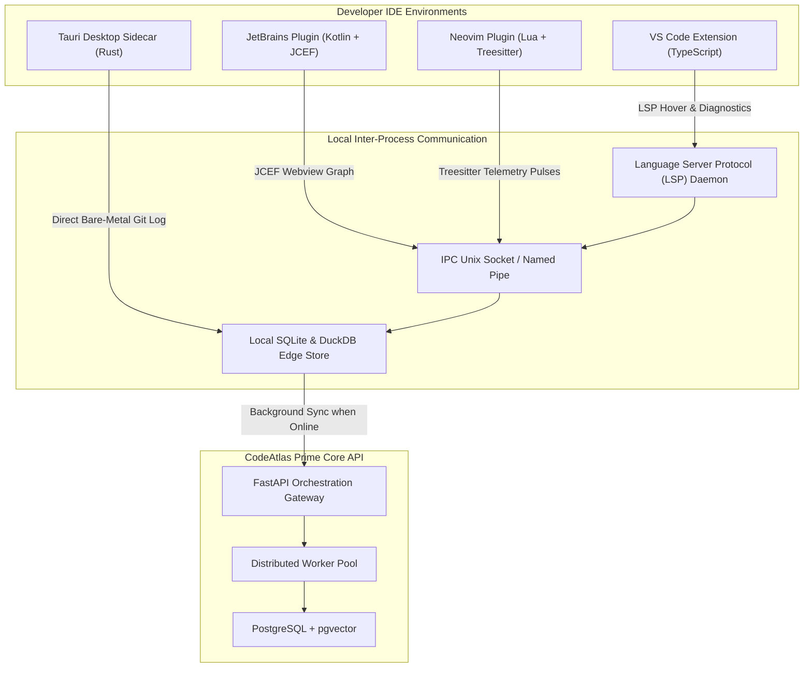
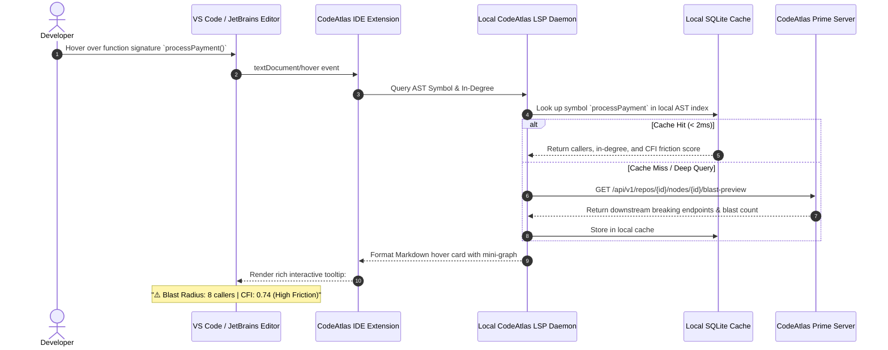
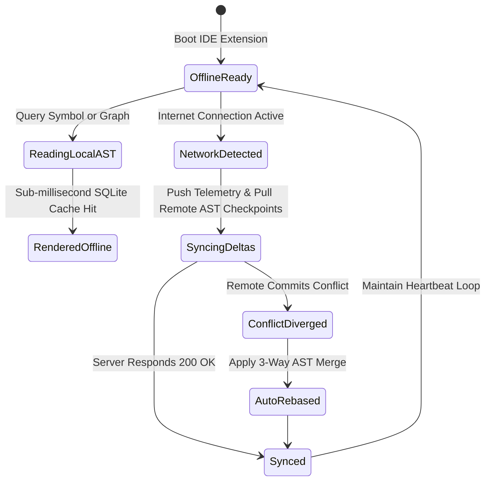

# Phase 7 Issues: IDE Extensions, Micro-Workspaces & Cross-Monorepo Federation

This document details all Phase 7 issues (`Issue 176 – Issue 215`) for CodeAtlas and CodeAtlas Prime, covering in-editor IDE extensions (VS Code, JetBrains, Neovim), desktop bare-metal sidecars, offline local caching, cross-repository federation, CodeAtlasQL query engine, and multi-tenant micro-workspaces.

---

## 📊 Phase 7 Visual Architecture & Technical Blueprint Suite

### 1. Multi-IDE & Desktop Extension Architecture Flowchart



### 2. Sequence Diagram: In-Editor Hover AST Lookup & Blast Preview



### 3. State Machine Diagram: Local Offline Cache & Sync State



---

### Issue 176: VS Code Extension Language Server Protocol (LSP) AST Bridge
- **Labels**: `phase:phase-7-extensions`, `type:feature`, `priority:P0-critical`, `component:extensions`, `area:vscode`, `status:ready`
- **Milestone**: `M8: IDE Extensions & Federation`
- **Estimate**: `5 Story Points`
- **Component**: `packages/vscode-extension/src/lspClient.ts`
- **Problem Statement**:
  Developers working in VS Code must switch context to a browser tab to view architecture dependencies, breaking their coding flow.
- **Technical Specification**:
  - Implement a Language Server Protocol (LSP) client embedding into VS Code.
  - Intercepts `textDocument/hover` to render interactive AST caller graphs, cyclomatic complexity scores, and downstream blast radiuses.
  - Emits `workspace/diagnostic` warnings when code violates architectural boundaries defined in `codeatlas.config.json`.
- **Acceptance Criteria**:
  - [ ] Hovering over any class or function renders an in-editor card with caller counts and blast radius.
  - [ ] Illegal cross-package imports show immediate squiggly warning lines in the editor.
  - [ ] Response latency $< 5	ext{ms}$ via local LSP server.

---

### Issue 177: JetBrains IntelliJ & PyCharm Webview Sidepane Integration
- **Labels**: `phase:phase-7-extensions`, `type:feature`, `priority:P0-critical`, `component:extensions`, `area:jetbrains`, `status:ready`
- **Milestone**: `M8: IDE Extensions & Federation`
- **Estimate**: `5 Story Points`
- **Component**: `packages/jetbrains-plugin/src/main/kotlin/CodeAtlasToolWindow.kt`
- **Problem Statement**:
  JetBrains users (IntelliJ IDEA, PyCharm, WebStorm) require native tool windows embedding the React Flow architecture canvas without external browser switching.
- **Technical Specification**:
  - Kotlin-based JetBrains plugin utilizing JCEF (Java Chromium Embedded Framework).
  - Embeds the CodeAtlas topological canvas in a docked right sidebar tool window.
  - Synchronizes active editor file with canvas node selection via PSI (Program Structure Interface) listeners.
- **Acceptance Criteria**:
  - [ ] Opening any file in IntelliJ automatically centers the CodeAtlas sidepane on the corresponding AST node.
  - [ ] Seamless dark/light theme synchronization with JetBrains UI theme.
  - [ ] Full keyboard shortcut integration (`Ctrl+Shift+A` to inspect blast radius).

---

### Issue 178: Neovim Lua & Tree-Sitter Live Cursor Telemetry Hook
- **Labels**: `phase:phase-7-extensions`, `type:feature`, `priority:P1-high`, `component:extensions`, `area:neovim`, `status:ready`
- **Milestone**: `M8: IDE Extensions & Federation`
- **Estimate**: `3 Story Points`
- **Component**: `packages/neovim-plugin/lua/codeatlas/telemetry.lua`
- **Problem Statement**:
  Terminal-centric developers using Neovim need lightweight, zero-latency telemetry tracking and architecture diagnostics.
- **Technical Specification**:
  - Native Lua plugin leveraging Neovim's built-in Tree-Sitter engine.
  - Hooks into `CursorMoved`, `BufEnter`, and `BufWritePost` autocommands.
  - Emits local heartbeats over Unix Domain Socket to the CodeAtlas daemon without impacting typing performance.
- **Acceptance Criteria**:
  - [ ] Zero measurable latency or lag in Neovim cursor movement ($< 0.1	ext{ms}$ execution).
  - [ ] Tracks active editor time and sends WakaTime-compatible telemetry.
  - [ ] Provides `:CodeAtlasBlast` command to output downstream callers in quickfix list.

---

### Issue 179: Tauri & Rust Desktop Sidecar for Bare-Metal Parsing
- **Labels**: `phase:phase-7-extensions`, `type:infra`, `priority:P0-critical`, `component:apps/desktop`, `area:tauri`, `status:ready`
- **Milestone**: `M8: IDE Extensions & Federation`
- **Estimate**: `8 Story Points`
- **Component**: `apps/desktop/src-tauri/src/main.rs`
- **Problem Statement**:
  Large enterprise monorepos cannot upload gigabytes of source code to external servers; developers need a bare-metal desktop application operating 100% locally.
- **Technical Specification**:
  - Tauri v2 application combining a Rust backend with the Next.js React Flow canvas.
  - Rust worker executes multi-threaded Tree-Sitter parsing across CPU cores using `rayon`.
  - Embeds a local DuckDB / SQLite database for sub-millisecond query execution.
- **Acceptance Criteria**:
  - [ ] Parses a 10,000-file repository in $< 15	ext{s}$ using multi-core Rust parser.
  - [ ] Memory footprint $< 120	ext{MB}$ in idle state.
  - [ ] Functions completely with network adapters disabled.

---

### Issue 180: Local SQLite Edge Cache for Offline Monorepo Navigation
- **Labels**: `phase:phase-7-extensions`, `type:perf`, `priority:P1-high`, `component:packages/shared`, `area:offline`, `status:ready`
- **Milestone**: `M8: IDE Extensions & Federation`
- **Estimate**: `5 Story Points`
- **Component**: `packages/shared/src/cache/sqliteEdgeCache.ts`
- **Problem Statement**:
  Developers working on airplanes or trains lose access to CodeAtlas when offline, preventing them from exploring architecture graphs and documentation.
- **Technical Specification**:
  - Client-side SQLite database (via `sql.js` or native SQLite in Electron/Tauri).
  - Replicates repository nodes, edges, summaries, and issue mappings locally.
  - Synchronizes deltas with the master PostgreSQL server upon reconnection using timestamp-based reconciliation.
- **Acceptance Criteria**:
  - [ ] Full graph search and navigation available without internet access.
  - [ ] Automatic sync queue handles reconnection without data loss or race conditions.
  - [ ] Compression reduces 100MB repository metadata to $< 8	ext{MB}$ SQLite database.

---

### Issue 181: Multi-Repository Cross-Dependency Graph Federation
- **Labels**: `phase:phase-7-extensions`, `type:feature`, `priority:P0-critical`, `component:apps/api`, `area:federation`, `status:ready`
- **Milestone**: `M8: IDE Extensions & Federation`
- **Estimate**: `8 Story Points`
- **Component**: `apps/api/services/federation_service.py`
- **Problem Statement**:
  Microservice architectures split functionality across dozens of distinct repositories; analyzing a single repo in isolation blinds engineers to cross-service dependencies.
- **Technical Specification**:
  - Federation engine ingesting OpenAPI schemas, gRPC protobuf definitions, and shared npm/pip package dependencies across repositories.
  - Synthesizes a federated super-graph connecting services via `routes_to`, `calls_rpc`, and `depends_on_package` edges.
- **Acceptance Criteria**:
  - [ ] Visualizes multi-repository dependency topologies on the CodeAtlas canvas.
  - [ ] Traces an API call from frontend repo through backend gateway to database microservice.
  - [ ] Evaluates cross-repository breaking change blast radiuses.

---

### Issue 182: Package Boundary Firewall & Circular Import Preventer
- **Labels**: `phase:phase-7-extensions`, `type:feature`, `priority:P0-critical`, `component:apps/api`, `area:linter`, `status:ready`
- **Milestone**: `M8: IDE Extensions & Federation`
- **Estimate**: `5 Story Points`
- **Component**: `apps/api/services/boundary_linter.py`
- **Problem Statement**:
  Monorepos gradually degrade into tangled spaghetti code when developers bypass architectural boundaries with unauthorized cross-package imports.
- **Technical Specification**:
  - Reads `codeatlas.config.json` defining strict boundary rules:
    ```json
    { "disallow": [{ "from": "apps/web/**", "to": "apps/api/**" }] }
    ```
  - Analyzes AST import edges on every git commit.
  - Detects newly introduced circular dependency cycles using Tarjan's strongly connected components algorithm.
- **Acceptance Criteria**:
  - [ ] Fails CI pipeline with exact file:line diagnostics when unauthorized imports are added.
  - [ ] Identifies circular dependency loops before they cause runtime import errors.
  - [ ] Generates visual diagram of the prohibited import cycle.

---

### Issue 183: Custom CodeAtlasQL Query Engine for AST Rule Checking
- **Labels**: `phase:phase-7-extensions`, `type:feature`, `priority:P1-high`, `component:apps/api`, `area:query-engine`, `status:ready`
- **Milestone**: `M8: IDE Extensions & Federation`
- **Estimate**: `8 Story Points`
- **Component**: `apps/api/services/codeatlasql.py`
- **Problem Statement**:
  Engineering teams need a domain-specific query language to audit complex architectural patterns (e.g. "Find all controllers that directly query the database without using a service layer").
- **Technical Specification**:
  - Lexer, parser, and execution engine for CodeAtlasQL:
    ```sql
    FIND Node n WHERE n.type = 'controller' AND EXISTS (n -[:calls]-> m WHERE m.type = 'model')
    ```
  - Traverses the AST graph and returns matching nodes with visual canvas highlighting.
- **Acceptance Criteria**:
  - [ ] Executes graph pattern queries across 50,000 nodes in $< 100	ext{ms}$.
  - [ ] Supports filtering by node attributes, edge types, and path lengths.
  - [ ] Allows saving custom queries as automated CI architectural lint rules.

---

### Issue 184: GitHub App PR Review Bot with Interactive SVG Diff Embeds
- **Labels**: `phase:phase-7-extensions`, `type:feature`, `priority:P0-critical`, `component:apps/api`, `area:github-bot`, `status:ready`
- **Milestone**: `M8: IDE Extensions & Federation`
- **Estimate**: `5 Story Points`
- **Component**: `apps/api/services/github_bot.py`
- **Problem Statement**:
  Pull request reviewers need immediate visual comprehension of what architectural components an incoming PR alters without opening the canvas manually.
- **Technical Specification**:
  - Webhook listener for `pull_request.opened` and `pull_request.synchronize`.
  - Calculates topological diff and renders a dynamic SVG miniature diagram of affected components.
  - Posts an automated markdown comment containing the blast radius score, breaking changes, and suggested reviewers.
- **Acceptance Criteria**:
  - [ ] Posts comment to GitHub PR within 10 seconds of creation.
  - [ ] Renders crisp SVG diagram illustrating added/modified/deleted nodes.
  - [ ] Updates comment automatically when new commits are pushed.

---

### Issue 185: Slack & Discord Conversational Bot with Slash Commands
- **Labels**: `phase:phase-7-extensions`, `type:feature`, `priority:P2-medium`, `component:apps/api`, `area:integrations`, `status:ready`
- **Milestone**: `M8: IDE Extensions & Federation`
- **Estimate**: `3 Story Points`
- **Component**: `apps/api/routers/slack_bot.py`
- **Problem Statement**:
  Engineers in chat channels ask repetitive architecture questions ("Where is user auth?", "Who owns billing service?") that CodeAtlas can answer instantly.
- **Technical Specification**:
  - Slash command `/codeatlas <query>` for Slack and Discord.
  - Queries CodeAtlas RAG chat engine and returns grounded answer with exact file links and ownership badges.
  - Supports `/codeatlas blast <symbol>` to preview blast radius directly in chat.
- **Acceptance Criteria**:
  - [ ] Responds in chat within 3 seconds.
  - [ ] Formats responses with rich Slack Block Kit / Discord Embed cards.
  - [ ] Includes deep links directly into CodeAtlas canvas for the referenced node.

---

### Issue 186: GitLab & Bitbucket Ingestion & Webhook Compatibility Layer
- **Labels**: `phase:phase-7-extensions`, `type:feature`, `priority:P1-high`, `component:apps/api`, `area:git-providers`, `status:ready`
- **Milestone**: `M8: IDE Extensions & Federation`
- **Estimate**: `5 Story Points`
- **Component**: `apps/api/services/git_providers/`
- **Problem Statement**:
  Enterprises using self-hosted GitLab or Bitbucket Server cannot use CodeAtlas if it only supports GitHub.
- **Technical Specification**:
  - Provider abstraction layer (`GitProviderInterface`) normalizing webhooks, commit logs, OAuth, and repository cloning.
  - Implementations for `GitLabProvider` (GitLab API v4) and `BitbucketProvider` (Bitbucket REST API).
- **Acceptance Criteria**:
  - [ ] Full parity with GitHub for repository cloning, push webhooks, and issue fetching.
  - [ ] Supports self-hosted GitLab CE/EE instances behind enterprise firewalls.
  - [ ] Verified with integration test suite for both providers.

---

### Issue 187: Monorepo Package Scoping Wizard for Micro-Frontends
- **Labels**: `phase:phase-7-extensions`, `type:frontend`, `priority:P2-medium`, `component:apps/web`, `area:monorepo`, `status:ready`
- **Milestone**: `M8: IDE Extensions & Federation`
- **Estimate**: `3 Story Points`
- **Component**: `apps/web/src/components/monorepo/PackageScopingWizard.tsx`
- **Problem Statement**:
  Engineers working on a single micro-frontend in a large monorepo get overwhelmed by unrelated packages cluttering the canvas.
- **Technical Specification**:
  - Interactive filter wizard allowing developers to scope the canvas to a single package and its immediate dependencies.
  - Preserves package-level boundaries as visual cluster boundaries.
- **Acceptance Criteria**:
  - [ ] Scopes canvas to selected workspace in one click.
  - [ ] Reduces visible node count and accelerates rendering on massive repos.
  - [ ] Saves scoping presets per user.

---

### Issue 188: Real-Time Collaborative Graph Editing with CRDTs (Yjs)
- **Labels**: `phase:phase-7-extensions`, `type:feature`, `priority:P1-high`, `component:apps/web`, `area:collaboration`, `status:ready`
- **Milestone**: `M8: IDE Extensions & Federation`
- **Estimate**: `8 Story Points`
- **Component**: `apps/web/src/lib/collaboration/yjsProvider.ts`
- **Problem Statement**:
  Architects and tech leads conducting design reviews need to collaborate on the canvas in real time with shared cursors, annotations, and node grouping.
- **Technical Specification**:
  - Real-time collaboration using Yjs Conflict-Free Replicated Data Types (CRDTs) over WebSockets.
  - Displays multi-user cursors with user avatars and colored selection rings.
  - Synchronizes node layout adjustments, custom sticky notes, and architectural boundary edits.
- **Acceptance Criteria**:
  - [ ] Sub-50ms synchronization latency across multiple concurrent users.
  - [ ] Conflict-free resolution of simultaneous node position updates.
  - [ ] Presence indicators show who is actively viewing each subgraph.

---

### Issue 189: Visual Code Churn Velocity Heatmap Shader in VS Code
- **Labels**: `phase:phase-7-extensions`, `type:frontend`, `priority:P2-medium`, `component:packages/vscode-extension`, `area:heatmap`, `status:ready`
- **Milestone**: `M8: IDE Extensions & Federation`
- **Estimate**: `3 Story Points`
- **Component**: `packages/vscode-extension/src/decorations/churnHeatmap.ts`
- **Problem Statement**:
  Developers editing a file cannot see which specific lines or functions have undergone extreme churn in the past 30 days.
- **Technical Specification**:
  - In-editor gutter and background color decorations highlighting functions by churn frequency.
  - Cool blue for stable code, orange for moderately modified code, glowing crimson for high-risk hotspots.
- **Acceptance Criteria**:
  - [ ] Renders subtle, non-intrusive gutter markers in VS Code editor.
  - [ ] Hovering over a hotspot reveals recent commit count and author churn.
  - [ ] Toggleable via status bar button or shortcut.

---

### Issue 190: In-Editor What-If Mutation Preview via Code Actions
- **Labels**: `phase:phase-7-extensions`, `type:feature`, `priority:P1-high`, `component:packages/vscode-extension`, `area:simulation`, `status:ready`
- **Milestone**: `M8: IDE Extensions & Federation`
- **Estimate**: `5 Story Points`
- **Component**: `packages/vscode-extension/src/codeActions/refactorSimulator.ts`
- **Problem Statement**:
  Developers about to delete or rename an exported function in their editor don't know what callers in other packages will break.
- **Technical Specification**:
  - VS Code Code Action / Quick Fix: "Simulate Architectural Refactor".
  - Queries CodeAtlas Chronos simulation engine and displays an inline preview of all impacted files and API routes.
- **Acceptance Criteria**:
  - [ ] Accessible directly from editor context menu (`Alt+Enter`).
  - [ ] Lists exact downstream call sites with line numbers before the change is made.
  - [ ] Offers one-click navigation to affected caller files.

---

### Issue 191: Distributed Task Worker Auto-Scaling via Redis Queue Depth
- **Labels**: `phase:phase-7-extensions`, `type:perf`, `priority:P1-high`, `component:apps/api`, `area:infra`, `status:ready`
- **Milestone**: `M8: IDE Extensions & Federation`
- **Estimate**: `5 Story Points`
- **Component**: `apps/api/tasks/autoscaler.py`
- **Problem Statement**:
  Surges in simultaneous repository ingestion requests cause Celery task queues in Redis to back up, increasing webhook processing latency from seconds to tens of minutes.
- **Technical Specification**:
  - Implements an automated queue depth monitor checking `LLEN celery` and `XLEN telemetry:stream`.
  - Calculates worker demand:
    $$N_{\text{workers}} = \text{clamp}\left(\left\lceil \frac{\text{QueueDepth}}{\text{TargetLatency} \cdot \mu_{\text{throughput}}} \right\rceil, N_{\min}, N_{\max}\right)$$
  - Dynamically triggers Celery worker process pool scaling or Kubernetes HPA scale events.
- **Acceptance Criteria**:
  - [ ] Automatically scales workers from 2 to 20 under sustained queue load.
  - [ ] Reduces queue wait times to $< 10\text{s}$ during traffic spikes.
  - [ ] Gracefully scales down idle workers after 5 minutes of cooldown.

---

### Issue 192: Cross-Package API Route Breaking Change Sentinel
- **Labels**: `phase:phase-7-extensions`, `type:feature`, `priority:P0-critical`, `component:apps/api`, `area:linter`, `status:ready`
- **Milestone**: `M8: IDE Extensions & Federation`
- **Estimate**: `5 Story Points`
- **Component**: `apps/api/services/route_sentinel.py`
- **Problem Statement**:
  Backend developers altering API route signatures or parameter names frequently break consumer frontend calls in monorepos without noticing until integration tests fail.
- **Technical Specification**:
  - AST analyzer tracking `routes_to` edges between frontend fetch/axios call sites and backend FastAPI/Express route decorators.
  - Validates parameter schemas, query parameters, and return types across the workspace boundary.
  - Generates breaking change alerts before commits are pushed.
- **Acceptance Criteria**:
  - [ ] Detects renamed, removed, or type-altered API route parameters across packages.
  - [ ] Identifies every broken client call site with exact file:line references.
  - [ ] Integrates into pre-commit hooks and PR review comments.

---

### Issue 193: Contributor Mental Model Onboarding Tooltips in Editor
- **Labels**: `phase:phase-7-extensions`, `type:frontend`, `priority:P2-medium`, `component:packages/vscode-extension`, `area:onboarding`, `status:ready`
- **Milestone**: `M8: IDE Extensions & Federation`
- **Estimate**: `3 Story Points`
- **Component**: `packages/vscode-extension/src/onboarding/conceptTooltips.ts`
- **Problem Statement**:
  New contributors working in unfamiliar directories encounter proprietary abstractions and design patterns without contextual guidance.
- **Technical Specification**:
  - Injects contextual CodeLens tooltips above key classes and entry points:
    `💡 CodeAtlas Concept: "Event Sourcing Pipeline" (Click to view 2-min explainer)`.
  - Clicking opens an interactive webview explaining the mental model, dependencies, and rules.
- **Acceptance Criteria**:
  - [ ] Displays unobtrusive concept tooltips on mapped architectural nodes.
  - [ ] Links directly to CodeAtlas living documentation and visual subgraph.
  - [ ] Toggleable per user via editor settings.

---

### Issue 194: AST Symbol Re-Indexing on File System Watcher Events
- **Labels**: `phase:phase-7-extensions`, `type:perf`, `priority:P1-high`, `component:apps/api`, `area:ingestion`, `status:ready`
- **Milestone**: `M8: IDE Extensions & Federation`
- **Estimate**: `5 Story Points`
- **Component**: `apps/api/services/fs_watcher.py`
- **Problem Statement**:
  Re-indexing the entire repository on local file saves causes high CPU utilization and lags the editor interface.
- **Technical Specification**:
  - Native filesystem watcher (`watchfiles` in Python / `chokidar` in Node).
  - Implements debounced incremental re-parsing: re-parses only modified AST subtrees and updates affected graph edges in $< 50\text{ms}$.
  - Re-computes embeddings only when docstrings or function signatures change.
- **Acceptance Criteria**:
  - [ ] File save triggers incremental re-index in $< 50\text{ms}$.
  - [ ] Re-uses unchanged AST nodes and vector embeddings via SHA-256 content hashes.
  - [ ] CPU utilization remains $< 5\%$ during active local coding.

---

### Issue 195: WebContainer In-Browser Dev Server Hot-Reload Engine
- **Labels**: `phase:phase-7-extensions`, `type:feature`, `priority:P1-high`, `component:apps/web`, `area:flight-simulator`, `status:ready`
- **Milestone**: `M8: IDE Extensions & Federation`
- **Estimate**: `8 Story Points`
- **Component**: `apps/web/src/lib/flight/webContainer.ts`
- **Problem Statement**:
  Flight Simulator learners cannot see live preview results of their simulated pull request edits without running a local dev server.
- **Technical Specification**:
  - Embeds WebAssembly WebContainers directly into `@codeatlas/web`.
  - Boots an in-browser Node.js runtime executing Vite or Next.js development server.
  - Renders live application preview in an embedded iframe with hot module replacement (HMR).
- **Acceptance Criteria**:
  - [ ] Boots virtual dev server in-browser in $< 3\text{s}$.
  - [ ] File edits in virtual IDE update the live preview iframe instantly.
  - [ ] Requires zero local installation on the user's host operating system.

---

### Issue 196: Interactive Git Cherry-Pick Assistant in Sidecar
- **Labels**: `phase:phase-7-extensions`, `type:frontend`, `priority:P2-medium`, `component:apps/desktop`, `area:git`, `status:ready`
- **Milestone**: `M8: IDE Extensions & Federation`
- **Estimate**: `5 Story Points`
- **Component**: `apps/desktop/src/components/git/CherryPickAssistant.tsx`
- **Problem Statement**:
  Cherry-picking bug fixes across release branches often causes silent regressions due to unselected dependent commits.
- **Technical Specification**:
  - Analyzes AST dependencies of commits selected for `git cherry-pick`.
  - Checks if the cherry-picked patch requires symbols introduced in intermediate commits.
  - Warns the developer: "Commit `a8f4c2e` requires `UserService.verifyToken()` introduced in `commit_9c3b17d`".
- **Acceptance Criteria**:
  - [ ] Identifies missing prerequisite commits before cherry-pick execution.
  - [ ] Prevents broken builds and unresolved symbol compiler errors.
  - [ ] Generates sequential cherry-pick commands to safely backport fixes.

---

### Issue 197: Asymmetric Ed25519 Hardware Security Module (HSM) Signing
- **Labels**: `phase:phase-7-extensions`, `type:security`, `priority:P0-critical`, `component:apps/api`, `area:security`, `status:ready`
- **Milestone**: `M8: IDE Extensions & Federation`
- **Estimate**: `5 Story Points`
- **Component**: `apps/api/services/hsm_signer.py`
- **Problem Statement**:
  Storing Ed25519 private keys in plaintext environment variables leaves the badge certification network vulnerable to key theft.
- **Technical Specification**:
  - Integrates with Cloud KMS (AWS KMS, Google Cloud KMS, HashiCorp Vault Transit).
  - Signs credential payloads using cryptographic hardware security modules (HSM) where private keys never leave the hardware boundary.
  - Supports automatic key rotation with verifiable public key certificates (`kid`).
- **Acceptance Criteria**:
  - [ ] Signs credential payloads via HSM in $< 15\text{ms}$.
  - [ ] Zero private key material exposed in memory or environment variables.
  - [ ] Full tamper-evident key access audit logging.

---

### Issue 198: Dynamic SVG Shield & Badge Rendering Edge Functions
- **Labels**: `phase:phase-7-extensions`, `type:perf`, `priority:P1-high`, `component:apps/api`, `area:badges`, `status:ready`
- **Milestone**: `M8: IDE Extensions & Federation`
- **Estimate**: `3 Story Points`
- **Component**: `apps/web/src/app/api/badges/[...slug]/route.ts`
- **Problem Statement**:
  Serving dynamic SVG badges from the centralized backend API incurs network latency for global GitHub users viewing READMEs.
- **Technical Specification**:
  - Deploys SVG badge rendering as Edge Functions on Cloudflare Workers / Vercel Edge.
  - Employs Edge KV cache and stale-while-revalidate HTTP caching headers.
  - Responds to badge requests globally in $< 20\text{ms}$.
- **Acceptance Criteria**:
  - [ ] Global edge response latency $< 20\text{ms}$.
  - [ ] Generates pixel-perfect SVG graphics identical to the backend renderer.
  - [ ] Survives 100,000+ requests/hour without backend server load.

---

### Issue 199: Privacy-Preserving Team Telemetry Anonymization Filter
- **Labels**: `phase:phase-7-extensions`, `type:security`, `priority:P0-critical`, `component:apps/api`, `area:telemetry`, `status:ready`
- **Milestone**: `M8: IDE Extensions & Federation`
- **Estimate**: `5 Story Points`
- **Component**: `apps/api/services/privacy_filter.py`
- **Problem Statement**:
  Aggregating developer focus time into engineering management dashboards risks violating employee trust and privacy regulations (GDPR).
- **Technical Specification**:
  - Enforces $k$-anonymity: team metrics are only displayed if at least $k \ge 5$ distinct contributors modified the component within the time window.
  - Applies differential privacy noise ($\epsilon = 0.5$) to active minutes before reporting aggregate team focus hours.
  - Anonymizes author identities with ephemeral daily hashes.
- **Acceptance Criteria**:
  - [ ] Prevents re-identification of individual developer work patterns.
  - [ ] 100% compliant with GDPR and EU employee data protection standards.
  - [ ] Allows individual engineers to view their own raw data while masking team exports.

---

### Issue 200: Subgraph Prompt Packaging Plugin for Cursor & Windsurf
- **Labels**: `phase:phase-7-extensions`, `type:feature`, `priority:P1-high`, `component:extensions`, `area:ai-prompt`, `status:ready`
- **Milestone**: `M8: IDE Extensions & Federation`
- **Estimate**: `3 Story Points`
- **Component**: `packages/vscode-extension/src/commands/exportPrompt.ts`
- **Problem Statement**:
  Developers using Cursor, Windsurf, or Copilot must manually select and copy relevant files to provide context for AI refactoring.
- **Technical Specification**:
  - Right-click editor command: "Copy Subgraph Prompt for AI".
  - Traverses the AST 1-hop neighborhood, bundles interface contracts, and formats an optimized prompt directly onto the user's system clipboard.
- **Acceptance Criteria**:
  - [ ] One-click clipboard copy of token-optimized prompt in $< 200\text{ms}$.
  - [ ] Formats context with file headers and TypeScript/Python interface boundaries.
  - [ ] Fits strictly within configured token limits (e.g. 8k, 32k tokens).

---

### Issue 201: Automated Dependency Upgrade Blast Radius Evaluator
- **Labels**: `phase:phase-7-extensions`, `type:feature`, `priority:P1-high`, `component:apps/api`, `area:deps`, `status:ready`
- **Milestone**: `M8: IDE Extensions & Federation`
- **Estimate**: `5 Story Points`
- **Component**: `apps/api/services/dependency_evaluator.py`
- **Problem Statement**:
  Upgrading major third-party libraries (e.g. React 18 $\rightarrow$ 19, Pydantic v1 $\rightarrow$ v2) creates widespread breakage that is difficult to plan and estimate.
- **Technical Specification**:
  - Ingests release notes and breaking change signatures for target dependency upgrades.
  - Cross-references codebase import edges to identify every function and component calling deprecated or altered APIs.
  - Generates a migration checklist with exact LOC impact and estimated engineering effort.
- **Acceptance Criteria**:
  - [ ] Maps every affected call site for proposed library version upgrades.
  - [ ] Highlights high-risk files needing architectural rewrites.
  - [ ] Calculates migration complexity score before upgrading dependencies.

---

### Issue 202: Monorepo Turborepo / Nx Pipeline Cache Visualizer
- **Labels**: `phase:phase-7-extensions`, `type:frontend`, `priority:P2-medium`, `component:apps/web`, `area:monorepo`, `status:ready`
- **Milestone**: `M8: IDE Extensions & Federation`
- **Estimate**: `5 Story Points`
- **Component**: `apps/web/src/components/monorepo/CacheVisualizer.tsx`
- **Problem Statement**:
  Monorepo build pipelines suffer from cache misses that engineers cannot diagnose without reading thousands of lines of terminal logs.
- **Technical Specification**:
  - Ingests Turborepo / Nx build execution graphs and cache hit/miss telemetry.
  - Overlays cache status onto the CodeAtlas canvas: green for cached packages, amber for cold builds, red for cache-invalidating churn files.
- **Acceptance Criteria**:
  - [ ] Pinpoints exact files that caused monorepo build cache invalidation.
  - [ ] Displays build time savings from caching on the repository dashboard.
  - [ ] Recommends package boundary improvements to increase cache hit rates.

---

### Issue 203: Microservice Contract Verification with Pact & OpenAPI
- **Labels**: `phase:phase-7-extensions`, `type:feature`, `priority:P1-high`, `component:apps/api`, `area:contracts`, `status:ready`
- **Milestone**: `M8: IDE Extensions & Federation`
- **Estimate**: `5 Story Points`
- **Component**: `apps/api/services/contract_verifier.py`
- **Problem Statement**:
  Independent microservice deployment teams introduce subtle payload contract mismatches that escape unit tests and cause production 500 errors.
- **Technical Specification**:
  - Validates API route consumers and providers against Pact contracts and OpenAPI specifications.
  - Flags breaking field type changes, removed endpoints, and required header omissions.
- **Acceptance Criteria**:
  - [ ] Blocks PRs that introduce breaking contract changes to downstream consumers.
  - [ ] Visualizes consumer-provider contract relationships on the federated graph.
  - [ ] Exports verified OpenAPI 3.1 specifications.

---

### Issue 204: Client-Side Vector Embedding Inference with WebGPU
- **Labels**: `phase:phase-7-extensions`, `type:perf`, `priority:P1-high`, `component:apps/web`, `area:webgpu`, `status:ready`
- **Milestone**: `M8: IDE Extensions & Federation`
- **Estimate**: `8 Story Points`
- **Component**: `apps/web/src/lib/ai/webgpuEmbeddings.ts`
- **Problem Statement**:
  Generating embeddings for live code search in local/offline environments requires GPU acceleration without sending text to external server APIs.
- **Technical Specification**:
  - Integrates Transformers.js with WebGPU backend running ONNX models (`all-MiniLM-L6-v2` / `nomic-embed-text`) directly in the user's browser.
  - Computes 384-dimensional dense vectors in $< 5\text{ms}$ per code chunk on client GPU.
- **Acceptance Criteria**:
  - [ ] Embeds search queries in $< 5\text{ms}$ using client WebGPU.
  - [ ] Zero server API token consumption or network transmission.
  - [ ] Gracefully falls back to WebAssembly CPU execution if WebGPU is unavailable.

---

### Issue 205: Tree-Sitter C++ & C# Native Parser Bindings
- **Labels**: `phase:phase-7-extensions`, `type:feature`, `priority:P2-medium`, `component:apps/api`, `area:parsers`, `status:ready`
- **Milestone**: `M8: IDE Extensions & Federation`
- **Estimate**: `5 Story Points`
- **Component**: `apps/api/parsers/cpp_csharp_parser.py`
- **Problem Statement**:
  Enterprise codebases containing legacy C++ services or .NET C# applications cannot be fully analyzed if CodeAtlas only supports web languages.
- **Technical Specification**:
  - Tree-Sitter bindings for C++ (`tree-sitter-cpp`) and C# (`tree-sitter-c-sharp`).
  - Extracts classes, structs, templates, namespaces, method signatures, and inheritance hierarchies.
- **Acceptance Criteria**:
  - [ ] Parses C++ header/implementation files and C# solution projects.
  - [ ] Extracts class inheritance and method call edges into the dependency graph.
  - [ ] Verified against open-source C++ and .NET test fixtures.

---

### Issue 206: Swift & Kotlin Mobile Architecture Graph Extractors
- **Labels**: `phase:phase-7-extensions`, `type:feature`, `priority:P2-medium`, `component:apps/api`, `area:parsers`, `status:ready`
- **Milestone**: `M8: IDE Extensions & Federation`
- **Estimate**: `5 Story Points`
- **Component**: `apps/api/parsers/mobile_parser.py`
- **Problem Statement**:
  Mobile engineering teams building iOS (Swift) and Android (Kotlin) apps need architecture visualization for UI view hierarchies and dependency injection modules.
- **Technical Specification**:
  - Parses Swift (`tree-sitter-swift`) and Kotlin (`tree-sitter-kotlin`).
  - Extracts SwiftUI views, Jetpack Compose functions, view models, and Dagger/Hilt/Koin DI dependencies.
- **Acceptance Criteria**:
  - [ ] Maps view-to-view navigation flows and view-to-viewmodel bindings.
  - [ ] Identifies dependency injection graphs and singleton services.
  - [ ] Verified on iOS and Android golden repository fixtures.

---

### Issue 207: SQL Query Execution Plan Visualizer in OmniQuery Lens
- **Labels**: `phase:phase-7-extensions`, `type:frontend`, `priority:P1-high`, `component:apps/web`, `area:omniquery`, `status:ready`
- **Milestone**: `M8: IDE Extensions & Federation`
- **Estimate**: `5 Story Points`
- **Component**: `apps/web/src/components/omnidrawer/QueryPlanVisualizer.tsx`
- **Problem Statement**:
  Developers writing conversational queries in OmniQuery cannot inspect whether the generated SQL will cause slow sequential table scans on production databases.
- **Technical Specification**:
  - Runs `EXPLAIN (ANALYZE, COSTS, VERBOSE, FORMAT JSON)` on the target query in a sandboxed session.
  - Visualizes the execution plan tree: Index Scans, Sequential Scans, Hash Joins, and estimated row costs.
  - Highlights missing indexes in red and suggests `CREATE INDEX` remediation statements.
- **Acceptance Criteria**:
  - [ ] Renders interactive execution plan tree with node costs.
  - [ ] Flags unindexed table scans on tables with $> 10,000$ rows.
  - [ ] Generates automated index creation recommendations.

---

### Issue 208: Real-Time WebSocket Channel for Multi-User Cursors
- **Labels**: `phase:phase-7-extensions`, `type:feature`, `priority:P1-high`, `component:apps/api`, `area:collab`, `status:ready`
- **Milestone**: `M8: IDE Extensions & Federation`
- **Estimate**: `5 Story Points`
- **Component**: `apps/api/routers/presence.py`
- **Problem Statement**:
  Remote engineering teams conducting architecture design sessions need to see each other's live cursor positions and selections across the canvas.
- **Technical Specification**:
  - High-throughput WebSocket server broadcasting ephemeral presence payloads:
    `{ user_id, x, y, viewport, selected_node_id }`.
  - Debounced at 60Hz with delta compression to minimize network traffic.
- **Acceptance Criteria**:
  - [ ] Renders smooth multi-user cursors with $< 30\text{ms}$ latency.
  - [ ] Automatic reconnection upon network jitter.
  - [ ] Handles 50 concurrent active users per repository room.

---

### Issue 209: Architectural Technical Debt Paydown Priority Queue
- **Labels**: `phase:phase-7-extensions`, `type:feature`, `priority:P1-high`, `component:apps/api`, `area:analytics`, `status:ready`
- **Milestone**: `M8: IDE Extensions & Federation`
- **Estimate**: `5 Story Points`
- **Component**: `apps/api/services/debt_prioritizer.py`
- **Problem Statement**:
  Engineering teams know they have technical debt but lack an objective, data-driven ranking of which debt items deliver the highest ROI if refactored.
- **Technical Specification**:
  - Calculates the Debt Paydown ROI score for each node:
    $$\text{ROI}(v) = \text{Churn}_{30d}(v) \cdot \text{Complexity}(v) \cdot \text{InDegree}(v) \cdot \text{CFI}(v)$$
  - Ranks codebase hotspots into an actionable sprint backlog with estimated engineering time savings.
- **Acceptance Criteria**:
  - [ ] Ranks codebase refactoring targets by objective developer hours saved.
  - [ ] Filters by workspace package and directory.
  - [ ] One-click export of top debt items into GitHub Issues with pre-filled blueprints.

---

### Issue 210: Automated Dead Code & Zombie Function Pruning Bot
- **Labels**: `phase:phase-7-extensions`, `type:feature`, `priority:P2-medium`, `component:apps/api`, `area:cleanup`, `status:ready`
- **Milestone**: `M8: IDE Extensions & Federation`
- **Estimate**: `5 Story Points`
- **Component**: `apps/api/services/dead_code_bot.py`
- **Problem Statement**:
  Unused functions, obsolete endpoints, and orphaned types accumulate across monorepos, confusing developers and slowing down builds.
- **Technical Specification**:
  - Graph traversal identifying nodes with $\text{InDegree}(v) = 0$ that are not public entry points or framework decorators.
  - Cross-references git blame to ensure the code has been untouched for $> 90$ days.
  - Generates automated pull request proposing deletion with full downstream test verification.
- **Acceptance Criteria**:
  - [ ] Accurately identifies zero-caller dead code without false positives on dynamic reflection.
  - [ ] Verifies all tests pass when candidate code is deleted.
  - [ ] Scaffolds clean PR with list of safely removed lines.

---

### Issue 211: Contributor First-PR Safety Guardrail Pre-Flight Hook
- **Labels**: `phase:phase-7-extensions`, `type:feature`, `priority:P1-high`, `component:apps/api`, `area:contributor`, `status:ready`
- **Milestone**: `M8: IDE Extensions & Federation`
- **Estimate**: `3 Story Points`
- **Component**: `apps/api/services/first_pr_guard.py`
- **Problem Statement**:
  First-time contributors often submit pull requests that accidentally modify unrelated core files, breaking master CI builds.
- **Technical Specification**:
  - Webhook listener checking incoming PRs from authors with 0 previous merges.
  - Asserts that modified files match the low-blast isolation score ($	ext{CIS} \ge 0.70$) and do not touch critical infrastructure nodes.
- **Acceptance Criteria**:
  - [ ] Flags accidental modifications to core infrastructure files.
  - [ ] Posts friendly educational comment guiding the contributor on how to scope their PR.
  - [ ] Protects repository maintainers from high-blast beginner regressions.

---

### Issue 212: GitHub Discussions Q&A Ingestion & Knowledge Graph Index
- **Labels**: `phase:phase-7-extensions`, `type:feature`, `priority:P2-medium`, `component:apps/api`, `area:rag`, `status:ready`
- **Milestone**: `M8: IDE Extensions & Federation`
- **Estimate**: `5 Story Points`
- **Component**: `apps/api/services/discussions_ingestion.py`
- **Problem Statement**:
  Tribal knowledge, architectural rationale, and workarounds shared in GitHub Discussions threads are lost and disconnected from the source code graph.
- **Technical Specification**:
  - Ingests GitHub Discussions Q&A threads via GraphQL API.
  - Links resolved answers to mentioned AST code nodes in PostgreSQL + pgvector.
  - Enhances RAG chat responses with verified maintainer discussion answers.
- **Acceptance Criteria**:
  - [ ] Embeds discussion threads into pgvector HNSW index.
  - [ ] Cites relevant discussion threads in conversational code search.
  - [ ] Links discussions to specific node inspector drawers on the canvas.

---

### Issue 213: End-to-End Extension Automation Tests with Playwright
- **Labels**: `phase:phase-7-extensions`, `type:test`, `priority:P0-critical`, `component:extensions`, `area:testing`, `status:ready`
- **Milestone**: `M8: IDE Extensions & Federation`
- **Estimate**: `5 Story Points`
- **Component**: `packages/vscode-extension/tests/e2e.test.ts`
- **Problem Statement**:
  IDE extension updates can accidentally break hover providers, sidepane webviews, or LSP communications without automated integration tests.
- **Technical Specification**:
  - Automated test suite using `@vscode/test-electron` and Playwright.
  - Tests extension activation, AST hover cards, boundary diagnostics, and sidepane graph rendering.
- **Acceptance Criteria**:
  - [ ] 100% automated pass rate in GitHub Actions CI pipeline.
  - [ ] Verifies LSP communication across Windows, macOS, and Linux runners.
  - [ ] Executes full suite in $< 90\text{s}$.

---

### Issue 214: Low-Memory Profile Mode for 100,000+ Node Monorepos
- **Labels**: `phase:phase-7-extensions`, `type:perf`, `priority:P0-critical`, `component:apps/web`, `area:perf`, `status:ready`
- **Milestone**: `M8: IDE Extensions & Federation`
- **Estimate**: `8 Story Points`
- **Component**: `apps/web/src/lib/graph/lowMemoryMode.ts`
- **Problem Statement**:
  Rendering massive monorepos exceeding 100,000 nodes causes browser tab memory exhaustion and browser tab crashes.
- **Technical Specification**:
  - Implements hierarchical level-of-detail (LOD) node streaming:
    - Zoomed Out ($< 0.2\times$): Renders only package cluster boundaries and high-degree hubs.
    - Zoomed In ($> 0.8\times$): Dynamically streams function/variable child nodes in viewport.
  - Uses `ArrayBuffer` and typed arrays for node coordinates instead of heavy JavaScript objects.
- **Acceptance Criteria**:
  - [ ] Browser memory stays $< 350\text{MB}$ while viewing 100,000-node graph.
  - [ ] Maintains stable 60 FPS panning and zooming.
  - [ ] Zero browser tab out-of-memory crashes.

---

### Issue 215: Phase 7 Capstone Release & Marketplace Publication
- **Labels**: `phase:phase-7-extensions`, `type:infra`, `priority:P0-critical`, `component:infra`, `area:release`, `status:ready`
- **Milestone**: `M8: IDE Extensions & Federation`
- **Estimate**: `3 Story Points`
- **Component**: `scripts/publish_extensions.sh`
- **Problem Statement**:
  Releasing IDE extensions to multiple marketplaces (VS Code Marketplace, Open VSX, JetBrains Marketplace) requires automated, reproducible release pipelines.
- **Technical Specification**:
  - Automated GitHub Actions workflow building and signing extension packages (`.vsix` and `.zip`).
  - Publishes to VS Code Marketplace, Open VSX Registry, and JetBrains Plugin Repository with verified publisher keys.
  - Automated changelog generation via `semantic-release`.
- **Acceptance Criteria**:
  - [ ] One-click or automated git tag trigger publishing to all marketplaces.
  - [ ] Verifies SHA-256 package checksums and cryptographic signatures.
  - [ ] Generates clean release notes linking closed GitHub issues.
