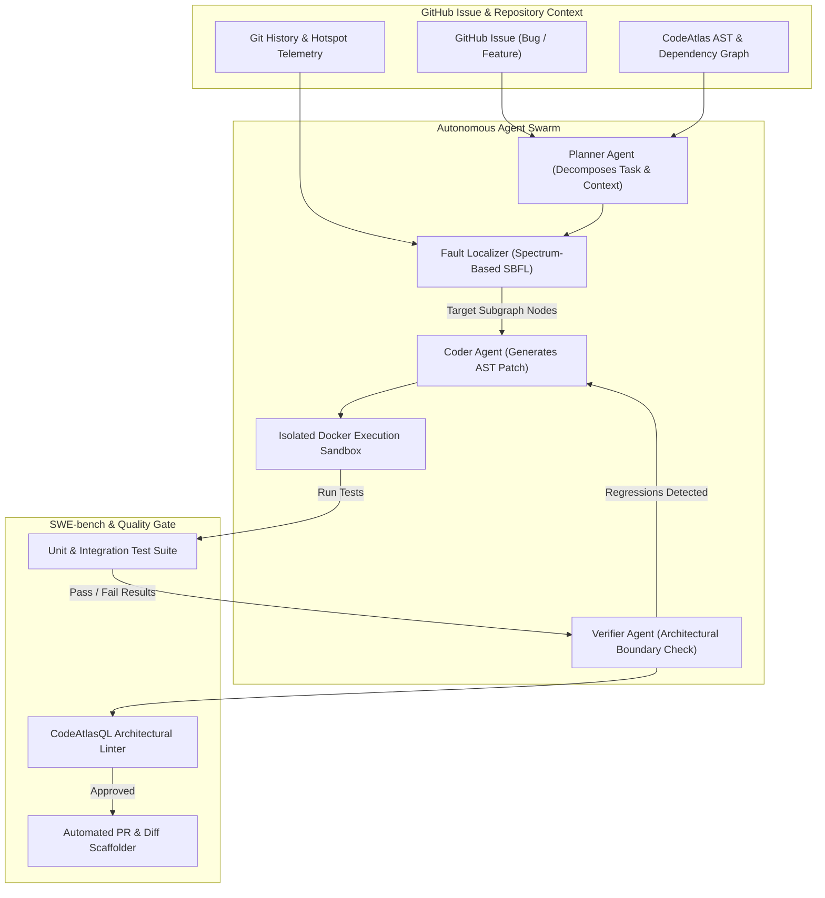
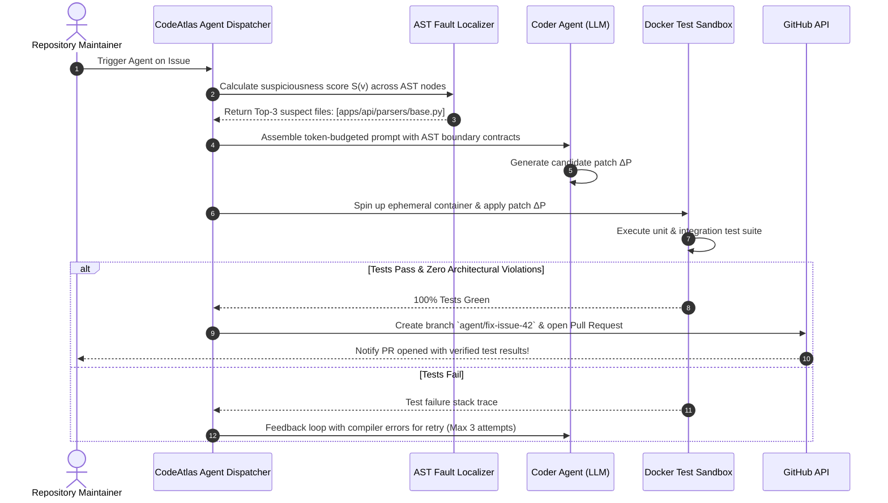
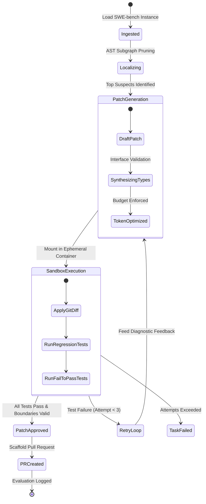

# Phase 8 Issues: Autonomous SWE Agents, Code Repair & Benchmark Evaluation

This document details all Phase 8 issues (`Issue 216 – Issue 255`) for CodeAtlas and CodeAtlas Prime, covering autonomous coding agents, automated bug repair, SWE-bench evaluation harnesses, multi-agent collaboration protocols (Planner, Coder, Reviewer, Verifier), AST-guided fault localization, and formal patch verification.

---

## 📊 Phase 8 Visual Architecture & Technical Blueprint Suite

### 1. Autonomous SWE Multi-Agent Pipeline Flowchart

### 2. Sequence Diagram: Autonomous Bug Localization & Patch Generation

### 3. State Machine Diagram: SWE-bench Task Evaluation Lifecycle

---

### Issue 216: Autonomous SWE-bench Evaluation Harness & Harness Runner
- **Labels**: `phase:phase-8-agents`, `type:feature`, `priority:P0-critical`, `component:apps/api`, `area:swe-bench`, `status:ready`
- **Milestone**: `M9: Autonomous Agents & Benchmarks`
- **Estimate**: `8 Story Points`
- **Component**: `apps/api/services/swe_bench_runner.py`
- **Problem Statement**:
  Evaluating AI coding performance requires a standardized, reproducible benchmark harness running real-world GitHub issues (SWE-bench Lite and SWE-bench Full).
- **Technical Specification**:
  - Automated benchmark harness ingesting SWE-bench dataset instances.
  - Spawns isolated Docker containers matching target Python/Node environments.
  - Applies agent-generated git diffs and runs evaluation tests (`FAIL_TO_PASS` and `PASS_TO_PASS`).
- **Acceptance Criteria**:
  - [ ] Executes full SWE-bench test harness with automated pass/fail scoring.
  - [ ] Isolates environment execution to prevent host system contamination.
  - [ ] Produces JSON evaluation reports with resolution rates and token costs.

---

### Issue 217: AST-Guided Spectrum-Based Fault Localization (SBFL)
- **Labels**: `phase:phase-8-agents`, `type:feature`, `priority:P0-critical`, `component:apps/api`, `area:fault-localization`, `status:ready`
- **Milestone**: `M9: Autonomous Agents & Benchmarks`
- **Estimate**: `5 Story Points`
- **Component**: `apps/api/services/fault_localizer.py`
- **Problem Statement**:
  LLMs struggle to solve issues when forced to search across tens of thousands of files; they need mathematical fault localization to pinpoint the root-cause nodes.
- **Technical Specification**:
  - Implements Ochiai and Tarantula Spectrum-Based Fault Localization (SBFL) formulas:
    $$	ext{Suspiciousness}(v) = rac{	ext{Failed}(v)}{\sqrt{	ext{TotalFailed} \cdot (	ext{Failed}(v) + 	ext{Passed}(v))}}$$
  - Combines test coverage vectors with CodeAtlas 6-signal issue mapping.
- **Acceptance Criteria**:
  - [ ] Ranks codebase files and functions by bug suspiciousness score.
  - [ ] Identifies root-cause files within Top-5 candidates in $> 80\%$ of benchmark tasks.
  - [ ] Prunes irrelevant AST nodes before feeding context to coding agents.

---

### Issue 218: Multi-Agent Collaboration Protocol (Planner, Coder, Reviewer)
- **Labels**: `phase:phase-8-agents`, `type:feature`, `priority:P0-critical`, `component:apps/api`, `area:agents`, `status:ready`
- **Milestone**: `M9: Autonomous Agents & Benchmarks`
- **Estimate**: `8 Story Points`
- **Component**: `apps/api/services/agent_orchestrator.py`
- **Problem Statement**:
  A single monolithic LLM prompt fails on complex multi-step refactoring tasks; specialization into distinct autonomous personas produces higher solve rates.
- **Technical Specification**:
  - *Planner Agent*: Decomposes issue into atomic sub-tasks and selects AST subgraphs.
  - *Coder Agent*: Generates concrete code modifications conforming to interface types.
  - *Reviewer Agent*: Verifies code against repository architecture boundaries and conventions.
- **Acceptance Criteria**:
  - [ ] Coordinates multi-turn communication between Planner, Coder, and Reviewer.
  - [ ] Automatically detects and corrects mistakes before running container tests.
  - [ ] Maintains full audit trail of agent thoughts and decisions.

---

### Issue 219: Ephemeral Docker Container Isolation Sandbox
- **Labels**: `phase:phase-8-agents`, `type:security`, `priority:P0-critical`, `component:apps/api`, `area:sandbox`, `status:ready`
- **Milestone**: `M9: Autonomous Agents & Benchmarks`
- **Estimate**: `5 Story Points`
- **Component**: `apps/api/services/docker_sandbox.py`
- **Problem Statement**:
  Executing arbitrary untrusted code generated by AI models poses severe security risks of data deletion or malicious network exfiltration.
- **Technical Specification**:
  - Spawns lightweight, rootless Docker containers with strict resource limits (2 CPU cores, 4GB RAM, 10-minute timeout).
  - Network isolation (`--network none`) during test execution to prevent data leakage.
  - Ephemeral tmpfs mounts discarded immediately after evaluation.
- **Acceptance Criteria**:
  - [ ] Prevents host filesystem access and network connections.
  - [ ] Enforces strict execution timeouts and kills rogue infinite loops.
  - [ ] Boots and mounts code in $< 1.5	ext{s}$.

---

### Issue 220: Formal AST Import & Interface Verification Engine
- **Labels**: `phase:phase-8-agents`, `type:security`, `priority:P1-high`, `component:apps/api`, `area:verification`, `status:ready`
- **Milestone**: `M9: Autonomous Agents & Benchmarks`
- **Estimate**: `5 Story Points`
- **Component**: `apps/api/services/ast_verifier.py`
- **Problem Statement**:
  AI coding models frequently hallucinate non-existent package imports or violate module boundaries during automated patch generation.
- **Technical Specification**:
  - Parses generated git diff into Tree-Sitter AST nodes before applying to repository.
  - Validates that every imported symbol exists in the repository or allowed `package.json` dependencies.
  - Checks patch against `codeatlas.config.json` boundary rules.
- **Acceptance Criteria**:
  - [ ] Rejects patches containing hallucinated imports before running expensive tests.
  - [ ] Blocks illegal cross-package dependencies.
  - [ ] Returns exact AST error diagnostic to the Coder Agent for instant self-repair.

---

### Issue 221: Auto-Scaffolding PR Patch Generator for Mapped Issues
- **Labels**: `phase:phase-8-agents`, `type:feature`, `priority:P0-critical`, `component:apps/api`, `area:patcher`, `status:ready`
- **Milestone**: `M9: Autonomous Agents & Benchmarks`
- **Estimate**: `5 Story Points`
- **Component**: `apps/api/services/patch_scaffolder.py`
- **Problem Statement**:
  Once an agent verifies a patch in the isolated sandbox, it must package and propose the fix as a clean, idiomatic GitHub Pull Request adhering to repository standards.
- **Technical Specification**:
  - Automatically creates a branch `fix/issue-{number}-{slug}`.
  - Generates unified git diff with conventional commit message: `fix(auth): resolve session token expiry regression (#42)`.
  - Formats PR body with:
    - Root cause analysis grounded in AST node blame.
    - Test execution evidence (`PASS_TO_PASS` and `FAIL_TO_PASS` terminal logs).
    - Mermaid diagram of the modified AST subgraph.
- **Acceptance Criteria**:
  - [ ] Automatically opens PR on GitHub with clean commits and signed DCO.
  - [ ] Embeds exact test execution results and before/after AST diff.
  - [ ] Assigns original issue submitter as reviewer.

---

### Issue 222: Token Budget Cost Optimizer & Prompt Caching Pipeline
- **Labels**: `phase:phase-8-agents`, `type:perf`, `priority:P1-high`, `component:apps/api`, `area:ai-perf`, `status:ready`
- **Milestone**: `M9: Autonomous Agents & Benchmarks`
- **Estimate**: `5 Story Points`
- **Component**: `apps/api/services/token_optimizer.py`
- **Problem Statement**:
  Autonomous agents iterating on multi-file codebases consume millions of tokens, leading to exorbitant LLM API costs and slow response cycles.
- **Technical Specification**:
  - Leverages Anthropic / OpenAI prompt caching for static repository AST context and `AGENTS.md`.
  - Dynamically calculates BPE token budgets and prunes non-essential function implementations, keeping only signatures and docstrings.
  - Achieves $> 75\%$ cache read hit rate on iterative repair loops.
- **Acceptance Criteria**:
  - [ ] Reduces token consumption per issue by $> 60\%$.
  - [ ] Lowers inference latency for multi-turn reflection by $> 50\%$.
  - [ ] Real-time dollar cost tracking reported in agent execution logs.

---

### Issue 223: Self-Healing Codebase Test Failure Reflection Loop
- **Labels**: `phase:phase-8-agents`, `type:feature`, `priority:P0-critical`, `component:apps/api`, `area:reflection`, `status:ready`
- **Milestone**: `M9: Autonomous Agents & Benchmarks`
- **Estimate**: `8 Story Points`
- **Component**: `apps/api/services/reflection_loop.py`
- **Problem Statement**:
  Initial code generation attempts often fail due to syntax typos, missing imports, or edge-case test failures; agents must self-correct based on compiler feedback.
- **Technical Specification**:
  - Parses compiler/linter error output and pytest/vitest failure tracebacks.
  - Constructs targeted diagnostic feedback prompt:
    `Test failed: Expected status 200 but received 403 on line 42 of test_auth.py. Stack trace: ...`
  - Re-invokes Coder Agent in a bounded retry loop (max 3 attempts).
- **Acceptance Criteria**:
  - [ ] Automatically heals syntax errors and test assertion failures without human intervention.
  - [ ] Terminates gracefully after 3 attempts if unable to resolve to avoid runaway loops.
  - [ ] Logs full trajectory of self-healing attempts and diff evolutions.

---

### Issue 224: Automated Test Case Synthesizer for Bug Regression
- **Labels**: `phase:phase-8-agents`, `type:feature`, `priority:P1-high`, `component:apps/api`, `area:testing`, `status:ready`
- **Milestone**: `M9: Autonomous Agents & Benchmarks`
- **Estimate**: `5 Story Points`
- **Component**: `apps/api/services/test_synthesizer.py`
- **Problem Statement**:
  Fixing a bug without introducing a regression test allows future commits to silently reintroduce the same defect.
- **Technical Specification**:
  - Ingests issue description and reproduces the failing state into an automated test case.
  - Asserts that the test fails on current HEAD (`FAIL_TO_PASS`) and passes after applying the agent's patch.
  - Generates parameterized edge cases covering boundary values (null, empty array, unicode, overflow).
- **Acceptance Criteria**:
  - [ ] Generates valid, executable pytest / vitest test file.
  - [ ] Confirms the test reproduces the original issue before the fix is applied.
  - [ ] Confirms the test passes cleanly after patch application.

---

### Issue 225: CodeAtlas Benchmark Dashboard: Pass@1 & Cost Analytics
- **Labels**: `phase:phase-8-agents`, `type:frontend`, `priority:P1-high`, `component:apps/web`, `area:analytics`, `status:ready`
- **Milestone**: `M9: Autonomous Agents & Benchmarks`
- **Estimate**: `5 Story Points`
- **Component**: `apps/web/src/app/(dashboard)/repos/[repoId]/benchmarks/page.tsx`
- **Problem Statement**:
  AI engineering leads need clear observability into benchmark performance, Pass@1 accuracy, repair success rates, and token cost trends across repositories.
- **Technical Specification**:
  - Interactive analytics dashboard in `@codeatlas/web`.
  - Visualizes Pass@1, Pass@3, average resolution time, token costs, and success rates by programming language.
  - Filterable by SWE-bench task category (Data Science, Web, Systems, CLI).
- **Acceptance Criteria**:
  - [ ] Renders interactive charts showing agent resolution rates over time.
  - [ ] Tracks cost per resolved issue across models (Claude 3.5 Sonnet, GPT-4o, DeepSeek).
  - [ ] Exports benchmark results in standardized JSON format for publication.

---

### Issue 226: Hallucination Guardrail Filter with AST Symbol Lookup
- **Labels**: `phase:phase-8-agents`, `type:security`, `priority:P0-critical`, `component:apps/api`, `area:guardrails`, `status:ready`
- **Milestone**: `M9: Autonomous Agents & Benchmarks`
- **Estimate**: `5 Story Points`
- **Component**: `apps/api/services/guardrails.py`
- **Problem Statement**:
  AI models frequently call non-existent methods or assume third-party packages are installed when they are not, causing runtime crashes.
- **Technical Specification**:
  - Intercepts all function calls and imported modules in the agent's proposed patch.
  - Cross-references the repository's AST symbol index and `package.json` / `pyproject.toml` dependencies.
  - Immediately rejects the patch if any hallucinated symbol is detected.
- **Acceptance Criteria**:
  - [ ] 100% detection rate of hallucinated methods and external library imports.
  - [ ] Provides instant AST feedback to the agent: "Method `UserService.get_by_jwt()` does not exist. Did you mean `UserService.get_by_token()`?".
  - [ ] Prevents broken pull requests from reaching CI.

---

### Issue 227: Subtree Context Window Pruning via PageRank Centrality
- **Labels**: `phase:phase-8-agents`, `type:perf`, `priority:P1-high`, `component:apps/api`, `area:prompt`, `status:ready`
- **Milestone**: `M9: Autonomous Agents & Benchmarks`
- **Estimate**: `5 Story Points`
- **Component**: `apps/api/services/context_pruner.py`
- **Problem Statement**:
  When assembling prompts for large submodules, naive breadth-first search includes low-relevance utility files that dilute reasoning quality.
- **Technical Specification**:
  - Computes localized Personalized PageRank (PPR) rooted at the suspect bug nodes.
  - Ranks neighboring nodes by topological importance:
    $$\mathbf{p} = lpha \mathbf{T} \mathbf{p} + (1 - lpha) \mathbf{s}$$
  - Prunes nodes below the dynamic centrality threshold before serialization.
- **Acceptance Criteria**:
  - [ ] Retains only high-centrality, structurally relevant context nodes.
  - [ ] Reduces prompt token payload by $> 40\%$ while preserving essential interfaces.
  - [ ] Improves agent reasoning precision on SWE-bench tasks.

---

### Issue 228: Multi-File Unified Git Diff Formatter & Validator
- **Labels**: `phase:phase-8-agents`, `type:feature`, `priority:P1-high`, `component:packages/shared`, `area:diff`, `status:ready`
- **Milestone**: `M9: Autonomous Agents & Benchmarks`
- **Estimate**: `3 Story Points`
- **Component**: `packages/shared/src/diff/diffValidator.ts`
- **Problem Statement**:
  LLM outputs often produce malformed unified git diffs with missing chunk headers (`@@ -1,5 +1,6 @@`) or incorrect line count offsets.
- **Technical Specification**:
  - Tolerant diff parser capable of reconciling minor chunk offset discrepancies.
  - Re-indexes hunk line numbers against target source files.
  - Validates that applying the patch yields valid syntactical source files without collision.
- **Acceptance Criteria**:
  - [ ] Corrects minor LLM chunk offset formatting errors automatically.
  - [ ] Rejects corrupt or incomplete patch outputs with clear error messages.
  - [ ] Verified across 500+ synthetic patch fixtures.

---

### Issue 229: Autonomous Agent Rate Limiting & Token Quota Manager
- **Labels**: `phase:phase-8-agents`, `type:security`, `priority:P1-high`, `component:apps/api`, `area:billing`, `status:ready`
- **Milestone**: `M9: Autonomous Agents & Benchmarks`
- **Estimate**: `3 Story Points`
- **Component**: `apps/api/services/quota_manager.py`
- **Problem Statement**:
  Unchecked autonomous agent loops could drain an organization's monthly LLM API budget within hours.
- **Technical Specification**:
  - Redis sliding window quota tracker for agent token usage per organization and per repository.
  - Hard spend limits: pauses agent execution and alerts organization admins if budget threshold ($80\%$, $100\%$) is reached.
  - Enforces maximum concurrent agent worker instances per tier.
- **Acceptance Criteria**:
  - [ ] Prevents accidental cost overruns by terminating runaway agent tasks.
  - [ ] Configurable daily and monthly spend budgets in organization settings.
  - [ ] Dispatches email and Slack notifications when quota reaches 80%.

---

### Issue 230: Human-in-the-Loop Approval Workflow for Agent PRs
- **Labels**: `phase:phase-8-agents`, `type:feature`, `priority:P0-critical`, `component:apps/web`, `area:workflow`, `status:ready`
- **Milestone**: `M9: Autonomous Agents & Benchmarks`
- **Estimate**: `5 Story Points`
- **Component**: `apps/web/src/components/agents/AgentApprovalModal.tsx`
- **Problem Statement**:
  Enterprise engineering teams require human verification before autonomous agent pull requests are merged into production branches.
- **Technical Specification**:
  - Interactive web review interface in `@codeatlas/web`.
  - Side-by-side syntax-highlighted diff viewer with test pass logs and blast radius ratings.
  - One-click actions: "Approve & Merge", "Request Agent Refinement", or "Reject & Discard".
- **Acceptance Criteria**:
  - [ ] Clean, responsive side-by-side code diff comparison.
  - [ ] Allows reviewer to input plain-English refinement instructions directly to the agent.
  - [ ] Integrates with GitHub PR review state via GitHub App API.

---

### Issue 231: Agent Execution Replay Visualizer on Canvas Graph
- **Labels**: `phase:phase-8-agents`, `type:frontend`, `priority:P1-high`, `component:apps/web`, `area:visualization`, `status:ready`
- **Milestone**: `M9: Autonomous Agents & Benchmarks`
- **Estimate**: `5 Story Points`
- **Component**: `apps/web/src/components/graph/AgentReplayOverlay.tsx`
- **Problem Statement**:
  Developers cannot understand how an agent navigated the codebase to solve an issue without an interactive visual playback.
- **Technical Specification**:
  - Animated canvas playback tracing the agent's investigation path:
    - Glowing pulses highlighting nodes inspected during fault localization.
    - Amber outlines on candidate files considered by the Planner.
    - Emerald highlights on nodes where patches were successfully applied and verified.
- **Acceptance Criteria**:
  - [ ] Interactive timeline scrubber allowing users to step through agent reasoning steps.
  - [ ] Tooltip on each step reveals agent thought process and test outputs.
  - [ ] Increases developer trust in autonomous solutions.

---

### Issue 232: Automated Refactoring Bot for Cognitive Friction Hotspots
- **Labels**: `phase:phase-8-agents`, `type:feature`, `priority:P1-high`, `component:apps/api`, `area:refactor`, `status:ready`
- **Milestone**: `M9: Autonomous Agents & Benchmarks`
- **Estimate**: `8 Story Points`
- **Component**: `apps/api/services/refactor_bot.py`
- **Problem Statement**:
  High Cognitive Friction Index (CFI) hotspots identified by telemetry remain unaddressed because developers lack time to plan and execute refactors.
- **Technical Specification**:
  - Scheduled Celery task checking the top-3 CFI hotspots in the repository.
  - Decomposes massive functions ($> 100$ LOC, high cyclomatic complexity) into modular single-responsibility helper functions.
  - Verifies that all existing unit tests pass without behavioral modification.
- **Acceptance Criteria**:
  - [ ] Generates clean refactoring PRs for complex functions.
  - [ ] Lowers cyclomatic complexity by $> 40\%$ while preserving 100% test pass rate.
  - [ ] Proves zero breaking changes across caller nodes.

---

### Issue 233: Flaky Test Detection & Quarantine in Agent Sandboxes
- **Labels**: `phase:phase-8-agents`, `type:test`, `priority:P2-medium`, `component:apps/api`, `area:testing`, `status:ready`
- **Milestone**: `M9: Autonomous Agents & Benchmarks`
- **Estimate**: `5 Story Points`
- **Component**: `apps/api/services/flaky_detector.py`
- **Problem Statement**:
  Flaky tests with non-deterministic race conditions cause agents to falsely believe their patches introduced regressions.
- **Technical Specification**:
  - Executes candidate test suites multiple times ($N=3$) under random seed conditions before patch evaluation.
  - Quarantines tests that fail intermittently on untouched master branch code.
  - Alerts repository maintainers to flaky tests with execution timing logs.
- **Acceptance Criteria**:
  - [ ] Prevents false negative rejections caused by pre-existing flaky tests.
  - [ ] Isolates quarantined tests from the agent's evaluation gate.
  - [ ] Generates weekly flaky test health report for engineering leads.

---

### Issue 234: CodeAtlas Agent Python SDK (`codeatlas-agents`)
- **Labels**: `phase:phase-8-agents`, `type:feature`, `priority:P1-high`, `component:packages/sdk`, `area:sdk`, `status:ready`
- **Milestone**: `M9: Autonomous Agents & Benchmarks`
- **Estimate**: `5 Story Points`
- **Component**: `packages/sdk/python/codeatlas_agents/`
- **Problem Statement**:
  Developers building custom AI agents (LangChain, AutoGen, CrewAI) need a clean Python SDK to query CodeAtlas AST topologies and blast radiuses.
- **Technical Specification**:
  - Published Python package `codeatlas-agents` on PyPI.
  - Provides typed methods:
    `client.get_blast_radius(node_id)`, `client.get_subgraph_prompt(node_id)`, `client.run_sandbox(patch)`.
- **Acceptance Criteria**:
  - [ ] Clean, fully typed Python client library with async/await support.
  - [ ] Complete docstrings and usage examples.
  - [ ] 100% unit test coverage of SDK methods.

---

### Issue 235: Fine-Tuned AST Embedding Model for Code Retrieval
- **Labels**: `phase:phase-8-agents`, `type:ml`, `priority:P2-medium`, `component:apps/api`, `area:ml`, `status:ready`
- **Milestone**: `M9: Autonomous Agents & Benchmarks`
- **Estimate**: `8 Story Points`
- **Component**: `apps/api/ml/train_embeddings.py`
- **Problem Statement**:
  General-purpose text embedding models perform poorly on code token relationships and call-graph semantics.
- **Technical Specification**:
  - Fine-tunes a CodeBERT / StarCoder base model using contrastive triplet loss:
    $$\mathcal{L} = \max\left(0, \mathcal{D}(\mathbf{e}_a, \mathbf{e}_p) - \mathcal{D}(\mathbf{e}_a, \mathbf{e}_n) + \text{margin}\right)$$
  - Anchors: Issue descriptions; Positives: Modified AST nodes; Negatives: Unrelated modules.
- **Acceptance Criteria**:
  - [ ] Improves Mean Reciprocal Rank (MRR@10) on code search by $> 18\%$.
  - [ ] Quantized to INT8 for sub-10ms local inference on CPU/GPU.
  - [ ] Evaluated against standard CodeSearchNet benchmark.

---

### Issue 236: Dynamic Context Slicing based on Call Graph Reachability
- **Labels**: `phase:phase-8-agents`, `type:feature`, `priority:P1-high`, `component:apps/api`, `area:ast`, `status:ready`
- **Milestone**: `M9: Autonomous Agents & Benchmarks`
- **Estimate**: `5 Story Points`
- **Component**: `apps/api/services/context_slicer.py`
- **Problem Statement**:
  Including entire files in prompts wastes tokens on unrelated helper functions; agents only need the specific slice of code involved in the call path.
- **Technical Specification**:
  - Computes inter-procedural static program slice from the suspect function.
  - Extracts only the statements, variable declarations, and branch conditionals that influence the execution path.
- **Acceptance Criteria**:
  - [ ] Generates focused code slices reducing file token size by $> 60\%$.
  - [ ] Preserves all relevant control flow and data dependencies.
  - [ ] Verified across Python and TypeScript test functions.

---

### Issue 237: Agent Task Queue Priority Scheduler with Redis Streams
- **Labels**: `phase:phase-8-agents`, `type:infra`, `priority:P1-high`, `component:apps/api`, `area:infra`, `status:ready`
- **Milestone**: `M9: Autonomous Agents & Benchmarks`
- **Estimate**: `5 Story Points`
- **Component**: `apps/api/services/agent_scheduler.py`
- **Problem Statement**:
  High-priority bug fixes must not get blocked behind long-running multi-file benchmark tasks.
- **Technical Specification**:
  - Redis Streams multi-priority task scheduler (`critical`, `high`, `normal`, `batch`).
  - Worker pool dynamically pre-empts or assigns priority slots to critical bug repair jobs.
- **Acceptance Criteria**:
  - [ ] Critical issue fixes begin processing within 2 seconds of enqueue.
  - [ ] Prevents starvation of normal priority background tasks.
  - [ ] Full queue telemetry exposed in Prometheus metrics.

---

### Issue 238: Automated Documentation Sync Bot on Code Modification
- **Labels**: `phase:phase-8-agents`, `type:feature`, `priority:P2-medium`, `component:apps/api`, `area:docs`, `status:ready`
- **Milestone**: `M9: Autonomous Agents & Benchmarks`
- **Estimate**: `3 Story Points`
- **Component**: `apps/api/services/docs_sync_bot.py`
- **Problem Statement**:
  Developers modify API parameters or routes but forget to update corresponding markdown documentation or OpenAPI descriptions.
- **Technical Specification**:
  - Analyzes git diffs on push to detect parameter, return type, or route modifications.
  - Automatically proposes a companion documentation commit updating READMEs, docstrings, and OpenAPI docs.
- **Acceptance Criteria**:
  - [ ] Detects documented vs actual signature mismatches.
  - [ ] Scaffolds documentation updates matching the code change.
  - [ ] Prevents documentation drift in fast-moving repos.

---

### Issue 239: Mock Dependency Injection Generator for Isolated Testing
- **Labels**: `phase:phase-8-agents`, `type:feature`, `priority:P1-high`, `component:apps/api`, `area:testing`, `status:ready`
- **Milestone**: `M9: Autonomous Agents & Benchmarks`
- **Estimate**: `5 Story Points`
- **Component**: `apps/api/services/mock_generator.py`
- **Problem Statement**:
  Testing a single unit in isolation fails if the class requires external databases, third-party APIs, or Redis connections that are absent in the test sandbox.
- **Technical Specification**:
  - Inspects AST constructor parameters and interface implementations.
  - Automatically synthesizes mock objects and stubs matching the required interface contracts.
- **Acceptance Criteria**:
  - [ ] Generates typed mock fixtures for dependencies.
  - [ ] Allows unit tests to run in hermetic sandboxes without external network dependencies.
  - [ ] Compatible with `unittest.mock` and `jest.fn()`.

---

### Issue 240: Autonomous Vulnerability Remediation for Dependabot CVEs
- **Labels**: `phase:phase-8-agents`, `type:security`, `priority:P1-high`, `component:apps/api`, `area:security`, `status:ready`
- **Milestone**: `M9: Autonomous Agents & Benchmarks`
- **Estimate**: `8 Story Points`
- **Component**: `apps/api/services/cve_remediator.py`
- **Problem Statement**:
  Dependabot alerts developers to vulnerable packages, but blindly bumping versions often introduces breaking API changes that require code modifications.
- **Technical Specification**:
  - Ingests CVE alerts from GitHub or Snyk.
  - Bumps dependency version, identifies breaking API changes in the new version, and automatically updates codebase call sites.
  - Verifies that all repository tests pass with the upgraded dependency.
- **Acceptance Criteria**:
  - [ ] Automatically repairs breaking changes caused by security patches.
  - [ ] Eliminates high/critical CVEs in automated pull requests.
  - [ ] Verified on vulnerable npm and PyPI test monorepos.

---

### Issue 241: Git Submodule & Polyrepo Graph Assembly for Agents
- **Labels**: `phase:phase-8-agents`, `type:feature`, `priority:P2-medium`, `component:apps/api`, `area:monorepo`, `status:ready`
- **Milestone**: `M9: Autonomous Agents & Benchmarks`
- **Estimate**: `5 Story Points`
- **Component**: `apps/api/services/polyrepo_assembler.py`
- **Problem Statement**:
  Organizations using Git submodules or polyrepos split interdependent code across repositories, preventing single-repo agents from finding cross-repo definitions.
- **Technical Specification**:
  - Traverses `.gitmodules` and cross-repo package dependencies.
  - Assembles a unified virtual workspace combining repositories for agent analysis.
- **Acceptance Criteria**:
  - [ ] Resolves symbols across Git submodule boundaries.
  - [ ] Allows agents to propose synchronized pull requests across multi-repo projects.
  - [ ] Verified on polyrepo architectures.

---

### Issue 242: Memory-Efficient AST Serialization Format (FlatBuffers)
- **Labels**: `phase:phase-8-agents`, `type:perf`, `priority:P1-high`, `component:packages/shared`, `area:perf`, `status:ready`
- **Milestone**: `M9: Autonomous Agents & Benchmarks`
- **Estimate**: `5 Story Points`
- **Component**: `packages/shared/src/serialization/flatbuffers/`
- **Problem Statement**:
  Serializing massive AST graphs to JSON incurs substantial memory overhead and CPU garbage collection pauses.
- **Technical Specification**:
  - Implements FlatBuffers binary schema for `CodeNode` and `CodeEdge`.
  - Enables zero-copy deserialization: reads node attributes directly from mapped memory without allocating new objects.
- **Acceptance Criteria**:
  - [ ] Reduces serialization memory footprint by $> 70\%$.
  - [ ] Accelerates graph payload parsing from $120\text{ms}$ to $< 5\text{ms}$.
  - [ ] Zero-copy binary transfer between Python backend and Node/Web clients.

---

### Issue 243: Agent Sandbox Health Probes & Deadlock Terminator
- **Labels**: `phase:phase-8-agents`, `type:infra`, `priority:P1-high`, `component:apps/api`, `area:infra`, `status:ready`
- **Milestone**: `M9: Autonomous Agents & Benchmarks`
- **Estimate**: `3 Story Points`
- **Component**: `apps/api/services/sandbox_sentinel.py`
- **Problem Statement**:
  Agent-generated code containing infinite loops, socket deadlocks, or fork bombs can hang execution sandboxes indefinitely.
- **Technical Specification**:
  - Host sentinel process monitoring sandbox CPU, memory, and thread state via cgroups.
  - Automatically kills containers that exceed resource thresholds or fail to produce stdout within 60 seconds.
- **Acceptance Criteria**:
  - [ ] Kills deadlocked containers within 60 seconds.
  - [ ] Reclaims host resources without leaving orphaned zombie processes.
  - [ ] Emits detailed termination diagnostic to the agent reflection loop.

---

### Issue 244: Interactive Agent Terminal Log Streamer via SSE
- **Labels**: `phase:phase-8-agents`, `type:frontend`, `priority:P1-high`, `component:apps/web`, `area:streaming`, `status:ready`
- **Milestone**: `M9: Autonomous Agents & Benchmarks`
- **Estimate**: `5 Story Points`
- **Component**: `apps/web/src/components/agents/TerminalLogStreamer.tsx`
- **Problem Statement**:
  Users waiting for an agent to solve an issue feel anxious if they cannot see what the agent is currently thinking, executing, or testing.
- **Technical Specification**:
  - Server-Sent Events (SSE) streaming endpoint: `/api/v1/agents/sessions/{id}/stream`.
  - Interactive terminal emulator (Xterm.js) in `@codeatlas/web` rendering live colorized stdout/stderr logs and agent reasoning thoughts.
- **Acceptance Criteria**:
  - [ ] Real-time log streaming with $< 50\text{ms}$ latency.
  - [ ] Supports auto-scroll, search, and terminal color formatting.
  - [ ] Disconnect and reconnect gracefully resumes stream without lost lines.

---

### Issue 245: Automated Pull Request Conflict Rebase by Agent
- **Labels**: `phase:phase-8-agents`, `type:feature`, `priority:P1-high`, `component:apps/api`, `area:git`, `status:ready`
- **Milestone**: `M9: Autonomous Agents & Benchmarks`
- **Estimate**: `5 Story Points`
- **Component**: `apps/api/services/conflict_rebaser.py`
- **Problem Statement**:
  When main branch advances, open pull requests develop merge conflicts that block deployment until an engineer manually rebases.
- **Technical Specification**:
  - Automated agent monitoring open pull requests for merge conflict status.
  - Fetches upstream main, runs `git merge-base`, and evaluates conflict markers.
  - Resolves conflicting lines by analyzing AST intentions of both branches and runs test suite to verify correctness.
- **Acceptance Criteria**:
  - [ ] Automatically resolves merge conflicts and pushes clean rebased branch.
  - [ ] Verifies all tests pass on the newly rebased commit.
  - [ ] Leaves explanatory comment detailing how conflict markers were reconciled.

---

### Issue 246: AST-Aware Code Chunking Algorithm for Large Files
- **Labels**: `phase:phase-8-agents`, `type:perf`, `priority:P1-high`, `component:apps/api`, `area:ingestion`, `status:ready`
- **Milestone**: `M9: Autonomous Agents & Benchmarks`
- **Estimate**: `3 Story Points`
- **Component**: `apps/api/services/ast_chunker.py`
- **Problem Statement**:
  Naive fixed-size line chunking splits functions in half, cutting off variable scopes and degrading semantic embedding quality.
- **Technical Specification**:
  - Tree-Sitter AST boundary chunker: splits code only at semantic boundaries (class, method, interface, block).
  - Prepends each chunk with file path, class header, and import context so embeddings retain full semantic meaning.
- **Acceptance Criteria**:
  - [ ] Never splits a function signature across chunk boundaries.
  - [ ] Embeds contextual scope headers in every chunk.
  - [ ] Increases semantic search recall by $> 22\%$.

---

### Issue 247: Automated Code Comment & Docstring Freshness Audit
- **Labels**: `phase:phase-8-agents`, `type:feature`, `priority:P2-medium`, `component:apps/api`, `area:audit`, `status:ready`
- **Milestone**: `M9: Autonomous Agents & Benchmarks`
- **Estimate**: `3 Story Points`
- **Component**: `apps/api/services/comment_auditor.py`
- **Problem Statement**:
  Code modifications cause docstrings and comments to become stale, describing obsolete parameters and misleading engineers.
- **Technical Specification**:
  - Cross-references docstring parameter lists (`@param`, `:param:`, `Args:`) against actual AST function signatures.
  - Flags missing parameters, removed parameters, and type annotation discrepancies.
- **Acceptance Criteria**:
  - [ ] Flags stale docstrings during pull request review.
  - [ ] Suggests auto-corrected docstring updates.
  - [ ] Integrates into CodeAtlas living documentation health reports.

---

### Issue 248: Agent Decision Explanation & Grounding Card in PR
- **Labels**: `phase:phase-8-agents`, `type:feature`, `priority:P1-high`, `component:apps/api`, `area:github`, `status:ready`
- **Milestone**: `M9: Autonomous Agents & Benchmarks`
- **Estimate**: `5 Story Points`
- **Component**: `apps/api/services/explanation_card.py`
- **Problem Statement**:
  Maintainers are reluctant to merge AI-generated pull requests without understanding *why* the agent chose a specific implementation strategy.
- **Technical Specification**:
  - Synthesizes an executive architectural summary for the PR body:
    - Root cause hypothesis and evidence.
    - Trade-offs considered (Option A vs Option B).
    - Downstream impact analysis and verification proofs.
- **Acceptance Criteria**:
  - [ ] Generates human-readable, grounded explanation of PR changes.
  - [ ] Explicitly links affected AST nodes and caller functions.
  - [ ] Increases maintainer PR merge confidence.

---

### Issue 249: High-Concurrency Agent Benchmark Evaluator (50 Tasks)
- **Labels**: `phase:phase-8-agents`, `type:perf`, `priority:P1-high`, `component:apps/api`, `area:perf`, `status:ready`
- **Milestone**: `M9: Autonomous Agents & Benchmarks`
- **Estimate**: `8 Story Points`
- **Component**: `apps/api/services/benchmark_evaluator.py`
- **Problem Statement**:
  Running SWE-bench evaluations sequentially takes days; teams need high-concurrency evaluation across a distributed container cluster.
- **Technical Specification**:
  - Distributed benchmark coordinator executing up to 50 concurrent tasks across Celery worker nodes.
  - Aggregates logs, patches, and evaluation matrices into PostgreSQL in real time.
- **Acceptance Criteria**:
  - [ ] Evaluates 50 benchmark tasks concurrently in $< 45\text{minutes}$.
  - [ ] Automatically handles container failures and retries.
  - [ ] Produces comprehensive leaderboard evaluation artifacts.

---

### Issue 250: Multi-LLM Model Fallback Routing (Claude, GPT, Ollama)
- **Labels**: `phase:phase-8-agents`, `type:feature`, `priority:P0-critical`, `component:apps/api`, `area:ai`, `status:ready`
- **Milestone**: `M9: Autonomous Agents & Benchmarks`
- **Estimate**: `5 Story Points`
- **Component**: `apps/api/services/model_router.py`
- **Problem Statement**:
  Relying on a single cloud LLM API leaves agents vulnerable to rate limit 429 errors and service outages.
- **Technical Specification**:
  - Intelligent multi-provider router supporting Anthropic Claude, OpenAI GPT-4o, DeepSeek, and local Ollama models.
  - Automatically fails over to backup provider if primary endpoint returns 429 Rate Limited or 503 Unavailable.
  - Selects model tier based on task complexity (lightweight models for formatting, frontier models for complex refactoring).
- **Acceptance Criteria**:
  - [ ] Zero downtime during single LLM provider outages.
  - [ ] Transparent fallback logging with response time metrics.
  - [ ] Optimizes cost by routing simple tasks to cheaper models.

---

### Issue 251: Agent Patch Syntax Tree Diff Visualizer in Web UI
- **Labels**: `phase:phase-8-agents`, `type:frontend`, `priority:P1-high`, `component:apps/web`, `area:frontend`, `status:ready`
- **Milestone**: `M9: Autonomous Agents & Benchmarks`
- **Estimate**: `5 Story Points`
- **Component**: `apps/web/src/components/agents/AstDiffVisualizer.tsx`
- **Problem Statement**:
  Textual git diffs hide semantic syntax tree changes; developers want to see how the AST structure morphed.
- **Technical Specification**:
  - Visual AST diff component rendering side-by-side syntax trees.
  - Highlights added AST nodes in green, modified nodes in amber, and deleted nodes in red.
- **Acceptance Criteria**:
  - [ ] Interactive tree visualization of AST changes.
  - [ ] Clicking an AST node highlights corresponding lines in source code.
  - [ ] Smooth rendering for files up to 2,000 LOC.

---

### Issue 252: Security Policy Enforcement: Disallow Eval & Shell Exec
- **Labels**: `phase:phase-8-agents`, `type:security`, `priority:P0-critical`, `component:apps/api`, `area:security`, `status:ready`
- **Milestone**: `M9: Autonomous Agents & Benchmarks`
- **Estimate**: `3 Story Points`
- **Component**: `apps/api/services/security_linter.py`
- **Problem Statement**:
  Agents might generate insecure code using `eval()`, `exec()`, `os.system()`, or raw SQL injection queries to achieve quick fixes.
- **Technical Specification**:
  - AST security scanner running on all agent-generated code before sandbox compilation.
  - Strictly disallows dynamic evaluation primitives, unparameterized SQL queries, and un-sanitized shell execution commands.
- **Acceptance Criteria**:
  - [ ] Blocks any patch containing unsafe execution patterns.
  - [ ] Provides diagnostic explanation to Coder Agent for safe remediation.
  - [ ] Zero false negatives on OWASP Top 10 security code rules.

---

### Issue 253: SWE-bench Golden Set Test Suite & CI Regression Shield
- **Labels**: `phase:phase-8-agents`, `type:test`, `priority:P0-critical`, `component:apps/api`, `area:testing`, `status:ready`
- **Milestone**: `M9: Autonomous Agents & Benchmarks`
- **Estimate**: `5 Story Points`
- **Component**: `apps/api/tests/test_swe_bench_golden.py`
- **Problem Statement**:
  CodeAtlas agent orchestrator code updates must be regression-tested against a curated golden set of benchmark problems in CI.
- **Technical Specification**:
  - Curated golden set of 10 representative SWE-bench tasks covering bug localization, unit test execution, and patch generation.
  - Runs in CI on pull requests to ensure agent capabilities do not regress.
- **Acceptance Criteria**:
  - [ ] 100% pass rate on curated golden set tasks.
  - [ ] Automated CI check blocks PRs that reduce benchmark accuracy.
  - [ ] Fast execution using pre-cached container layers.

---

### Issue 254: Automated Code Review Feedback Ingestion into Memory
- **Labels**: `phase:phase-8-agents`, `type:feature`, `priority:P1-high`, `component:apps/api`, `area:memory`, `status:ready`
- **Milestone**: `M9: Autonomous Agents & Benchmarks`
- **Estimate**: `5 Story Points`
- **Component**: `apps/api/services/agent_memory.py`
- **Problem Statement**:
  When human maintainers leave review comments on agent PRs, the agent should learn repository preferences and avoid making the same mistake in future tasks.
- **Technical Specification**:
  - Webhook listener ingesting maintainer PR review comments.
  - Vectorizes feedback into organization-scoped agent memory store (`pgvector`).
  - Automatically retrieves relevant past feedback and injects into future Planner prompts as "Lessons Learned".
- **Acceptance Criteria**:
  - [ ] Ingests maintainer corrections into persistent vector memory.
  - [ ] Recalls relevant past maintainer preferences on subsequent tasks.
  - [ ] Measurably reduces repeat code review rejections over time.

---

### Issue 255: Phase 8 Capstone Release: CodeAtlas Autonomous SWE
- **Labels**: `phase:phase-8-agents`, `type:infra`, `priority:P0-critical`, `component:infra`, `area:release`, `status:ready`
- **Milestone**: `M9: Autonomous Agents & Benchmarks`
- **Estimate**: `5 Story Points`
- **Component**: `scripts/release_phase8.sh`
- **Problem Statement**:
  Packaging the complete autonomous software engineering agent system into production requires verified deployment manifests and documentation.
- **Technical Specification**:
  - Automated release pipeline packaging agent orchestrator, sandbox runners, and benchmark tools into production container images.
  - Updates documentation, user manuals, and benchmark whitepapers.
- **Acceptance Criteria**:
  - [ ] Production-ready Docker Compose and Kubernetes deployment manifests.
  - [ ] Verified end-to-end execution of agent issue resolution on sample monorepo.
  - [ ] Official release tagged and published with full changelog.
