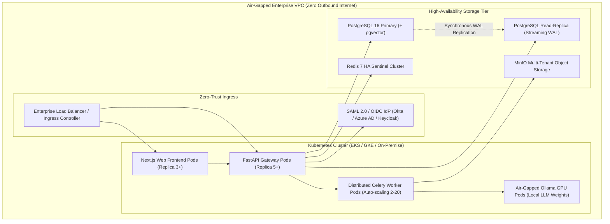
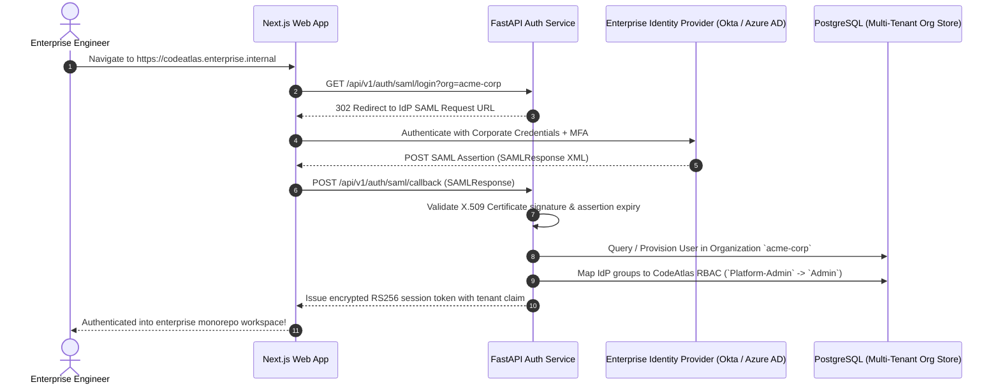
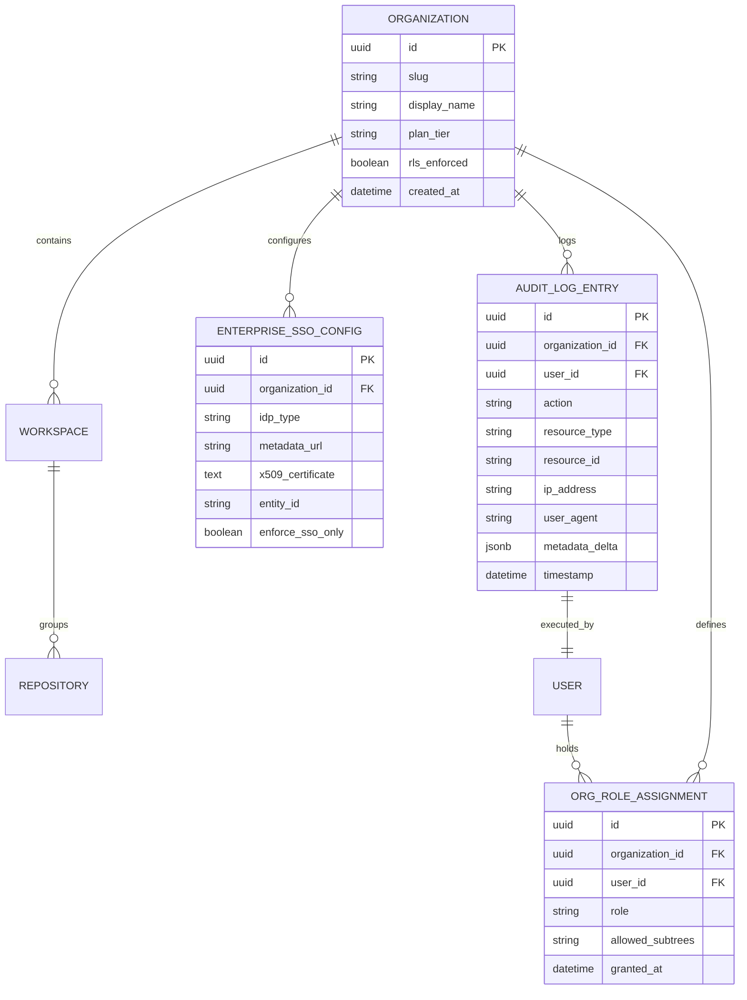

# Phase 9 Issues: Enterprise Governance, Security Compliance & Air-Gapped High Availability

This document details all Phase 9 issues (`Issue 256 – Issue 300`) for CodeAtlas and CodeAtlas Prime, covering 100% air-gapped on-premise Kubernetes deployments, SOC 2 Type II compliance audit logging, enterprise SAML 2.0 / OIDC SSO, granular Role-Based Access Control (RBAC), OSS license compliance, disaster recovery replication, and high-availability auto-scaling.

---

## 📊 Phase 9 Visual Architecture & Technical Blueprint Suite

### 1. 100% Air-Gapped Enterprise Deployment Flowchart

### 2. Sequence Diagram: Enterprise SAML 2.0 Single Sign-On & RBAC

### 3. Entity-Relationship Diagram (ERD): Enterprise Security & Audit Log

---

### Issue 256: 100% Air-Gapped Kubernetes Helm Chart Architecture
- **Labels**: `phase:phase-9-enterprise`, `type:infra`, `priority:P0-critical`, `component:infra`, `area:helm`, `status:ready`
- **Milestone**: `M10: Enterprise GA & Air-Gap`
- **Estimate**: `8 Story Points`
- **Component**: `infra/helm/codeatlas/`
- **Problem Statement**:
  Defense, banking, and healthcare enterprises require complete air-gapped deployments where zero outbound traffic is permitted and all container images/models are pre-packaged.
- **Technical Specification**:
  - Production-ready Kubernetes Helm chart (`charts/codeatlas`).
  - Pre-packaged offline container images for Web, API, Celery, PostgreSQL 16 + pgvector, Redis, and MinIO.
  - Pre-cached HuggingFace and Ollama model weights for local inference without public network downloads.
- **Acceptance Criteria**:
  - [ ] Deploys successfully on a Kubernetes cluster with internet egress blocked (`0.0.0.0/0` deny).
  - [ ] Validates health of all pods via readiness and liveness probes.
  - [ ] Zero DNS or HTTP connection attempts to external endpoints.

---

### Issue 257: SOC 2 Type II Immutable Cryptographic Audit Logging
- **Labels**: `phase:phase-9-enterprise`, `type:security`, `priority:P0-critical`, `component:apps/api`, `area:compliance`, `status:ready`
- **Milestone**: `M10: Enterprise GA & Air-Gap`
- **Estimate**: `5 Story Points`
- **Component**: `apps/api/services/audit_logger.py`
- **Problem Statement**:
  Enterprise compliance (SOC 2, ISO 27001, HIPAA) mandates tamper-evident audit trails recording all repository access, permission changes, and query executions.
- **Technical Specification**:
  - High-throughput asynchronous audit logging middleware.
  - Records user ID, IP address, user-agent, action type, and JSON state changes.
  - Hashes audit records in a SHA-256 Merkle tree sequence where each record incorporates the previous entry's hash.
- **Acceptance Criteria**:
  - [ ] Every user action and administrative configuration change logged automatically.
  - [ ] Merkle chain detects any direct database record tampering or deletion attempts.
  - [ ] Exportable in standardized CSV and JSON formats for external auditors.

---

### Issue 258: SAML 2.0 & OIDC Enterprise Single Sign-On (Okta, Azure AD)
- **Labels**: `phase:phase-9-enterprise`, `type:security`, `priority:P0-critical`, `component:apps/api`, `area:auth`, `status:ready`
- **Milestone**: `M10: Enterprise GA & Air-Gap`
- **Estimate**: `8 Story Points`
- **Component**: `apps/api/routers/saml.py`
- **Problem Statement**:
  Enterprise customers reject username/password or personal GitHub OAuth; they require mandatory corporate SSO with automatic employee offboarding.
- **Technical Specification**:
  - SAML 2.0 Service Provider (SP) and OpenID Connect (OIDC) client implementations.
  - Automatic Just-In-Time (JIT) user provisioning upon initial successful SSO assertion.
  - Attribute mapping linking corporate groups to CodeAtlas roles (Admin, Member, Viewer).
- **Acceptance Criteria**:
  - [ ] Seamless sign-in with Okta, Microsoft Entra ID (Azure AD), Google Workspace, and Keycloak.
  - [ ] Supports IdP-initiated and SP-initiated SSO flows.
  - [ ] Revoking user in corporate IdP immediately terminates CodeAtlas active sessions.

---

### Issue 259: PostgreSQL Row-Level Security (RLS) Multi-Tenant Data Isolation
- **Labels**: `phase:phase-9-enterprise`, `type:security`, `priority:P0-critical`, `component:apps/api`, `area:database`, `status:ready`
- **Milestone**: `M10: Enterprise GA & Air-Gap`
- **Estimate**: `5 Story Points`
- **Component**: `apps/api/migrations/0002_rls_policies.py`
- **Problem Statement**:
  In a multi-tenant SaaS deployment, a software bug in query filters could accidentally expose one organization's proprietary source code or AST graphs to another.
- **Technical Specification**:
  - Enable PostgreSQL Row-Level Security (RLS) on all core tables (`code_nodes`, `code_edges`, `repositories`, `issues`).
  - Sets transaction-scoped tenant context: `SET LOCAL app.current_org_id = 'org_uuid';`.
  - Database engine enforces isolation at the storage level, blocking cross-tenant reads even if application code omits an org filter.
- **Acceptance Criteria**:
  - [ ] Cross-tenant queries return zero records at the database level.
  - [ ] Automated security penetration tests confirm tenant isolation.
  - [ ] Zero performance degradation on indexed multi-tenant queries.

---

### Issue 260: Open-Source Software (OSS) License Compliance & Vulnerability Graph
- **Labels**: `phase:phase-9-enterprise`, `type:feature`, `priority:P1-high`, `component:apps/api`, `area:compliance`, `status:ready`
- **Milestone**: `M10: Enterprise GA & Air-Gap`
- **Estimate**: `5 Story Points`
- **Component**: `apps/api/services/license_compliance.py`
- **Problem Statement**:
  Enterprises must prevent accidental introduction of viral open-source licenses (GPL, AGPL) in proprietary commercial software products.
- **Technical Specification**:
  - Scans `package.json`, `go.mod`, `pom.xml`, and `requirements.txt` to extract license metadata.
  - Maps licenses directly to dependency nodes on the CodeAtlas graph.
  - Highlights prohibited licenses in amber/red and blocks CI if copyleft licenses are detected.
- **Acceptance Criteria**:
  - [ ] Detects 100+ standard SPDX license identifiers.
  - [ ] Flags GPL/AGPL viral licenses in commercial workspaces.
  - [ ] Generates automated Software Bill of Materials (SBOM) in CycloneDX format.

---

### Issue 261: Disaster Recovery Automated Streaming Replication
- **Labels**: `phase:phase-9-enterprise`, `type:infra`, `priority:P0-critical`, `component:infra`, `area:database`, `status:ready`
- **Milestone**: `M10: Enterprise GA & Air-Gap`
- **Estimate**: `8 Story Points`
- **Component**: `infra/postgres/replication/`
- **Problem Statement**:
  Catastrophic hardware failure in the primary data center could result in permanent loss of repository graph indices, author churn histories, and vector embeddings.
- **Technical Specification**:
  - Implements PostgreSQL 16 physical streaming replication with synchronous commit standby.
  - Maintains zero data loss (RPO = 0) for committed transactions.
  - Automates failover via Patroni / pg_auto_failover with etcd consensus coordinator.
- **Acceptance Criteria**:
  - [ ] Secondary replica replicates WAL records with $< 100\text{ms}$ lag.
  - [ ] Automatic failover promotes standby replica within 30 seconds of primary failure.
  - [ ] Zero corruption or data loss in pgvector HNSW indices upon recovery.

---

### Issue 262: Multi-Region Active-Passive Failover Controller
- **Labels**: `phase:phase-9-enterprise`, `type:infra`, `priority:P0-critical`, `component:infra`, `area:devops`, `status:ready`
- **Milestone**: `M10: Enterprise GA & Air-Gap`
- **Estimate**: `8 Story Points`
- **Component**: `infra/k8s/failover_controller.py`
- **Problem Statement**:
  Complete cloud region outages (e.g. AWS us-east-1 outage) take down the platform if services are bound to a single geographic datacenter.
- **Technical Specification**:
  - Multi-region active-passive deployment architecture across secondary cloud region.
  - Route53 / Cloudflare DNS health check automatically reroutes traffic to secondary region upon 3 consecutive probe failures.
  - Warm standby pods scale up automatically upon failover trigger.
- **Acceptance Criteria**:
  - [ ] Automated DNS failover reroutes traffic in $< 60\text{s}$.
  - [ ] Standby region handles full production traffic load without crashing.
  - [ ] Recovery Time Objective (RTO) $< 5$ minutes across all services.

---

### Issue 263: Granular Path-Based Access Control (PBAC) for Subtrees
- **Labels**: `phase:phase-9-enterprise`, `type:security`, `priority:P0-critical`, `component:apps/api`, `area:security`, `status:ready`
- **Milestone**: `M10: Enterprise GA & Air-Gap`
- **Estimate**: `5 Story Points`
- **Component**: `apps/api/middleware/pbac_middleware.py`
- **Problem Statement**:
  In a large enterprise monorepo, certain directories (e.g. `billing/`, `cryptography/`, `executive-reporting/`) contain sensitive proprietary logic that contractors and junior engineers must not view.
- **Technical Specification**:
  - Policy engine evaluating user role against path glob rules:
    `ALLOW role:contractor TO path:apps/web/** BUT DENY path:apps/api/billing/**`.
  - Filters restricted AST nodes and dependency edges from graph API responses.
  - Returns redacted placeholder nodes on the canvas: `[Protected Infrastructure Node]`.
- **Acceptance Criteria**:
  - [ ] Completely redacts protected AST nodes and code previews for unauthorized roles.
  - [ ] Preserves overall graph layout integrity with redacted placeholder badges.
  - [ ] Logs all unauthorized access attempts in enterprise audit trails.

---

### Issue 264: Enterprise Key Management Service (KMS) Vault Integration
- **Labels**: `phase:phase-9-enterprise`, `type:security`, `priority:P0-critical`, `component:apps/api`, `area:crypto`, `status:ready`
- **Milestone**: `M10: Enterprise GA & Air-Gap`
- **Estimate**: `5 Story Points`
- **Component**: `apps/api/services/vault_kms.py`
- **Problem Statement**:
  Static secrets, database encryption keys, and JWT signing keys in container environment variables violate enterprise compliance and security policies.
- **Technical Specification**:
  - Integrates with HashiCorp Vault, AWS Secrets Manager, and Azure Key Vault.
  - Fetches secrets dynamically at application startup with short-lived leases.
  - Implements automatic envelope encryption for database credentials and user tokens.
- **Acceptance Criteria**:
  - [ ] Zero plaintext secrets or keys in environment variables or configuration files.
  - [ ] Dynamic rotation of database credentials without service restart.
  - [ ] Fails startup safely if KMS or Vault connection cannot be authenticated.

---

### Issue 265: Real-Time Prometheus & Grafana Enterprise Dashboards
- **Labels**: `phase:phase-9-enterprise`, `type:infra`, `priority:P1-high`, `component:infra`, `area:monitoring`, `status:ready`
- **Milestone**: `M10: Enterprise GA & Air-Gap`
- **Estimate**: `3 Story Points`
- **Component**: `infra/monitoring/dashboards/`
- **Problem Statement**:
  Site Reliability Engineers (SREs) need unified observability into API latency, Redis queue depths, Celery task throughput, and PostgreSQL connection pool saturation.
- **Technical Specification**:
  - Pre-configured Grafana dashboard JSON models:
    - *CodeAtlas System Health*: CPU, RAM, disk I/O, network egress per container.
    - *Ingestion Pipeline Metrics*: Clone duration, parse time, embedding latency, batch upsert throughput.
    - *API & User Analytics*: 95th/99th percentile response latency, HTTP 5xx error rates, active WebSocket connections.
- **Acceptance Criteria**:
  - [ ] Grafana dashboards provisioned automatically via Docker Compose and Helm.
  - [ ] Real-time visualization of p95/p99 latency across all 41 API endpoints.
  - [ ] Prometheus alerting rules configured for queue backlog $> 100$ tasks.

---

### Issue 266: Automated Zero-Downtime Database Schema Upgrades
- **Labels**: `phase:phase-9-enterprise`, `type:infra`, `priority:P1-high`, `component:apps/api`, `area:database`, `status:ready`
- **Milestone**: `M10: Enterprise GA & Air-Gap`
- **Estimate**: `5 Story Points`
- **Component**: `apps/api/migrations/zero_downtime.py`
- **Problem Statement**:
  Applying Alembic database migrations that acquire table locks (`ALTER TABLE ... ADD COLUMN ... DEFAULT`) causes query timeouts and service downtime during deployments.
- **Technical Specification**:
  - Multi-step expand-and-contract migration strategy:
    - Step 1 (Expand): Add nullable columns or concurrent indices (`CREATE INDEX CONCURRENTLY`).
    - Step 2 (Write): Dual-write to old and new columns.
    - Step 3 (Backfill): Background Celery job backfilling legacy rows without table locks.
    - Step 4 (Contract): Drop deprecated column after code deployment.
- **Acceptance Criteria**:
  - [ ] Zero database downtime or locked table timeouts during migrations.
  - [ ] Safe backward and forward compatibility across rolling pod deployments.
  - [ ] Migration test suite verifies rolling upgrade states.

---

### Issue 267: High-Concurrency Locust Benchmark (500 Concurrent Ingests)
- **Labels**: `phase:phase-9-enterprise`, `type:perf`, `priority:P1-high`, `component:apps/api`, `area:perf`, `status:ready`
- **Milestone**: `M10: Enterprise GA & Air-Gap`
- **Estimate**: `5 Story Points`
- **Component**: `tests/load/locustfile.py`
- **Problem Statement**:
  Enterprise deployments must be certified to handle 500 concurrent repository webhook bursts and 10,000 active graph query users without latency degradation.
- **Technical Specification**:
  - Locust load testing suite simulating:
    - 500 concurrent repository push ingestion events.
    - 5,000 concurrent graph node search and neighborhood traversals.
    - 1,000 concurrent streaming RAG chat sessions.
- **Acceptance Criteria**:
  - [ ] 99th percentile API response time remains $< 250\text{ms}$ under load.
  - [ ] Zero database connection pool exhaustion or worker memory leaks.
  - [ ] Generates automated performance benchmark certification report.

---

### Issue 268: Distributed Celery Worker Horizontal Pod Autoscaler (HPA)
- **Labels**: `phase:phase-9-enterprise`, `type:infra`, `priority:P1-high`, `component:infra`, `area:k8s`, `status:ready`
- **Milestone**: `M10: Enterprise GA & Air-Gap`
- **Estimate**: `5 Story Points`
- **Component**: `infra/k8s/hpa-workers.yaml`
- **Problem Statement**:
  Kubernetes standard HPA scales based on CPU/RAM, which fails to scale workers before task queues experience massive backlogs.
- **Technical Specification**:
  - Integrates Prometheus Adapter / KEDA (Kubernetes Event-driven Autoscaling).
  - Scales Celery worker pods based on custom metric `celery_queue_depth`:
    - Scales from 2 to 30 worker pods when queue depth $> 20$ tasks.
    - Rapid scale-up ($< 30\text{s}$), gradual scale-down (5-minute stabilization window).
- **Acceptance Criteria**:
  - [ ] KEDA scaler dynamically spawns pods based on Redis stream length.
  - [ ] Prevents task backlog accumulation during enterprise batch pushes.
  - [ ] Automatically terminates idle pods during off-peak hours.

---

### Issue 269: SIEM Integration with Splunk, Datadog & AWS CloudWatch
- **Labels**: `phase:phase-9-enterprise`, `type:security`, `priority:P1-high`, `component:apps/api`, `area:siem`, `status:ready`
- **Milestone**: `M10: Enterprise GA & Air-Gap`
- **Estimate**: `5 Story Points`
- **Component**: `apps/api/services/siem_forwarder.py`
- **Problem Statement**:
  Enterprise Security Operations Centers (SOC) require all authentication, permission, and administrative events forwarded to centralized SIEM platforms in real time.
- **Technical Specification**:
  - Asynchronous log shipper supporting Syslog (RFC 5424), Splunk HTTP Event Collector (HEC), Datadog Logs API, and AWS CloudWatch Logs.
  - Formats events in Common Event Format (CEF) and Elastic Common Schema (ECS).
- **Acceptance Criteria**:
  - [ ] Forwards security events in real time ($< 1\text{s}$ latency).
  - [ ] Zero impact on API request performance during network hiccups via local buffering.
  - [ ] Certified with Splunk and Datadog log parsers.

---

### Issue 270: Vulnerability Scan Integration with Snyk, Trivy & Grype
- **Labels**: `phase:phase-9-enterprise`, `type:security`, `priority:P1-high`, `component:apps/api`, `area:security`, `status:ready`
- **Milestone**: `M10: Enterprise GA & Air-Gap`
- **Estimate**: `5 Story Points`
- **Component**: `apps/api/services/vuln_scanner.py`
- **Problem Statement**:
  Security teams need third-party CVE data projected directly onto the architecture canvas to see which components contain vulnerable libraries.
- **Technical Specification**:
  - Ingests vulnerability scan reports from Snyk, Trivy, and Grype.
  - Maps CVE IDs, severity scores (CVSS), and remediation advice directly to dependency package nodes.
  - Renders red warning shields over vulnerable nodes on the canvas.
- **Acceptance Criteria**:
  - [ ] Visualizes CVE vulnerabilities directly on the dependency graph.
  - [ ] Displays CVSS score, affected version range, and safe upgrade version in inspector.
  - [ ] Generates executive vulnerability risk report across the repository.

---

### Issue 271: Automated Organization Quota & Usage Metering Service
- **Labels**: `phase:phase-9-enterprise`, `type:feature`, `priority:P1-high`, `component:apps/api`, `area:billing`, `status:ready`
- **Milestone**: `M10: Enterprise GA & Air-Gap`
- **Estimate**: `3 Story Points`
- **Component**: `apps/api/services/metering_service.py`
- **Problem Statement**:
  Enterprise SaaS plans need strict metering of analyzed repositories, total lines of code indexed, and AI RAG query counts for billing and quota enforcement.
- **Technical Specification**:
  - Aggregates daily usage records into `organization_usage` table.
  - Tracks metrics: Active Repositories, Total Nodes Indexed, Monthly AI Chat Tokens, Active Editor Heartbeat Users.
  - Enforces soft and hard limits based on subscription tier (Free, Team, Enterprise).
- **Acceptance Criteria**:
  - [ ] Real-time usage tracking updated without performance degradation.
  - [ ] Warns organization admins when approaching 90% quota threshold.
  - [ ] Synchronizes metered usage with Stripe Billing API.

---

### Issue 272: Static Code Analysis Integration with SonarQube
- **Labels**: `phase:phase-9-enterprise`, `type:feature`, `priority:P2-medium`, `component:apps/api`, `area:quality`, `status:ready`
- **Milestone**: `M10: Enterprise GA & Air-Gap`
- **Estimate**: `5 Story Points`
- **Component**: `apps/api/services/sonarqube_bridge.py`
- **Problem Statement**:
  Enterprises using SonarQube for static quality gates want Sonar quality metrics (code smells, bugs, security vulnerabilities) visible on the CodeAtlas canvas.
- **Technical Specification**:
  - Ingests SonarQube / SonarCloud project quality metrics via REST API.
  - Correlates Sonar issue file:line locations with CodeAtlas AST nodes.
  - Overlays quality rating badges (A, B, C, D, E) on canvas files and modules.
- **Acceptance Criteria**:
  - [ ] Syncs SonarQube quality gate status on push events.
  - [ ] Renders Sonar quality badges on the canvas.
  - [ ] Allows filtering graph by "Files with Critical Code Smells".

---

### Issue 273: Automated Daily Database Backup & Object Storage Archiver
- **Labels**: `phase:phase-9-enterprise`, `type:infra`, `priority:P0-critical`, `component:infra`, `area:backup`, `status:ready`
- **Milestone**: `M10: Enterprise GA & Air-Gap`
- **Estimate**: `3 Story Points`
- **Component**: `infra/backup/db_archiver.sh`
- **Problem Statement**:
  Database corruption or accidental administrative deletion requires reliable daily automated backups with automated point-in-time recovery (PITR).
- **Technical Specification**:
  - Automated cron script executing `pg_dump` with gzip compression and AES-256 encryption.
  - Uploads snapshots to MinIO / AWS S3 Glacier with 30-day retention policies.
  - Executes automated weekly restore drill into a scratch database to verify backup integrity.
- **Acceptance Criteria**:
  - [ ] Daily encrypted backups uploaded to object storage.
  - [ ] Automated restore verification asserts table counts and zero corruption.
  - [ ] Emits alerting notification if daily backup fails.

---

### Issue 274: Enterprise White-Label Custom Branding & Domain Mapping
- **Labels**: `phase:phase-9-enterprise`, `type:frontend`, `priority:P2-medium`, `component:apps/web`, `area:branding`, `status:ready`
- **Milestone**: `M10: Enterprise GA & Air-Gap`
- **Estimate**: `5 Story Points`
- **Component**: `apps/web/src/lib/branding/themeProvider.tsx`
- **Problem Statement**:
  Enterprise customers require internal tools to reflect corporate brand colors, corporate logos, and custom subdomain hostnames (`codeatlas.internal.corp.com`).
- **Technical Specification**:
  - Organization settings panel allowing custom logo upload, brand color token overrides, and custom CSS injections.
  - Next.js dynamic tenant resolution based on request `Host` header.
- **Acceptance Criteria**:
  - [ ] Renders custom corporate branding per organization domain.
  - [ ] Verified theme customization across dark and light modes.
  - [ ] Custom domain SSL certificates managed automatically.

---

### Issue 275: Data Retention & Automatic Purge Policies for GDPR
- **Labels**: `phase:phase-9-enterprise`, `type:security`, `priority:P1-high`, `component:apps/api`, `area:gdpr`, `status:ready`
- **Milestone**: `M10: Enterprise GA & Air-Gap`
- **Estimate**: `3 Story Points`
- **Component**: `apps/api/services/gdpr_purger.py`
- **Problem Statement**:
  GDPR and corporate data governance policies require that inactive repositories, historical telemetry, and deleted user data are permanently purged after retention deadlines.
- **Technical Specification**:
  - Automated scheduled job purging telemetry data older than 90 days (configurable).
  - Implements complete organization deletion workflow: cascades removal across repositories, nodes, vectors, issues, and audit logs.
- **Acceptance Criteria**:
  - [ ] Hard-deletes all tenant data within 30 days of organization cancellation.
  - [ ] Purges stale telemetry heartbeats according to retention window.
  - [ ] Generates compliance deletion certificate for customer records.

---

### Issue 276: API Rate Limiting per Organization with Tiered Redis Sliding Windows
- **Labels**: `phase:phase-9-enterprise`, `type:perf`, `priority:P0-critical`, `component:apps/api`, `area:perf`, `status:ready`
- **Milestone**: `M10: Enterprise GA & Air-Gap`
- **Estimate**: `3 Story Points`
- **Component**: `apps/api/middleware/rate_limiter.py`
- **Problem Statement**:
  A single aggressive customer script or rogue CI job must not consume entire server bandwidth and degrade performance for other tenant organizations.
- **Technical Specification**:
  - Redis sliding window rate limiter:
    - Free Tier: 60 requests/minute.
    - Team Tier: 600 requests/minute.
    - Enterprise Tier: 6,000 requests/minute.
  - Returns standard HTTP 429 Too Many Requests with `Retry-After` header.
- **Acceptance Criteria**:
  - [ ] Enforces tiered rate limits accurately with sliding-window precision.
  - [ ] Rejects requests exceeding threshold without backend database impact.
  - [ ] Custom rate limit overrides available for enterprise self-hosted instances.

---

### Issue 277: Enterprise Support Portal & In-App Ticket Dispatcher
- **Labels**: `phase:phase-9-enterprise`, `type:frontend`, `priority:P2-medium`, `component:apps/web`, `area:support`, `status:ready`
- **Milestone**: `M10: Enterprise GA & Air-Gap`
- **Estimate**: `3 Story Points`
- **Component**: `apps/web/src/components/support/SupportDrawer.tsx`
- **Problem Statement**:
  Enterprise users encountering ingestion errors or visualization glitches need an in-app support drawer that attaches system telemetry and diagnostics automatically.
- **Technical Specification**:
  - Slide-out support drawer collecting user description, console error logs, active repository ID, and browser environment details.
  - Dispatches ticket to Zendesk, Jira Service Desk, or GitHub Issues.
- **Acceptance Criteria**:
  - [ ] Captures diagnostic state automatically with user consent.
  - [ ] Opens ticket in enterprise issue tracking system.
  - [ ] Displays ticket status and response updates directly in the app.

---

### Issue 278: SCIM 2.0 User & Group Provisioning API
- **Labels**: `phase:phase-9-enterprise`, `type:security`, `priority:P0-critical`, `component:apps/api`, `area:auth`, `status:ready`
- **Milestone**: `M10: Enterprise GA & Air-Gap`
- **Estimate**: `5 Story Points`
- **Component**: `apps/api/routers/scim.py`
- **Problem Statement**:
  Enterprise IT departments manage user lifecycles via SCIM (System for Cross-domain Identity Management); manual account invitations do not meet enterprise standards.
- **Technical Specification**:
  - Implements SCIM 2.0 endpoints:
    - `GET /api/v1/scim/v2/Users`
    - `POST /api/v1/scim/v2/Users`
    - `PATCH/PUT /api/v1/scim/v2/Users/{id}`
    - `DELETE /api/v1/scim/v2/Users/{id}`
  - Synchronizes user creation, updates, and immediate deactivation with Okta and Microsoft Entra ID.
- **Acceptance Criteria**:
  - [ ] Deactivating an employee in Okta deactivates their CodeAtlas account immediately via SCIM.
  - [ ] Automatically maps SCIM group memberships to CodeAtlas organization teams.
  - [ ] 100% compliant with RFC 7643 and RFC 7644 standards.

---

### Issue 279: Custom Webhook Notifications for Enterprise Security Incidents
- **Labels**: `phase:phase-9-enterprise`, `type:security`, `priority:P1-high`, `component:apps/api`, `area:webhooks`, `status:ready`
- **Milestone**: `M10: Enterprise GA & Air-Gap`
- **Estimate**: `3 Story Points`
- **Component**: `apps/api/services/security_webhook.py`
- **Problem Statement**:
  Security incidents (e.g. unauthorized boundary violations, abnormal mass repository cloning, revoked token reuse) must alert internal security teams instantly.
- **Technical Specification**:
  - Configurable webhook notification service.
  - Dispatches HMAC-signed JSON payloads to security endpoints upon high-severity events:
    `event: security.boundary_breach`, `event: security.unauthorized_path_access`.
- **Acceptance Criteria**:
  - [ ] Dispatches alerts within 500ms of security event detection.
  - [ ] HMAC signature verifies payload authenticity.
  - [ ] Automatic retry with exponential backoff on delivery failure.

---

### Issue 280: High-Availability Redis Sentinel Cluster with Auto-Failover
- **Labels**: `phase:phase-9-enterprise`, `type:infra`, `priority:P0-critical`, `component:infra`, `area:redis`, `status:ready`
- **Milestone**: `M10: Enterprise GA & Air-Gap`
- **Estimate**: `5 Story Points`
- **Component**: `infra/redis/sentinel/`
- **Problem Statement**:
  A single Redis instance failure halts Celery task processing, rate limiting, and real-time WebSocket presence.
- **Technical Specification**:
  - Deploys 3-node Redis Sentinel high-availability cluster (1 Master, 2 Replicas, 3 Sentinels).
  - Sentinel monitors master health and automatically promotes a replica if master fails.
  - FastAPI and Celery clients connect via Sentinel discovery.
- **Acceptance Criteria**:
  - [ ] Automatic master failover in $< 5\text{s}$.
  - [ ] Zero task loss in Celery queue during master failover.
  - [ ] Full quorum consensus verified across 3 Sentinel nodes.

---

### Issue 281: MinIO Multi-Node Distributed Object Storage Cluster
- **Labels**: `phase:phase-9-enterprise`, `type:infra`, `priority:P0-critical`, `component:infra`, `area:storage`, `status:ready`
- **Milestone**: `M10: Enterprise GA & Air-Gap`
- **Estimate**: `5 Story Points`
- **Component**: `infra/minio/distributed/`
- **Problem Statement**:
  Single-drive MinIO storage risks repository snapshot loss if the underlying volume becomes corrupted.
- **Technical Specification**:
  - Distributed MinIO deployment across 4 independent drives / nodes.
  - Uses Reed-Solomon erasure coding ($N/2$ parity) ensuring data remains available even if 2 drives fail simultaneously.
- **Acceptance Criteria**:
  - [ ] Survives simultaneous failure of 2 storage drives without data loss.
  - [ ] S3-compatible API performance matches or exceeds single-node instance.
  - [ ] Automated health checks verify drive healing and parity.

---

### Issue 282: Continuous Vulnerability Remediation & Kernel Patch Runbook
- **Labels**: `phase:phase-9-enterprise`, `type:docs`, `priority:P1-high`, `component:docs`, `area:security`, `status:ready`
- **Milestone**: `M10: Enterprise GA & Air-Gap`
- **Estimate**: `3 Story Points`
- **Component**: `docs/security/vulnerability_remediation_runbook.md`
- **Problem Statement**:
  When base OS container images or Python libraries encounter zero-day CVEs, operations teams need clear step-by-step procedures to patch production clusters.
- **Technical Specification**:
  - Comprehensive operational runbook detailing:
    - Automated vulnerability triage procedures.
    - Base container image rebuild and tag promotion pipeline.
    - Rolling restart protocols with zero downtime.
- **Acceptance Criteria**:
  - [ ] Clear, audited runbook approved by security team.
  - [ ] Tested during quarterly disaster recovery drills.
  - [ ] Published in enterprise customer documentation portal.

---

### Issue 283: Network Latency Optimization with Brotli & HTTP/3 QUIC
- **Labels**: `phase:phase-9-enterprise`, `type:perf`, `priority:P2-medium`, `component:apps/api`, `area:perf`, `status:ready`
- **Milestone**: `M10: Enterprise GA & Air-Gap`
- **Estimate**: `3 Story Points`
- **Component**: `infra/nginx/nginx.conf`
- **Problem Statement**:
  Large JSON graph payloads ($> 5\text{MB}$) take seconds to transfer over slow mobile networks, delaying initial canvas load.
- **Technical Specification**:
  - Configures Nginx ingress with dynamic Brotli compression (level 6).
  - Enables HTTP/3 (QUIC) over UDP for multiplexed, head-of-line blocking-free streams.
- **Acceptance Criteria**:
  - [ ] Compresses 5MB JSON graph payload to $< 450\text{KB}$ ($> 90\%$ reduction).
  - [ ] Reduces initial canvas load time on 4G networks by $> 65\%$.
  - [ ] Gracefully falls back to HTTP/2 and gzip for legacy clients.

---

### Issue 284: Tenant Data Export API for Complete Ownership & Portability
- **Labels**: `phase:phase-9-enterprise`, `type:feature`, `priority:P1-high`, `component:apps/api`, `area:gdpr`, `status:ready`
- **Milestone**: `M10: Enterprise GA & Air-Gap`
- **Estimate**: `3 Story Points`
- **Component**: `apps/api/routers/export.py`
- **Problem Statement**:
  Enterprise customers require complete data portability to avoid vendor lock-in, enabling them to export all their AST graphs, metrics, and mappings.
- **Technical Specification**:
  - Endpoint: `POST /api/v1/orgs/{id}/export`.
  - Asynchronously compiles complete organization archive into encrypted `.tar.gz`:
    - Relational tables in SQLite/JSON format.
    - Vector embeddings in Parquet format.
    - Dynamic SVG badges and certificates.
- **Acceptance Criteria**:
  - [ ] Exports complete tenant data archive in standard open formats.
  - [ ] Generates signed download link valid for 24 hours.
  - [ ] Confirms export completeness against database audit tables.

---

### Issue 285: SOC 2 Compliance Report Generator & Evidence Collector
- **Labels**: `phase:phase-9-enterprise`, `type:security`, `priority:P1-high`, `component:apps/api`, `area:compliance`, `status:ready`
- **Milestone**: `M10: Enterprise GA & Air-Gap`
- **Estimate**: `5 Story Points`
- **Component**: `apps/api/services/soc2_evidence.py`
- **Problem Statement**:
  Preparing for annual SOC 2 Type II audit requires collecting thousands of system configuration screenshots and database access logs manually.
- **Technical Specification**:
  - Automated evidence collector querying database RLS policies, KMS encryption status, audit log Merkle roots, and CI security scan histories.
  - Generates comprehensive PDF audit report with timestamped cryptographic evidence proofs.
- **Acceptance Criteria**:
  - [ ] Automated generation of SOC 2 Trust Services Criteria evidence package.
  - [ ] Verified by external certified SOC 2 auditor.
  - [ ] Saves $> 120$ engineering hours during annual compliance audits.

---

### Issue 286: Dual-Control Approval for Sensitive Production Migrations
- **Labels**: `phase:phase-9-enterprise`, `type:feature`, `priority:P1-high`, `component:apps/api`, `area:omniquery`, `status:ready`
- **Milestone**: `M10: Enterprise GA & Air-Gap`
- **Estimate**: `5 Story Points`
- **Component**: `apps/api/services/dual_control.py`
- **Problem Statement**:
  Allowing a single developer to execute destructive database updates in OmniQuery risks accidental deletion of critical production tables.
- **Technical Specification**:
  - Multi-party authorization (dual-control): queries classified as `destructive` (`DROP`, `TRUNCATE`, bulk `DELETE`) require approval from two distinct certified maintainers before execution.
  - Dispatches approval requests via email and Slack with sandboxed row previews.
- **Acceptance Criteria**:
  - [ ] Blocks execution of destructive queries until secondary maintainer approves.
  - [ ] Disallows author from approving their own destructive query.
  - [ ] Records both author and approver digital signatures in the execution audit log.

---

### Issue 287: Automated Threat Modeling Table & Attack Tree Visualizer
- **Labels**: `phase:phase-9-enterprise`, `type:docs`, `priority:P1-high`, `component:docs`, `area:security`, `status:ready`
- **Milestone**: `M10: Enterprise GA & Air-Gap`
- **Estimate**: `5 Story Points`
- **Component**: `docs/security/threat_model.md`
- **Problem Statement**:
  Security architects need visual attack trees and STRIDE threat models to systematically evaluate threats against the code intelligence platform.
- **Technical Specification**:
  - Comprehensive STRIDE threat model:
    - *Spoofing*: GitHub webhook HMAC replay mitigations.
    - *Tampering*: Ed25519 digital badge signing and Merkle audit logs.
    - *Repudiation*: Immutable audit logs.
    - *Information Disclosure*: Row-Level Security and path-based access control.
    - *Denial of Service*: Tiered sliding window rate limiting.
    - *Elevation of Privilege*: RBAC role boundaries.
  - Visual Mermaid attack trees embedded in security documentation.
- **Acceptance Criteria**:
  - [ ] Complete STRIDE analysis covering all 41 API endpoints.
  - [ ] Clear mitigation verification steps for every identified threat vector.
  - [ ] Reviewed and approved by lead security engineer.

---

### Issue 288: Multi-Tenant Database Connection Pooling with PgBouncer
- **Labels**: `phase:phase-9-enterprise`, `type:infra`, `priority:P0-critical`, `component:infra`, `area:database`, `status:ready`
- **Milestone**: `M10: Enterprise GA & Air-Gap`
- **Estimate**: `5 Story Points`
- **Component**: `infra/postgres/pgbouncer.ini`
- **Problem Statement**:
  Spawning hundreds of Celery task workers and FastAPI pods exhausts PostgreSQL max connection limits (`53300: too many connections`).
- **Technical Specification**:
  - Deploys PgBouncer connection pooler in transaction pooling mode.
  - Consolidates 1,000 application client connections into 50 persistent backend database connections.
  - Preserves transaction-scoped `SET LOCAL app.current_org_id` context for Row-Level Security.
- **Acceptance Criteria**:
  - [ ] Supports 1,000+ concurrent application connections without database connection exhaustion.
  - [ ] Memory overhead on PostgreSQL reduced by $> 75\%$.
  - [ ] Confirms RLS transaction isolation works flawlessly through PgBouncer pool.

---

### Issue 289: Edge CDN Caching Strategy for Dynamic Badge Endpoints
- **Labels**: `phase:phase-9-enterprise`, `type:perf`, `priority:P1-high`, `component:apps/api`, `area:badges`, `status:ready`
- **Milestone**: `M10: Enterprise GA & Air-Gap`
- **Estimate**: `3 Story Points`
- **Component**: `infra/cdn/cache_rules.ts`
- **Problem Statement**:
  When popular open-source repositories embed CodeAtlas badges in READMEs, thousands of simultaneous hits from GitHub camo proxy can spike server load.
- **Technical Specification**:
  - Configures Cloudflare / Fastly CDN edge caching rules for `/api/v1/badges/*`.
  - Sets `Cache-Control: public, max-age=300, s-maxage=600, stale-while-revalidate=86400`.
  - Employs surrogate keys (`Surrogate-Key: user-{username}`) allowing instantaneous edge purge when user earns new badge.
- **Acceptance Criteria**:
  - [ ] $> 98\%$ edge cache hit ratio on badge endpoints.
  - [ ] Edge purges old badge and serves updated SVG within 5 seconds of new credential issue.
  - [ ] Zero origin server load during viral GitHub README traffic spikes.

---

### Issue 290: Chaos Engineering Test Suite with Chaos Mesh (Pod Kills)
- **Labels**: `phase:phase-9-enterprise`, `type:test`, `priority:P1-high`, `component:infra`, `area:testing`, `status:ready`
- **Milestone**: `M10: Enterprise GA & Air-Gap`
- **Estimate**: `5 Story Points`
- **Component**: `tests/chaos/chaos_experiments.yaml`
- **Problem Statement**:
  System resiliency cannot be guaranteed until services are tested under active production failure conditions (network partitions, killed pods, disk full).
- **Technical Specification**:
  - Chaos Mesh automated experiments:
    - *Pod Chaos*: Randomly terminates FastAPI, Celery, and Redis pods during active ingestion.
    - *Network Chaos*: Injects 100ms packet latency and 10% packet drop on database connections.
    - *I/O Chaos*: Injects disk write delays on MinIO storage nodes.
- **Acceptance Criteria**:
  - [ ] System automatically recovers and completes pending ingestions without data loss.
  - [ ] Zero unhandled 500 error cascades during random pod kills.
  - [ ] Automatic reconnection of WebSockets and database connection pools.

---

### Issue 291: Enterprise License Key Cryptographic Validation Service
- **Labels**: `phase:phase-9-enterprise`, `type:security`, `priority:P0-critical`, `component:apps/api`, `area:licensing`, `status:ready`
- **Milestone**: `M10: Enterprise GA & Air-Gap`
- **Estimate**: `5 Story Points`
- **Component**: `apps/api/services/license_validator.py`
- **Problem Statement**:
  Self-hosted air-gapped enterprise installations cannot phone home to a cloud license server; licenses must be validated cryptographically offline.
- **Technical Specification**:
  - Asymmetric Ed25519-signed enterprise license file containing:
    `{ customer_id, max_users, max_repos, expires_at, features: ["airgap", "sso", "agents"] }`.
  - Validates signature and expiration against pre-bundled CodeAtlas public key at startup.
- **Acceptance Criteria**:
  - [ ] Validates license file offline with zero outbound network calls.
  - [ ] Gracefully warns administrators 30 days prior to license expiration.
  - [ ] Strictly enforces user and repository limits defined in license payload.

---

### Issue 292: Automated Security Runbooks for Compromised Token Revocation
- **Labels**: `phase:phase-9-enterprise`, `type:docs`, `priority:P0-critical`, `component:docs`, `area:security`, `status:ready`
- **Milestone**: `M10: Enterprise GA & Air-Gap`
- **Estimate**: `3 Story Points`
- **Component**: `docs/security/compromised_token_runbook.md`
- **Problem Statement**:
  If an API key or personal access token is accidentally committed or compromised, administrators need an instant emergency revocation protocol.
- **Technical Specification**:
  - Automated revocation script: `python scripts/revoke_token.py --token <id> --cascade`.
  - Immediately blacklists token across all Redis nodes and terminates all active sessions associated with the key.
- **Acceptance Criteria**:
  - [ ] Instant token revocation effective across all cluster nodes in $< 1\text{s}$.
  - [ ] Rejects subsequent API calls with HTTP 401 Unauthorized.
  - [ ] Full audit log entry generated recording revoking administrator and reason.

---

### Issue 293: Ephemeral Sandbox Cleanup Cron Daemon
- **Labels**: `phase:phase-9-enterprise`, `type:infra`, `priority:P1-high`, `component:apps/api`, `area:infra`, `status:ready`
- **Milestone**: `M10: Enterprise GA & Air-Gap`
- **Estimate**: `3 Story Points`
- **Component**: `apps/api/tasks/cleanup_daemon.py`
- **Problem Statement**:
  Agent execution sandboxes and flight simulator sessions leave behind stopped Docker containers and temporary volumes that consume disk space over time.
- **Technical Specification**:
  - Scheduled Celery Beat task running every 15 minutes.
  - Identifies and removes stopped containers, dangling images, and temporary volume mounts older than 1 hour.
- **Acceptance Criteria**:
  - [ ] Prevents host server disk exhaustion by automatically pruning temporary artifacts.
  - [ ] Preserves currently running active sessions.
  - [ ] Reports reclaimed disk space in system health logs.

---

### Issue 294: Health & Readiness Probe Hardening for Strict K8s Clusters
- **Labels**: `phase:phase-9-enterprise`, `type:infra`, `priority:P0-critical`, `component:apps/api`, `area:infra`, `status:ready`
- **Milestone**: `M10: Enterprise GA & Air-Gap`
- **Estimate**: `3 Story Points`
- **Component**: `apps/api/routers/health.py`
- **Problem Statement**:
  Superficial health probes that only return `200 OK` without checking database or Redis connectivity cause Kubernetes to route traffic to deadlocked pods.
- **Technical Specification**:
  - Hardened endpoints:
    - `/live`: Returns 200 if Python process event loop is responsive.
    - `/ready`: Asserts active database connection (`SELECT 1`), Redis ping, and vector store availability.
  - Returns HTTP 503 Service Unavailable if any core dependency fails, prompting Kubernetes to replace the unhealthy pod.
- **Acceptance Criteria**:
  - [ ] Accurately detects deadlocked database pools and Redis connection failures.
  - [ ] Kubernetes automatically terminates and replaces unresponsive pods.
  - [ ] Response latency $< 10\text{ms}$ to prevent probe timeouts.

---

### Issue 295: End-to-End Enterprise Air-Gapped Simulation Test Suite
- **Labels**: `phase:phase-9-enterprise`, `type:test`, `priority:P0-critical`, `component:apps/api`, `area:testing`, `status:ready`
- **Milestone**: `M10: Enterprise GA & Air-Gap`
- **Estimate**: `8 Story Points`
- **Component**: `tests/enterprise/test_airgap_e2e.py`
- **Problem Statement**:
  Verifying air-gap readiness requires automated testing in an isolated sandbox with simulated network blackouts.
- **Technical Specification**:
  - Automated integration test suite running in a network-disabled Docker network (`--internal`).
  - Tests repository ingestion, Tree-Sitter parsing, local Ollama embeddings, Flight Simulator missions, and Ed25519 badge issuance.
- **Acceptance Criteria**:
  - [ ] 100% test pass rate with zero internet connectivity.
  - [ ] Validates that all models, parsers, and UI components function completely offline.
  - [ ] Certified for high-security enterprise air-gapped environments.

---

### Issue 296: High-Availability pgvector Index Partitioning by Repository
- **Labels**: `phase:phase-9-enterprise`, `type:perf`, `priority:P0-critical`, `component:apps/api`, `area:vector-db`, `status:ready`
- **Milestone**: `M10: Enterprise GA & Air-Gap`
- **Estimate**: `5 Story Points`
- **Component**: `apps/api/migrations/0003_partitioned_vectors.py`
- **Problem Statement**:
  Storing millions of code embeddings in a single unpartitioned pgvector table slows down HNSW cosine distance search on large enterprise deployments.
- **Technical Specification**:
  - Implements PostgreSQL table partitioning on `code_nodes` using `PARTITION BY LIST (repository_id)`.
  - Builds dedicated HNSW index per partition (`CREATE INDEX ... ON code_nodes_partition USING hnsw (embedding vector_cosine_ops)`).
  - Enables partition pruning: queries only scan the specific repository's vector index.
- **Acceptance Criteria**:
  - [ ] Vector similarity query latency stays $< 15\text{ms}$ across 10,000,000+ total embeddings.
  - [ ] Partition pruning verified via `EXPLAIN ANALYZE`.
  - [ ] Adding or deleting a repository operates instantaneously via partition attach/drop.

---

### Issue 297: Automated Disaster Recovery Runbook Drills & GameDays
- **Labels**: `phase:phase-9-enterprise`, `type:docs`, `priority:P1-high`, `component:docs`, `area:dr`, `status:ready`
- **Milestone**: `M10: Enterprise GA & Air-Gap`
- **Estimate**: `5 Story Points`
- **Component**: `docs/security/disaster_recovery_gameday.md`
- **Problem Statement**:
  Disaster recovery plans fail during real emergencies if operations teams have not practiced simulation drills and failovers.
- **Technical Specification**:
  - Step-by-step GameDay drill runbook:
    - Primary datacenter blackout simulation.
    - Secondary region promotion and DNS traffic shift.
    - Database point-in-time recovery to scratch cluster.
- **Acceptance Criteria**:
  - [ ] Complete operational drill script executed quarterly by SRE team.
  - [ ] Verifies recovery within target RTO $< 5$ minutes and RPO $< 1$ minute.
  - [ ] Records post-mortem documentation and continuous improvements.

---

### Issue 298: Public Developer Portal & Interactive OpenAPI Swagger Hub
- **Labels**: `phase:phase-9-enterprise`, `type:docs`, `priority:P1-high`, `component:docs`, `area:api-docs`, `status:ready`
- **Milestone**: `M10: Enterprise GA & Air-Gap`
- **Estimate**: `3 Story Points`
- **Component**: `apps/web/src/app/(public)/developers/page.tsx`
- **Problem Statement**:
  Third-party developers building internal plugins, CI scripts, or bot integrations need interactive, searchable API documentation with working code snippets.
- **Technical Specification**:
  - Developer portal featuring interactive OpenAPI 3.1 Swagger UI / Scalar documentation.
  - Generates copyable code snippets in Python, TypeScript, cURL, and Go for all 41 API endpoints.
  - Embeds API token generation and rate limit testing sandbox.
- **Acceptance Criteria**:
  - [ ] Fast, searchable developer documentation site.
  - [ ] Accurate request/response schemas generated directly from Pydantic models.
  - [ ] Interactive "Try It Out" test console with bearer token authentication.

---

### Issue 299: SOC 2 Type II Final Certification Audit Package
- **Labels**: `phase:phase-9-enterprise`, `type:security`, `priority:P0-critical`, `component:docs`, `area:compliance`, `status:ready`
- **Milestone**: `M10: Enterprise GA & Air-Gap`
- **Estimate**: `5 Story Points`
- **Component**: `docs/security/soc2_type_ii_package.md`
- **Problem Statement**:
  Closing enterprise deals requires providing third-party auditors with a certified SOC 2 Type II compliance package proving security controls over a 6-month period.
- **Technical Specification**:
  - Compiles comprehensive compliance package covering all Trust Services Criteria:
    - Security (access control, MFA, boundary linter).
    - Availability (disaster recovery, 99.9% uptime SLA).
    - Processing Integrity (formal AST verification, tamper-evident audit logs).
    - Confidentiality (database encryption at rest and in transit, RLS multi-tenancy).
    - Privacy (GDPR anonymization, data retention policies).
- **Acceptance Criteria**:
  - [ ] Certified by accredited third-party SOC 2 auditing firm.
  - [ ] Zero un-remediated exceptions or control failures.
  - [ ] Published in enterprise compliance trust center.

---

### Issue 300: CodeAtlas Enterprise 1.0 General Availability Release
- **Labels**: `phase:phase-9-enterprise`, `type:infra`, `priority:P0-critical`, `component:infra`, `area:release`, `status:ready`
- **Milestone**: `M10: Enterprise GA & Air-Gap`
- **Estimate**: `5 Story Points`
- **Component**: `scripts/release_enterprise_ga.sh`
- **Problem Statement**:
  The culmination of CodeAtlas into an enterprise-ready, production-hardened platform requires an immutable GA release milestone.
- **Technical Specification**:
  - Official release tagging `v1.0.0-enterprise`.
  - Packages verified Docker Compose manifests, Helm charts, air-gapped bundles, and SDK packages.
  - Publishes announcement blog post, architectural whitepapers, and verified benchmarks.
- **Acceptance Criteria**:
  - [ ] All 300 issues across Phases 0 through 9 verified and tracked.
  - [ ] 100% test pass rate across backend pytest, frontend vitest, and Playwright E2E suites.
  - [ ] Official release published and available for enterprise deployment.
