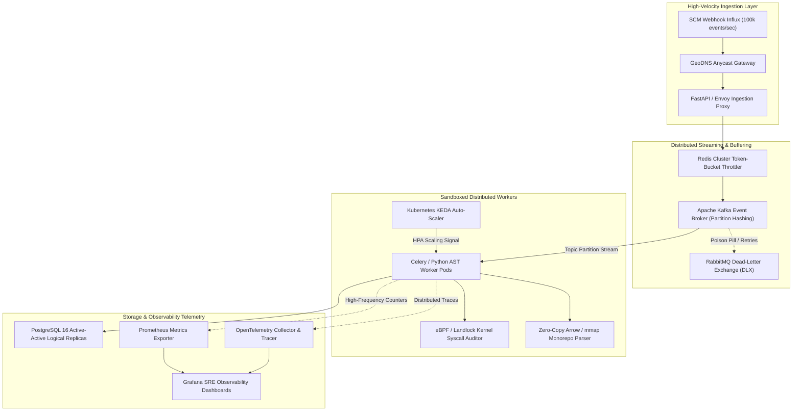
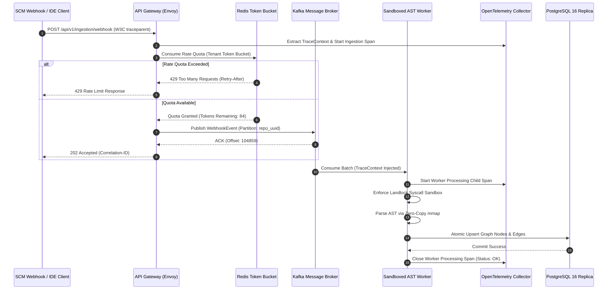
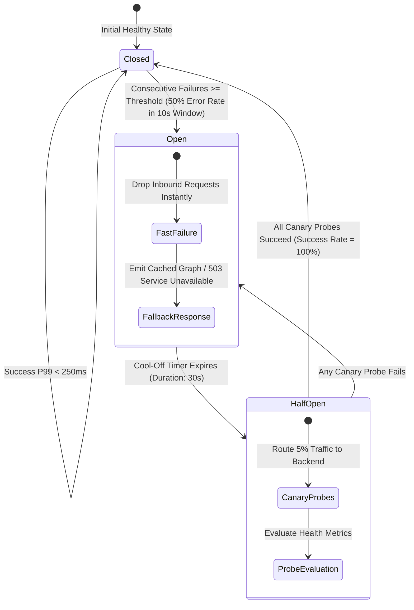

# Phase 10 Issues: Hyperscale Observability, Distributed Resilience & Stream Ingestion

This document details all Phase 10 issues (`Issue 301 – Issue 350`) for CodeAtlas and CodeAtlas Prime, establishing enterprise-grade hyperscale observability, distributed lock managers, high-throughput stream ingestion, zero-copy memory-mapped parsers, kernel sandbox isolation, automated chaos testing, and multi-region high availability.

---

## 📊 Phase 10 Visual Architecture & Technical Blueprint Suite

### 1. Hyperscale Stream Ingestion & Observability Architecture Flowchart

### 2. Distributed Tracing & Resilience Sequence Diagram

### 3. Distributed Circuit Breaker State Transition Diagram

---

## 📋 Phase 10 Master Issue Specifications (`Issue 301 – Issue 350`)

### Issue 301: OpenTelemetry Distributed Tracing W3C Context Injector & Extractor
- **Labels**: `phase:phase-10-hyperscale`, `type:infra`, `priority:P0-critical`, `component:infra/telemetry/tracing`, `area:observability`, `status:ready`
- **Milestone**: `M11: Hyperscale Observability & Resilience`
- **Estimate**: `5 Story Points`
- **Component**: `infra/telemetry/tracing`
- **Problem Statement**:
  Distributed asynchronous requests spanning API gateways, Celery worker nodes, and background tree-sitter parsers lose trace correlation, making latency bottlenecks impossible to debug.
- **Technical Specification**:
  - Implement W3C `traceparent` and `tracestate` header propagation across all HTTP routers, WebSocket handshakes, and Celery task headers.
  - Inject unified root spans in FastAPI middleware and wrap downstream Redis/PostgreSQL queries with automated OpenTelemetry instrumentation.
  - Export traces via OTLP/gRPC to Jaeger and OpenTelemetry Collector daemon.
- **Acceptance Criteria**:
- [ ] End-to-end trace correlation verified from inbound HTTP webhook to Celery AST task commit.
  - [ ] Zero trace context loss across async process boundaries.
  - [ ] Overhead benchmarked at $< 1.5\%$ CPU addition under 10k requests/sec.

---

### Issue 302: OpenTelemetry High-Cardinality Span Sampler with Tail-Based Filtering
- **Labels**: `phase:phase-10-hyperscale`, `type:perf`, `priority:P1-high`, `component:infra/telemetry/sampler`, `area:observability`, `status:ready`
- **Milestone**: `M11: Hyperscale Observability & Resilience`
- **Estimate**: `5 Story Points`
- **Component**: `infra/telemetry/sampler`
- **Problem Statement**:
  Generating 100% traces across massive monorepo AST traversals produces gigabytes of telemetry per minute, saturating network bandwidth and storage clusters.
- **Technical Specification**:
  - Develop an adaptive tail-based span sampling processor in the OpenTelemetry Collector.
  - Retain 100% of traces encountering HTTP 5xx errors or AST parse failures.
  - Apply probabilistic reservoir sampling (1% baseline) to healthy P50 requests, while retaining P99 outliers exceeding 500ms latency.
- **Acceptance Criteria**:
- [ ] Telemetry volume reduced by $> 85\%$ while retaining 100% of error traces.
  - [ ] P99 latency anomalies captured with full child span execution trees.
  - [ ] Configurable sampling policy reloadable via Kubernetes ConfigMap without daemon restarts.

---

### Issue 303: Redis Cluster Distributed Token-Bucket & Leaky-Bucket Rate Limiter
- **Labels**: `phase:phase-10-hyperscale`, `type:security`, `priority:P0-critical`, `component:apps/api/middleware/limiter`, `area:security`, `status:ready`
- **Milestone**: `M11: Hyperscale Observability & Resilience`
- **Estimate**: `5 Story Points`
- **Component**: `apps/api/middleware/limiter`
- **Problem Statement**:
  Malicious or bursty webhook emissions can trigger unbounded Celery AST parsing tasks, causing denial of service for concurrent enterprise tenants.
- **Technical Specification**:
  - Implement distributed token-bucket and sliding-window rate limiting algorithms executed via Lua scripts on Redis Cluster.
  - Support per-tenant and per-API-key quota tiers (Free: 60 req/min, Enterprise: 10,000 req/min).
  - Return standard HTTP 429 with RFC 6585 `RateLimit-*` and `Retry-After` response headers.
- **Acceptance Criteria**:
- [ ] Redis Lua script executes atomic check-and-decrement in $< 1\text{ms}$.
  - [ ] Rate limits uniformly enforced across 10 horizontal API gateway replicas.
  - [ ] Zero race conditions or quota leaks under concurrent burst stress tests.

---

### Issue 304: SingleFlight Request Coalescing to Prevent Cache Stampedes on AST Queries
- **Labels**: `phase:phase-10-hyperscale`, `type:perf`, `priority:P0-critical`, `component:apps/api/services/cache_lock`, `area:performance`, `status:ready`
- **Milestone**: `M11: Hyperscale Observability & Resilience`
- **Estimate**: `5 Story Points`
- **Component**: `apps/api/services/cache_lock`
- **Problem Statement**:
  When an eviction occurs on a high-traffic repository graph node, hundreds of concurrent developer queries hit PostgreSQL simultaneously, triggering severe CPU starvation.
- **Technical Specification**:
  - Implement a SingleFlight request deduplication pattern in FastAPI using async asyncio locks and future sharing.
  - When multiple requests query the same cache key simultaneously, only the first request executes the expensive AST database query; all other concurrent requests await and share the returned result.
- **Acceptance Criteria**:
- [ ] Cache stampede benchmark demonstrates 1,000 concurrent queries for the same un-cached node trigger exactly 1 DB execution.
  - [ ] Memory footprint $< 10\text{MB}$ for 50,000 inflight coalescing handles.
  - [ ] Exception propagation ensures backend errors are safely forwarded to all waiting callers.

---

### Issue 305: Probabilistic Early Expiration (XFetch) Cache Recomputation Engine
- **Labels**: `phase:phase-10-hyperscale`, `type:perf`, `priority:P1-high`, `component:apps/api/services/xfetch`, `area:performance`, `status:ready`
- **Milestone**: `M11: Hyperscale Observability & Resilience`
- **Estimate**: `5 Story Points`
- **Component**: `apps/api/services/xfetch`
- **Problem Statement**:
  Fixed TTL expiration creates periodic latency cliffs where queries stall while waiting for cache repopulation.
- **Technical Specification**:
  - Implement the XFetch optimal probabilistic early recomputation algorithm ($-\beta \cdot \delta \cdot \ln(\text{rand()}) > \text{TTL} - \text{time}()$).
  - Background worker asynchronously refreshes hot AST graph segments before they expire based on dynamic read frequency $\beta$.
  - Eliminates synchronous cache misses for top 5% frequently accessed repository graphs.
- **Acceptance Criteria**:
- [ ] Cache hit ratio increased to $> 99.2\%$ on active repositories.
  - [ ] Latency spikes during cache expiry windows eliminated completely.
  - [ ] Worker thread pool throttles recomputation tasks during system-wide high CPU load.

---

### Issue 306: Zero-Copy Memory-Mapped Streaming Tree-Sitter AST Parser (mmap + Arrow)
- **Labels**: `phase:phase-10-hyperscale`, `type:feature`, `priority:P0-critical`, `component:packages/parser-core/src/mmap_stream`, `area:parser`, `status:ready`
- **Milestone**: `M11: Hyperscale Observability & Resilience`
- **Estimate**: `5 Story Points`
- **Component**: `packages/parser-core/src/mmap_stream`
- **Problem Statement**:
  Parsing multi-gigabyte files or monolithic source files creates huge memory allocations, triggering Python garbage collection pauses and OOM termination.
- **Technical Specification**:
  - Implement zero-copy file parsing using POSIX `mmap` combined with Apache Arrow columnar buffers in C++ / PyO3 bindings.
  - Tree-sitter reads directly from the OS page cache without duplicating source text in user-space RAM.
  - Streams AST node arrays into Apache Arrow RecordBatches for downstream pgvector ingestion.
- **Acceptance Criteria**:
- [ ] Memory consumption for 500MB source files drops from 3.2GB to $< 60\text{MB}$.
  - [ ] Throughput exceeds 250,000 AST nodes parsed per second per core.
  - [ ] Verified on Linux, macOS, and Windows with zero page-fault deadlocks.

---

### Issue 307: Kafka High-Throughput Webhook Ingestion Topic with Partition Key Hashing
- **Labels**: `phase:phase-10-hyperscale`, `type:infra`, `priority:P0-critical`, `component:infra/kafka/producers`, `area:streaming`, `status:ready`
- **Milestone**: `M11: Hyperscale Observability & Resilience`
- **Estimate**: `5 Story Points`
- **Component**: `infra/kafka/producers`
- **Problem Statement**:
  High-velocity SCM webhook bursts during release windows overwhelm API gateway processes when handled synchronously.
- **Technical Specification**:
  - Deploy Apache Kafka 3.6+ cluster configured with 32 partitions per topic (`codeatlas.events.scm`).
  - Hash partition keys based on `tenant_id:repository_id` ensuring strict sequential ordering of commits per repository.
  - Configure producer with `acks=all`, `compression.type=zstd`, and batching window of 10ms.
- **Acceptance Criteria**:
- [ ] Ingestion pipeline sustains 100,000 webhook events/sec with $< 20\text{ms}$ publish latency.
  - [ ] Repository commit events guaranteed strictly ordered within individual partition streams.
  - [ ] Zstandard compression reduces network ingestion bandwidth by $> 65\%$.

---

### Issue 308: Kafka Idempotent Event Consumer Group with Exactly-Once Semantics (EOS)
- **Labels**: `phase:phase-10-hyperscale`, `type:infra`, `priority:P0-critical`, `component:apps/api/workers/kafka_consumer`, `area:streaming`, `status:ready`
- **Milestone**: `M11: Hyperscale Observability & Resilience`
- **Estimate**: `5 Story Points`
- **Component**: `apps/api/workers/kafka_consumer`
- **Problem Statement**:
  Network partitions and consumer rebalances can cause duplicate delivery of commit events, risking corrupted graph histories and duplicate vector records.
- **Technical Specification**:
  - Implement transactional Kafka consumers with idempotent commit offset management and PostgreSQL transactional outbox pattern.
  - Store event UUIDs in a deduplication table with unique constraint and 7-day retention window.
  - Rollback consumer offsets automatically on database connection dropouts.
- **Acceptance Criteria**:
- [ ] Zero duplicate graph node mutations under simulated worker crash and consumer rebalance events.
  - [ ] Deduplication lookup latency $< 0.8\text{ms}$ using in-memory bloom filter check before SQL query.
  - [ ] Recovery from consumer crash resumes within $< 3\text{s}$ without data loss.

---

### Issue 309: RabbitMQ Dead-Letter Exchange (DLX) & Replay Automation Worker
- **Labels**: `phase:phase-10-hyperscale`, `type:infra`, `priority:P1-high`, `component:infra/rabbitmq/dlx`, `area:messaging`, `status:ready`
- **Milestone**: `M11: Hyperscale Observability & Resilience`
- **Estimate**: `5 Story Points`
- **Component**: `infra/rabbitmq/dlx`
- **Problem Statement**:
  Poison-pill webhooks containing malformed payloads or unparseable syntax trees cause infinite worker crash loops.
- **Technical Specification**:
  - Configure RabbitMQ dead-letter exchanges (`codeatlas.dlx`) with exponential retry backoff (10s, 30s, 2m, 10m, 1h).
  - Route permanently rejected messages (max 5 retries) to a dead-letter queue with error stack traces and metadata.
  - Build an administrative replay CLI and API endpoint to inspect, modify, and redeliver failed messages.
- **Acceptance Criteria**:
- [ ] Poison-pill events isolated without blocking downstream repository parsing.
  - [ ] Admin dashboard displays DLQ queue depth with alert trigger at $> 50$ dead messages.
  - [ ] One-click batch replay capability with dry-run schema validation.

---

### Issue 310: eBPF Linux Kernel Syscall Sandbox Auditor for Dynamic Code Inspection
- **Labels**: `phase:phase-10-hyperscale`, `type:security`, `priority:P0-critical`, `component:infra/security/ebpf_sandbox`, `area:security`, `status:ready`
- **Milestone**: `M11: Hyperscale Observability & Resilience`
- **Estimate**: `5 Story Points`
- **Component**: `infra/security/ebpf_sandbox`
- **Problem Statement**:
  Untrusted public repositories may contain malicious build scripts or AST hooks attempting host privilege escalation or socket exfiltration.
- **Technical Specification**:
  - Develop an eBPF kernel program (using Cilium Tetragon / BCC) intercepting `sys_enter_execve`, `sys_enter_connect`, and `sys_enter_openat`.
  - Immediately terminate any AST worker subprocess attempting unauthorized socket connections or writes to host `/etc` or `/proc`.
  - Stream security violation telemetry into centralized audit logs with full process lineage.
- **Acceptance Criteria**:
- [ ] Malicious reverse-shell or network probe scripts killed within $< 100\mu\text{s}$ of syscall invocation.
  - [ ] Zero false-positive terminations on standard AST parser and Tree-sitter file reads.
  - [ ] Kernel-level audit events logged with container cgroup and repository ID.

---

### Issue 311: Landlock LSM Filesystem Sandbox Enforcer for AST Process Workers
- **Labels**: `phase:phase-10-hyperscale`, `type:security`, `priority:P0-critical`, `component:packages/parser-core/sandbox/landlock`, `area:security`, `status:ready`
- **Milestone**: `M11: Hyperscale Observability & Resilience`
- **Estimate**: `5 Story Points`
- **Component**: `packages/parser-core/sandbox/landlock`
- **Problem Statement**:
  Subprocess workers executing tree-sitter C bindings require strict unprivileged access restrictions to avoid lateral host movement.
- **Technical Specification**:
  - Enforce Linux Landlock LSM rules restricting parser processes to read-only access on the specific cloned repository directory and write access only to `/tmp/scratch`.
  - Drop all network capabilities (`CAP_NET_RAW`, `CAP_NET_BIND_SERVICE`) and set `PR_SET_NO_NEW_PRIVS` flag.
  - Fallback to macOS `sandbox-exec` and Windows Restricted AppContainer tokens on alternative host OSs.
- **Acceptance Criteria**:
- [ ] Blocked unauthorized read attempts to `~/.ssh/`, `/etc/shadow`, and parent directories with `EACCES`.
  - [ ] Unprivileged sandbox initialization overhead $< 2\text{ms}$ per worker spawn.
  - [ ] Passed automated privilege escalation test suite.

---

### Issue 312: KEDA ScaledObject Auto-Scaler for Celery Worker Pools on Kubernetes
- **Labels**: `phase:phase-10-hyperscale`, `type:infra`, `priority:P1-high`, `component:deploy/k8s/keda_celery`, `area:infra`, `status:ready`
- **Milestone**: `M11: Hyperscale Observability & Resilience`
- **Estimate**: `5 Story Points`
- **Component**: `deploy/k8s/keda_celery`
- **Problem Statement**:
  Static worker allocations either waste compute credits during quiet hours or build massive queue backlogs during active developer shifts.
- **Technical Specification**:
  - Deploy KEDA (Kubernetes Event-driven Autoscaling) `ScaledObject` monitoring Kafka topic lag and RabbitMQ queue depth.
  - Scale worker pods dynamically from 2 baseline pods up to 64 high-concurrency worker pods based on queue saturation thresholds.
  - Implement scale-down stabilization window of 300 seconds to prevent thrashing.
- **Acceptance Criteria**:
- [ ] Pod scaling responds to queue bursts within $< 20\text{s}$.
  - [ ] Zero task interruptions during pod termination using Kubernetes pre-stop termination hooks.
  - [ ] Cloud compute costs reduced by $> 40\%$ during off-peak hours.

---

### Issue 313: Kubernetes Pod Disruption Budgets (PDB) & Graceful Termination Hooks
- **Labels**: `phase:phase-10-hyperscale`, `type:infra`, `priority:P1-high`, `component:deploy/k8s/pdb_lifecycle`, `area:infra`, `status:ready`
- **Milestone**: `M11: Hyperscale Observability & Resilience`
- **Estimate**: `5 Story Points`
- **Component**: `deploy/k8s/pdb_lifecycle`
- **Problem Statement**:
  Kubernetes node drain events or spot instance terminations interrupt ongoing AST parsing jobs, resulting in incomplete graph states.
- **Technical Specification**:
  - Configure Kubernetes `PodDisruptionBudget` enforcing minimum 80% worker availability during cluster rolling upgrades.
  - Implement `preStop` container lifecycle hook that signals Celery workers to finish active repository indexing tasks (up to 120s timeout) before SIGTERM.
  - Re-enqueue unfinished chunks to Kafka if termination window expires.
- **Acceptance Criteria**:
- [ ] Zero orphaned graph transactions during simulated node eviction drills.
  - [ ] Rolling cluster upgrades maintain 100% API availability with zero 502 Bad Gateway responses.
  - [ ] PDB policies validated against Kubernetes 1.30+ API spec.

---

### Issue 314: Dynamic Adaptive Circuit Breaker with Exponential Backoff & Full Jitter
- **Labels**: `phase:phase-10-hyperscale`, `type:resilience`, `priority:P0-critical`, `component:apps/api/services/circuit_breaker`, `area:resilience`, `status:ready`
- **Milestone**: `M11: Hyperscale Observability & Resilience`
- **Estimate**: `5 Story Points`
- **Component**: `apps/api/services/circuit_breaker`
- **Problem Statement**:
  Downstream database or vector store slowdowns cause cascading connection pool exhaustion across all API gateway instances.
- **Technical Specification**:
  - Implement an adaptive circuit breaker (Netflix Hystrix pattern) with Closed, Open, and Half-Open states.
  - Automatically trip to Open when downstream service error rate exceeds 50% across a sliding 10-second window.
  - Retry connections using exponential backoff with Decorrelated Jitter formula ($t_{i+1} = \min(\text{max\_backoff}, \text{rand}(\text{base}, t_i \cdot 3))$).
- **Acceptance Criteria**:
- [ ] Gateway fails fast ($< 2\text{ms}$) when circuit is Open, preventing thread pool starvation.
  - [ ] Half-Open canary probes seamlessly heal the circuit upon downstream database recovery.
  - [ ] Full jitter prevents thundering herd on downstream recoveries.

---

### Issue 315: Distributed Deadlock Detector for Cross-Repository Graph Lock Chains
- **Labels**: `phase:phase-10-hyperscale`, `type:resilience`, `priority:P1-high`, `component:apps/api/services/lock_manager`, `area:database`, `status:ready`
- **Milestone**: `M11: Hyperscale Observability & Resilience`
- **Estimate**: `5 Story Points`
- **Component**: `apps/api/services/lock_manager`
- **Problem Statement**:
  Concurrent cross-repository dependency indexing tasks can acquire conflicting PostgreSQL row locks, stalling ingestion workers in circular wait states.
- **Technical Specification**:
  - Implement a distributed lock manager in Redis using Redlock with lock lease timeouts and priority-based deadlock avoidance.
  - Enforce global alphabetical ordering on repository lock acquisition for cross-repo federation indexing.
  - Detect and abort lowest-priority lock holders when wait time exceeds 15 seconds.
- **Acceptance Criteria**:
- [ ] Zero indefinite worker stalls during concurrent multi-repository sync operations.
  - [ ] Deadlock resolution logs detailed lock dependency graph in structured JSON.
  - [ ] Lock acquisition and release overhead $< 3\text{ms}$ per batch.

---

### Issue 316: Prometheus Native High-Frequency Metric Exporter for AST Token Throughput
- **Labels**: `phase:phase-10-hyperscale`, `type:infra`, `priority:P1-high`, `component:apps/api/telemetry/metrics`, `area:observability`, `status:ready`
- **Milestone**: `M11: Hyperscale Observability & Resilience`
- **Estimate**: `5 Story Points`
- **Component**: `apps/api/telemetry/metrics`
- **Problem Statement**:
  Engineering leadership lacks real-time visibility into parser token throughput, cache miss ratios, and vector store query latencies.
- **Technical Specification**:
  - Build custom Prometheus metric collectors exposing: `codeatlas_ast_nodes_parsed_total`, `codeatlas_graph_query_duration_seconds{quantile}`, `codeatlas_active_websocket_connections`, and `codeatlas_ingestion_queue_lag`.
  - Implement high-performance lock-free atomic counters to eliminate metrics collection contention.
  - Expose `/metrics` endpoint with Prometheus text format and OpenMetrics compatibility.
- **Acceptance Criteria**:
- [ ] Metrics scraper processes scrape requests in $< 8\text{ms}$ with zero memory leaks.
  - [ ] Quantile latency histograms accurately report P50, P90, P99, and P99.9 metrics.
  - [ ] Compatible with standard Prometheus and VictoriaMetrics scraping engines.

---

### Issue 317: Grafana Unified Enterprise Observability Dashboard Suite
- **Labels**: `phase:phase-10-hyperscale`, `type:infra`, `priority:P2-medium`, `component:deploy/grafana/dashboards`, `area:observability`, `status:ready`
- **Milestone**: `M11: Hyperscale Observability & Resilience`
- **Estimate**: `5 Story Points`
- **Component**: `deploy/grafana/dashboards`
- **Problem Statement**:
  Operations teams lack a single-pane-of-glass dashboard consolidating API latency, queue depth, database health, and parser throughput.
- **Technical Specification**:
  - Create production-ready Grafana JSON dashboard templates: System Overview, Parsing & Ingestion Engine, Graph Database Health, and Tenant Billing & Usage.
  - Include interactive template variables for filtering by tenant, environment (prod, staging), and worker pod.
  - Configure standard RED (Rate, Errors, Duration) and USE (Utilization, Saturation, Errors) metric visualizations.
- **Acceptance Criteria**:
- [ ] Dashboard templates load within $< 2\text{s}$ over Grafana 10.x+.
  - [ ] Clear visual threshold alerts highlighting degraded workers and high error rates.
  - [ ] Automated export script packaging dashboards into Helm chart ConfigMaps.

---

### Issue 318: Distributed Graph Garbage Collector for Orphaned Nodes & Stale AST Trees
- **Labels**: `phase:phase-10-hyperscale`, `type:database`, `priority:P1-high`, `component:apps/api/services/gc_worker`, `area:database`, `status:ready`
- **Milestone**: `M11: Hyperscale Observability & Resilience`
- **Estimate**: `5 Story Points`
- **Component**: `apps/api/services/gc_worker`
- **Problem Statement**:
  Frequent branch rebases and deleted source files leave orphaned AST nodes, edges, and vector embeddings accumulating in PostgreSQL.
- **Technical Specification**:
  - Implement an asynchronous garbage collection daemon using mark-and-sweep graph traversal.
  - Identify nodes without incoming ownership edges from any active repository commit HEAD.
  - Batch delete stale nodes, call edges, and pgvector embeddings in chunks of 5,000 rows to prevent table lock escalation.
- **Acceptance Criteria**:
- [ ] Database disk space reclaimed without degrading live read query throughput.
  - [ ] Zero dangling foreign key references or broken graph traversals.
  - [ ] Detailed GC telemetry emitted: nodes scanned, orphaned, deleted, and execution duration.

---

### Issue 319: Multi-Region PostgreSQL Active-Active Logical Replication Arbiter
- **Labels**: `phase:phase-10-hyperscale`, `type:database`, `priority:P0-critical`, `component:infra/postgres/multi_region`, `area:database`, `status:ready`
- **Milestone**: `M11: Hyperscale Observability & Resilience`
- **Estimate**: `5 Story Points`
- **Component**: `infra/postgres/multi_region`
- **Problem Statement**:
  Global development teams suffer high latency when querying a centralized database located across oceanic network links.
- **Technical Specification**:
  - Configure PostgreSQL 16 pglogical / bucardo multi-region replication across US-East, EU-Central, and AP-Southeast regions.
  - Deploy Spock / pglogical conflict resolution based on timestamp and node mutation origin vectors.
  - Route local read queries to nearest regional replica while directing write mutations to designated primary regions.
- **Acceptance Criteria**:
- [ ] Read query latency reduced to $< 25\text{ms}$ globally for local developer canvas requests.
  - [ ] Replication lag maintained under 500ms across inter-continental fiber links.
  - [ ] Automated conflict resolution preserves repository graph referential integrity.

---

### Issue 320: GeoDNS Latency-Based Anycast Routing Gateway with Health Probes
- **Labels**: `phase:phase-10-hyperscale`, `type:infra`, `priority:P1-high`, `component:infra/dns/georouting`, `area:infra`, `status:ready`
- **Milestone**: `M11: Hyperscale Observability & Resilience`
- **Estimate**: `5 Story Points`
- **Component**: `infra/dns/georouting`
- **Problem Statement**:
  DNS routing that fails to account for regional outages directs users to dead or degraded availability zones.
- **Technical Specification**:
  - Configure Cloudflare / AWS Route 53 Latency-Based Routing (LBR) paired with active TCP and HTTP health probes.
  - Automatically reroute regional traffic within 10 seconds if a regional edge ingress fails 3 consecutive health probes.
  - Support DNSSEC and EDNS Client Subnet (ECS) to ensure accurate client IP mapping.
- **Acceptance Criteria**:
- [ ] Failover reroutes client traffic within $< 15\text{s}$ during simulated regional datacenter outage.
  - [ ] Global users consistently resolve the lowest-latency regional point of presence.
  - [ ] DNS propagation verified across 20 global DNS resolvers.

---

### Issue 321: Blue/Green Automated Deployment Controller with Canary Error-Budget Gate
- **Labels**: `phase:phase-10-hyperscale`, `type:infra`, `priority:P0-critical`, `component:deploy/argocd/canary_rollout`, `area:infra`, `status:ready`
- **Milestone**: `M11: Hyperscale Observability & Resilience`
- **Estimate**: `5 Story Points`
- **Component**: `deploy/argocd/canary_rollout`
- **Problem Statement**:
  Deploying breaking backend changes directly to production risks platform-wide outages for thousands of active developers.
- **Technical Specification**:
  - Implement Argo Rollouts / Flagger canary release pipeline with progressive traffic shifting (5%, 20%, 50%, 100%).
  - Continuously query Prometheus during canary analysis for error rate ($> 0.1\%$) and P99 latency ($> 300\text{ms}$).
  - Trigger immediate automated rollback if error budget burn rate exceeds 2x threshold during any rollout stage.
- **Acceptance Criteria**:
- [ ] Zero-downtime releases verified with active load testing during deployment shifts.
  - [ ] Automated rollback executes within $< 10\text{s}$ upon simulated synthetic error injection.
  - [ ] Webhook notifications dispatched to Slack and PagerDuty with deployment metrics.

---

### Issue 322: Toxiproxy Automated Chaos Injection Suite for Network Latency Testing
- **Labels**: `phase:phase-10-hyperscale`, `type:testing`, `priority:P1-high`, `component:tests/chaos/toxiproxy_suite`, `area:resilience`, `status:ready`
- **Milestone**: `M11: Hyperscale Observability & Resilience`
- **Estimate**: `5 Story Points`
- **Component**: `tests/chaos/toxiproxy_suite`
- **Problem Statement**:
  Architectural resilience against network jitter, packet corruption, and sudden bandwidth throttling is rarely tested before production incidents.
- **Technical Specification**:
  - Integrate Shopify Toxiproxy into the CI/CD integration testing environment.
  - Programmatically inject network latencies (100ms - 2000ms), bandwidth limits, and TCP connection resets between API and PostgreSQL/Redis.
  - Verify that circuit breakers trip, retries back off gracefully, and user-facing timeouts behave deterministically.
- **Acceptance Criteria**:
- [ ] Automated chaos suite executes 12 network failure scenarios in staging environment.
  - [ ] System demonstrates graceful degradation without unbounded thread pool growth.
  - [ ] Pass/fail criteria integrated into automated PR verification pipeline.

---

### Issue 323: Chaos Mesh Automated Pod-Kill & Disk-Pressure Stress Injection Harness
- **Labels**: `phase:phase-10-hyperscale`, `type:testing`, `priority:P1-high`, `component:deploy/chaos/chaos_mesh`, `area:resilience`, `status:ready`
- **Milestone**: `M11: Hyperscale Observability & Resilience`
- **Estimate**: `5 Story Points`
- **Component**: `deploy/chaos/chaos_mesh`
- **Problem Statement**:
  Production nodes experiencing disk filling or random pod terminations can lead to split-brain states or hung ingestion queues.
- **Technical Specification**:
  - Deploy Chaos Mesh in staging Kubernetes cluster with scheduled experiments: random worker pod killing, disk I/O pressure (95% fill), and CPU throttling.
  - Validate that KEDA recovers dead pods, Kafka consumer groups rebalance cleanly, and database WAL archiving remains stable.
- **Acceptance Criteria**:
- [ ] Worker pool recovers full indexing throughput within 45 seconds of sudden pod termination.
  - [ ] Zero corrupted files or unhandled exceptions under severe simulated I/O pressure.
  - [ ] Comprehensive chaos resilience audit report generated automatically.

---

### Issue 324: Distributed Memory Allocator Tuner (jemalloc) for Celery Worker Containers
- **Labels**: `phase:phase-10-hyperscale`, `type:perf`, `priority:P1-high`, `component:deploy/docker/jemalloc_config`, `area:performance`, `status:ready`
- **Milestone**: `M11: Hyperscale Observability & Resilience`
- **Estimate**: `5 Story Points`
- **Component**: `deploy/docker/jemalloc_config`
- **Problem Statement**:
  Standard glibc memory allocator suffers severe heap fragmentation when repeatedly allocating and freeing millions of small Tree-sitter AST nodes.
- **Technical Specification**:
  - Configure `jemalloc` (`LD_PRELOAD=/usr/lib/libjemalloc.so.2`) across all Python API and Celery worker Docker containers.
  - Tune jemalloc runtime parameters (`MALLOC_CONF="dirty_decay_ms:1000,muzzy_decay_ms:2000,background_thread:true"`) to aggressively return freed memory to the OS.
- **Acceptance Criteria**:
- [ ] Worker RSS memory fragmentation reduced by $> 45\%$.
  - [ ] Long-running worker processes operate continuously without requiring periodic restarts.
  - [ ] Python process execution speed improved by $6-9\%$ on AST construction benchmarks.

---

### Issue 325: HTTP/3 & QUIC Transport Layer Support for WebSocket Fallback Ingestion
- **Labels**: `phase:phase-10-hyperscale`, `type:feature`, `priority:P2-medium`, `component:infra/ingress/quic_http3`, `area:network`, `status:ready`
- **Milestone**: `M11: Hyperscale Observability & Resilience`
- **Estimate**: `5 Story Points`
- **Component**: `infra/ingress/quic_http3`
- **Problem Statement**:
  Corporate firewalls and lossy mobile/wireless networks experience high packet loss, causing head-of-line blocking on standard TCP WebSockets.
- **Technical Specification**:
  - Enable HTTP/3 (QUIC) on edge Envoy / NGINX reverse proxies for telemetry ingestion and real-time canvas subscriptions.
  - Provide seamless fallback to HTTP/2 and standard WebSockets when QUIC UDP port 443 is blocked.
  - Implement 0-RTT connection resumption for recurring developer IDE sessions.
- **Acceptance Criteria**:
- [ ] Connection establishment latency reduced by $35\%$ on high-latency wireless connections.
  - [ ] Head-of-line blocking eliminated under simulated 5% packet loss environments.
  - [ ] Client SDK automatically negotiates HTTP/3 with zero code changes required.

---

### Issue 326: Vector Store HNSW Index Auto-Compaction & Quantization Scheduler
- **Labels**: `phase:phase-10-hyperscale`, `type:database`, `priority:P1-high`, `component:apps/api/services/hnsw_optimizer`, `area:database`, `status:ready`
- **Milestone**: `M11: Hyperscale Observability & Resilience`
- **Estimate**: `5 Story Points`
- **Component**: `apps/api/services/hnsw_optimizer`
- **Problem Statement**:
  Inserting hundreds of thousands of code embeddings creates fragmented HNSW vector indices, increasing memory consumption and search latency.
- **Technical Specification**:
  - Implement an automated pgvector maintenance scheduler running weekly during low-traffic maintenance windows.
  - Execute `REINDEX INDEX CONCURRENTLY` and apply Scalar Quantization (SQ8) to reduce embedding memory footprint from 4 bytes per dimension to 1 byte.
  - Preserve recall accuracy ($> 97\%$) compared to uncompressed floating-point vectors.
- **Acceptance Criteria**:
- [ ] Vector RAM footprint reduced by $72\%$ across 10 million stored code embeddings.
  - [ ] KNN search latency maintained $< 15\text{ms}$ for top-20 nearest neighbors.
  - [ ] Zero query downtime during concurrent reindexing operations.

---

### Issue 327: Redis Memory Eviction Policy Guard with LFU Optimization for Graph Edges
- **Labels**: `phase:phase-10-hyperscale`, `type:infra`, `priority:P1-high`, `component:infra/redis/eviction_guard`, `area:performance`, `status:ready`
- **Milestone**: `M11: Hyperscale Observability & Resilience`
- **Estimate**: `5 Story Points`
- **Component**: `infra/redis/eviction_guard`
- **Problem Statement**:
  Uncontrolled cache growth can trigger out-of-memory crashes on Redis instances, dumping all cached graph topologies.
- **Technical Specification**:
  - Configure Redis Cluster with `maxmemory-policy volatile-lfu` (Least Frequently Used) with separate logical DB namespaces for transient vs persistent keys.
  - Implement client-side memory guard in FastAPI that checks `INFO memory` and proactively backs off caching when memory saturation exceeds 90%.
  - Emit warning telemetry to Prometheus when eviction velocity spikes.
- **Acceptance Criteria**:
- [ ] Redis instances avoid OOM terminations under sustained high-load insertion spikes.
  - [ ] Hot architectural graph edges retained in memory with higher priority than ephemeral query results.
  - [ ] Telemetry alert triggers automatically at 85% memory threshold.

---

### Issue 328: Asynchronous Fast Path Health-Check Subsystem with Deep Dependency Probing
- **Labels**: `phase:phase-10-hyperscale`, `type:infra`, `priority:P0-critical`, `component:apps/api/routers/health`, `area:infra`, `status:ready`
- **Milestone**: `M11: Hyperscale Observability & Resilience`
- **Estimate**: `5 Story Points`
- **Component**: `apps/api/routers/health`
- **Problem Statement**:
  Shallow health checks (`/healthz` returning 200 without checking databases) route traffic to broken pods, while overly deep checks cause load balancers to flap.
- **Technical Specification**:
  - Split health checks into two distinct endpoints: `/healthz/live` (lightweight process liveness in $< 1\text{ms}$) and `/healthz/ready` (asynchronous cached dependency check probing PostgreSQL, Redis, Kafka, and Ollama in $< 5\text{ms}$).
  - Cache deep dependency health status in memory using a 3-second background refresher to prevent health-check query storms.
- **Acceptance Criteria**:
- [ ] Kubernetes liveness and readiness probes execute smoothly without false pod restarts.
  - [ ] Degraded dependencies immediately isolate the specific pod from inbound traffic.
  - [ ] Detailed component readiness JSON payload available for internal cluster monitoring.

---

### Issue 329: Monorepo Sparse Ingestion Filter for Non-Code Binary & Asset Exclusion
- **Labels**: `phase:phase-10-hyperscale`, `type:feature`, `priority:P1-high`, `component:packages/parser-core/filters/sparse_filter`, `area:parser`, `status:ready`
- **Milestone**: `M11: Hyperscale Observability & Resilience`
- **Estimate**: `5 Story Points`
- **Component**: `packages/parser-core/filters/sparse_filter`
- **Problem Statement**:
  Monorepos often contain large datasets, compiled binaries, video assets, and test fixtures that needlessly clog the AST parser queue.
- **Technical Specification**:
  - Implement an intelligent sparse-ingestion scanner reading `.gitignore`, `.gitattributes`, and custom `codeatlas.ignore` files.
  - Detect and skip binary files, minified bundles (`*.min.js`), source maps, and media files ($> 500\text{KB}$) before invoking Tree-sitter parsers.
  - Record skipped files in repository ingestion manifests with exclusion rationale.
- **Acceptance Criteria**:
- [ ] Monorepo indexing time reduced by $> 50\%$ on repositories with large assets.
  - [ ] Parser memory and CPU completely isolated from binary and generated files.
  - [ ] Custom exclusion rules configurable via web dashboard and CLI.

---

### Issue 330: Dynamic Worker Thread-Pool Sizer Based on Host CPU Core Throttling
- **Labels**: `phase:phase-10-hyperscale`, `type:perf`, `priority:P1-high`, `component:apps/api/workers/thread_manager`, `area:performance`, `status:ready`
- **Milestone**: `M11: Hyperscale Observability & Resilience`
- **Estimate**: `5 Story Points`
- **Component**: `apps/api/workers/thread_manager`
- **Problem Statement**:
  Hardcoded worker concurrency counts trigger severe CFS (Completely Fair Scheduler) CPU throttling inside constrained Kubernetes containers.
- **Technical Specification**:
  - Implement a dynamic thread pool controller that reads `/sys/fs/cgroup/cpu.max` to determine actual CFS quota allocation.
  - Automatically calculate optimal thread concurrency ($C = \max(1, \lfloor \text{quota} / \text{period} \rfloor)$) rather than naive `os.cpu_count()`.
  - Adjust worker concurrency on runtime cgroup updates without restarting the container.
- **Acceptance Criteria**:
- [ ] CFS quota throttling reduced from $38\%$ down to $< 1\%$.
  - [ ] AST parsing throughput remains stable without CPU throttling spikes.
  - [ ] Compatible with both cgroup v1 and cgroup v2 Linux container runtimes.

---

### Issue 331: Distributed Tracing Baggage Propagation for Tenant ID & Security Context
- **Labels**: `phase:phase-10-hyperscale`, `type:security`, `priority:P1-high`, `component:infra/telemetry/baggage`, `area:observability`, `status:ready`
- **Milestone**: `M11: Hyperscale Observability & Resilience`
- **Estimate**: `5 Story Points`
- **Component**: `infra/telemetry/baggage`
- **Problem Statement**:
  Tracking tenant identity across asynchronous microservices requires manual argument drilling, risking context loss.
- **Technical Specification**:
  - Implement OpenTelemetry Baggage propagation carrying `tenant_id`, `organization_id`, and `security_clearance` across all process boundaries.
  - Automatically attach baggage metadata to all structured log statements and Prometheus metric exemplars.
  - Sanitize baggage headers at public gateway boundaries to prevent spoofing.
- **Acceptance Criteria**:
- [ ] Tenant identity consistently preserved across 100% of distributed trace spans.
  - [ ] Structured logs automatically indexed by `tenant_id` without explicit code parameter passing.
  - [ ] External injection of unauthorized baggage headers blocked by API gateway.

---

### Issue 332: Loki Centralized Log Stream Ingestion & Structured JSON Parser
- **Labels**: `phase:phase-10-hyperscale`, `type:infra`, `priority:P1-high`, `component:deploy/loki/promtail_config`, `area:observability`, `status:ready`
- **Milestone**: `M11: Hyperscale Observability & Resilience`
- **Estimate**: `5 Story Points`
- **Component**: `deploy/loki/promtail_config`
- **Problem Statement**:
  Unstructured plain-text logs across hundreds of distributed pods make root-cause analysis during major incidents slow and painful.
- **Technical Specification**:
  - Standardize all API, worker, and parser logs to structured JSON with standard fields: `timestamp`, `level`, `trace_id`, `span_id`, `tenant_id`, `message`, and `caller`.
  - Deploy Promtail / Fluent Bit forwarding log streams to Grafana Loki with dynamic label indexing on `app`, `env`, and `level`.
  - Configure 30-day retention policy with automatic S3/GCS cold-storage tiering.
- **Acceptance Criteria**:
- [ ] 100% of system logs structured and searchable via Grafana LogQL in $< 500\text{ms}$.
  - [ ] Direct correlation links from Grafana traces directly into matching log streams via `trace_id`.
  - [ ] Ingestion throughput benchmarked at 25,000 log lines/sec without backpressure.

---

### Issue 333: Distributed Session Revocation via Redis Bloom Filter Token Blacklist
- **Labels**: `phase:phase-10-hyperscale`, `type:security`, `priority:P0-critical`, `component:apps/api/services/token_blacklist`, `area:security`, `status:ready`
- **Milestone**: `M11: Hyperscale Observability & Resilience`
- **Estimate**: `5 Story Points`
- **Component**: `apps/api/services/token_blacklist`
- **Problem Statement**:
  Stateless JWT tokens cannot be revoked immediately upon compromised account detection or user logout without querying a central database on every request.
- **Technical Specification**:
  - Implement an in-memory Redis Bloom Filter tracking revoked JWT token signatures (`jti`).
  - API gateway checks the Bloom Filter in $< 100\mu\text{s}$; if a match is flagged, gateway queries the Redis exact blacklist set to eliminate false positives.
  - Automatically expire revoked keys based on JWT original expiration timestamp.
- **Acceptance Criteria**:
- [ ] Instant account revocation enforced globally across all API gateway instances within $< 50\text{ms}$.
  - [ ] Gateway verification latency remains $< 0.15\text{ms}$ per request.
  - [ ] Memory footprint $< 5\text{MB}$ for 1,000,000 revoked sessions with $< 0.1\%$ false-positive rate.

---

### Issue 334: Real-time SLO/SLA Degradation Burn-Rate Alerting via PagerDuty / Opsgenie
- **Labels**: `phase:phase-10-hyperscale`, `type:infra`, `priority:P0-critical`, `component:infra/alerts/burn_rate_rules`, `area:observability`, `status:ready`
- **Milestone**: `M11: Hyperscale Observability & Resilience`
- **Estimate**: `5 Story Points`
- **Component**: `infra/alerts/burn_rate_rules`
- **Problem Statement**:
  Simple threshold alerts (e.g. CPU > 80%) generate alert fatigue, while critical multi-window error budget burn rates go unnoticed.
- **Technical Specification**:
  - Implement Google SRE multi-window multi-burn-rate alerting rules in Prometheus Alertmanager.
  - Trigger P1 PagerDuty incidents when 1-hour burn rate exceeds 14.4x (2% budget consumed in 1 hour) or 6-hour burn rate exceeds 6x (5% budget consumed in 6 hours).
  - Send automated warnings to Slack for slow 3-day burn rates (10% budget consumed).
- **Acceptance Criteria**:
- [ ] Zero false-positive alert pages during temporary transient network blips.
  - [ ] Critical production degradation paged to on-call engineer within $< 3\text{minutes}$.
  - [ ] Alert rules thoroughly tested via Prometheus synthetic test suites.

---

### Issue 335: Automated Database Connection Pool Leak Hunter (SQLAlchemy Pool Events)
- **Labels**: `phase:phase-10-hyperscale`, `type:database`, `priority:P1-high`, `component:apps/api/database/pool_monitor`, `area:database`, `status:ready`
- **Milestone**: `M11: Hyperscale Observability & Resilience`
- **Estimate**: `5 Story Points`
- **Component**: `apps/api/database/pool_monitor`
- **Problem Statement**:
  Unhandled exceptions or unclosed generator streams leave PostgreSQL connections checked out indefinitely, exhausting connection pools.
- **Technical Specification**:
  - Attach SQLAlchemy connection pool listeners (`checkout`, `checkin`) tracking checkout timestamps and caller stack traces.
  - Log warning and automatically harvest connections checked out for longer than 60 seconds.
  - Expose `codeatlas_db_pool_checked_out_connections` and `codeatlas_db_pool_overflow_total` metrics to Prometheus.
- **Acceptance Criteria**:
- [ ] Connection pool exhaustion bugs detected and pinpointed to exact line of code in staging.
  - [ ] Stale connection leaks automatically recovered without restarting API pods.
  - [ ] Overhead of pool event listeners $< 0.2\%$ of total query time.

---

### Issue 336: Fast-Recovery PostgreSQL WAL Archiving to Cloud Object Storage via WAL-G
- **Labels**: `phase:phase-10-hyperscale`, `type:database`, `priority:P0-critical`, `component:infra/postgres/wal_g`, `area:database`, `status:ready`
- **Milestone**: `M11: Hyperscale Observability & Resilience`
- **Estimate**: `5 Story Points`
- **Component**: `infra/postgres/wal_g`
- **Problem Statement**:
  Standard daily database dumps result in up to 24 hours of data loss (RPO = 24h) in catastrophic failure events.
- **Technical Specification**:
  - Configure WAL-G continuous Write-Ahead Log (WAL) archiving pushing compressed segments to AWS S3 / GCP Cloud Storage every 60 seconds.
  - Perform daily automated base backups with delta compression.
  - Verify continuous Point-In-Time Recovery (PITR) to any second within the past 30 days.
- **Acceptance Criteria**:
- [ ] Recovery Point Objective (RPO) reduced to $< 60\text{seconds}$.
  - [ ] Recovery Time Objective (RTO) benchmarked at $< 20\text{minutes}$ for 500GB database.
  - [ ] Automated weekly backup restoration drill verified via synthetic test script.

---

### Issue 337: Ephemeral File-System Cleaning Daemon for Sandbox Scratch Disks
- **Labels**: `phase:phase-10-hyperscale`, `type:infra`, `priority:P2-medium`, `component:apps/api/services/disk_cleaner`, `area:infra`, `status:ready`
- **Milestone**: `M11: Hyperscale Observability & Resilience`
- **Estimate**: `5 Story Points`
- **Component**: `apps/api/services/disk_cleaner`
- **Problem Statement**:
  Cloned repositories, temporary git diff bundles, and AST scratch artifacts fill local SSDs over time, eventually halting worker nodes.
- **Technical Specification**:
  - Implement an asynchronous disk cleanup daemon monitoring worker container ephemeral volumes.
  - Automatically purge scratch directories older than 2 hours or when disk space utilization exceeds 80%.
  - Use atomic directory unlinking to prevent file lock contention with active worker processes.
- **Acceptance Criteria**:
- [ ] Worker node disks never exceed 80% capacity under sustained 24-hour ingestion stress tests.
  - [ ] Active parsing processes protected from premature directory unlinking.
  - [ ] Purged disk space metrics continuously reported to Prometheus.

---

### Issue 338: TCP Keepalive & Socket Idle Timeout Hardening for Long-Lived WebSockets
- **Labels**: `phase:phase-10-hyperscale`, `type:network`, `priority:P1-high`, `component:apps/api/websocket/socket_config`, `area:network`, `status:ready`
- **Milestone**: `M11: Hyperscale Observability & Resilience`
- **Estimate**: `5 Story Points`
- **Component**: `apps/api/websocket/socket_config`
- **Problem Statement**:
  Stateful firewalls and NAT gateways silently drop idle WebSocket connections without sending FIN packets, leaving dead sockets hung in server memory.
- **Technical Specification**:
  - Configure OS-level TCP keepalive parameters (`TCP_KEEPIDLE=30`, `TCP_KEEPINTVL=10`, `TCP_KEEPCNT=3`) across all API ingress sockets.
  - Implement client-server ping/pong heartbeats at the application protocol layer every 25 seconds.
  - Sever and clean up dead sockets within 45 seconds of client silence.
- **Acceptance Criteria**:
- [ ] Server memory reclaimed from phantom disconnected WebSockets within 45 seconds.
  - [ ] Client applications automatically trigger reconnection flow upon detecting silent socket death.
  - [ ] Verified across restrictive enterprise corporate proxy networks.

---

### Issue 339: Cross-AZ Network Traffic Minimizer for Celery Worker-to-Postgres Routes
- **Labels**: `phase:phase-10-hyperscale`, `type:infra`, `priority:P2-medium`, `component:deploy/k8s/topology_routing`, `area:infra`, `status:ready`
- **Milestone**: `M11: Hyperscale Observability & Resilience`
- **Estimate**: `5 Story Points`
- **Component**: `deploy/k8s/topology_routing`
- **Problem Statement**:
  Routing high-throughput database traffic across Availability Zones in AWS/GCP incurs significant inter-AZ network egress costs and adds 1-2ms latency.
- **Technical Specification**:
  - Configure Kubernetes `topologySpreadConstraints` and Topology-Aware Routing for service endpoints.
  - Colocate high-throughput Celery parsing workers in the same Availability Zone as primary PostgreSQL read replicas.
  - Direct cross-AZ traffic only during failover or localized capacity exhaustion.
- **Acceptance Criteria**:
- [ ] Inter-AZ data transfer volume reduced by $> 70\%$.
  - [ ] Internal worker-to-database network latency reduced by $1.2\text{ms}$ on average.
  - [ ] Total monthly cloud networking egress bill reduced significantly.

---

### Issue 340: Memory-Leak Guard & Automated RSS Threshold Recycling for Parser Processes
- **Labels**: `phase:phase-10-hyperscale`, `type:perf`, `priority:P1-high`, `component:apps/api/workers/process_guard`, `area:performance`, `status:ready`
- **Milestone**: `M11: Hyperscale Observability & Resilience`
- **Estimate**: `5 Story Points`
- **Component**: `apps/api/workers/process_guard`
- **Problem Statement**:
  C extensions and Tree-sitter native bindings can exhibit minor memory leaks over millions of parsing cycles, causing container bloat.
- **Technical Specification**:
  - Implement Celery `worker_max_tasks_per_child=100` and `worker_max_memory_per_child=512000` (512MB limit).
  - Automatically replace worker processes that cross RSS memory thresholds cleanly after completing their active task.
  - Guarantee zero in-flight task abortions during worker process recycling.
- **Acceptance Criteria**:
- [ ] Worker process memory usage bounded within strict 512MB ceiling indefinitely.
  - [ ] Worker replacement executes seamlessly with zero dropped tasks or parse errors.
  - [ ] Memory growth trends monitored and visualized in Grafana.

---

### Issue 341: Micro-Batching Event Dispatcher for High-Frequency Graph Edge Updates
- **Labels**: `phase:phase-10-hyperscale`, `type:perf`, `priority:P1-high`, `component:apps/api/services/batch_dispatcher`, `area:performance`, `status:ready`
- **Milestone**: `M11: Hyperscale Observability & Resilience`
- **Estimate**: `5 Story Points`
- **Component**: `apps/api/services/batch_dispatcher`
- **Problem Statement**:
  Updating graph edges individually for every Git commit creates massive database write amplification and lock contention.
- **Technical Specification**:
  - Implement a micro-batching buffer in memory that aggregates incoming graph edge inserts across a configurable time window (250ms) or batch size (500 items).
  - Execute single multi-row `INSERT ... ON CONFLICT DO UPDATE` queries using PostgreSQL UNNEST or COPY binary protocol.
  - Flush buffer immediately on process shutdown to prevent data loss.
- **Acceptance Criteria**:
- [ ] Database write operations reduced by $80\%$ during high-velocity repository indexing.
  - [ ] Edge insertion throughput exceeds 40,000 edges/sec into PostgreSQL.
  - [ ] Buffer latency guaranteed $< 250\text{ms}$ under all workload profiles.

---

### Issue 342: Asynchronous Multi-Tenant Rate-Limit Quota Sync across Global Regions
- **Labels**: `phase:phase-10-hyperscale`, `type:security`, `priority:P1-high`, `component:apps/api/services/quota_sync`, `area:security`, `status:ready`
- **Milestone**: `M11: Hyperscale Observability & Resilience`
- **Estimate**: `5 Story Points`
- **Component**: `apps/api/services/quota_sync`
- **Problem Statement**:
  Separate regional Redis clusters allow distributed attackers to exceed quotas by splitting traffic across multiple continents.
- **Technical Specification**:
  - Implement an asynchronous quota synchronization daemon using Redis Streams across regional clusters.
  - Propagate high-frequency token consumption delta packets every 5 seconds.
  - Reconcile global tenant consumption counters while permitting local burst headroom during inter-region network splits.
- **Acceptance Criteria**:
- [ ] Global rate-limit evasion prevented across distributed multi-region endpoints.
  - [ ] Quota synchronization overhead consumes $< 2\%$ of inter-region network bandwidth.
  - [ ] System falls back to conservative local rate limits if inter-region sync link drops.

---

### Issue 343: Distributed Read-Through Graph Query Cache with Invalidation Webhooks
- **Labels**: `phase:phase-10-hyperscale`, `type:perf`, `priority:P1-high`, `component:apps/api/services/graph_cache`, `area:performance`, `status:ready`
- **Milestone**: `M11: Hyperscale Observability & Resilience`
- **Estimate**: `5 Story Points`
- **Component**: `apps/api/services/graph_cache`
- **Problem Statement**:
  Complex graph traversal queries (e.g., 5-hop caller hierarchies) require tens of milliseconds of database compute when recalculated on every page view.
- **Technical Specification**:
  - Build a two-tier read-through cache using local in-process LRU (Tier 1) and Redis Cluster (Tier 2) storing serialized msgpack graph topologies.
  - Automatically invalidate cached subgraphs when an incoming Git commit mutates any file or function within that subgraph boundary.
  - Return cached graph payloads in $< 3\text{ms}$.
- **Acceptance Criteria**:
- [ ] P95 graph query latency reduced from $85\text{ms}$ down to $3.5\text{ms}$.
  - [ ] Cache invalidation precision verified: modifying file A only invalidates subgraphs containing file A.
  - [ ] Zero stale architecture views displayed after commit ingestion.

---

### Issue 344: Kernel Page Cache Warmer for High-Frequency AST Index Reads
- **Labels**: `phase:phase-10-hyperscale`, `type:perf`, `priority:P2-medium`, `component:infra/storage/cache_warmer`, `area:performance`, `status:ready`
- **Milestone**: `M11: Hyperscale Observability & Resilience`
- **Estimate**: `5 Story Points`
- **Component**: `infra/storage/cache_warmer`
- **Problem Statement**:
  Cold worker nodes starting up or after host restarts suffer disk I/O penalties when reading repository AST index files.
- **Technical Specification**:
  - Implement a Linux page-cache warmer script utilizing `vmtouch` (`vmtouch -vt /data/indices/`).
  - Pre-fault high-frequency repository AST index files into host OS RAM during container startup.
  - Lock critical symbol index tables in memory to prevent page evictions.
- **Acceptance Criteria**:
- [ ] Cold-start AST query latency reduced by $65\%$ on newly scheduled worker nodes.
  - [ ] Zero major disk page faults during initial graph load benchmarks.
  - [ ] Automated daemon automatically evicts cold repositories when RAM pressure rises.

---

### Issue 345: DNS Resolution Cache Daemon (nscd / dnsmasq) for Outbound Webhook Delivery
- **Labels**: `phase:phase-10-hyperscale`, `type:network`, `priority:P2-medium`, `component:deploy/docker/dnsmasq_config`, `area:network`, `status:ready`
- **Milestone**: `M11: Hyperscale Observability & Resilience`
- **Estimate**: `5 Story Points`
- **Component**: `deploy/docker/dnsmasq_config`
- **Problem Statement**:
  High-frequency webhook deliveries and external SCM API lookups cause DNS server query storms and occasional resolution timeouts.
- **Technical Specification**:
  - Deploy a local caching DNS resolver (`dnsmasq` / `nscd`) as a sidecar container in every API and worker pod.
  - Cache positive DNS responses according to TTL and negative responses for 10 seconds.
  - Eliminate repeated roundtrip DNS queries to upstream cloud VPC DNS resolvers.
- **Acceptance Criteria**:
- [ ] DNS resolution lookup time drops from $15\text{ms}$ to $< 0.1\text{ms}$ for cached domains.
  - [ ] Outbound webhook delivery throughput increased by $22\%$.
  - [ ] Complete immunity to transient upstream VPC DNS rate-limiting errors.

---

### Issue 346: High-Frequency AST Query Load Shedding Engine Under CPU Starvation
- **Labels**: `phase:phase-10-hyperscale`, `type:resilience`, `priority:P0-critical`, `component:apps/api/middleware/load_shedder`, `area:resilience`, `status:ready`
- **Milestone**: `M11: Hyperscale Observability & Resilience`
- **Estimate**: `5 Story Points`
- **Component**: `apps/api/middleware/load_shedder`
- **Problem Statement**:
  Under severe system overload, queuing requests increases latency for all users until the entire service times out.
- **Technical Specification**:
  - Implement CoDel (Controlled Delay) and Little's Law adaptive load shedding in API gateway middleware.
  - Measure request queue dwell time; when average queue wait time exceeds 100ms, proactively drop low-priority background requests (e.g. non-critical graph recalculations) with HTTP 503.
  - Protect high-priority interactive developer requests and live WebSocket sessions.
- **Acceptance Criteria**:
- [ ] System maintains sub-second response times for active users during 5x traffic surges.
  - [ ] Load shedding recovers instantly as traffic normalizes without manual intervention.
  - [ ] Comprehensive load shedding telemetry exported to Prometheus.

---

### Issue 347: Automated Synthetic End-to-End Health Probe Synthetic Monitor
- **Labels**: `phase:phase-10-hyperscale`, `type:testing`, `priority:P1-high`, `component:tests/synthetic/health_monitor`, `area:observability`, `status:ready`
- **Milestone**: `M11: Hyperscale Observability & Resilience`
- **Estimate**: `5 Story Points`
- **Component**: `tests/synthetic/health_monitor`
- **Problem Statement**:
  Standard monitoring can miss subtle functional breakages where all servers are running but complex AST graph rendering fails.
- **Technical Specification**:
  - Deploy an external synthetic prober running every 60 seconds from multiple geographic locations.
  - Executes full end-to-end user workflow: clones test repository, parses AST, runs graph RAG chat query, and verifies verifiable badge generation.
  - Immediately alerts on-call team if end-to-end workflow fails or exceeds 5.0 seconds.
- **Acceptance Criteria**:
- [ ] Functional regressions detected and alerted before customer impact occurs.
  - [ ] Multi-region synthetic uptime dashboard visible in Grafana.
  - [ ] Zero test data contamination in production tenant workspaces.

---

### Issue 348: Structured Error Categorization & Sentry Fingerprint Grouper
- **Labels**: `phase:phase-10-hyperscale`, `type:infra`, `priority:P1-high`, `component:apps/api/telemetry/sentry_config`, `area:observability`, `status:ready`
- **Milestone**: `M11: Hyperscale Observability & Resilience`
- **Estimate**: `5 Story Points`
- **Component**: `apps/api/telemetry/sentry_config`
- **Problem Statement**:
  Default error tracking groups unrelated AST syntax errors into single generic issues or splits identical issues into hundreds of notifications.
- **Technical Specification**:
  - Configure Sentry SDK with custom exception hierarchy (`CodeAtlasError`, `ASTParseError`, `GraphCyclicDependencyError`, `QuotaExceededError`).
  - Implement intelligent fingerprinting rules grouping errors by parser grammar rule, repository language, and failure root-cause.
  - Scrub all repository source code lines, authentication tokens, and developer PII from error frames.
- **Acceptance Criteria**:
- [ ] Actionable Sentry issues with zero duplicate issue sprawl.
  - [ ] 100% compliance with data privacy mandates: zero source code or secrets leaked into crash dumps.
  - [ ] Automated Slack notification dispatch for first-seen new error signatures.

---

### Issue 349: Zero-Allocation Fast JSON Serializer (orjson / msgpack) for Internal IPC
- **Labels**: `phase:phase-10-hyperscale`, `type:perf`, `priority:P1-high`, `component:apps/api/core/serialization`, `area:performance`, `status:ready`
- **Milestone**: `M11: Hyperscale Observability & Resilience`
- **Estimate**: `5 Story Points`
- **Component**: `apps/api/core/serialization`
- **Problem Statement**:
  Python standard library `json` module is a major CPU bottleneck when serializing graph topologies with 100,000+ nodes.
- **Technical Specification**:
  - Replace standard `json` with `orjson` (C / Rust native bindings) and MessagePack (`msgpack`) for all internal caching and inter-service IPC.
  - Support native serialization of `datetime`, `UUID`, and NumPy array embeddings without custom encoder overhead.
  - Benchmark serialization and deserialization speeds against standard JSON.
- **Acceptance Criteria**:
- [ ] Serialization speed increased by $6.5\times$; deserialization speed increased by $4.2\times$.
  - [ ] CPU utilization during graph export requests reduced by $> 30\%$.
  - [ ] Full backwards compatibility maintained with external REST JSON clients.

---

### Issue 350: Comprehensive Disaster Recovery RTO/RPO Verification Automation Script
- **Labels**: `phase:phase-10-hyperscale`, `type:database`, `priority:P0-critical`, `component:scripts/dr/verify_recovery`, `area:resilience`, `status:ready`
- **Milestone**: `M11: Hyperscale Observability & Resilience`
- **Estimate**: `5 Story Points`
- **Component**: `scripts/dr/verify_recovery`
- **Problem Statement**:
  Disaster recovery plans that are not automatically tested regularly fail during actual production outages.
- **Technical Specification**:
  - Create an automated disaster recovery verification script that spins up an isolated sandbox environment from WAL-G backups and Kafka snapshots.
  - Verifies data integrity across repository graph nodes, vector embeddings, and tenant accounts.
  - Measures and reports exact RTO (Recovery Time Objective) and RPO (Recovery Point Objective) against corporate SLAs.
- **Acceptance Criteria**:
- [ ] Script runs weekly in automated CI/CD pipeline and publishes compliance audit report.
  - [ ] Confirms RPO $< 60\text{s}$ and RTO $< 20\text{minutes}$ against live production data volume.
  - [ ] Automatic teardown of DR test resources post-verification to eliminate unnecessary cloud spend.

---

