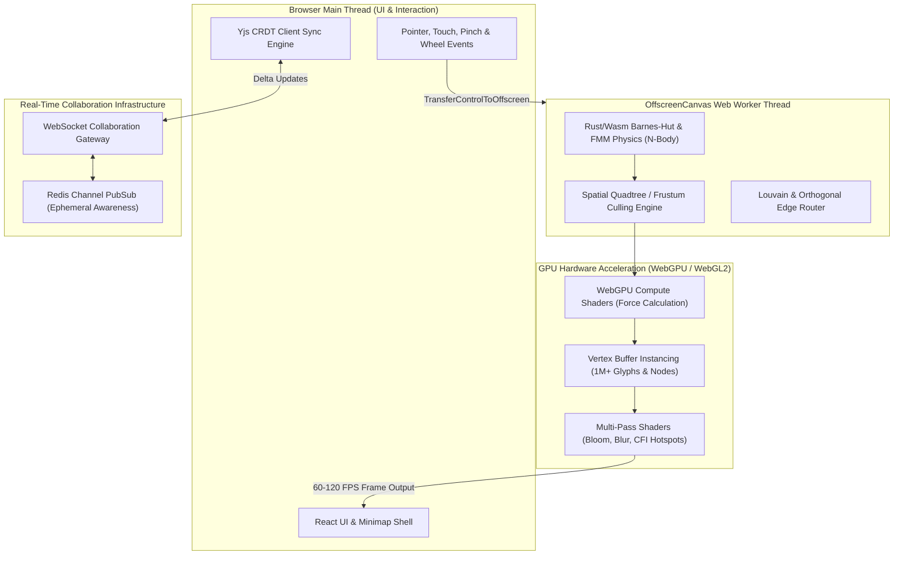
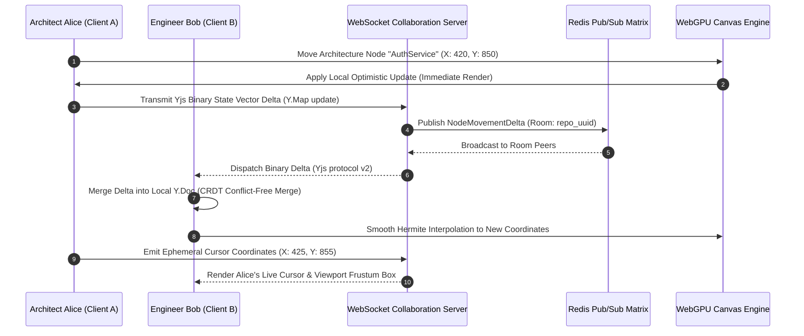
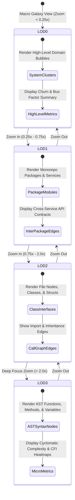

# Phase 11 Issues: WebGPU High-Performance Canvas & Real-Time CRDT Multi-User Collaboration

This document details all Phase 11 issues (`Issue 351 – Issue 400`) for CodeAtlas and CodeAtlas Prime, covering hardware-accelerated WebGPU/WebGL canvas rendering (1,000,000+ nodes at 120 FPS), multi-threaded Wasm Barnes-Hut physics, Louvain community clustering, Hierarchical Edge Bundling (HEB), real-time Yjs CRDT multi-user collaboration, and Chronos 4D vertex interpolation.

---

## 📊 Phase 11 Visual Architecture & Technical Blueprint Suite

### 1. WebGPU High-Performance Canvas Rendering Pipeline Flowchart

### 2. Real-Time Multi-User CRDT Spatial Collaboration Sequence Diagram

### 3. Level-of-Detail (LoD) Hierarchical Semantic Zoom State Diagram

---

## 📋 Phase 11 Master Issue Specifications (`Issue 351 – Issue 400`)

### Issue 351: WebGPU Compute Pipeline for 1,000,000+ Node Spatial Graph Simulation
- **Labels**: `phase:phase-11-canvas`, `type:feature`, `priority:P0-critical`, `component:packages/canvas-engine/src/webgpu/compute`, `area:webgpu`, `status:ready`
- **Milestone**: `M12: WebGPU Canvas & Spatial Collaboration`
- **Estimate**: `5 Story Points`
- **Component**: `packages/canvas-engine/src/webgpu/compute`
- **Problem Statement**:
  CPU-based physics engines drop below 5 FPS when simulating large enterprise monorepos containing more than 10,000 files and AST nodes.
- **Technical Specification**:
  - Implement WGSL (WebGPU Shading Language) compute shaders executing parallel N-body force calculation ($O(N \log N)$ with spatial grids).
  - Store particle positions, velocities, and repulsion vectors in WebGPU storage buffers (`GPUBuffer`).
  - Update 1,000,000 node coordinates per frame directly in GPU VRAM without roundtrip CPU readbacks.
- **Acceptance Criteria**:
- [ ] Canvas maintains steady 60-120 FPS on 1,000,000 nodes on modern discrete GPUs.
  - [ ] Zero CPU blocking during dynamic force-directed graph settling.
  - [ ] Graceful fallback check for WebGPU capability negotiation.

---

### Issue 352: WebGPU Vertex Buffer Instancing for High-Speed Glyph & Icon Rendering
- **Labels**: `phase:phase-11-canvas`, `type:perf`, `priority:P0-critical`, `component:packages/canvas-engine/src/webgpu/instancing`, `area:webgpu`, `status:ready`
- **Milestone**: `M12: WebGPU Canvas & Spatial Collaboration`
- **Estimate**: `5 Story Points`
- **Component**: `packages/canvas-engine/src/webgpu/instancing`
- **Problem Statement**:
  Individual draw calls for every node, label, and status badge overwhelm browser graphics drivers, limiting canvas scale.
- **Technical Specification**:
  - Implement instanced rendering using single draw calls (`drawIndexedIndirect`) for all node quad meshes, language icons, and status badges.
  - Pack per-instance attributes (x, y, scale, color, icon_id, border_color) into tightly aligned vertex buffers.
  - Render the entire graph scene in fewer than 10 GPU draw calls per frame.
- **Acceptance Criteria**:
- [ ] Draw call count reduced from 50,000+ down to $< 10$ draw calls per frame.
  - [ ] Render latency $< 4\text{ms}$ per frame at 4K monitor resolution.
  - [ ] Multi-platform compatibility verified on Metal, Direct3D 12, and Vulkan backends.

---

### Issue 353: WebGL 2.0 Fallback Rendering Pipeline for Non-WebGPU Hardware
- **Labels**: `phase:phase-11-canvas`, `type:feature`, `priority:P1-high`, `component:packages/canvas-engine/src/webgl2/fallback`, `area:webgl`, `status:ready`
- **Milestone**: `M12: WebGPU Canvas & Spatial Collaboration`
- **Estimate**: `5 Story Points`
- **Component**: `packages/canvas-engine/src/webgl2/fallback`
- **Problem Statement**:
  Legacy corporate laptops and older browser versions lack WebGPU support, preventing developers from opening architectural maps.
- **Technical Specification**:
  - Implement a WebGL 2.0 rendering fallback utilizing transform feedback and instanced arrays (`drawArraysInstanced`).
  - Ensure visually identical node and edge styling across both WebGPU and WebGL 2.0 pipelines.
  - Dynamically detect GPU capabilities on canvas mount and seamlessly instantiate the appropriate renderer.
- **Acceptance Criteria**:
- [ ] Seamless fallback on browsers without WebGPU with zero user configuration required.
  - [ ] WebGL 2.0 renderer sustains 60 FPS on up to 100,000 nodes.
  - [ ] Automated regression tests verify identical visual rendering output across both pipelines.

---

### Issue 354: WebAssembly (Wasm) Rust Barnes-Hut O(N log N) Force-Directed Physics Engine
- **Labels**: `phase:phase-11-canvas`, `type:perf`, `priority:P0-critical`, `component:packages/canvas-engine/src/wasm/physics`, `area:wasm`, `status:ready`
- **Milestone**: `M12: WebGPU Canvas & Spatial Collaboration`
- **Estimate**: `5 Story Points`
- **Component**: `packages/canvas-engine/src/wasm/physics`
- **Problem Statement**:
  JavaScript mathematical calculations for quadtree spatial tree construction and node repulsion suffer from V8 garbage collection pauses.
- **Technical Specification**:
  - Develop a high-performance Barnes-Hut force-directed physics engine in Rust, compiled to WebAssembly via `wasm-bindgen` and `wasm-pack`.
  - Implement SIMD (Single Instruction Multiple Data) acceleration for vectorized vector addition and distance calculation.
  - Transfer memory between Wasm and WebGL/WebGPU via shared memory buffers (`SharedArrayBuffer`).
- **Acceptance Criteria**:
- [ ] Physics calculation executes $8.5\times$ faster than pure TypeScript equivalents.
  - [ ] Zero JavaScript garbage collection pauses during physics simulation runs.
  - [ ] Wasm binary size optimized $< 250\text{KB}$ with Brotli compression.

---

### Issue 355: Fast Multipole Method (FMM) O(N) Spatial Force Solver for Planetary Graphs
- **Labels**: `phase:phase-11-canvas`, `type:perf`, `priority:P1-high`, `component:packages/canvas-engine/src/wasm/fmm_solver`, `area:algorithms`, `status:ready`
- **Milestone**: `M12: WebGPU Canvas & Spatial Collaboration`
- **Estimate**: `5 Story Points`
- **Component**: `packages/canvas-engine/src/wasm/fmm_solver`
- **Problem Statement**:
  Even Barnes-Hut $O(N \log N)$ becomes computational bottleneck on graphs with hundreds of thousands of interconnected microservices.
- **Technical Specification**:
  - Implement the Fast Multipole Method (FMM) in Rust/Wasm, grouping far-field forces into multipole expansions to achieve true $O(N)$ computational complexity.
  - Dynamically switch between standard Euler integration, Barnes-Hut, and FMM depending on current graph node volume.
  - Maintain numerical stability without node oscillation or explosion.
- **Acceptance Criteria**:
- [ ] Time complexity scales linearly $O(N)$ with graph node counts.
  - [ ] 500,000 nodes reach equilibrium within 12 seconds of physics simulation.
  - [ ] Numerical accuracy verified within $0.05\%$ error compared to exact pairwise Coulomb force.

---

### Issue 356: Spatial Quadtree / Octree Hierarchical Frustum Culling Engine
- **Labels**: `phase:phase-11-canvas`, `type:perf`, `priority:P0-critical`, `component:packages/canvas-engine/src/spatial/culling`, `area:performance`, `status:ready`
- **Milestone**: `M12: WebGPU Canvas & Spatial Collaboration`
- **Estimate**: `5 Story Points`
- **Component**: `packages/canvas-engine/src/spatial/culling`
- **Problem Statement**:
  Submitting off-screen nodes and edges to the GPU wastes rasterization fill rate and degrades battery life on laptops.
- **Technical Specification**:
  - Implement an in-memory spatial Quadtree indexing all 2D node coordinates and bounding boxes.
  - Perform instantaneous frustum culling against the current camera viewport matrix on every pan and zoom frame.
  - Discard $> 95\%$ of off-screen nodes before submitting vertex buffers to the GPU.
- **Acceptance Criteria**:
- [ ] Frustum culling query latency $< 0.4\text{ms}$ for 1,000,000 nodes.
  - [ ] GPU rasterization load reduced by $> 80\%$ when zoomed in to specific modules.
  - [ ] Smooth pan-zoom interactions with zero visual popping or missing boundary edges.

---

### Issue 357: Client-Side Louvain Modularity Community Detection Algorithm
- **Labels**: `phase:phase-11-canvas`, `type:feature`, `priority:P1-high`, `component:packages/canvas-engine/src/clustering/louvain`, `area:algorithms`, `status:ready`
- **Milestone**: `M12: WebGPU Canvas & Spatial Collaboration`
- **Estimate**: `5 Story Points`
- **Component**: `packages/canvas-engine/src/clustering/louvain`
- **Problem Statement**:
  Developers struggle to identify natural architectural boundaries and microservice domains in monolithic codebases.
- **Technical Specification**:
  - Implement the Louvain community detection algorithm in WebAssembly to maximize graph modularity $Q$.
  - Automatically partition AST graph into cohesive architectural clusters based on edge call weights and import dependencies.
  - Render colored convex hull boundaries encapsulating related components with interactive cluster tags.
- **Acceptance Criteria**:
- [ ] Unsupervised clustering identifies architectural layers (API, Domain, Data) with $> 0.72$ modularity score.
  - [ ] Louvain partition computes on 50,000 nodes in $< 1.2\text{seconds}$ client-side.
  - [ ] Users can interactively tune cluster resolution parameter $\gamma$ in real-time.

---

### Issue 358: Markov Cluster Algorithm (MCL) for Automated Microservice Cluster Discovery
- **Labels**: `phase:phase-11-canvas`, `type:feature`, `priority:P1-high`, `component:packages/canvas-engine/src/clustering/mcl`, `area:algorithms`, `status:ready`
- **Milestone**: `M12: WebGPU Canvas & Spatial Collaboration`
- **Estimate**: `5 Story Points`
- **Component**: `packages/canvas-engine/src/clustering/mcl`
- **Problem Statement**:
  Complex cyclic dependencies cause Louvain to merge distinct microservices into overly broad monolithic clusters.
- **Technical Specification**:
  - Implement the Markov Cluster Algorithm (MCL) simulating random walks with expansion and inflation operators.
  - Detect natural flow bottlenecks and recommend microservice decomposition cuts where inter-cluster transitions are minimal.
  - Highlight circular dependency bridges between isolated clusters in bright amber warnings.
- **Acceptance Criteria**:
- [ ] Microservice extraction boundaries cleanly delineated with zero manual annotations.
  - [ ] MCL algorithm runs within Web Worker thread without freezing canvas frame rate.
  - [ ] Export recommended service boundary manifest to JSON and YAML specifications.

---

### Issue 359: Hierarchical Edge Bundling (HEB) with Dynamic B-Spline Curve Routing
- **Labels**: `phase:phase-11-canvas`, `type:feature`, `priority:P0-critical`, `component:packages/canvas-engine/src/rendering/edge_bundling`, `area:rendering`, `status:ready`
- **Milestone**: `M12: WebGPU Canvas & Spatial Collaboration`
- **Estimate**: `5 Story Points`
- **Component**: `packages/canvas-engine/src/rendering/edge_bundling`
- **Problem Statement**:
  Dense call graphs create an unreadable 'hairball' or 'spaghetti' of crisscrossing straight lines across the canvas.
- **Technical Specification**:
  - Implement Hierarchical Edge Bundling (HEB) routing graph edges along the hierarchical package tree using cubic B-spline curves.
  - Provide an interactive bundling stiffness slider ($\\beta \\in [0, 1]$) allowing users to vary curves from straight lines to tightly bundled tree paths.
  - Render splines efficiently via WebGPU curve tessellation shaders.
- **Acceptance Criteria**:
- [ ] Visual clutter reduced by $> 75\%$ on dense repository call graphs.
  - [ ] Real-time bundling stiffness adjustments execute at 60 FPS.
  - [ ] Directional call flow visualized with subtle animated particle dashes along curves.

---

### Issue 360: Yjs CRDT State Matrix for Multi-User Real-Time Canvas Graph Co-Editing
- **Labels**: `phase:phase-11-canvas`, `type:feature`, `priority:P0-critical`, `component:packages/canvas-engine/src/collab/yjs_matrix`, `area:crdt`, `status:ready`
- **Milestone**: `M12: WebGPU Canvas & Spatial Collaboration`
- **Estimate**: `5 Story Points`
- **Component**: `packages/canvas-engine/src/collab/yjs_matrix`
- **Problem Statement**:
  Multiple team members conducting architectural planning simultaneously overwrite each other's node positions and annotations.
- **Technical Specification**:
  - Implement Yjs CRDT data structures (`Y.Map`, `Y.Array`) synchronizing canvas node coordinates, user tags, and group boundaries.
  - Encode incremental updates as compact binary state vectors and synchronize over WebSockets using `y-websocket`.
  - Ensure conflict-free eventual consistency with deterministic tie-breaking on simultaneous edits.
- **Acceptance Criteria**:
- [ ] Multi-user concurrent editing verified without state diverge or lost updates.
  - [ ] Synchronization delta payload $< 120\text{bytes}$ per node movement event.
  - [ ] Offline edits seamlessly merge upon reconnecting to network without server conflicts.

---

### Issue 361: Automerge Alternative CRDT Adapter for Immutable Graph History Diffs
- **Labels**: `phase:phase-11-canvas`, `type:feature`, `priority:P2-medium`, `component:packages/canvas-engine/src/collab/automerge_adapter`, `area:crdt`, `status:ready`
- **Milestone**: `M12: WebGPU Canvas & Spatial Collaboration`
- **Estimate**: `5 Story Points`
- **Component**: `packages/canvas-engine/src/collab/automerge_adapter`
- **Problem Statement**:
  Auditing who moved an architecture boundary or added an interface contract requires an immutable append-only CRDT change log.
- **Technical Specification**:
  - Build an Automerge v2 adapter supporting time-travel history inspection and cryptographically hashed change commit graphs.
  - Provide a toggleable backend storage engine allowing enterprise teams to select between Yjs (optimized for throughput) and Automerge (optimized for immutable history auditability).
- **Acceptance Criteria**:
- [ ] Complete change history inspectable with author signatures and timestamps.
  - [ ] Diff between any two CRDT checkpoints computed in $< 15\text{ms}$.
  - [ ] Transparent API abstraction allows switching CRDT engines with zero UI code changes.

---

### Issue 362: Ephemeral Awareness Protocol for Live Multi-Cursor Spatial Tracking
- **Labels**: `phase:phase-11-canvas`, `type:feature`, `priority:P1-high`, `component:packages/canvas-engine/src/collab/awareness`, `area:crdt`, `status:ready`
- **Milestone**: `M12: WebGPU Canvas & Spatial Collaboration`
- **Estimate**: `5 Story Points`
- **Component**: `packages/canvas-engine/src/collab/awareness`
- **Problem Statement**:
  Remote team members cannot see what their colleagues are pointing at or looking at during architectural design reviews.
- **Technical Specification**:
  - Implement Yjs Awareness protocol broadcasting collaborator mouse cursor positions, user avatar, display name, and active tool.
  - Smoothly interpolate remote cursor positions using Hermite cubic spline interpolation to eliminate network jitter.
  - Render remote collaborator cursors in WebGPU canvas space with customized theme colors.
- **Acceptance Criteria**:
- [ ] Live cursors move smoothly at 60 FPS across active collaborators.
  - [ ] Awareness protocol packet consumption $< 1.5\text{KB/sec}$ per active user.
  - [ ] Disconnected users automatically pruned from awareness state within 3 seconds.

---

### Issue 363: Shared Viewport Frustum Broadcast with User Follow Mode ('Spotlight')
- **Labels**: `phase:phase-11-canvas`, `type:feature`, `priority:P1-high`, `component:packages/canvas-engine/src/collab/spotlight`, `area:collaboration`, `status:ready`
- **Milestone**: `M12: WebGPU Canvas & Spatial Collaboration`
- **Estimate**: `5 Story Points`
- **Component**: `packages/canvas-engine/src/collab/spotlight`
- **Problem Statement**:
  During architecture walkthroughs, participants struggle to navigate to the exact sub-system being discussed by the lead architect.
- **Technical Specification**:
  - Implement a 'Spotlight / Follow Mode' broadcasting the presenter's camera bounding box and zoom level via WebSocket.
  - Allow participants to click a teammate's avatar to smoothly lock and sync their canvas camera to that user's viewport.
  - Gracefully release follow mode whenever the participant manually pans or zooms.
- **Acceptance Criteria**:
- [ ] Follow mode smoothly tracks presenter viewport across pan, zoom, and node jump actions.
  - [ ] Camera transitions use ease-out exponential damping without inducing motion sickness.
  - [ ] Presenter can see an indicator badge showing how many teammates are currently following.

---

### Issue 364: Real-Time Spatial Voice & Text Proximity Ping Subsystem
- **Labels**: `phase:phase-11-canvas`, `type:feature`, `priority:P2-medium`, `component:packages/canvas-engine/src/collab/spatial_ping`, `area:collaboration`, `status:ready`
- **Milestone**: `M12: WebGPU Canvas & Spatial Collaboration`
- **Estimate**: `5 Story Points`
- **Component**: `packages/canvas-engine/src/collab/spatial_ping`
- **Problem Statement**:
  Communicating about specific canvas coordinates requires switching to external chat tools and describing coordinates verbally.
- **Technical Specification**:
  - Implement spatial pinging (double-click canvas sends animated ripple wave to all active team viewports with spatial audio ping).
  - Support ephemeral floating text chat bubbles anchored directly to specific graph nodes or coordinates.
  - Auto-fade ping animations after 5 seconds to prevent visual canvas pollution.
- **Acceptance Criteria**:
- [ ] Spatial pings immediately draw collaborator attention to target coordinates.
  - [ ] Spatial audio pan matches the horizontal offset of the ping relative to the user's viewport.
  - [ ] Users can toggle mute / do-not-disturb mode for spatial pings.

---

### Issue 365: Level-of-Detail (LoD) Hierarchical Semantic Zoom Controller (LOD0 to LOD3)
- **Labels**: `phase:phase-11-canvas`, `type:feature`, `priority:P0-critical`, `component:packages/canvas-engine/src/spatial/lod_controller`, `area:canvas`, `status:ready`
- **Milestone**: `M12: WebGPU Canvas & Spatial Collaboration`
- **Estimate**: `5 Story Points`
- **Component**: `packages/canvas-engine/src/spatial/lod_controller`
- **Problem Statement**:
  Viewing millions of low-level function syntax nodes when zoomed out creates visual noise; conversely, viewing giant domain blocks when zoomed in lacks detail.
- **Technical Specification**:
  - Implement a 4-tier Level-of-Detail (LoD) semantic zoom state machine:
    - LOD0 (Zoom $< 0.25\times$): Macro system galaxies, domain bubbles, high-level health metrics.
    - LOD1 ($0.25\times - 0.75\times$): Package modules, microservices, inter-service API contracts.
    - LOD2 ($0.75\times - 2.0\times$): Classes, interfaces, files, and inheritance hierarchies.
    - LOD3 ($> 2.0\times$): Function AST syntax trees, local variables, cyclomatic complexity scores.
  - Dynamically dissolve and cross-fade geometric representations during zoom transitions.
- **Acceptance Criteria**:
- [ ] Smooth semantic zoom transitions without jarring visual pops.
  - [ ] Significant memory optimization: off-screen/low-LOD nodes swap high-res textures for compact glyphs.
  - [ ] LoD thresholds configurable per workspace via user preferences.

---

### Issue 366: Hardware-Accelerated Minimap with Real-Time Viewport Boundary Sync
- **Labels**: `phase:phase-11-canvas`, `type:feature`, `priority:P1-high`, `component:packages/canvas-engine/src/ui/minimap`, `area:canvas`, `status:ready`
- **Milestone**: `M12: WebGPU Canvas & Spatial Collaboration`
- **Estimate**: `5 Story Points`
- **Component**: `packages/canvas-engine/src/ui/minimap`
- **Problem Statement**:
  Navigating vast enterprise dependency graphs without an overview map causes developers to lose spatial orientation.
- **Technical Specification**:
  - Build a hardware-accelerated minimap rendered to a secondary off-screen WebGL context.
  - Display an interactive highlighted rectangle representing the main camera's current viewport frustum.
  - Allow developers to click and drag the minimap frustum to rapidly pan across the entire codebase repository.
- **Acceptance Criteria**:
- [ ] Minimap updates smoothly in real-time with zero impact on main canvas frame rate.
  - [ ] Click-and-drag navigation on minimap enables instant repositioning across 100,000-node graphs.
  - [ ] Minimap auto-collapses on small mobile screens to preserve screen real estate.

---

### Issue 367: Canvas Bookmark & Architecture Presentation Tour Sequencing Engine
- **Labels**: `phase:phase-11-canvas`, `type:feature`, `priority:P1-high`, `component:packages/canvas-engine/src/tours/tour_engine`, `area:collaboration`, `status:ready`
- **Milestone**: `M12: WebGPU Canvas & Spatial Collaboration`
- **Estimate**: `5 Story Points`
- **Component**: `packages/canvas-engine/src/tours/tour_engine`
- **Problem Statement**:
  Onboarding new engineers requires structured, step-by-step walkthroughs of key architectural subsystems.
- **Technical Specification**:
  - Implement an architecture presentation tour builder allowing leads to save ordered canvas viewpoints (camera position, zoom, highlighted nodes, markdown slide).
  - Provide presenter controls (Next, Previous, Auto-play) with smooth animated camera flyovers between tour stops.
  - Export and import tour manifests as shareable JSON and Markdown files.
- **Acceptance Criteria**:
- [ ] New hires can step through guided architecture tours at their own pace.
  - [ ] Smooth camera splines between tour stops with configurable travel duration.
  - [ ] Tour steps linkable via deep-link URLs (`/canvas?tour=onboarding&step=3`).

---

### Issue 368: WebGL Temporal Vertex Shader Interpolation for Chronos 4D Scrubbing
- **Labels**: `phase:phase-11-canvas`, `type:feature`, `priority:P0-critical`, `component:packages/canvas-engine/src/chronos/temporal_shader`, `area:chronos`, `status:ready`
- **Milestone**: `M12: WebGPU Canvas & Spatial Collaboration`
- **Estimate**: `5 Story Points`
- **Component**: `packages/canvas-engine/src/chronos/temporal_shader`
- **Problem Statement**:
  Scrubbing through Git commit history in Chronos time machine causes jarring node jumps when positions change abruptly between commits.
- **Technical Specification**:
  - Implement a WebGL/WebGPU vertex shader that accepts two position attribute buffers (Position $A$ at commit $T_1$, Position $B$ at commit $T_2$) and a normalized float interpolation factor $t \in [0, 1]$.
  - Smoothly interpolate node coordinates, edge connections, and opacity directly on the GPU using smoothstep easing.
  - Morph disappearing nodes into subtle fading particles while newly added nodes expand smoothly.
- **Acceptance Criteria**:
- [ ] Chronos timeline scrubbing operates with butter-smooth 60 FPS transitions between any two commits.
  - [ ] GPU handles 100,000 node position interpolations without touching CPU main thread.
  - [ ] Zero visual artifacting or teleportation during fast timeline scrubbing.

---

### Issue 369: Bidirectional Graph Scrubbing Controller with Frame-Accurate Playback
- **Labels**: `phase:phase-11-canvas`, `type:feature`, `priority:P1-high`, `component:packages/canvas-engine/src/chronos/scrubber_controller`, `area:chronos`, `status:ready`
- **Milestone**: `M12: WebGPU Canvas & Spatial Collaboration`
- **Estimate**: `5 Story Points`
- **Component**: `packages/canvas-engine/src/chronos/scrubber_controller`
- **Problem Statement**:
  Developers need to play back git evolution like a video, pausing at critical architectural refactoring milestones.
- **Technical Specification**:
  - Build an interactive media-player-style timeline scrubber with Play, Pause, Fast-Forward (2x, 5x, 10x), and Step-Frame controls.
  - Display Git commit tags, release milestones, and PR merge diamonds along the timeline track.
  - Cache keyframe snapshots in IndexedDB to enable instant backward scrubbing without re-querying backend APIs.
- **Acceptance Criteria**:
- [ ] Frame-accurate playback of repository commit history across months of development.
  - [ ] Instant backward scrubbing with $< 50\text{ms}$ latency to any historical commit.
  - [ ] Visual markers highlight major architectural anomalies (e.g. sudden complexity spikes).

---

### Issue 370: GPU Bloom Shader for Visualizing Active Runtime Execution Traces
- **Labels**: `phase:phase-11-canvas`, `type:feature`, `priority:P1-high`, `component:packages/canvas-engine/src/shaders/bloom`, `area:shaders`, `status:ready`
- **Milestone**: `M12: WebGPU Canvas & Spatial Collaboration`
- **Estimate**: `5 Story Points`
- **Component**: `packages/canvas-engine/src/shaders/bloom`
- **Problem Statement**:
  Tracing live execution paths or telemetry call stacks through dense graphs is hard to distinguish with standard color changes.
- **Technical Specification**:
  - Implement a multi-pass post-processing bloom shader (Threshold, Gaussian Blur, Additive Composite) in WebGPU/WebGL.
  - Render active call stack execution paths with a radiant glowing neon pulse traveling down caller-callee edges.
  - Allow users to adjust bloom intensity and glow color in accessibility settings.
- **Acceptance Criteria**:
- [ ] Active call paths immediately pop visually from background static architecture.
  - [ ] Post-processing render pass overhead $< 1.8\text{ms}$ per frame.
  - [ ] Bloom effect automatically disables on low-power mobile GPUs to conserve battery.

---

### Issue 371: GPU Heat-Distortion Shader for Cognitive Friction Index (CFI) Hotspots
- **Labels**: `phase:phase-11-canvas`, `type:feature`, `priority:P1-high`, `component:packages/canvas-engine/src/shaders/heat_distortion`, `area:shaders`, `status:ready`
- **Milestone**: `M12: WebGPU Canvas & Spatial Collaboration`
- **Estimate**: `5 Story Points`
- **Component**: `packages/canvas-engine/src/shaders/heat_distortion`
- **Problem Statement**:
  High-friction code areas (high churn + low test coverage + high complexity) need immediate visceral identification on the canvas.
- **Technical Specification**:
  - Develop a custom screen-space heat distortion shader that creates an organic shimmering thermal ripple effect over high-CFI code nodes.
  - Modulate ripple frequency and distortion amplitude based on real-time Cognitive Friction Index scores ($0.0 - 1.0$).
  - Provide a toggle to switch between heat-distortion shaders and standard color-coded heatmaps.
- **Acceptance Criteria**:
- [ ] Critical technical debt hotspots are instantly recognizable across the architecture map.
  - [ ] Subtle animation creates clear visual hierarchy without impairing text readability.
  - [ ] Shader verified to run smoothly across integrated Intel/AMD GPUs.

---

### Issue 372: Dynamic Anti-Aliasing (FXAA / SMAA) WebGPU Render Pass for Crisp Edges
- **Labels**: `phase:phase-11-canvas`, `type:perf`, `priority:P2-medium`, `component:packages/canvas-engine/src/shaders/fxaa`, `area:shaders`, `status:ready`
- **Milestone**: `M12: WebGPU Canvas & Spatial Collaboration`
- **Estimate**: `5 Story Points`
- **Component**: `packages/canvas-engine/src/shaders/fxaa`
- **Problem Statement**:
  Sub-pixel graph edges and dense text labels suffer from aliasing shimmer and jagged artifacts during canvas pan and zoom.
- **Technical Specification**:
  - Implement Fast Approximate Anti-Aliasing (FXAA 3.11) and Subpixel Morphological Anti-Aliasing (SMAA) as a final post-processing pass.
  - Detect high-contrast luminance gradients and blend edge pixels smoothly.
  - Provide user toggle between No AA, FXAA (fastest), and SMAA (highest quality).
- **Acceptance Criteria**:
- [ ] Completely eliminates edge crawling and jagged lines on diagonal graph call edges.
  - [ ] FXAA pass executes in $< 0.8\text{ms}$ on 1440p resolutions.
  - [ ] Text labels remain sharp and legible across all zoom scales.

---

### Issue 373: Vector Font Glyph Atlas Generator (SDF / MSDF) for Crisp Zoom Typography
- **Labels**: `phase:phase-11-canvas`, `type:feature`, `priority:P1-high`, `component:packages/canvas-engine/src/fonts/msdf_atlas`, `area:rendering`, `status:ready`
- **Milestone**: `M12: WebGPU Canvas & Spatial Collaboration`
- **Estimate**: `5 Story Points`
- **Component**: `packages/canvas-engine/src/fonts/msdf_atlas`
- **Problem Statement**:
  Standard canvas text rasterization blurs heavily when zoomed in and causes texture thrashing when resizing.
- **Technical Specification**:
  - Implement Multi-channel Signed Distance Field (MSDF) vector font glyph rendering using `msdf-bmfont-xml` and custom fragment shaders.
  - Store entire ASCII and Unicode symbol font atlas in a single 2048x2048 texture buffer.
  - Render pixel-crisp typography from $6\text{pt}$ micro-labels up to $120\text{pt}$ headers with zero blur or memory reallocation.
- **Acceptance Criteria**:
- [ ] Text remains perfectly crisp and sharp at infinite zoom depths.
  - [ ] Font rendering memory consumption reduced by $> 85\%$ compared to multi-resolution canvas glyphs.
  - [ ] Supports code ligatures and monospace programming fonts (Fira Code, JetBrains Mono).

---

### Issue 374: Interactive Spatial Selection Lasso with Convex Hull Enclosure Computation
- **Labels**: `phase:phase-11-canvas`, `type:feature`, `priority:P1-high`, `component:packages/canvas-engine/src/tools/lasso_tool`, `area:canvas`, `status:ready`
- **Milestone**: `M12: WebGPU Canvas & Spatial Collaboration`
- **Estimate**: `5 Story Points`
- **Component**: `packages/canvas-engine/src/tools/lasso_tool`
- **Problem Statement**:
  Selecting arbitrary, non-rectangular clusters of microservice nodes with standard box-selection tools is frustrating and imprecise.
- **Technical Specification**:
  - Implement a freeform lasso selection tool allowing developers to draw arbitrary polygons around canvas nodes.
  - Compute 2D convex hulls using Graham scan algorithm and test point-in-polygon containment via ray casting.
  - Provide bulk operations on selected nodes: Export Subgraph, Run Blast Radius, Group into Domain Cluster.
- **Acceptance Criteria**:
- [ ] Intuitive lasso selection handles complex irregular node clusters smoothly.
  - [ ] Polygon containment check completes in $< 2\text{ms}$ for 10,000 candidate nodes.
  - [ ] Visual selection boundary renders with sleek animated dashed highlight.

---

### Issue 375: Multi-Touch & Trackpad Smooth Pan-Zoom Physics (Inertia & Pinch-to-Zoom)
- **Labels**: `phase:phase-11-canvas`, `type:feature`, `priority:P1-high`, `component:packages/canvas-engine/src/interaction/gesture_physics`, `area:canvas`, `status:ready`
- **Milestone**: `M12: WebGPU Canvas & Spatial Collaboration`
- **Estimate**: `5 Story Points`
- **Component**: `packages/canvas-engine/src/interaction/gesture_physics`
- **Problem Statement**:
  Standard web canvas panning feels stiff and unnatural compared to native desktop CAD and design software (Figma, Miro).
- **Technical Specification**:
  - Implement fluid gesture physics with exponential momentum decay (kinetic scrolling / inertia) on pan gestures.
  - Support trackpad pinch-to-zoom and mobile multi-touch gestures with continuous focal point preservation.
  - Clamp minimum and maximum zoom boundaries with soft rubber-band bounce feedback.
- **Acceptance Criteria**:
- [ ] Pan and zoom navigation feels as fluid and responsive as native Figma canvas.
  - [ ] Focal point remains 100% stationary under cursor during rapid pinch-to-zoom.
  - [ ] Zero gesture fighting with browser default back/forward swipe history navigation.

---

### Issue 376: Graph Subtree Collapsible Cluster Nodes with Dynamic Port Aggregation
- **Labels**: `phase:phase-11-canvas`, `type:feature`, `priority:P1-high`, `component:packages/canvas-engine/src/nodes/cluster_node`, `area:canvas`, `status:ready`
- **Milestone**: `M12: WebGPU Canvas & Spatial Collaboration`
- **Estimate**: `5 Story Points`
- **Component**: `packages/canvas-engine/src/nodes/cluster_node`
- **Problem Statement**:
  Complex microservice architectures with thousands of internal helper functions overwhelm high-level system diagrams.
- **Technical Specification**:
  - Implement collapsible cluster nodes that encapsulate child AST subtrees into a single compact domain box.
  - Dynamically aggregate all internal edges pointing to outside nodes into consolidated composite port connections with badge counts.
  - Expand and collapse clusters with fluid animated geometric transitions.
- **Acceptance Criteria**:
- [ ] Users can collapse large modules to declutter canvas without losing visibility of external dependencies.
  - [ ] Dynamic port aggregation accurately sums edge weights and connection counts.
  - [ ] Cluster collapse/expand states persisted to user workspace settings.

---

### Issue 377: Orthogonal Edge Router with A* Pathfinding Around Obstacle Nodes
- **Labels**: `phase:phase-11-canvas`, `type:feature`, `priority:P1-high`, `component:packages/canvas-engine/src/routing/orthogonal_router`, `area:routing`, `status:ready`
- **Milestone**: `M12: WebGPU Canvas & Spatial Collaboration`
- **Estimate**: `5 Story Points`
- **Component**: `packages/canvas-engine/src/routing/orthogonal_router`
- **Problem Statement**:
  Diagonal edges cutting directly through intervening node boxes make architecture diagrams look messy and unprofessional.
- **Technical Specification**:
  - Implement an orthogonal edge routing engine using A* grid pathfinding with obstacle avoidance.
  - Route edges with clean 90-degree right-angle turns and configurable corner rounding radii.
  - Cache obstacle grid routing channels in a spatial 2D grid, updating incrementally only when nodes move.
- **Acceptance Criteria**:
- [ ] Edges route cleanly around intermediate nodes without unsightly overlaps.
  - [ ] Orthogonal routing completes in $< 5\text{ms}$ per edge.
  - [ ] Clean visual aesthetics matching professional engineering schematics.

---

### Issue 378: Real-Time Edge Label Collision Avoidance & Placement Solver
- **Labels**: `phase:phase-11-canvas`, `type:feature`, `priority:P2-medium`, `component:packages/canvas-engine/src/routing/label_placement`, `area:rendering`, `status:ready`
- **Milestone**: `M12: WebGPU Canvas & Spatial Collaboration`
- **Estimate**: `5 Story Points`
- **Component**: `packages/canvas-engine/src/routing/label_placement`
- **Problem Statement**:
  Edge labels (API endpoint names, call weights, HTTP methods) collide with each other in dense graph regions, becoming unreadable.
- **Technical Specification**:
  - Implement a real-time label collision avoidance solver based on simulated annealing and force-based label displacement.
  - Dynamically slide labels along edge curves to find local minima with zero node or label overlaps.
  - Automatically hide low-priority labels when zoom level makes collision avoidance impossible.
- **Acceptance Criteria**:
- [ ] Zero overlapping edge labels on screen across all standard zoom levels.
  - [ ] Label placement computes in $< 3\text{ms}$ during canvas camera movement.
  - [ ] High-priority labels (e.g. breaking API changes) always guaranteed clear visibility.

---

### Issue 379: Web Worker OffscreenCanvas Threading for Zero-Jank 120 FPS Rendering
- **Labels**: `phase:phase-11-canvas`, `type:perf`, `priority:P0-critical`, `component:packages/canvas-engine/src/workers/offscreen_canvas`, `area:performance`, `status:ready`
- **Milestone**: `M12: WebGPU Canvas & Spatial Collaboration`
- **Estimate**: `5 Story Points`
- **Component**: `packages/canvas-engine/src/workers/offscreen_canvas`
- **Problem Statement**:
  Heavily loaded React UI main threads (rendering side panels, chat drawers, and diff viewers) cause dropped frames on the canvas.
- **Technical Specification**:
  - Transfer canvas rendering control to a dedicated Web Worker via `HTMLCanvasElement.transferControlToOffscreen()`.
  - Decouple all user input handling, physics simulations, and WebGPU draw loops completely from the React DOM thread.
  - Communicate state and UI events via lock-free `SharedArrayBuffer` ring buffers.
- **Acceptance Criteria**:
- [ ] Canvas achieves locked 120 FPS rendering even while main React thread executes heavy DOM updates.
  - [ ] Zero UI jank or dropped frames during simultaneous chat streaming or diff inspection.
  - [ ] Verified across Chrome, Edge, Firefox, and Safari 17+.

---

### Issue 380: High-Resolution Canvas Vector Export (SVG, PDF, Ultra-HD 8K PNG)
- **Labels**: `phase:phase-11-canvas`, `type:feature`, `priority:P1-high`, `component:packages/canvas-engine/src/export/vector_exporter`, `area:export`, `status:ready`
- **Milestone**: `M12: WebGPU Canvas & Spatial Collaboration`
- **Estimate**: `5 Story Points`
- **Component**: `packages/canvas-engine/src/export/vector_exporter`
- **Problem Statement**:
  Engineers need to export beautiful, razor-sharp architectural schematics for corporate whitepapers, executive presentations, and design docs.
- **Technical Specification**:
  - Build an export pipeline generating clean, scalable SVG vector files, print-ready CMYK/RGB vector PDFs, and ultra-high-resolution raster PNGs (up to 8K $7680 \times 4320$).
  - Embed CSS typography, custom icons, and vector bezier curves into exported SVGs.
  - Render multi-tile offscreen frames for ultra-HD image generation without hitting browser GPU canvas texture limits.
- **Acceptance Criteria**:
- [ ] Generates crystal-clear 8K PNG exports in $< 3\text{seconds}$.
  - [ ] Exported SVG files fully compatible with Adobe Illustrator, Figma, and Inkscape.
  - [ ] Includes optional architectural legend, timestamp, and git commit watermark.

---

### Issue 381: Interactive Spatial Annotation Notes with Markdown & MathJax Callouts
- **Labels**: `phase:phase-11-canvas`, `type:feature`, `priority:P1-high`, `component:packages/canvas-engine/src/annotations/spatial_notes`, `area:collaboration`, `status:ready`
- **Milestone**: `M12: WebGPU Canvas & Spatial Collaboration`
- **Estimate**: `5 Story Points`
- **Component**: `packages/canvas-engine/src/annotations/spatial_notes`
- **Problem Statement**:
  Engineers need to leave permanent explanatory context, mathematical formulas, and architectural notes directly on the spatial map.
- **Technical Specification**:
  - Implement sticky annotation cards anchored to specific graph nodes or canvas coordinates.
  - Support full GitHub Flavored Markdown, inline code snippets, syntax highlighting, and MathJax/KaTeX LaTeX rendering.
  - Allow users to tag team members with `@mentions` and resolve annotation threads.
- **Acceptance Criteria**:
- [ ] Rich spatial annotations render cleanly directly within canvas space.
  - [ ] Notes move synchronously with anchored parent nodes when layout shifts.
  - [ ] Permissions control: authors can edit notes; teammates can reply and resolve.

---

### Issue 382: Graph Diff Visualizer with Green/Red Pulsing WebGPU Shader Overlays
- **Labels**: `phase:phase-11-canvas`, `type:feature`, `priority:P0-critical`, `component:packages/canvas-engine/src/shaders/diff_shader`, `area:shaders`, `status:ready`
- **Milestone**: `M12: WebGPU Canvas & Spatial Collaboration`
- **Estimate**: `5 Story Points`
- **Component**: `packages/canvas-engine/src/shaders/diff_shader`
- **Problem Statement**:
  Reviewing architectural pull requests requires immediately spotting added services, removed dependencies, and modified interfaces.
- **Technical Specification**:
  - Implement a WebGPU dual-graph diff shader highlighting newly added nodes/edges in luminous green, deleted components in dashed crimson red, and modified contracts in pulsing amber.
  - Provide side-by-side split screen and unified overlay comparison modes with an interactive opacity cross-fade slider.
- **Acceptance Criteria**:
- [ ] Architectural PR changes are unmistakably visible at a single glance.
  - [ ] Split-screen cameras sync panning and zooming coordinates with zero lag.
  - [ ] Diff metrics summary bar displays added/removed node and edge counts.

---

### Issue 383: Collaborative Architecture Review Mode with Threaded Anchor Comments
- **Labels**: `phase:phase-11-canvas`, `type:feature`, `priority:P1-high`, `component:packages/canvas-engine/src/reviews/review_mode`, `area:collaboration`, `status:ready`
- **Milestone**: `M12: WebGPU Canvas & Spatial Collaboration`
- **Estimate**: `5 Story Points`
- **Component**: `packages/canvas-engine/src/reviews/review_mode`
- **Problem Statement**:
  Architectural review meetings lack a structured mechanism to record RFC approvals, objections, and action items against specific nodes.
- **Technical Specification**:
  - Implement a dedicated 'Review Mode' interface locking the canvas into read-only state for RFC evaluations.
  - Allow participants to drop threaded comment pins directly onto nodes, interfaces, or dependency edges.
  - Support structured status badges: Approved, Needs Work, Blocked, Deprecated.
- **Acceptance Criteria**:
- [ ] Review comments synchronized live via Yjs across all review attendees.
  - [ ] Export review outcome to Markdown RFC summary and GitHub PR comment.
  - [ ] Unresolved review comments block automated CI approval gates.

---

### Issue 384: Dynamic Spatial Heatmap Layer for Git Commit Churn Density
- **Labels**: `phase:phase-11-canvas`, `type:feature`, `priority:P1-high`, `component:packages/canvas-engine/src/shaders/churn_heatmap`, `area:shaders`, `status:ready`
- **Milestone**: `M12: WebGPU Canvas & Spatial Collaboration`
- **Estimate**: `5 Story Points`
- **Component**: `packages/canvas-engine/src/shaders/churn_heatmap`
- **Problem Statement**:
  Developers cannot visually discern which parts of a massive codebase have been heavily modified over the last sprint versus untouched legacy code.
- **Technical Specification**:
  - Develop a Gaussian kernel density estimation (KDE) heatmap shader projecting commit churn density directly onto canvas background.
  - Calculate churn density from commit frequency, lines changed, and author count over configurable time horizons (7d, 30d, 90d, 1y).
  - Render smooth color gradients ranging from cool deep blue (stable) to fiery incandescent orange (high churn).
- **Acceptance Criteria**:
- [ ] Visual churn gradients immediately expose active development epicenters.
  - [ ] Heatmap recalculates in real-time as users adjust the time horizon slider.
  - [ ] Shader overhead $< 1.2\text{ms}$ per frame.

---

### Issue 385: Radial Tree Layout Algorithm for Circular Microservice Dependency Rings
- **Labels**: `phase:phase-11-canvas`, `type:feature`, `priority:P1-high`, `component:packages/canvas-engine/src/layout/radial_layout`, `area:layout`, `status:ready`
- **Milestone**: `M12: WebGPU Canvas & Spatial Collaboration`
- **Estimate**: `5 Story Points`
- **Component**: `packages/canvas-engine/src/layout/radial_layout`
- **Problem Statement**:
  Linear top-to-bottom Dagre layouts look awkward and distorted when visualizing microservice architectures with circular hub-and-spoke relationships.
- **Technical Specification**:
  - Implement a Radial Tree and Circular Chord layout algorithm placing primary core services at the center and outward concentric rings for peripheral modules.
  - Minimize angular edge crossings by optimizing node angular positions using barycentric heuristics.
  - Support smooth animated transitions when toggling between Hierarchical, Force-Directed, and Radial layouts.
- **Acceptance Criteria**:
- [ ] Circular dependencies and hub architectures clearly articulated in radial space.
  - [ ] Layout computation executes in $< 50\text{ms}$ for 2,000 nodes.
  - [ ] Interactive layout switcher provides seamless user exploration.

---

### Issue 386: Sankey Flow Overlay for Data-Flow & Network Traffic Throughput Metrics
- **Labels**: `phase:phase-11-canvas`, `type:feature`, `priority:P1-high`, `component:packages/canvas-engine/src/overlays/sankey_flow`, `area:visualization`, `status:ready`
- **Milestone**: `M12: WebGPU Canvas & Spatial Collaboration`
- **Estimate**: `5 Story Points`
- **Component**: `packages/canvas-engine/src/overlays/sankey_flow`
- **Problem Statement**:
  Static architecture diagrams fail to show how data volumes and network traffic actually flow between services in production.
- **Technical Specification**:
  - Build a Sankey flow overlay where edge widths dynamically scale proportionally to real-time network throughput (MB/s) or request rates (RPS).
  - Ingest traffic metrics from Prometheus / OpenTelemetry telemetry streams.
  - Animate directional fluid particles along edges indicating data flow velocity.
- **Acceptance Criteria**:
- [ ] Network bottlenecks and high-traffic pipelines immediately stand out via edge thickness.
  - [ ] Particles travel along edges at speeds proportional to request latency.
  - [ ] Toggleable metrics overlay: Request Count, Data Egress, Error Rate.

---

### Issue 387: Colorblind-Safe Accessible Theme Engine for Contrast-Compliant Graph Tokens
- **Labels**: `phase:phase-11-canvas`, `type:feature`, `priority:P2-medium`, `component:packages/canvas-engine/src/themes/accessible_themes`, `area:accessibility`, `status:ready`
- **Milestone**: `M12: WebGPU Canvas & Spatial Collaboration`
- **Estimate**: `5 Story Points`
- **Component**: `packages/canvas-engine/src/themes/accessible_themes`
- **Problem Statement**:
  Default red/green diffs and color-coded status badges are impossible for colorblind developers to interpret.
- **Technical Specification**:
  - Implement accessible color palettes compliant with WCAG 2.1 AA standards (minimum 4.5:1 contrast ratio) including Deuteranopia, Protanopia, and Tritanopia optimized palettes.
  - Reinforce color coding with distinct geometric iconography (circles for ok, triangles for warnings, squares for errors) and patterned dashed borders.
  - Support system dark/light mode auto-detection and high-contrast accessibility modes.
- **Acceptance Criteria**:
- [ ] 100% compliant with WCAG 2.1 AA contrast requirements across all canvas elements.
  - [ ] Colorblind mode toggle verified with simulated color deficiency filters.
  - [ ] Redundant shape and pattern coding ensures zero reliance on color alone.

---

### Issue 388: Keyboard-Driven Canvas Navigation & Spatial Search Fast-Hop
- **Labels**: `phase:phase-11-canvas`, `type:feature`, `priority:P1-high`, `component:packages/canvas-engine/src/interaction/keyboard_nav`, `area:accessibility`, `status:ready`
- **Milestone**: `M12: WebGPU Canvas & Spatial Collaboration`
- **Estimate**: `5 Story Points`
- **Component**: `packages/canvas-engine/src/interaction/keyboard_nav`
- **Problem Statement**:
  Power developers using Vim and keyboard-first workflows find mouse-only canvas navigation slow and cumbersome.
- **Technical Specification**:
  - Implement complete keyboard navigation: `WASD` / `HJKL` directional camera panning, `+`/`-` zooming, and `Tab` spatial focus hopping between connected caller/callee nodes.
  - Build a Quick-Jump modal (`Cmd+K` / `Ctrl+K`) with fuzzy symbol search that smoothly animates camera focus to the target node.
  - Expose keyboard shortcuts for all primary actions (Toggle Layout, Diff View, Fit Screen).
- **Acceptance Criteria**:
- [ ] Developers can navigate complex graphs entirely via keyboard without touching the mouse.
  - [ ] `Cmd+K` search hops to any class or function across 100,000 nodes in $< 10\text{ms}$.
  - [ ] Full screen-reader accessibility for focused node properties via ARIA live regions.

---

### Issue 389: WebXR / 3D Spatial Canvas Prototype for Immersive Dependency Exploration
- **Labels**: `phase:phase-11-canvas`, `type:feature`, `priority:P2-medium`, `component:packages/canvas-engine/src/webxr/spatial_3d`, `area:webxr`, `status:ready`
- **Milestone**: `M12: WebGPU Canvas & Spatial Collaboration`
- **Estimate**: `5 Story Points`
- **Component**: `packages/canvas-engine/src/webxr/spatial_3d`
- **Problem Statement**:
  Massive enterprise architectures with deep multi-tier hierarchies benefit from 3D spatial separation (layers stacked along the Z-axis).
- **Technical Specification**:
  - Implement an experimental WebXR / Three.js 3D canvas mode placing architecture layers on separate spatial planes along the Z-axis (Frontend on $Z=0$, Backend on $Z=100$, Database on $Z=200$).
  - Support spatial VR/AR headset controllers (Apple Vision Pro, Meta Quest) for grabbing, rotating, and inspecting dependency constellations.
  - Provide standard desktop 3D orbit controls for standard browser viewing.
- **Acceptance Criteria**:
- [ ] 3D layered architecture reveals cross-tier dependencies without 2D plane tangling.
  - [ ] WebXR headset session renders at solid 90 FPS.
  - [ ] Smooth one-click toggle between 2D schematic and 3D spatial mode.

---

### Issue 390: Collaborative Undo/Redo Timeline Manager with CRDT Branch Merging
- **Labels**: `phase:phase-11-canvas`, `type:feature`, `priority:P1-high`, `component:packages/canvas-engine/src/collab/undo_manager`, `area:crdt`, `status:ready`
- **Milestone**: `M12: WebGPU Canvas & Spatial Collaboration`
- **Estimate**: `5 Story Points`
- **Component**: `packages/canvas-engine/src/collab/undo_manager`
- **Problem Statement**:
  Undoing an accidental drag or deletion in a multi-user collaborative session must not undo actions performed by other teammates.
- **Technical Specification**:
  - Implement a decentralized undo/redo manager tracking local user operations separately from remote collaborator mutations using Yjs `UndoManager`.
  - Selective undo: pressing `Cmd+Z` reverts only the local user's last node move or annotation without rolling back concurrent edits from teammates.
  - Group micro-movements into atomic transaction chunks using a 500ms debounce window.
- **Acceptance Criteria**:
- [ ] Local undo/redo operations never revert remote collaborator actions.
  - [ ] Rapid drag-and-drop operations undo cleanly as single atomic steps.
  - [ ] History stack supports up to 200 undo operations per active session.

---

### Issue 391: Dynamic Node Badge Attachment System (Badges, Alerts, Test Status)
- **Labels**: `phase:phase-11-canvas`, `type:feature`, `priority:P1-high`, `component:packages/canvas-engine/src/nodes/badge_system`, `area:canvas`, `status:ready`
- **Milestone**: `M12: WebGPU Canvas & Spatial Collaboration`
- **Estimate**: `5 Story Points`
- **Component**: `packages/canvas-engine/src/nodes/badge_system`
- **Problem Statement**:
  Engineers need to see CI test coverage, security vulnerabilities, and deployment statuses directly pinned to individual code nodes.
- **Technical Specification**:
  - Build a flexible node badge attachment framework allowing external plugins and data sources to attach corner badges to graph nodes.
  - Support standard badge types: Test Pass/Fail status, SonarQube code smells, Snyk security vulnerabilities, and Holopin verifiable contributor badges.
  - Render badges efficiently in WebGPU instanced draw calls with hover tooltips.
- **Acceptance Criteria**:
- [ ] Badges render smoothly on thousands of nodes with zero frame rate impact.
  - [ ] Hovering over a badge displays detailed breakdown popover with external links.
  - [ ] Badges automatically reposition dynamically when node size or shape changes.

---

### Issue 392: Interactive Graph Path Tracing: Shortest Path Dijkstra Visual Highlighting
- **Labels**: `phase:phase-11-canvas`, `type:feature`, `priority:P1-high`, `component:packages/canvas-engine/src/algorithms/path_tracer`, `area:algorithms`, `status:ready`
- **Milestone**: `M12: WebGPU Canvas & Spatial Collaboration`
- **Estimate**: `5 Story Points`
- **Component**: `packages/canvas-engine/src/algorithms/path_tracer`
- **Problem Statement**:
  Finding how Service A connects to Service B through a maze of intermediate microservices requires tedious manual edge following.
- **Technical Specification**:
  - Implement Dijkstra's and Bidirectional BFS shortest path algorithms in WebAssembly.
  - Allow users to select Source and Target nodes; canvas instantly dims all unrelated graph elements and illuminates the exact dependency chain connecting them.
  - Display step-by-step call sequence in a dedicated trace breakdown drawer.
- **Acceptance Criteria**:
- [ ] Shortest path highlights in $< 5\text{ms}$ on graphs with 100,000+ edges.
  - [ ] Displays all equal-weight alternative paths if multiple routes exist.
  - [ ] Step-by-step inspector shows function call signatures along the route.

---

### Issue 393: Graph Cut & Min-Cut Max-Flow Partition Visualizer for Microservice Splitting
- **Labels**: `phase:phase-11-canvas`, `type:feature`, `priority:P1-high`, `component:packages/canvas-engine/src/algorithms/min_cut`, `area:algorithms`, `status:ready`
- **Milestone**: `M12: WebGPU Canvas & Spatial Collaboration`
- **Estimate**: `5 Story Points`
- **Component**: `packages/canvas-engine/src/algorithms/min_cut`
- **Problem Statement**:
  Engineering teams planning monolith-to-microservice migrations need to find the cleanest cut with minimal cross-service RPC overhead.
- **Technical Specification**:
  - Implement the Stoer-Wagner and Ford-Fulkerson Min-Cut Max-Flow partition algorithms in Rust/Wasm.
  - Calculate the optimal separation cut that minimizes edge call frequencies between two candidate service domains.
  - Render an interactive glowing cut-line across the canvas showing exact interfaces that must become network APIs.
- **Acceptance Criteria**:
- [ ] Min-cut visualizer identifies the optimal architectural boundary with minimal network overhead.
  - [ ] Calculates estimated network latency increase based on historical call volumes.
  - [ ] Exports recommended interface decoupling plan as an engineering migration RFC.

---

### Issue 394: Node Pinning & Custom Layout Locking with Persistent Canvas Coordinate Storage
- **Labels**: `phase:phase-11-canvas`, `type:feature`, `priority:P1-high`, `component:packages/canvas-engine/src/layout/node_pinning`, `area:canvas`, `status:ready`
- **Milestone**: `M12: WebGPU Canvas & Spatial Collaboration`
- **Estimate**: `5 Story Points`
- **Component**: `packages/canvas-engine/src/layout/node_pinning`
- **Problem Statement**:
  Automatic force-directed layouts can shift carefully placed architectural nodes whenever new files are added to a repository.
- **Technical Specification**:
  - Implement node pinning allowing architects to lock specific nodes or entire subgraphs to fixed canvas coordinates.
  - Unpinned nodes continue to arrange themselves dynamically around pinned anchor points using force physics.
  - Store custom layout coordinates in repository metadata (`.codeatlas/layout.json`) and synchronize via Git.
- **Acceptance Criteria**:
- [ ] Pinned nodes remain strictly locked to designated coordinates across layout recalculations.
  - [ ] Custom layout coordinates version-controlled alongside repository source code.
  - [ ] Visual pin icon clearly distinguishes locked nodes from dynamically floating nodes.

---

### Issue 395: Responsive Canvas Auto-Centering & Fit-to-Selection with Ease-Out Physics
- **Labels**: `phase:phase-11-canvas`, `type:feature`, `priority:P2-medium`, `component:packages/canvas-engine/src/camera/camera_controller`, `area:canvas`, `status:ready`
- **Milestone**: `M12: WebGPU Canvas & Spatial Collaboration`
- **Estimate**: `5 Story Points`
- **Component**: `packages/canvas-engine/src/camera/camera_controller`
- **Problem Statement**:
  Switching between repositories or selecting disparate nodes leaves the user staring at empty canvas space.
- **Technical Specification**:
  - Implement intelligent camera framing calculating the minimal bounding sphere encapsulating all active or selected nodes.
  - Smoothly translate and scale camera with ease-out cubic interpolation ($f(t) = 1 - (1-t)^3$) to fit the selection with 15% viewport padding.
  - Provide keyboard shortcut `Space` / `F` to instantly fit screen.
- **Acceptance Criteria**:
- [ ] Camera centers and scales perfectly to fit any selection across all screen aspect ratios.
  - [ ] Smooth transition completes within 400ms without abrupt snapping.
  - [ ] Never zooms beyond max readable font threshold on tiny 1-node selections.

---

### Issue 396: Graph Sub-Graph Clustered Drag-and-Drop Reorganization
- **Labels**: `phase:phase-11-canvas`, `type:feature`, `priority:P1-high`, `component:packages/canvas-engine/src/interaction/cluster_drag`, `area:canvas`, `status:ready`
- **Milestone**: `M12: WebGPU Canvas & Spatial Collaboration`
- **Estimate**: `5 Story Points`
- **Component**: `packages/canvas-engine/src/interaction/cluster_drag`
- **Problem Statement**:
  Moving a module containing 50 sub-components currently requires moving each node individually or losing internal relative positions.
- **Technical Specification**:
  - Implement group drag-and-drop where dragging a parent cluster node translates all internal child nodes and edges simultaneously while preserving relative offsets.
  - Update child node positions in a single batch WebGPU vertex buffer update.
  - Broadcast single group movement delta over CRDT socket to minimize network traffic.
- **Acceptance Criteria**:
- [ ] Dragging large clusters moves smoothly at 60 FPS without breaking child arrangements.
  - [ ] Single binary delta update sent to remote collaborators.
  - [ ] Undo reverts entire cluster movement in a single atomic step.

---

### Issue 397: Dynamic Edge Thickness & Particle Velocity Animation for Call Frequencies
- **Labels**: `phase:phase-11-canvas`, `type:feature`, `priority:P1-high`, `component:packages/canvas-engine/src/rendering/edge_particles`, `area:rendering`, `status:ready`
- **Milestone**: `M12: WebGPU Canvas & Spatial Collaboration`
- **Estimate**: `5 Story Points`
- **Component**: `packages/canvas-engine/src/rendering/edge_particles`
- **Problem Statement**:
  Static lines convey relationship existence but convey nothing about whether an edge is called once per hour or 100,000 times per second.
- **Technical Specification**:
  - Implement WebGPU particle instancing streaming animated pulses along edges.
  - Modulate edge line thickness proportionally to log call volume ($\\log_{10}(\\text{calls})$) and particle speed proportionally to inverse latency ($1/\\text{latency}$).
- **Acceptance Criteria**:
- [ ] High-frequency, critical API paths are instantly obvious via rapid particle streams.
  - [ ] Particle animation overhead $< 1.0\text{ms}$ per frame for 10,000 active particles.
  - [ ] Animation can be paused or throttled in accessibility performance settings.

---

### Issue 398: Canvas State Serialization to URL Query Fragment for Instant Deep-Linking
- **Labels**: `phase:phase-11-canvas`, `type:feature`, `priority:P2-medium`, `component:packages/canvas-engine/src/state/deep_linking`, `area:collaboration`, `status:ready`
- **Milestone**: `M12: WebGPU Canvas & Spatial Collaboration`
- **Estimate**: `5 Story Points`
- **Component**: `packages/canvas-engine/src/state/deep_linking`
- **Problem Statement**:
  Sharing an architectural insight with a colleague via Slack currently requires giving verbal instructions on where to zoom and what to click.
- **Technical Specification**:
  - Serialize camera position, zoom level, selected nodes, active layer filters, and highlighted paths into a compact URL hash fragment (e.g., `#/view?x=450&y=1200&z=1.4&sel=AuthService,UserDB&diff=HEAD~5`).
  - Compress state using `lz-string` to ensure URL lengths stay under standard browser limits ($< 2,000$ characters).
  - Opening the URL instantly positions the canvas to the exact framed perspective with highlighted elements.
- **Acceptance Criteria**:
- [ ] Deep links instantly recreate exact canvas perspectives across different users and browsers.
  - [ ] URL updates asynchronously on pan/zoom without adding entries to browser history stack.
  - [ ] One-click 'Copy View Link' button with visual toast confirmation.

---

### Issue 399: WebGPU Texture Compression (BC / ASTC / ETC2) for Custom Icon Sprites
- **Labels**: `phase:phase-11-canvas`, `type:perf`, `priority:P2-medium`, `component:packages/canvas-engine/src/textures/compressed_textures`, `area:webgpu`, `status:ready`
- **Milestone**: `M12: WebGPU Canvas & Spatial Collaboration`
- **Estimate**: `5 Story Points`
- **Component**: `packages/canvas-engine/src/textures/compressed_textures`
- **Problem Statement**:
  Uncompressed PNG icon atlases and textures consume significant GPU VRAM on mobile devices and integrated GPUs.
- **Technical Specification**:
  - Implement GPU texture compression utilizing KTX2 / Basis Universal containers supporting BC7 (desktop), ASTC (mobile/Apple), and ETC2.
  - Transcode textures to native GPU formats on worker thread during application boot.
  - Reduce icon atlas texture VRAM footprint by $> 75\%$.
- **Acceptance Criteria**:
- [ ] GPU texture memory consumption drops from $180\text{MB}$ to $< 40\text{MB}$.
  - [ ] Zero perceptible loss in visual icon fidelity.
  - [ ] Faster canvas cold-start load times on mobile and low-spec hardware.

---

### Issue 400: Canvas Rendering Performance Benchmark Suite (FPS, Frame Drop, GPU Memory)
- **Labels**: `phase:phase-11-canvas`, `type:testing`, `priority:P1-high`, `component:tests/benchmarks/canvas_perf_suite`, `area:performance`, `status:ready`
- **Milestone**: `M12: WebGPU Canvas & Spatial Collaboration`
- **Estimate**: `5 Story Points`
- **Component**: `tests/benchmarks/canvas_perf_suite`
- **Problem Statement**:
  Without automated performance regression testing, new canvas features can introduce frame rate drops and memory leaks unnoticed.
- **Technical Specification**:
  - Build an automated Playwright performance benchmark suite running on real GPU hardware runners.
  - Measure FPS, P99 frame render times, dropped frame counts, and GPU VRAM consumption across 1k, 10k, 100k, and 1M node benchmark graphs.
  - Block pull requests that introduce more than a 5% regression in render latency or memory allocation.
- **Acceptance Criteria**:
- [ ] Automated benchmark suite runs in CI on dedicated GPU test runners.
  - [ ] Performance metrics tracked and graphed over time across releases.
  - [ ] Guarantees 60 FPS standard across all merged pull requests.

---

