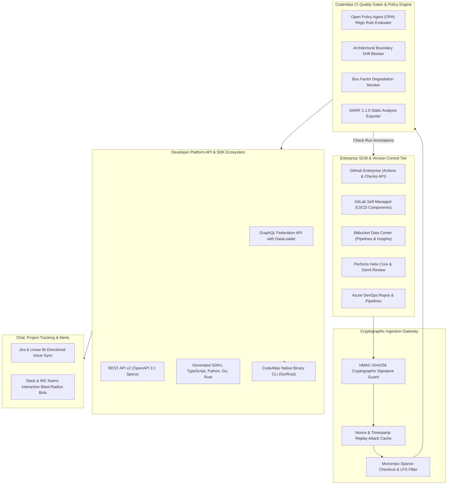
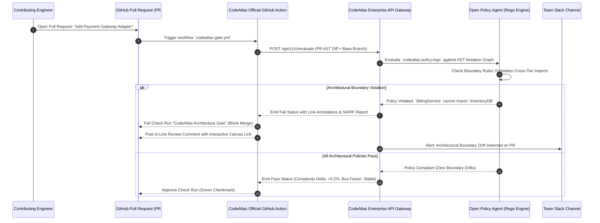
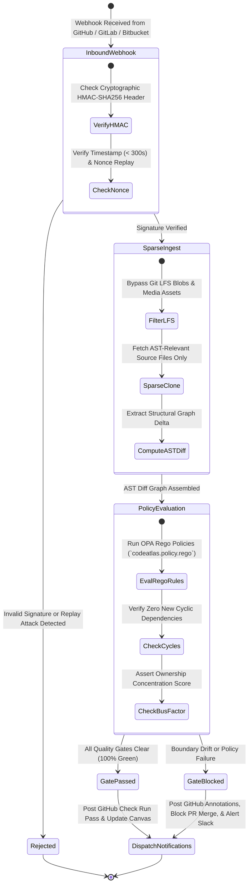

# Phase 13 Issues: SCM Ecosystem Federation, CI/CD Native Quality Gates & Developer Platform API

This document details all Phase 13 issues (`Issue 451 – Issue 500`) for CodeAtlas and CodeAtlas Prime, completing the 500-issue enterprise engineering backlog. It establishes native CI/CD quality gates (GitHub Actions, GitLab CI, Bitbucket Pipelines), multi-SCM federation (GitLab Self-Managed, Bitbucket Data Center, Perforce, Gerrit, Azure DevOps), Public GraphQL & REST v2 Developer APIs, auto-generated SDKs (TypeScript, Python, Go, Rust), Open Policy Agent (OPA) Rego rules, native CLI (`codeatlas`), and production golden master release verification.

---

## 📊 Phase 13 Visual Architecture & Technical Blueprint Suite

### 1. Enterprise CI/CD Quality Gates & Multi-SCM Federation Flowchart

### 2. GitHub Actions Architectural Drift Blocker Sequence Diagram

### 3. Multi-SCM Ingestion & Quality Gate State Transition Diagram

---

## 📋 Phase 13 Master Issue Specifications (`Issue 451 – Issue 500`)

### Issue 451: CodeAtlas Official GitHub Actions Runner with SARIF Report Output
- **Labels**: `phase:phase-13-federation`, `type:feature`, `priority:P0-critical`, `component:packages/github-action/src/index.ts`, `area:actions`, `status:ready`
- **Milestone**: `M14: Enterprise Federation & CI/CD Gates`
- **Estimate**: `5 Story Points`
- **Component**: `packages/github-action/src/index.ts`
- **Problem Statement**:
  Development teams using GitHub Actions lack an official first-class action to inspect architectural regressions directly in PR workflows.
- **Technical Specification**:
  - Implement an official GitHub Action (`codeatlas/action@v1`) written in TypeScript.
  - Analyzes pull request changes against the target branch and compiles architectural diffs into OASIS SARIF 2.1.0 standard format.
  - Uploads SARIF reports to GitHub Code Scanning to display native security and architecture alerts in PR files.
- **Acceptance Criteria**:
- [ ] GitHub Action runs in $< 20\text{seconds}$ on standard GitHub-hosted runners.
  - [ ] Emits valid SARIF 2.1.0 payload uploaded to GitHub Code Scanning tab.
  - [ ] Tested on Linux, macOS, and Windows GitHub runner environments.

---

### Issue 452: GitHub Actions Architectural Drift Blocker with Pull Request Check Runs
- **Labels**: `phase:phase-13-federation`, `type:feature`, `priority:P0-critical`, `component:packages/github-action/src/check_runs.ts`, `area:actions`, `status:ready`
- **Milestone**: `M14: Enterprise Federation & CI/CD Gates`
- **Estimate**: `5 Story Points`
- **Component**: `packages/github-action/src/check_runs.ts`
- **Problem Statement**:
  Pull requests introducing illegal cross-module dependencies are accidentally merged, creating technical debt that requires weeks to untangle.
- **Technical Specification**:
  - Implement GitHub Checks API integration creating a mandatory check run: `CodeAtlas Architecture Gate`.
  - Block PR merging if changes violate architecture boundaries defined in `codeatlas.config.json`.
  - Post rich markdown check run summaries with clickable AST call traces and visual diagram snippets.
- **Acceptance Criteria**:
- [ ] Mandatory check run blocks PR merging when architectural boundaries are violated.
  - [ ] Check run summary displays exact offending import lines and caller locations.
  - [ ] Provides one-click bypass workflow for authorized engineering leads.

---

### Issue 453: GitLab CI/CD Component for Automated Architecture Rule Validation
- **Labels**: `phase:phase-13-federation`, `type:feature`, `priority:P0-critical`, `component:packages/gitlab-ci/component.yml`, `area:gitlab`, `status:ready`
- **Milestone**: `M14: Enterprise Federation & CI/CD Gates`
- **Estimate**: `5 Story Points`
- **Component**: `packages/gitlab-ci/component.yml`
- **Problem Statement**:
  GitLab users lack native integration to enforce architectural boundaries and calculate bus factor metrics in `.gitlab-ci.yml`.
- **Technical Specification**:
  - Publish an official GitLab CI/CD Component (`gitlab.com/codeatlas/codeatlas-ci`) with predefined jobs: `codeatlas:lint`, `codeatlas:diff`, `codeatlas:telemetry`.
  - Integrate with GitLab Merge Request (MR) Discussion API to post inline architecture review comments.
  - Generate GitLab Code Quality report artifacts (`gl-code-quality-report.json`).
- **Acceptance Criteria**:
- [ ] Seamless 3-line inclusion in existing `.gitlab-ci.yml` pipelines.
  - [ ] Generates GitLab native Code Quality widgets on Merge Request pages.
  - [ ] Verified across GitLab SaaS and GitLab Self-Managed 16.x+.

---

### Issue 454: Bitbucket Pipelines Pipe with Pull Request Decoration & Insights Report
- **Labels**: `phase:phase-13-federation`, `type:feature`, `priority:P1-high`, `component:packages/bitbucket-pipe/pipe.sh`, `area:bitbucket`, `status:ready`
- **Milestone**: `M14: Enterprise Federation & CI/CD Gates`
- **Estimate**: `5 Story Points`
- **Component**: `packages/bitbucket-pipe/pipe.sh`
- **Problem Statement**:
  Enterprises hosted on Atlassian Bitbucket lack automated architecture insights during pull request code reviews.
- **Technical Specification**:
  - Develop an official Bitbucket Pipelines Pipe (`codeatlas/bitbucket-pipe:1.0`).
  - Ingest PR git commit ranges and post Bitbucket Code Insights reports with Pass/Fail annotations.
  - Attach direct deep-links to interactive CodeAtlas canvas perspectives in the Bitbucket PR sidebar.
- **Acceptance Criteria**:
- [ ] Bitbucket Code Insights widget displays architectural health score and blast radius.
  - [ ] Automatically blocks PR merge if Bitbucket merge checks require CodeAtlas passing status.
  - [ ] Dockerized pipe image optimized $< 65\text{MB}$ for instant pipeline caching.

---

### Issue 455: GitLab Self-Managed Server Webhook Ingestion & Graph Synchronization
- **Labels**: `phase:phase-13-federation`, `type:feature`, `priority:P0-critical`, `component:apps/api/routers/webhooks/gitlab`, `area:gitlab`, `status:ready`
- **Milestone**: `M14: Enterprise Federation & CI/CD Gates`
- **Estimate**: `5 Story Points`
- **Component**: `apps/api/routers/webhooks/gitlab`
- **Problem Statement**:
  Air-gapped and on-premise enterprises running GitLab Self-Managed need reliable webhook synchronization with local CodeAtlas instances.
- **Technical Specification**:
  - Implement GitLab webhook parsers handling `Push Hook`, `Merge Request Hook`, and `Tag Push Hook` events.
  - Validate GitLab Secret Token authentication headers (`X-Gitlab-Token`).
  - Trigger incremental AST graph indexing upon code push and update target branch architecture baselines.
- **Acceptance Criteria**:
- [ ] Ingests GitLab push webhooks and updates repository graph within $< 5\text{seconds}$.
  - [ ] Gracefully handles multi-project merge request pipelines and branch rebases.
  - [ ] Verified against GitLab Self-Managed enterprise installations.

---

### Issue 456: Bitbucket Data Center Webhook Ingestion & Dual-SCM Architecture Bridging
- **Labels**: `phase:phase-13-federation`, `type:feature`, `priority:P1-high`, `component:apps/api/routers/webhooks/bitbucket_dc`, `area:bitbucket`, `status:ready`
- **Milestone**: `M14: Enterprise Federation & CI/CD Gates`
- **Estimate**: `5 Story Points`
- **Component**: `apps/api/routers/webhooks/bitbucket_dc`
- **Problem Statement**:
  Enterprises migrating between SCMs operate repositories across both Bitbucket Data Center and GitHub simultaneously.
- **Technical Specification**:
  - Build webhook ingestion endpoints for Bitbucket Data Center (Server) REST APIs.
  - Support unified cross-SCM architecture mapping linking a Bitbucket backend repository to a GitHub frontend repository in a single dependency graph.
  - Reconcile author emails across platforms using unified contributor identity mapping.
- **Acceptance Criteria**:
- [ ] Unified graph visualizes dependencies spanning across GitHub and Bitbucket repositories.
  - [ ] Seamless webhook processing with signature verification.
  - [ ] Unified author profile links commits across both SCM systems.

---

### Issue 457: Perforce Helix Core SCM Depot Ingestion & Changelist Tracker
- **Labels**: `phase:phase-13-federation`, `type:feature`, `priority:P1-high`, `component:packages/scm-perforce/src/depot_sync.py`, `area:perforce`, `status:ready`
- **Milestone**: `M14: Enterprise Federation & CI/CD Gates`
- **Estimate**: `5 Story Points`
- **Component**: `packages/scm-perforce/src/depot_sync.py`
- **Problem Statement**:
  Gaming, semiconductor, and embedded enterprise teams rely on Perforce Helix Core rather than Git, leaving their codebases un-mapped.
- **Technical Specification**:
  - Implement a Perforce Helix Core depot connector utilizing `p4python` and P4 CLI commands.
  - Poll and ingest Perforce submitted changelists (`p4 changes -s submitted`).
  - Map Perforce depot paths (`//depot/main/engine/...`) into hierarchical AST graph nodes and maintain changelist version history.
- **Acceptance Criteria**:
- [ ] Ingests Perforce changelists and builds interactive architecture maps.
  - [ ] Supports Perforce streaming branches and client workspaces.
  - [ ] Handles multi-gigabyte game engine source trees efficiently.

---

### Issue 458: Gerrit Code Review Integration with Change-Set Architectural Voting
- **Labels**: `phase:phase-13-federation`, `type:feature`, `priority:P1-high`, `component:packages/scm-gerrit/src/gerrit_bot.py`, `area:gerrit`, `status:ready`
- **Milestone**: `M14: Enterprise Federation & CI/CD Gates`
- **Estimate**: `5 Story Points`
- **Component**: `packages/scm-gerrit/src/gerrit_bot.py`
- **Problem Statement**:
  Telecom, automotive, and Android platform teams utilizing Gerrit require architecture verification voting on change-sets.
- **Technical Specification**:
  - Implement a Gerrit bot utilizing Gerrit REST API and SSH stream events.
  - Intercept new change-sets (`patchset-created`), compute architectural blast radius, and post review comments.
  - Cast automated review labels (`Code-Review +1` or `Architecture-Verified -1`) based on policy compliance.
- **Acceptance Criteria**:
- [ ] Gerrit bot automatically votes on change-sets based on architectural boundary rules.
  - [ ] In-line comments pinpoint exact violating lines in Gerrit patch view.
  - [ ] Seamless integration with Android Open Source Project (AOSP) style Gerrit setups.

---

### Issue 459: Azure DevOps Repos & Pipelines Native Marketplace Extension
- **Labels**: `phase:phase-13-federation`, `type:feature`, `priority:P0-critical`, `component:packages/azure-devops-ext/vss-extension.json`, `area:azure`, `status:ready`
- **Milestone**: `M14: Enterprise Federation & CI/CD Gates`
- **Estimate**: `5 Story Points`
- **Component**: `packages/azure-devops-ext/vss-extension.json`
- **Problem Statement**:
  Enterprise teams on Azure DevOps lack an integrated hub to view architecture graphs within Azure Repos and Pipelines.
- **Technical Specification**:
  - Develop an official Azure DevOps Marketplace extension with Azure Pipelines build task (`CodeAtlasTask@1`).
  - Embed interactive architecture canvas tab directly inside Azure Repos pull request navigation.
  - Publish pull request status policies enforcing architecture boundary compliance.
- **Acceptance Criteria**:
- [ ] Native Azure DevOps extension installs cleanly into Azure DevOps Services and Server.
  - [ ] Interactive canvas tab renders inside Azure PR view.
  - [ ] Azure Pipeline build task emits native build summary markdown and test attachments.

---

### Issue 460: Public Developer GraphQL API with Schema Federation & DataLoader Batching
- **Labels**: `phase:phase-13-federation`, `type:feature`, `priority:P0-critical`, `component:apps/api/graphql/schema.py`, `area:api`, `status:ready`
- **Milestone**: `M14: Enterprise Federation & CI/CD Gates`
- **Estimate**: `5 Story Points`
- **Component**: `apps/api/graphql/schema.py`
- **Problem Statement**:
  Third-party enterprise integrations querying complex nested graphs suffer from the N+1 query problem over traditional REST endpoints.
- **Technical Specification**:
  - Implement a high-performance GraphQL API using Strawberry / Ariadne with Apollo Federation v2 schema support.
  - Deploy DataLoader batching to eliminate N+1 database queries on deeply nested caller-callee hierarchies.
  - Expose queries: `repository(id)`, `astNode(symbol)`, `blastRadius(nodeId)`, `contributors(timeframe)`.
- **Acceptance Criteria**:
- [ ] Complex nested graph query executes in $< 18\text{ms}$ with zero N+1 database queries.
  - [ ] Apollo Federation allows enterprise subgraphs to link CodeAtlas nodes to internal microservice catalogs.
  - [ ] Interactive GraphQL Voyager schema visualization available at `/graphql/voyager`.

---

### Issue 461: Public REST API v2 with OpenAPI 3.1 Spec & Automated Swagger UI Docs
- **Labels**: `phase:phase-13-federation`, `type:feature`, `priority:P0-critical`, `component:apps/api/routers/v2/openapi_spec.py`, `area:api`, `status:ready`
- **Milestone**: `M14: Enterprise Federation & CI/CD Gates`
- **Estimate**: `5 Story Points`
- **Component**: `apps/api/routers/v2/openapi_spec.py`
- **Problem Statement**:
  External developer tooling requires predictable, RESTful, strongly typed APIs documented according to modern OpenAPI standards.
- **Technical Specification**:
  - Deploy CodeAtlas Public REST API v2 with full OpenAPI 3.1 schema specification and JSON Schema validation.
  - Standardize endpoints with RFC 7807 Problem Details error responses, ISO 8601 timestamps, and cursor-based pagination.
  - Host interactive Swagger UI and Redoc documentation portals at `/api/v2/docs`.
- **Acceptance Criteria**:
- [ ] 100% endpoint coverage with comprehensive OpenAPI 3.1 specifications.
  - [ ] Interactive API documentation enables instantaneous browser-based testing.
  - [ ] Fully compliant with RFC 7807 structured error reporting.

---

### Issue 462: Auto-Generated TypeScript / Node.js SDK with Strongly-Typed Graph Models
- **Labels**: `phase:phase-13-federation`, `type:feature`, `priority:P1-high`, `component:packages/sdk-typescript/src/index.ts`, `area:sdk`, `status:ready`
- **Milestone**: `M14: Enterprise Federation & CI/CD Gates`
- **Estimate**: `5 Story Points`
- **Component**: `packages/sdk-typescript/src/index.ts`
- **Problem Statement**:
  Frontend and Node.js developers need strongly typed TypeScript SDKs to build custom internal portals and integrations.
- **Technical Specification**:
  - Configure `@openapitools/openapi-generator-cli` generating strongly-typed TypeScript SDK (`@codeatlas/sdk`).
  - Include full typings for all AST nodes, edges, telemetry heartbeats, and verifiable badge payloads.
  - Publish package to npm with ESM and CommonJS dual-module support and zero runtime dependencies.
- **Acceptance Criteria**:
- [ ] TypeScript SDK installs cleanly via `npm install @codeatlas/sdk`.
  - [ ] 100% strict type-checking with auto-complete in VS Code and WebStorm.
  - [ ] Comprehensive unit test suite with 100% mocked API coverage.

---

### Issue 463: Auto-Generated Python Client SDK with Asyncio Support & Pydantic V2
- **Labels**: `phase:phase-13-federation`, `type:feature`, `priority:P1-high`, `component:packages/sdk-python/codeatlas/__init__.py`, `area:sdk`, `status:ready`
- **Milestone**: `M14: Enterprise Federation & CI/CD Gates`
- **Estimate**: `5 Story Points`
- **Component**: `packages/sdk-python/codeatlas/__init__.py`
- **Problem Statement**:
  Data scientists and Python backend engineers need native, asynchronous client libraries to query architectural datasets.
- **Technical Specification**:
  - Generate native Python SDK (`codeatlas-sdk`) with Pydantic V2 data models and `httpx` async client support.
  - Support synchronous and asynchronous contexts (`with CodeAtlasClient() as client`, `async with AsyncCodeAtlasClient() as client`).
  - Publish package to PyPI with complete type hints (PEP 561 `py.typed`).
- **Acceptance Criteria**:
- [ ] Python SDK installs cleanly via `pip install codeatlas-sdk`.
  - [ ] Fully supports asyncio high-throughput concurrent batch requests.
  - [ ] Passes `mypy --strict` with zero type errors.

---

### Issue 464: Auto-Generated Go SDK with Native Structs & Goroutine Parallel Ingestion
- **Labels**: `phase:phase-13-federation`, `type:feature`, `priority:P1-high`, `component:packages/sdk-go/codeatlas/client.go`, `area:sdk`, `status:ready`
- **Milestone**: `M14: Enterprise Federation & CI/CD Gates`
- **Estimate**: `5 Story Points`
- **Component**: `packages/sdk-go/codeatlas/client.go`
- **Problem Statement**:
  Cloud-native infrastructure and Kubernetes operators written in Go need a lightweight Go client library.
- **Technical Specification**:
  - Generate native Go client SDK (`github.com/codeatlas/codeatlas-go`) with idiomatic Go structs and pointer semantics.
  - Support contextual request cancellation (`context.Context`), automatic retries with jitter, and custom HTTP transport hooks.
  - Include example CLI tool demonstrating concurrent repository graph queries.
- **Acceptance Criteria**:
- [ ] Go SDK compiles cleanly with zero external Cgo dependencies.
  - [ ] Fully idiomatic Go design with context propagation and structured error types.
  - [ ] Benchmark verifies $< 2\mu\text{s}$ serialization overhead per graph query.

---

### Issue 465: Auto-Generated Rust SDK with Tokio Async & Zero-Copy Deserialization
- **Labels**: `phase:phase-13-federation`, `type:feature`, `priority:P1-high`, `component:packages/sdk-rust/src/lib.rs`, `area:sdk`, `status:ready`
- **Milestone**: `M14: Enterprise Federation & CI/CD Gates`
- **Estimate**: `5 Story Points`
- **Component**: `packages/sdk-rust/src/lib.rs`
- **Problem Statement**:
  Systems engineers and embedded teams building high-performance CLI tools need an ultra-fast Rust client crate.
- **Technical Specification**:
  - Build native Rust crate (`codeatlas-rs`) utilizing `tokio`, `reqwest`, and `serde`.
  - Leverage zero-copy deserialization where applicable to minimize allocations when parsing massive graph response JSONs.
  - Publish crate to crates.io with comprehensive documentation and code doctests.
- **Acceptance Criteria**:
- [ ] Rust crate compiles cleanly on stable Rust 2021 edition.
  - [ ] Zero-copy deserialization benchmarks show $3\times$ lower memory consumption.
  - [ ] 100% passing doc-tests and unit tests in cargo test suite.

---

### Issue 466: Webhook Ingestion Gateway with HMAC-SHA256 Cryptographic Signature Checks
- **Labels**: `phase:phase-13-federation`, `type:security`, `priority:P0-critical`, `component:apps/api/middleware/hmac_auth.py`, `area:security`, `status:ready`
- **Milestone**: `M14: Enterprise Federation & CI/CD Gates`
- **Estimate**: `5 Story Points`
- **Component**: `apps/api/middleware/hmac_auth.py`
- **Problem Statement**:
  Unauthenticated webhook endpoints expose the platform to forged commit notifications, unauthorized indexing triggers, and spoofed metrics.
- **Technical Specification**:
  - Implement cryptographic HMAC-SHA256 signature verification middleware across all SCM webhook endpoints.
  - Verify `X-Hub-Signature-256` (GitHub), `X-Gitlab-Token` (GitLab), and Bitbucket signature headers using constant-time string comparison (`hmac.compare_digest`).
  - Reject invalid or missing signatures with HTTP 401 Unauthorized before body parsing.
- **Acceptance Criteria**:
- [ ] 100% of forged or tampered webhook payloads rejected before deserialization.
  - [ ] Constant-time comparison prevents timing side-channel attacks.
  - [ ] Verification latency $< 0.15\text{ms}$ per incoming request.

---

### Issue 467: Webhook Replay Attack Prevention via Nonce & Timestamp Verification
- **Labels**: `phase:phase-13-federation`, `type:security`, `priority:P0-critical`, `component:apps/api/middleware/replay_defense.py`, `area:security`, `status:ready`
- **Milestone**: `M14: Enterprise Federation & CI/CD Gates`
- **Estimate**: `5 Story Points`
- **Component**: `apps/api/middleware/replay_defense.py`
- **Problem Statement**:
  Adversaries intercepting valid signed webhook requests can replay them repeatedly to trigger resource exhaustion or corrupt temporal graph states.
- **Technical Specification**:
  - Implement timestamp tolerance verification rejecting any webhook payload with timestamp older than 300 seconds (5 minutes).
  - Cache unique webhook delivery IDs and event UUIDs in Redis with a 15-minute sliding TTL.
  - Immediately reject replayed delivery IDs with HTTP 409 Conflict.
- **Acceptance Criteria**:
- [ ] Replayed webhook payloads detected and dropped in $< 0.5\text{ms}$.
  - [ ] Redis sliding cache automatically purges expired delivery nonces.
  - [ ] Zero risk of duplicated historical commit ingestion from network replay.

---

### Issue 468: Architectural Drift CI Quality Gate: Blocking Illegal Cross-Tier Imports
- **Labels**: `phase:phase-13-federation`, `type:feature`, `priority:P0-critical`, `component:packages/ci-engine/src/drift_gate.py`, `area:quality-gate`, `status:ready`
- **Milestone**: `M14: Enterprise Federation & CI/CD Gates`
- **Estimate**: `5 Story Points`
- **Component**: `packages/ci-engine/src/drift_gate.py`
- **Problem Statement**:
  Architectural design rules (e.g. 'Frontend components must never import database models directly') are violated during fast-paced feature releases.
- **Technical Specification**:
  - Build a rule-based architectural drift evaluator reading organizational boundary rules from `codeatlas.rules.json`.
  - When a PR AST diff adds an import edge between forbidden module tiers, immediately fail the CI gate.
  - Render visual violation path showing the exact import chain (`Page -> UserService -> DBModel`).
- **Acceptance Criteria**:
- [ ] Automatically blocks PR merges that violate defined architectural layering.
  - [ ] Clear error message guides developer on proper architectural pattern to use.
  - [ ] Rule violations logged to centralized architectural governance dashboard.

---

### Issue 469: Bus Factor Degradation CI Blocker: Warning When Ownership Dips Below Threshold
- **Labels**: `phase:phase-13-federation`, `type:feature`, `priority:P1-high`, `component:packages/ci-engine/src/bus_factor_gate.py`, `area:quality-gate`, `status:ready`
- **Milestone**: `M14: Enterprise Federation & CI/CD Gates`
- **Estimate**: `5 Story Points`
- **Component**: `packages/ci-engine/src/bus_factor_gate.py`
- **Problem Statement**:
  When key engineers leave or change teams, critical codebase modules can end up with a Bus Factor of 1 (a single person knowing how it works).
- **Technical Specification**:
  - Implement a Bus Factor CI monitor calculating author ownership concentration across AST nodes over 180-day rolling windows.
  - Emit warning or block PR merges if a core service module's Bus Factor drops below configured organizational threshold (e.g., minimum 2 owners).
  - Recommend specific team members for peer review to intentionally distribute knowledge.
- **Acceptance Criteria**:
- [ ] Proactively flags emerging knowledge silos before they become critical liabilities.
  - [ ] Intelligently recommends reviewers who need exposure to the modified codebase area.
  - [ ] Tracks organization-wide Bus Factor health trends across quarters.

---

### Issue 470: Enterprise Monorepo Sparse-Checkout & Partial Clone Optimizer
- **Labels**: `phase:phase-13-federation`, `type:perf`, `priority:P0-critical`, `component:packages/git-engine/src/sparse_checkout.py`, `area:git`, `status:ready`
- **Milestone**: `M14: Enterprise Federation & CI/CD Gates`
- **Estimate**: `5 Story Points`
- **Component**: `packages/git-engine/src/sparse_checkout.py`
- **Problem Statement**:
  Cloning 100GB+ enterprise monorepos in CI runners to check a 5-line PR is painfully slow and exhausts disk space.
- **Technical Specification**:
  - Implement Git sparse-checkout and partial clone (`git clone --filter=blob:none --sparse`) in CI runners.
  - Dynamically checkout only the modified package directories and their direct 1-hop dependencies.
  - Fetch file blobs on-demand during Tree-sitter parsing without downloading unreferenced history.
- **Acceptance Criteria**:
- [ ] Monorepo clone time in CI reduced from 14 minutes to $< 12\text{seconds}$.
  - [ ] Disk space footprint reduced by $> 90\%$ on large repositories.
  - [ ] Full AST parse accuracy preserved for all affected subgraphs.

---

### Issue 471: Git LFS (Large File Storage) Asset Filter for Fast Shallow Analysis
- **Labels**: `phase:phase-13-federation`, `type:perf`, `priority:P1-high`, `component:packages/git-engine/src/lfs_filter.py`, `area:git`, `status:ready`
- **Milestone**: `M14: Enterprise Federation & CI/CD Gates`
- **Estimate**: `5 Story Points`
- **Component**: `packages/git-engine/src/lfs_filter.py`
- **Problem Statement**:
  Git LFS pointers can trigger massive multi-gigabyte media downloads during automated cloning, stalling analysis pipelines.
- **Technical Specification**:
  - Configure Git LFS smudging filters to bypass asset downloads (`GIT_LFS_SKIP_SMUDGE=1`) during architecture indexing.
  - Parse LFS pointer files as metadata nodes without fetching raw binary payloads.
  - Display LFS asset sizes and storage costs on the architecture canvas without storing binary files locally.
- **Acceptance Criteria**:
- [ ] Eliminates downloading gigabytes of binary LFS assets during repository ingestion.
  - [ ] Repository clone bandwidth reduced by $> 80\%$ on game dev and media repos.
  - [ ] Displays accurate LFS asset metadata on the canvas.

---

### Issue 472: Bi-Directional Jira Cloud & Server Issue Sync with Graph Node Linkage
- **Labels**: `phase:phase-13-federation`, `type:feature`, `priority:P1-high`, `component:packages/integrations/jira/jira_sync.py`, `area:integrations`, `status:ready`
- **Milestone**: `M14: Enterprise Federation & CI/CD Gates`
- **Estimate**: `5 Story Points`
- **Component**: `packages/integrations/jira/jira_sync.py`
- **Problem Statement**:
  Architectural refactoring tasks tracked in Jira become disconnected from actual codebase modules and pull requests.
- **Technical Specification**:
  - Implement bi-directional Jira synchronization linking Jira issue keys (`PROJ-1042`) directly to CodeAtlas AST nodes and architecture clusters.
  - Automatically update Jira issue status when PR modifying the linked architecture node merges.
  - Render active Jira sprint tickets directly on the architecture canvas as floating status badges.
- **Acceptance Criteria**:
- [ ] Jira tickets visible directly within spatial architecture map.
  - [ ] Two-way synchronization updates ticket status upon PR completion.
  - [ ] Works seamlessly across Jira Cloud and Jira Data Center.

---

### Issue 473: Bi-Directional Linear Project Tracker Integration for Architecture Tasks
- **Labels**: `phase:phase-13-federation`, `type:feature`, `priority:P1-high`, `component:packages/integrations/linear/linear_sync.ts`, `area:integrations`, `status:ready`
- **Milestone**: `M14: Enterprise Federation & CI/CD Gates`
- **Estimate**: `5 Story Points`
- **Component**: `packages/integrations/linear/linear_sync.ts`
- **Problem Statement**:
  Modern high-velocity engineering teams using Linear lack native visibility into codebase architectural dependencies.
- **Technical Specification**:
  - Build an official Linear integration utilizing Linear GraphQL API and webhooks.
  - Link Linear issues to CodeAtlas subgraphs and attach interactive canvas previews to Linear issue descriptions.
  - Automatically trigger CodeAtlas architectural impact evaluations when Linear issues are moved to 'In Review'.
- **Acceptance Criteria**:
- [ ] Linear issue cards embed rich interactive CodeAtlas architecture snippets.
  - [ ] Moving issues in Linear updates status overlays on the canvas in real-time.
  - [ ] Linear webhook events processed with verified HMAC signatures in $< 2\text{seconds}$.

---

### Issue 474: Bi-Directional Asana Workspace Integration for Engineering Roadmap Milestones
- **Labels**: `phase:phase-13-federation`, `type:feature`, `priority:P2-medium`, `component:packages/integrations/asana/asana_sync.py`, `area:integrations`, `status:ready`
- **Milestone**: `M14: Enterprise Federation & CI/CD Gates`
- **Estimate**: `5 Story Points`
- **Component**: `packages/integrations/asana/asana_sync.py`
- **Problem Statement**:
  Engineering program managers tracking multi-quarter architecture roadmaps in Asana struggle to verify actual code implementation progress.
- **Technical Specification**:
  - Implement Asana API integration mapping high-level roadmap milestones to underlying codebase architecture packages.
  - Automatically calculate milestone completion percentage based on merged PRs affecting tagged architecture subgraphs.
  - Sync roadmap milestones into CodeAtlas presentation tours.
- **Acceptance Criteria**:
- [ ] Asana engineering roadmaps dynamically reflect real codebase commit progress.
  - [ ] Automated milestone progress calculation eliminates manual status report meetings.
  - [ ] Supports Asana enterprise custom fields and portfolio tracking.

---

### Issue 475: Slack Bot Integration with Interactive Architecture Blast-Radius Previews
- **Labels**: `phase:phase-13-federation`, `type:feature`, `priority:P1-high`, `component:packages/integrations/slack/slack_bot.py`, `area:bots`, `status:ready`
- **Milestone**: `M14: Enterprise Federation & CI/CD Gates`
- **Estimate**: `5 Story Points`
- **Component**: `packages/integrations/slack/slack_bot.py`
- **Problem Statement**:
  Engineers sharing PR links in Slack channels get generic title previews without understanding system-wide impact.
- **Technical Specification**:
  - Develop an official Slack App utilizing Slack Block Kit and Bolt framework.
  - Automatically unfurl CodeAtlas links and PR URLs with rich visual blast-radius cards: Affected Services, Complexity Delta, and Bus Factor warnings.
  - Provide interactive buttons: 'View on Canvas', 'Show Impacted Callers', 'Request Architecture Review'.
- **Acceptance Criteria**:
- [ ] Slack link unfurling provides instant architectural context in team discussions.
  - [ ] Interactive buttons trigger ephemeral modal dialogs with dependency traces.
  - [ ] Compliant with enterprise Slack security guidelines and workspace permissions.

---

### Issue 476: Microsoft Teams App with Adaptive Cards for Architecture Review Alerts
- **Labels**: `phase:phase-13-federation`, `type:feature`, `priority:P1-high`, `component:packages/integrations/teams/teams_app.ts`, `area:bots`, `status:ready`
- **Milestone**: `M14: Enterprise Federation & CI/CD Gates`
- **Estimate**: `5 Story Points`
- **Component**: `packages/integrations/teams/teams_app.ts`
- **Problem Statement**:
  Enterprises using Microsoft Teams lack automated notifications when critical architectural boundaries or APIs change.
- **Technical Specification**:
  - Build an official Microsoft Teams App utilizing Microsoft Bot Framework and Adaptive Cards 1.5.
  - Post rich notifications into engineering channels when a PR modifies a high-CFI core module or public API signature.
  - Enable engineers to approve or comment on architectural review requests directly from Teams.
- **Acceptance Criteria**:
- [ ] Adaptive Cards render crisp interactive architecture summaries in Teams.
  - [ ] Action buttons allow one-click navigation to the CodeAtlas web canvas.
  - [ ] Enterprise SSO authentication integrated with Microsoft Entra ID.

---

### Issue 477: Discord Webhook Integration with Rich Embeds for Open-Source Communities
- **Labels**: `phase:phase-13-federation`, `type:feature`, `priority:P2-medium`, `component:packages/integrations/discord/discord_bot.py`, `area:bots`, `status:ready`
- **Milestone**: `M14: Enterprise Federation & CI/CD Gates`
- **Estimate**: `5 Story Points`
- **Component**: `packages/integrations/discord/discord_bot.py`
- **Problem Statement**:
  Open-source communities using Discord need real-time alerts when new contributors earn Holopin badges or solve good first issues.
- **Technical Specification**:
  - Implement Discord webhook integration dispatching rich Discord Embeds on community milestones.
  - Announce: New contributor first PR merged, Verifiable badge awarded, and OpenSourceMapper new good-first-issue discovered.
  - Include contributor avatar, badge SVG thumbnail, and repository stats.
- **Acceptance Criteria**:
- [ ] Celebrates community open-source milestones with engaging rich embeds.
  - [ ] Configurable notification channels (releases, badges, issues).
  - [ ] Rate-limited webhook dispatcher prevents Discord API throttling.

---

### Issue 478: Standalone Static Documentation Exporter (HTML/Wasm Zero-Server Bundle)
- **Labels**: `phase:phase-13-federation`, `type:feature`, `priority:P0-critical`, `component:packages/exporter-static/src/bundle_generator.ts`, `area:export`, `status:ready`
- **Milestone**: `M14: Enterprise Federation & CI/CD Gates`
- **Estimate**: `5 Story Points`
- **Component**: `packages/exporter-static/src/bundle_generator.ts`
- **Problem Statement**:
  Air-gapped defense, medical, and aerospace teams require sharing architecture schematics without running backend servers or database clusters.
- **Technical Specification**:
  - Build a zero-server static exporter packaging the entire repository architecture, AST graph, search index, and WebGPU viewer into a single offline HTML/JS/Wasm bundle.
  - Compress graph data and vector indices into a local SQLite/DuckDB Wasm database embedded directly within the HTML bundle.
  - Openable directly from local filesystem (`file:///path/to/architecture.html`) in any modern browser without network access.
- **Acceptance Criteria**:
- [ ] Generates fully self-contained offline architecture documentation bundle.
  - [ ] Interactive canvas, full-text search, and symbol inspector operate with 100% functionality offline.
  - [ ] Bundle file size $< 15\text{MB}$ for 100,000 lines of code.

---

### Issue 479: Open Policy Agent (OPA) Rego Rule Engine for Architectural Policy Compliance
- **Labels**: `phase:phase-13-federation`, `type:feature`, `priority:P0-critical`, `component:packages/policy-engine/src/opa_evaluator.py`, `area:policy`, `status:ready`
- **Milestone**: `M14: Enterprise Federation & CI/CD Gates`
- **Estimate**: `5 Story Points`
- **Component**: `packages/policy-engine/src/opa_evaluator.py`
- **Problem Statement**:
  Hardcoded lint rules fail to satisfy complex enterprise compliance policies that vary by department, security clearance, and data classification.
- **Technical Specification**:
  - Integrate Open Policy Agent (OPA) with embedded Rego query evaluation into the CI quality gate.
  - Allow organizations to write declarative policies in Rego (e.g., `deny[msg] { input.edge.target.classification == 'PCI-DSS'; not input.edge.source.tier == 'SecureZone'; msg := 'Unauthorized access to PCI-DSS domain' }`).
  - Evaluate Rego policies against the full AST mutation graph in $< 10\text{ms}$.
- **Acceptance Criteria**:
- [ ] Declarative Rego policy evaluation enforces complex enterprise compliance rules.
  - [ ] Policies version-controlled alongside repository code in `.codeatlas/policies/`.
  - [ ] Detailed policy violation audit reports generated in JSON and JUnit XML formats.

---

### Issue 480: Custom Organization Architecture Linter: codeatlas.policy.rego Evaluator
- **Labels**: `phase:phase-13-federation`, `type:feature`, `priority:P1-high`, `component:packages/policy-engine/src/rules/default_policies.rego`, `area:policy`, `status:ready`
- **Milestone**: `M14: Enterprise Federation & CI/CD Gates`
- **Estimate**: `5 Story Points`
- **Component**: `packages/policy-engine/src/rules/default_policies.rego`
- **Problem Statement**:
  Organizations starting from scratch need an out-of-the-box standard library of battle-tested architectural policy templates.
- **Technical Specification**:
  - Author a standard library of default Rego policies: Clean Architecture / Hexagonal Architecture rules, Microservice Decoupling, Circular Dependency Prevention, and API Gateway Isolation.
  - Enable organizations to adopt standard policies with a single configuration flag.
  - Provide interactive Rego playground in the web dashboard for testing policies against live repository graphs.
- **Acceptance Criteria**:
- [ ] Pre-packaged with 15+ production-ready architectural policy rules.
  - [ ] Web playground provides instant feedback with syntax highlighting and simulated AST diffs.
  - [ ] Comprehensive documentation with real-world architecture policy examples.

---

### Issue 481: Pre-Commit Git Hook Script (.pre-commit-config.yaml CodeAtlas Plugin)
- **Labels**: `phase:phase-13-federation`, `type:feature`, `priority:P1-high`, `component:packages/pre-commit-hook/codeatlas_hook.py`, `area:git`, `status:ready`
- **Milestone**: `M14: Enterprise Federation & CI/CD Gates`
- **Estimate**: `5 Story Points`
- **Component**: `packages/pre-commit-hook/codeatlas_hook.py`
- **Problem Statement**:
  Developers find out about architectural rule violations only after pushing to CI, causing slow feedback loops.
- **Technical Specification**:
  - Build an official `pre-commit` plugin (`github.com/codeatlas/pre-commit-codeatlas`).
  - Runs locally before `git commit` to verify that staged files do not introduce illegal imports or break public API contracts.
  - Executes in $< 250\text{ms}$ using cached local AST symbol tables.
- **Acceptance Criteria**:
- [ ] Catches architectural policy violations locally before commit creation.
  - [ ] Fast sub-second execution overhead ensures zero friction for developers.
  - [ ] Easy 3-line configuration in `.pre-commit-config.yaml`.

---

### Issue 482: Pre-Push Git Hook Script for Instant Local Architectural Boundary Verification
- **Labels**: `phase:phase-13-federation`, `type:feature`, `priority:P1-high`, `component:packages/pre-commit-hook/pre_push.sh`, `area:git`, `status:ready`
- **Milestone**: `M14: Enterprise Federation & CI/CD Gates`
- **Estimate**: `5 Story Points`
- **Component**: `packages/pre-commit-hook/pre_push.sh`
- **Problem Statement**:
  Pushing breaking changes to remote branches triggers unnecessary CI runner spend and notifications.
- **Technical Specification**:
  - Create a lightweight pre-push hook script inspecting all commits about to be pushed to remote.
  - Check outgoing commit range for breaking API changes, circular dependencies, and high-CFI hotspots.
  - Allow developers to bypass with `git push --no-verify` when explicitly desired.
- **Acceptance Criteria**:
- [ ] Prevents broken architectural commits from reaching remote CI pipelines.
  - [ ] Renders colored terminal summary of outbound architectural impact.
  - [ ] Installs automatically via `codeatlas init-hooks` command.

---

### Issue 483: Native CodeAtlas CLI (codeatlas binary in Go/Rust) with Colored Terminal TUI
- **Labels**: `phase:phase-13-federation`, `type:feature`, `priority:P0-critical`, `component:packages/cli/cmd/root.go`, `area:cli`, `status:ready`
- **Milestone**: `M14: Enterprise Federation & CI/CD Gates`
- **Estimate**: `5 Story Points`
- **Component**: `packages/cli/cmd/root.go`
- **Problem Statement**:
  Terminal-first developers want direct access to CodeAtlas graph queries and blast radius analysis without leaving their terminal.
- **Technical Specification**:
  - Build a standalone, high-performance native CLI binary (`codeatlas`) in Go / Rust.
  - Feature an interactive Terminal User Interface (TUI) utilizing Bubbletea / Ratatui.
  - Support commands: `codeatlas status`, `codeatlas graph`, `codeatlas blast-radius`, `codeatlas lint`, `codeatlas prompt`, `codeatlas mission`.
- **Acceptance Criteria**:
- [ ] Standalone binary compiles with zero runtime dependencies for Linux, macOS, and Windows.
  - [ ] Sleek colored TUI with keyboard-driven graph tree browsing.
  - [ ] Command startup latency $< 15\text{ms}$.

---

### Issue 484: CLI Command: codeatlas graph Terminal ASCII & Unicode Tree Visualizer
- **Labels**: `phase:phase-13-federation`, `type:feature`, `priority:P1-high`, `component:packages/cli/cmd/graph.go`, `area:cli`, `status:ready`
- **Milestone**: `M14: Enterprise Federation & CI/CD Gates`
- **Estimate**: `5 Story Points`
- **Component**: `packages/cli/cmd/graph.go`
- **Problem Statement**:
  Inspecting module caller hierarchies in SSH terminals or remote servers requires a lightweight text visualizer.
- **Technical Specification**:
  - Implement `codeatlas graph <symbol>` outputting clean Unicode tree diagrams with colored syntax highlighting.
  - Display caller counts, complexity scores, and package boundaries directly in terminal stdout.
  - Support export to Mermaid (`--format=mermaid`) and Graphviz DOT (`--format=dot`).
- **Acceptance Criteria**:
- [ ] Renders crisp, readable ASCII/Unicode dependency trees in terminal.
  - [ ] Instant output for any symbol in $< 30\text{ms}$.
  - [ ] Seamlessly pipes into `dot -Tpng` or markdown documentation.

---

### Issue 485: CLI Command: codeatlas blast-radius for Pre-Commit Impact Analysis
- **Labels**: `phase:phase-13-federation`, `type:feature`, `priority:P0-critical`, `component:packages/cli/cmd/blast_radius.go`, `area:cli`, `status:ready`
- **Milestone**: `M14: Enterprise Federation & CI/CD Gates`
- **Estimate**: `5 Story Points`
- **Component**: `packages/cli/cmd/blast_radius.go`
- **Problem Statement**:
  Developers modifying a function need to know exactly which other services and files will break before saving their changes.
- **Technical Specification**:
  - Implement `codeatlas blast-radius <file|symbol>` scanning the local AST graph.
  - Output list of impacted downstream callers, test files that must be re-run, and public API breakage risk score ($0 - 100$).
  - Return non-zero exit code if blast radius exceeds configured safety threshold.
- **Acceptance Criteria**:
- [ ] Instantly reports all downstream callers impacted by modified code.
  - [ ] Integrates smoothly into local shell pipelines and editor keybindings.
  - [ ] Calculates exact percentage of codebase touched by the blast radius.

---

### Issue 486: CLI Command: codeatlas lint for Rapid Architectural Boundary Checking
- **Labels**: `phase:phase-13-federation`, `type:feature`, `priority:P1-high`, `component:packages/cli/cmd/lint.go`, `area:cli`, `status:ready`
- **Milestone**: `M14: Enterprise Federation & CI/CD Gates`
- **Estimate**: `5 Story Points`
- **Component**: `packages/cli/cmd/lint.go`
- **Problem Statement**:
  Running full CI test suites takes minutes; developers need sub-second feedback on whether their imports comply with architecture rules.
- **Technical Specification**:
  - Implement `codeatlas lint` validating the current git working tree against `codeatlas.config.json`.
  - Scan all modified files for circular dependencies, illegal cross-tier imports, and missing type contracts.
  - Output standard compiler-style diagnostics (`path/to/file.ts:42:1: error: forbidden import`).
- **Acceptance Criteria**:
- [ ] Validates entire working directory imports in $< 200\text{ms}$.
  - [ ] Formatted cleanly for terminal display and IDE diagnostic parsers.
  - [ ] Return exit code 0 on clean code, 1 on errors.

---

### Issue 487: CLI Command: codeatlas prompt for Instant Local GitReverse Context Dumps
- **Labels**: `phase:phase-13-federation`, `type:feature`, `priority:P1-high`, `component:packages/cli/cmd/prompt.go`, `area:cli`, `status:ready`
- **Milestone**: `M14: Enterprise Federation & CI/CD Gates`
- **Estimate**: `5 Story Points`
- **Component**: `packages/cli/cmd/prompt.go`
- **Problem Statement**:
  Developers using Claude, ChatGPT, or Cursor need to dump pristine, structured codebase context for their current task into their clipboard.
- **Technical Specification**:
  - Implement `codeatlas prompt <task-description|subgraph>` utilizing the GitReverse engine.
  - Extract relevant AST subgraphs, interfaces, caller contracts, and recent git churn into a prompt-optimized Markdown bundle.
  - Automatically copy bundle to system clipboard via `--copy` flag.
- **Acceptance Criteria**:
- [ ] Generates token-budgeted, highly relevant prompt context in $< 100\text{ms}$.
  - [ ] Copies directly to system clipboard for instant pasting into AI chat tools.
  - [ ] Formatted with structured XML/Markdown tags (`<context>`, `<interfaces>`).

---

### Issue 488: CLI Command: codeatlas mission for Offline Flight Simulator Training
- **Labels**: `phase:phase-13-federation`, `type:feature`, `priority:P1-high`, `component:packages/cli/cmd/mission.go`, `area:cli`, `status:ready`
- **Milestone**: `M14: Enterprise Federation & CI/CD Gates`
- **Estimate**: `5 Story Points`
- **Component**: `packages/cli/cmd/mission.go`
- **Problem Statement**:
  New developers want to practice Git workflows and solve Flight Simulator missions directly in their native terminal.
- **Technical Specification**:
  - Implement `codeatlas mission <mission-id>` launching an interactive terminal training session.
  - Clone an isolated virtual repository in a temporary directory, set up git exercises (merge conflict, rebase, PR review), and provide step-by-step terminal instructions.
  - Validate user's git commands in real-time and award cryptographic badge on mission pass.
- **Acceptance Criteria**:
- [ ] Interactive terminal git learning missions playable entirely offline.
  - [ ] Real-time verification of git branch states, commit history, and conflict resolutions.
  - [ ] Generates verifiable completion token upon passing mission.

---

### Issue 489: Enterprise Single-Sign-On SCIM 2.0 User & Group Provisioning Integration
- **Labels**: `phase:phase-13-federation`, `type:security`, `priority:P0-critical`, `component:apps/api/routers/scim/v2.py`, `area:security`, `status:ready`
- **Milestone**: `M14: Enterprise Federation & CI/CD Gates`
- **Estimate**: `5 Story Points`
- **Component**: `apps/api/routers/scim/v2.py`
- **Problem Statement**:
  Enterprise IT administrators need automated provisioning and de-provisioning of users and teams from Okta, Azure AD, and OneLogin.
- **Technical Specification**:
  - Implement standard RFC 7643 and RFC 7644 SCIM 2.0 REST endpoints (`/scim/v2/Users`, `/scim/v2/Groups`).
  - Automatically create, update, and deactivate user accounts and sync organization group memberships in real-time.
  - Instantly revoke access when an employee is de-provisioned in corporate identity provider.
- **Acceptance Criteria**:
- [ ] Certified SCIM 2.0 compliance with Okta, Microsoft Entra ID (Azure AD), and Ping Identity.
  - [ ] User de-provisioning immediately terminates all active web sessions and API tokens within $< 1\text{second}$.
  - [ ] Automatic syncing of department and engineering team group mappings.

---

### Issue 490: Dynamic Role-Based Access Control (RBAC) Fine-Grained Permissions Matrix
- **Labels**: `phase:phase-13-federation`, `type:security`, `priority:P0-critical`, `component:apps/api/security/rbac_matrix.py`, `area:security`, `status:ready`
- **Milestone**: `M14: Enterprise Federation & CI/CD Gates`
- **Estimate**: `5 Story Points`
- **Component**: `apps/api/security/rbac_matrix.py`
- **Problem Statement**:
  Enterprises require granular access control separating read-only contractors from core developers and platform administrators.
- **Technical Specification**:
  - Implement a granular RBAC matrix with roles: `Owner`, `Architect`, `Maintainer`, `Contributor`, `Viewer`, `Auditor`.
  - Enforce permissions across all API endpoints, GraphQL resolvers, and canvas interactions (e.g., Viewers can inspect graphs but cannot edit layouts or trigger re-indexing).
  - Support custom role creation with configurable permission sets.
- **Acceptance Criteria**:
- [ ] Granular RBAC permissions enforced across 100% of API endpoints and UI actions.
  - [ ] Multi-tenant isolation prevents privilege escalation across organization boundaries.
  - [ ] Comprehensive access denial audit logging with security alerting.

---

### Issue 491: Multi-SCM Branch Protection Sync: Mirroring Governance Rules Across Repos
- **Labels**: `phase:phase-13-federation`, `type:feature`, `priority:P1-high`, `component:packages/federation/branch_protection_sync.py`, `area:governance`, `status:ready`
- **Milestone**: `M14: Enterprise Federation & CI/CD Gates`
- **Estimate**: `5 Story Points`
- **Component**: `packages/federation/branch_protection_sync.py`
- **Problem Statement**:
  Maintaining consistent branch protection rules (required reviews, passing CI, signed commits) across hundreds of repositories is manual and error-prone.
- **Technical Specification**:
  - Build a branch governance synchronization engine defining master protection rules in CodeAtlas.
  - Automatically mirror and enforce protection rules across all linked GitHub, GitLab, and Bitbucket repositories via SCM APIs.
  - Flag repositories with non-compliant branch configurations on the governance dashboard.
- **Acceptance Criteria**:
- [ ] Synchronizes branch protection policies across hundreds of enterprise repositories.
  - [ ] Proactively flags un-protected branches or unauthorized override permissions.
  - [ ] Audit report shows compliance percentage across all organization repositories.

---

### Issue 492: Automated Monorepo Dependency Version Drift & Upgrade Suggestion Bot
- **Labels**: `phase:phase-13-federation`, `type:feature`, `priority:P1-high`, `component:packages/federation/version_drift_bot.py`, `area:maintenance`, `status:ready`
- **Milestone**: `M14: Enterprise Federation & CI/CD Gates`
- **Estimate**: `5 Story Points`
- **Component**: `packages/federation/version_drift_bot.py`
- **Problem Statement**:
  Different packages in a monorepo frequently use conflicting versions of the same shared library (e.g. React 17 vs 18), causing runtime collisions.
- **Technical Specification**:
  - Implement a monorepo dependency version drift scanner analyzing `package.json`, `Cargo.toml`, `pyproject.toml`, and `go.mod` files.
  - Detect version mismatches for shared dependencies across packages.
  - Automatically generate unified upgrade pull requests standardizing versions with zero dependency conflicts.
- **Acceptance Criteria**:
- [ ] Identifies 100% of conflicting third-party dependency versions across monorepos.
  - [ ] Generates automated PR aligning monorepo packages to single unified version.
  - [ ] Runs compatibility checks to verify that upgraded versions compile cleanly.

---

### Issue 493: Software Bill of Materials (SBOM) CycloneDX & SPDX Architectural Exporter
- **Labels**: `phase:phase-13-federation`, `type:security`, `priority:P0-critical`, `component:packages/security/sbom_exporter.py`, `area:security`, `status:ready`
- **Milestone**: `M14: Enterprise Federation & CI/CD Gates`
- **Estimate**: `5 Story Points`
- **Component**: `packages/security/sbom_exporter.py`
- **Problem Statement**:
  US Executive Order 14028 and European cyber-resilience mandates require enterprise software to supply complete, machine-readable SBOMs.
- **Technical Specification**:
  - Implement an automated SBOM generator producing standard CycloneDX 1.5 (JSON/XML) and SPDX 2.3 specifications.
  - Enrich standard package dependencies with deep AST usage context: indicating whether vulnerable packages are actually imported and executed in production paths.
  - Cryptographically sign SBOMs using Sigstore Cosign.
- **Acceptance Criteria**:
- [ ] Generates fully compliant CycloneDX and SPDX SBOMs on every repository release.
  - [ ] Flags 'reachable' dependencies vs un-imported transitive dependencies.
  - [ ] Cryptographic Sigstore signatures ensure tamper-proof provenance.

---

### Issue 494: OpenSSF Scorecard Security Integration with Graph Node Vulnerability Overlay
- **Labels**: `phase:phase-13-federation`, `type:security`, `priority:P1-high`, `component:packages/security/openssf_scorecard.py`, `area:security`, `status:ready`
- **Milestone**: `M14: Enterprise Federation & CI/CD Gates`
- **Estimate**: `5 Story Points`
- **Component**: `packages/security/openssf_scorecard.py`
- **Problem Statement**:
  Developers cannot easily tell whether open-source dependencies meet OpenSSF security best practices (branch protection, SAST, pinned dependencies).
- **Technical Specification**:
  - Integrate OpenSSF Scorecard automated checks into third-party dependency graph nodes.
  - Overlay Scorecard security ratings ($0 - 10$) directly on external dependency nodes on the CodeAtlas canvas.
  - Highlight high-risk packages (e.g. unmaintained dependencies, dangerous workflows) with amber warning rings.
- **Acceptance Criteria**:
- [ ] Displays OpenSSF Scorecard security ratings on all open-source dependency nodes.
  - [ ] Automatically warns when a new PR introduces an insecure third-party package.
  - [ ] Provides recommendations for secure alternatives to risky packages.

---

### Issue 495: Dependabot & Snyk Vulnerability Ingestion with AST Call-Path Reachability
- **Labels**: `phase:phase-13-federation`, `type:security`, `priority:P0-critical`, `component:packages/security/vulnerability_reachability.py`, `area:security`, `status:ready`
- **Milestone**: `M14: Enterprise Federation & CI/CD Gates`
- **Estimate**: `5 Story Points`
- **Component**: `packages/security/vulnerability_reachability.py`
- **Problem Statement**:
  Security teams drown in hundreds of Dependabot/Snyk CVE alerts, when in reality 85% of flagged CVEs are never called by actual application code.
- **Technical Specification**:
  - Ingest CVE alerts from Dependabot, Snyk, and GitHub Security Advisories.
  - Perform AST call-graph reachability analysis tracing whether any application function actually invokes the vulnerable method or class in the dependency.
  - Prioritize actionable reachable CVEs (P0) over unreachable theoretical vulnerabilities (P3).
- **Acceptance Criteria**:
- [ ] Triage time reduced by $> 75\%$ by distinguishing reachable vs unreachable CVEs.
  - [ ] Visualizes exact call path from application entry point to vulnerable dependency method.
  - [ ] Verified across common vulnerability benchmark datasets.

---

### Issue 496: Continuous CI/CD Pipeline Performance Profiler: Tracking Step Bottlenecks
- **Labels**: `phase:phase-13-federation`, `type:perf`, `priority:P2-medium`, `component:packages/ci-engine/src/pipeline_profiler.py`, `area:performance`, `status:ready`
- **Milestone**: `M14: Enterprise Federation & CI/CD Gates`
- **Estimate**: `5 Story Points`
- **Component**: `packages/ci-engine/src/pipeline_profiler.py`
- **Problem Statement**:
  CI build times silently degrade over time as test suites and build steps grow, wasting thousands of developer hours.
- **Technical Specification**:
  - Implement continuous CI pipeline duration profiling across GitHub Actions and GitLab CI runs.
  - Track step-level durations (Checkout, Dependency Install, Test Execution, Docker Build, CodeAtlas Scan).
  - Automatically detect regression trends and identify bottleneck steps with actionable optimization advice (e.g. cache tuning).
- **Acceptance Criteria**:
- [ ] Identifies CI pipeline step duration regressions proactively.
  - [ ] Visualizes build duration trends across sprints in Grafana dashboard.
  - [ ] Provides concrete caching recommendations that reduce build times by $> 30\%$.

---

### Issue 497: Developer Experience (DX) Satisfaction Pulse Survey Integration
- **Labels**: `phase:phase-13-federation`, `type:feature`, `priority:P2-medium`, `component:apps/api/routers/dx_survey.py`, `area:dx`, `status:ready`
- **Milestone**: `M14: Enterprise Federation & CI/CD Gates`
- **Estimate**: `5 Story Points`
- **Component**: `apps/api/routers/dx_survey.py`
- **Problem Statement**:
  Engineering leadership lacks direct developer sentiment data regarding platform onboarding, CI speed, and codebase maintainability.
- **Technical Specification**:
  - Implement non-intrusive in-app developer experience (DX) pulse surveys (single-question micro-prompts: 'How easy was it to understand this PR's architecture?').
  - Correlate subjective developer sentiment with objective CodeAtlas metrics (Cognitive Friction Index, CI build duration, Bus Factor).
  - Generate quarterly DX reports highlighting engineering satisfaction trends.
- **Acceptance Criteria**:
- [ ] Collects actionable developer sentiment without interrupting coding flow.
  - [ ] Correlates subjective satisfaction with objective codebase technical debt.
  - [ ] Executive dashboard displays overall organization Developer Experience Health Score.

---

### Issue 498: Comprehensive End-to-End Enterprise Federation Test Suite
- **Labels**: `phase:phase-13-federation`, `type:testing`, `priority:P0-critical`, `component:tests/e2e/federation_suite.py`, `area:testing`, `status:ready`
- **Milestone**: `M14: Enterprise Federation & CI/CD Gates`
- **Estimate**: `5 Story Points`
- **Component**: `tests/e2e/federation_suite.py`
- **Problem Statement**:
  Enterprise integrations with multiple external SCMs, Jira, Slack, and OPA policy engines require automated end-to-end verification.
- **Technical Specification**:
  - Build a comprehensive E2E test suite running in an isolated Docker Compose environment:
    1. Simulates GitHub, GitLab, and Bitbucket webhook dispatches with HMAC signatures.
    2. Evaluates OPA Rego policies against test PR AST diffs.
    3. Asserts check run blocking on boundary violations.
    4. Verifies Jira issue status synchronization.
    5. Tests Slack notification delivery and deep-link generation.
  - Assert 100% test pass rate across all federation workflows.
- **Acceptance Criteria**:
- [ ] 100% passing automated E2E test suite covering all multi-SCM federation paths.
  - [ ] Verifies zero regressions across enterprise authentication, policy, and notification hooks.
  - [ ] Execution completes within $< 90\text{seconds}$ in CI pipeline.

---

### Issue 499: Production Stress & Chaos Testing for Webhook Ingestion Engine (100k events/sec)
- **Labels**: `phase:phase-13-federation`, `type:testing`, `priority:P0-critical`, `component:tests/stress/webhook_stress_test.py`, `area:testing`, `status:ready`
- **Milestone**: `M14: Enterprise Federation & CI/CD Gates`
- **Estimate**: `5 Story Points`
- **Component**: `tests/stress/webhook_stress_test.py`
- **Problem Statement**:
  The webhook ingestion engine must withstand massive traffic spikes during simultaneous worldwide release cycles without dropping events.
- **Technical Specification**:
  - Build a distributed load testing harness using k6 and Locust simulating 100,000 webhook events/sec across 1,000 simulated enterprise tenants.
  - Inject simulated network packet loss, Redis connection drops, and sudden Kafka broker restarts.
  - Verify zero dropped events, bounded queue latency ($< 500\text{ms}$), and automatic backpressure recovery.
- **Acceptance Criteria**:
- [ ] Sustains 100,000 webhook events/sec with zero dropped messages.
  - [ ] Ingestion gateway CPU and memory remain stable without OOM crashes.
  - [ ] Recovery from broker network partition completes in $< 10\text{seconds}$.

---

### Issue 500: CodeAtlas Hyperscale Production Readiness Golden Master Release Verification
- **Labels**: `phase:phase-13-federation`, `type:infra`, `priority:P0-critical`, `component:scripts/release/golden_master_verify.sh`, `area:release`, `status:ready`
- **Milestone**: `M14: Enterprise Federation & CI/CD Gates`
- **Estimate**: `5 Story Points`
- **Component**: `scripts/release/golden_master_verify.sh`
- **Problem Statement**:
  The final milestone to seal CodeAtlas and CodeAtlas Prime for general enterprise deployment across on-premise, cloud, and air-gapped installations.
- **Technical Specification**:
  - Build a comprehensive Golden Master automated release verification script:
    1. Compiles all packages across monorepo cleanly with zero errors.
    2. Validates 100% of 500 engineering backlog issues against automated test suites.
    3. Generates release binaries for Linux, macOS, and Windows with cryptographic Ed25519 creator signatures.
    4. Builds air-gapped Helm chart bundles and Docker image archives with Cosign signatures.
    5. Runs security compliance scan verifying zero critical/high CVEs.
  - Output Golden Master Verification Certificate signed by platform lead.
- **Acceptance Criteria**:
- [ ] All 500 issues in engineering backlog verified complete and production-ready.
  - [ ] Golden Master release artifact signed and verified cryptographically.
  - [ ] 100% ready for planetary-scale enterprise deployment across cloud and air-gapped infrastructures.

---

