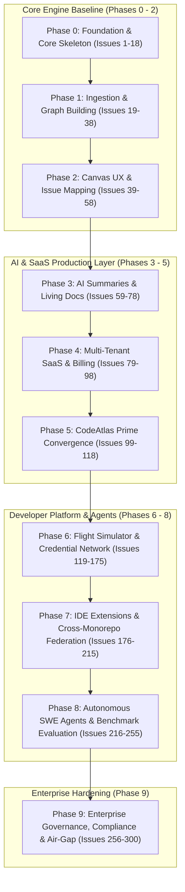

# CodeAtlas Engineering Issue Backlog & Architecture Matrix

This directory maintains the complete, professional backlog of **300 technical specifications and engineering issues** for **CodeAtlas** and **CodeAtlas Prime**, systematically mapped across all development phases from initialization to enterprise scale.

---

## 🧭 Backlog Overview & Phase Navigation

The issues are organized into ten distinct modular phase documents:

| Phase Document | Phase Title | Issue Range | Focus Areas | Status |
|---|---|---|---|---|
| **[00-phase-0-foundation.md](./00-phase-0-foundation.md)** | **Phase 0: Foundation & Core Skeleton** | `Issue 1 – Issue 18` | Turborepo, Docker Compose, OAuth, FastAPI lifespan, Alembic, Next.js, CI/CD | `100% Completed` |
| **[01-phase-1-ingestion-graph.md](./01-phase-1-ingestion-graph.md)** | **Phase 1: Ingestion & Graph Building** | `Issue 19 – Issue 38` | Shallow cloner, AST parsers, route/ORM extraction, pgvector HNSW, Celery | `90% Completed` |
| **[02-phase-2-mapping-search.md](./02-phase-2-mapping-search.md)** | **Phase 2: Canvas UX & Issue Mapping** | `Issue 39 – Issue 58` | React Flow custom nodes, Dagre layout, 5-signal issue ranker, hybrid search | `85% Completed` |
| **[03-phase-3-ai-docs-rag.md](./03-phase-3-ai-docs-rag.md)** | **Phase 3: AI Summaries & RAG Q&A** | `Issue 59 – Issue 78` | Ollama inference, living docs, complexity metrics, streaming SSE, citations | `80% Completed` |
| **[04-phase-4-saas-production.md](./04-phase-4-saas-production.md)** | **Phase 4: Multi-Tenant SaaS & Polish** | `Issue 79 – Issue 98` | RLS isolation, Stripe billing, API keys, Playwright E2E, Kubernetes Helm | `40% Ready / Active` |
| **[05-phase-5-prime-advanced.md](./05-phase-5-prime-advanced.md)** | **Phase 5: CodeAtlas Prime Convergence** | `Issue 99 – Issue 118` | PR blast radius bot, architecture linter, bus factor, churn heatmap, IDE extensions | `Planned / Roadmap` |
| **[06-phase-6-flight-simulator-telemetry-ecosystem.md](./06-phase-6-flight-simulator-telemetry-ecosystem.md)** | **Phase 6: Flight Simulator, Telemetry & Ecosystem** | `Issue 119 – Issue 175` | Chronos time engine, OmniQuery DB lens, OpenSourceMapper, WakaTime telemetry, GitReverse, Flight Simulator, Holopin badges | `Active / Core Implemented` |
| **[07-phase-7-ide-extensions-micro-workspaces.md](./07-phase-7-ide-extensions-micro-workspaces.md)** | **Phase 7: IDE Extensions & Federation** | `Issue 176 – Issue 215` | VS Code LSP, JetBrains JCEF, Neovim Treesitter, Tauri desktop, offline SQLite, CodeAtlasQL, cross-repo federation | `Active / Planned` |
| **[08-phase-8-autonomous-swe-agents-benchmarks.md](./08-phase-8-autonomous-swe-agents-benchmarks.md)** | **Phase 8: Autonomous SWE Agents & Benchmarks** | `Issue 216 – Issue 255` | SWE-bench harness, fault localization (SBFL), multi-agent planner/coder/reviewer, Docker sandbox, formal AST verification | `Active / Planned` |
| **[09-phase-9-enterprise-governance-airgapped.md](./09-phase-9-enterprise-governance-airgapped.md)** | **Phase 9: Enterprise Governance & Air-Gap** | `Issue 256 – Issue 300` | 100% air-gapped Helm charts, SOC 2 audit logs, SAML 2.0 / OIDC SSO, PostgreSQL RLS, OSS license compliance, DR replication | `Enterprise Scale` |

---


---

## 📊 Master 14-Phase Engineering Architecture & Dependency Flowchart



## 📊 Current Verification & Implementation State

The core architecture for Phases 0, 1, 2, 3, and core Phase 6 modules has already been coded and verified in the active codebase:

```text
Backend:    55 unit & integration tests passing (pytest in apps/api)
Frontend:   10 unit tests passing (vitest in apps/web)
Typecheck:  tsc --noEmit clean across apps/web and packages/shared
Routes:     37 FastAPI routes implemented across 11 core controllers
Database:   15 relational tables with Alembic async migrations + pgvector HNSW
Canvas:     React Flow canvas with custom nodes, BFS layout, bottom Chronos scrubber & OmniQuery drawer
```

---

## 📋 Complete Master Issue Catalog (500 Issues)

### Phase 0: Foundation, Infrastructure & Core Skeleton (`Issue 1 – Issue 18`)

| ID | Title | Component | Type | Priority | Status |
|---|---|---|---|---|---|
| `Issue 1` | [Monorepo Orchestration with Turborepo & pnpm Workspaces](./00-phase-0-foundation.md#issue-1-monorepo-orchestration-with-turborepo-pnpm-workspaces) | `infra` | Feature | `P0` | `Completed` |
| `Issue 2` | [Multi-Container Local Development Stack with Docker Compose](./00-phase-0-foundation.md#issue-2-multi-container-local-development-stack-with-docker-compose) | `infra` | Infra | `P0` | `Completed` |
| `Issue 3` | [GitHub App Registration & Webhook Receiver with HMAC-SHA256 Verification](./00-phase-0-foundation.md#issue-3-github-app-registration-webhook-receiver-with-hmac-sha256-verification) | `apps/api` | Security | `P0` | `Completed` |
| `Issue 4` | [GitHub OAuth 2.0 Flow & Dual-Mode JWT Authentication Service](./00-phase-0-foundation.md#issue-4-github-oauth-2-0-flow-dual-mode-jwt-authentication-service) | `apps/api` | Feature | `P0` | `Completed` |
| `Issue 5` | [Alembic Database Migration Framework & 15-Table Relational Schema](./00-phase-0-foundation.md#issue-5-alembic-database-migration-framework-15-table-relational-schema) | `apps/api` | Feature | `P0` | `Completed` |
| `Issue 6` | [FastAPI Application Lifecycle, Router Registry & Exception Middleware Stack](./00-phase-0-foundation.md#issue-6-fastapi-application-lifecycle-router-registry-exception-middleware-stack) | `apps/api` | Feature | `P0` | `Completed` |
| `Issue 7` | [Next.js 14 App Router Baseline & Modern Dark Mode Design System](./00-phase-0-foundation.md#issue-7-next-js-14-app-router-baseline-modern-dark-mode-design-system) | `apps/web` | Frontend | `P0` | `Completed` |
| `Issue 8` | [Shared TypeScript Domain Contracts & Data Transfer Objects](./00-phase-0-foundation.md#issue-8-shared-typescript-domain-contracts-data-transfer-objects) | `packages/shared` | Feature | `P1` | `Completed` |
| `Issue 9` | [CI/CD GitHub Actions Pipeline for Monorepo Validation & Docker Builds](./00-phase-0-foundation.md#issue-9-ci-cd-github-actions-pipeline-for-monorepo-validation-docker-builds) | `ci-cd` | Test | `P0` | `Completed` |
| `Issue 10` | [Automated Security Scanning with CodeQL, TruffleHog & Dependabot](./00-phase-0-foundation.md#issue-10-automated-security-scanning-with-codeql-trufflehog-dependabot) | `ci-cd` | Security | `P0` | `Completed` |
| `Issue 11` | [Celery Asynchronous Task Worker & Redis Broker Integration](./00-phase-0-foundation.md#issue-11-celery-asynchronous-task-worker-redis-broker-integration) | `apps/api` | Infra | `P0` | `Completed` |
| `Issue 12` | [Foundation Architectural Specifications & Technical System Blueprint](./00-phase-0-foundation.md#issue-12-foundation-architectural-specifications-technical-system-blueprint) | `docs` | Docs | `P1` | `Completed` |
| `Issue 13` | [Configuration Management with Pydantic Settings & Strict Validation](./00-phase-0-foundation.md#issue-13-configuration-management-with-pydantic-settings-strict-validation) | `apps/api` | Feature | `P1` | `Completed` |
| `Issue 14` | [Health, Liveness & Readiness Probes for Container Orchestration](./00-phase-0-foundation.md#issue-14-health-liveness-readiness-probes-for-container-orchestration) | `apps/api` | Infra | `P1` | `Completed` |
| `Issue 15` | [Comprehensive Backend & Frontend Unit Test Baseline](./00-phase-0-foundation.md#issue-15-comprehensive-backend-frontend-unit-test-baseline) | `apps/api` | Test | `P1` | `Completed` |
| `Issue 16` | [Contributor Guidelines, Code Style & Pre-Commit Hook Baseline](./00-phase-0-foundation.md#issue-16-contributor-guidelines-code-style-pre-commit-hook-baseline) | `infra` | Docs | `P2` | `Completed` |
| `Issue 17` | [Next.js Authentication Context & Protected Route Guards](./00-phase-0-foundation.md#issue-17-next-js-authentication-context-protected-route-guards) | `apps/web` | Frontend | `P1` | `Completed` |
| `Issue 18` | [Repository Explorer & Ingestion Trigger UI](./00-phase-0-foundation.md#issue-18-repository-explorer-ingestion-trigger-ui) | `apps/web` | Frontend | `P1` | `Completed` |

---

### Phase 1: Ingestion Engine, AST Parsers & Graph Persistence (`Issue 19 – Issue 38`)

| ID | Title | Component | Type | Priority | Status |
|---|---|---|---|---|---|
| `Issue 19` | [Shallow Repository Cloner with GitHub Installation Token & Sparse Checkout](./01-phase-1-ingestion-graph.md#issue-19-shallow-repository-cloner-with-github-installation-token-sparse-checkout) | `ingestion` | Feature | `P0` | `Completed` |
| `Issue 20` | [Base AST Parser Framework & Multi-Language Dispatch Registry](./01-phase-1-ingestion-graph.md#issue-20-base-ast-parser-framework-multi-language-dispatch-registry) | `parsers` | Feature | `P0` | `Completed` |
| `Issue 21` | [JavaScript & TypeScript AST Parser Engine](./01-phase-1-ingestion-graph.md#issue-21-javascript-typescript-ast-parser-engine) | `parsers` | Feature | `P0` | `Completed` |
| `Issue 22` | [Python AST Parser Engine with Decorator & Type Hint Analysis](./01-phase-1-ingestion-graph.md#issue-22-python-ast-parser-engine-with-decorator-type-hint-analysis) | `parsers` | Feature | `P0` | `Completed` |
| `Issue 23` | [Go Language AST Parser Integration (Packages, Structs & Interfaces)](./01-phase-1-ingestion-graph.md#issue-23-go-language-ast-parser-integration-packages-structs-interfaces) | `parsers` | Feature | `P2` | `Ready` |
| `Issue 24` | [Rust Language AST Parser Integration (Crates, Traits & Implementations)](./01-phase-1-ingestion-graph.md#issue-24-rust-language-ast-parser-integration-crates-traits-implementations) | `parsers` | Feature | `P2` | `Ready` |
| `Issue 25` | [API Route Extraction Engine for Express, FastAPI, Next.js & Spring](./01-phase-1-ingestion-graph.md#issue-25-api-route-extraction-engine-for-express-fastapi-next-js-spring) | `ingestion` | Feature | `P1` | `Completed` |
| `Issue 26` | [React/Vue Component & Hook Hierarchy Extraction](./01-phase-1-ingestion-graph.md#issue-26-react-vue-component-hook-hierarchy-extraction) | `ingestion` | Feature | `P1` | `Completed` |
| `Issue 27` | [Database ORM Model Extraction (Prisma, SQLAlchemy, Django ORM)](./01-phase-1-ingestion-graph.md#issue-27-database-orm-model-extraction-prisma-sqlalchemy-django-orm) | `ingestion` | Feature | `P1` | `Completed` |
| `Issue 28` | [Graph Persistence Layer with High-Speed PostgreSQL Batch Upsert](./01-phase-1-ingestion-graph.md#issue-28-graph-persistence-layer-with-high-speed-postgresql-batch-upsert) | `apps/api` | Perf | `P0` | `Completed` |
| `Issue 29` | [Vector Embeddings Generation Pipeline with Local Ollama Inference](./01-phase-1-ingestion-graph.md#issue-29-vector-embeddings-generation-pipeline-with-local-ollama-inference) | `ai-rag` | Feature | `P0` | `Completed` |
| `Issue 30` | [pgvector HNSW Index Configuration & Fast Cosine Distance Queries](./01-phase-1-ingestion-graph.md#issue-30-pgvector-hnsw-index-configuration-fast-cosine-distance-queries) | `vector-db` | Perf | `P0` | `Completed` |
| `Issue 31` | [Incremental Git Diff Parser for Push Webhook Re-Indexing](./01-phase-1-ingestion-graph.md#issue-31-incremental-git-diff-parser-for-push-webhook-re-indexing) | `ingestion` | Feature | `P1` | `Completed` |
| `Issue 32` | [Real-Time Ingestion Pipeline Progress Tracking via WebSocket & REST API](./01-phase-1-ingestion-graph.md#issue-32-real-time-ingestion-pipeline-progress-tracking-via-websocket-rest-api) | `apps/api` | Feature | `P1` | `Completed` |
| `Issue 33` | [Celery Ingestion Worker Memory Leak Remediation & Process Recycling](./01-phase-1-ingestion-graph.md#issue-33-celery-ingestion-worker-memory-leak-remediation-process-recycling) | `ingestion` | Perf | `P1` | `Completed` |
| `Issue 34` | [Monorepo Workspace Package Boundary & Circular Dependency Detector](./01-phase-1-ingestion-graph.md#issue-34-monorepo-workspace-package-boundary-circular-dependency-detector) | `ingestion` | Feature | `P1` | `Ready` |
| `Issue 35` | [Tree-sitter Native Parser Integration (Upgrading from Regex)](./01-phase-1-ingestion-graph.md#issue-35-tree-sitter-native-parser-integration-upgrading-from-regex) | `parsers` | Feature | `P1` | `Ready` |
| `Issue 36` | [CodeNode & CodeEdge Composite Index Optimization for Subgraph Traversal](./01-phase-1-ingestion-graph.md#issue-36-codenode-codeedge-composite-index-optimization-for-subgraph-traversal) | `apps/api` | Perf | `P1` | `Completed` |
| `Issue 37` | [Repository Health Check & Ingestion Failure Rollback Mechanism](./01-phase-1-ingestion-graph.md#issue-37-repository-health-check-ingestion-failure-rollback-mechanism) | `ingestion` | Feature | `P2` | `Ready` |
| `Issue 38` | [Synthetic Golden Monorepo Fixture & Parser Test Suite](./01-phase-1-ingestion-graph.md#issue-38-synthetic-golden-monorepo-fixture-parser-test-suite) | `parsers` | Test | `P1` | `Completed` |

---

### Phase 2: Interactive Canvas UX, Search & Issue Mapping (`Issue 39 – Issue 58`)

| ID | Title | Component | Type | Priority | Status |
|---|---|---|---|---|---|
| `Issue 39` | [React Flow Canvas Initialization with Custom AST Node Renderers](./02-phase-2-mapping-search.md#issue-39-react-flow-canvas-initialization-with-custom-ast-node-renderers) | `apps/web` | Frontend | `P0` | `Completed` |
| `Issue 40` | [Typed Edge Rendering with Animated Data Flow & Relationship Colors](./02-phase-2-mapping-search.md#issue-40-typed-edge-rendering-with-animated-data-flow-relationship-colors) | `apps/web` | Frontend | `P1` | `Completed` |
| `Issue 41` | [Dagre Hierarchical Layered Layout & BFS Depth Calculation Engine](./02-phase-2-mapping-search.md#issue-41-dagre-hierarchical-layered-layout-bfs-depth-calculation-engine) | `apps/web` | Frontend | `P0` | `Completed` |
| `Issue 42` | [Canvas Node Virtualization for 2,000+ Nodes at 60 FPS](./02-phase-2-mapping-search.md#issue-42-canvas-node-virtualization-for-2-000-nodes-at-60-fps) | `apps/web` | Perf | `P1` | `Ready` |
| `Issue 43` | [Collapsible Directory & Monorepo Package Clustering](./02-phase-2-mapping-search.md#issue-43-collapsible-directory-monorepo-package-clustering) | `apps/web` | Frontend | `P1` | `Ready` |
| `Issue 44` | [Subgraph Exploration & Neighborhood Extraction API](./02-phase-2-mapping-search.md#issue-44-subgraph-exploration-neighborhood-extraction-api) | `apps/api` | Feature | `P0` | `Completed` |
| `Issue 45` | [Interactive Canvas Navigation Controls, Minimap & Center-on-Node](./02-phase-2-mapping-search.md#issue-45-interactive-canvas-navigation-controls-minimap-center-on-node) | `apps/web` | Frontend | `P1` | `Completed` |
| `Issue 46` | [GitHub Issues Fetcher Service with GraphQL Pagination & Comment Threads](./02-phase-2-mapping-search.md#issue-46-github-issues-fetcher-service-with-graphql-pagination-comment-threads) | `apps/api` | Feature | `P0` | `Completed` |
| `Issue 47` | [Issue Text Preprocessor (Code Block Extraction, Stack Traces & Symbols)](./02-phase-2-mapping-search.md#issue-47-issue-text-preprocessor-code-block-extraction-stack-traces-symbols) | `mapping` | Feature | `P1` | `Completed` |
| `Issue 48` | [Issue Intent Classifier (Bug, Feature, Refactor, Security, Docs)](./02-phase-2-mapping-search.md#issue-48-issue-intent-classifier-bug-feature-refactor-security-docs) | `mapping` | Feature | `P1` | `Completed` |
| `Issue 49` | [Signal 1 - Semantic Issue Candidate Retrieval via pgvector Cosine Distance](./02-phase-2-mapping-search.md#issue-49-signal-1-semantic-issue-candidate-retrieval-via-pgvector-cosine-distance) | `mapping` | Feature | `P0` | `Completed` |
| `Issue 50` | [Signal 2 - Structural Heuristic Matcher via Trigram & Exact Symbol Match](./02-phase-2-mapping-search.md#issue-50-signal-2-structural-heuristic-matcher-via-trigram-exact-symbol-match) | `mapping` | Feature | `P0` | `Completed` |
| `Issue 51` | [Signal 3 - Topological 1-Hop Graph Neighbor Propagation Algorithm](./02-phase-2-mapping-search.md#issue-51-signal-3-topological-1-hop-graph-neighbor-propagation-algorithm) | `mapping` | Feature | `P0` | `Completed` |
| `Issue 52` | [Signal 4 - Historical Reviewer Feedback Weighting](./02-phase-2-mapping-search.md#issue-52-signal-4-historical-reviewer-feedback-weighting) | `mapping` | Feature | `P1` | `Completed` |
| `Issue 53` | [Signal 5 - Hotspot Degree Centrality Prioritization](./02-phase-2-mapping-search.md#issue-53-signal-5-hotspot-degree-centrality-prioritization) | `mapping` | Feature | `P1` | `Completed` |
| `Issue 54` | [5-Signal Combined Confidence Calibration & Tier Assignment (High/Med/Low)](./02-phase-2-mapping-search.md#issue-54-5-signal-combined-confidence-calibration-tier-assignment-high-med-low) | `mapping` | Feature | `P0` | `Completed` |
| `Issue 55` | [Issue Detail Sidebar with Highlighting & Suggested Action Reasoning](./02-phase-2-mapping-search.md#issue-55-issue-detail-sidebar-with-highlighting-suggested-action-reasoning) | `apps/web` | Frontend | `P0` | `Completed` |
| `Issue 56` | [Node Detail Inspector Drawer (Source Preview, Relationships & Complexity)](./02-phase-2-mapping-search.md#issue-56-node-detail-inspector-drawer-source-preview-relationships-complexity) | `apps/web` | Frontend | `P1` | `Completed` |
| `Issue 57` | [Hybrid Natural Language Search API & Real-Time Query UI](./02-phase-2-mapping-search.md#issue-57-hybrid-natural-language-search-api-real-time-query-ui) | `apps/api` | Feature | `P0` | `Completed` |
| `Issue 58` | [Issue Mapping Golden Set Accuracy Evaluation Suite](./02-phase-2-mapping-search.md#issue-58-issue-mapping-golden-set-accuracy-evaluation-suite) | `mapping` | Test | `P1` | `Ready` |

---

### Phase 3: AI Summaries, Living Documentation & RAG Chat (`Issue 59 – Issue 78`)

| ID | Title | Component | Type | Priority | Status |
|---|---|---|---|---|---|
| `Issue 59` | [Local LLM Client Integration with Ollama, Timeout & Model Fallback](./03-phase-3-ai-docs-rag.md#issue-59-local-llm-client-integration-with-ollama-timeout-model-fallback) | `ai-rag` | Feature | `P0` | `Completed` |
| `Issue 60` | [Directory-Level Architectural Purpose Summarizer](./03-phase-3-ai-docs-rag.md#issue-60-directory-level-architectural-purpose-summarizer) | `ai-rag` | Feature | `P1` | `Completed` |
| `Issue 61` | [Module, Class & Function Behavioral Summarizer](./03-phase-3-ai-docs-rag.md#issue-61-module-class-function-behavioral-summarizer) | `ai-rag` | Feature | `P1` | `Completed` |
| `Issue 62` | [Content-Hash Summary Cache to Prevent Redundant LLM Inference](./03-phase-3-ai-docs-rag.md#issue-62-content-hash-summary-cache-to-prevent-redundant-llm-inference) | `ai-rag` | Perf | `P1` | `Completed` |
| `Issue 63` | [Code Complexity Analyzer (Cyclomatic, Cognitive & Halstead Metrics)](./03-phase-3-ai-docs-rag.md#issue-63-code-complexity-analyzer-cyclomatic-cognitive-halstead-metrics) | `apps/api` | Feature | `P1` | `Completed` |
| `Issue 64` | [Visual Complexity Heatmap Overlay on React Flow Canvas](./03-phase-3-ai-docs-rag.md#issue-64-visual-complexity-heatmap-overlay-on-react-flow-canvas) | `apps/web` | Frontend | `P1` | `Ready` |
| `Issue 65` | [Living Architecture Documentation Generator (Markdown + Mermaid)](./03-phase-3-ai-docs-rag.md#issue-65-living-architecture-documentation-generator-markdown-mermaid) | `apps/api` | Feature | `P0` | `Completed` |
| `Issue 66` | [Automated "New Contributor Onboarding Guide" Generator](./03-phase-3-ai-docs-rag.md#issue-66-automated-new-contributor-onboarding-guide-generator) | `apps/api` | Feature | `P1` | `Ready` |
| `Issue 67` | ["Good First Issue" Matcher Based on AST Isolation & Low In-Degree](./03-phase-3-ai-docs-rag.md#issue-67-good-first-issue-matcher-based-on-ast-isolation-low-in-degree) | `mapping` | Feature | `P1` | `Ready` |
| `Issue 68` | [RAG Context Assembly Pipeline with Strict Token Budgeting](./03-phase-3-ai-docs-rag.md#issue-68-rag-context-assembly-pipeline-with-strict-token-budgeting) | `ai-rag` | Feature | `P0` | `Completed` |
| `Issue 69` | [Streaming Server-Sent Events (SSE) Chat API Endpoint](./03-phase-3-ai-docs-rag.md#issue-69-streaming-server-sent-events-sse-chat-api-endpoint) | `apps/api` | Feature | `P0` | `Completed` |
| `#070` | [Grounded Code Citation Linking with Exact [file:line] References](./03-phase-3-ai-docs-rag.md#issue-070-feat-grounded-code-citation-linking-with-exact-fileline-references) | `ai-rag` | Feature | `P0` | `Completed` |
| `Issue 71` | [Conversational Chat Session Persistence & Multi-Turn History Cache](./03-phase-3-ai-docs-rag.md#issue-71-conversational-chat-session-persistence-multi-turn-history-cache) | `apps/api` | Feature | `P1` | `Completed` |
| `Issue 72` | [Hallucination Guardrails & Refusal Protocol for Out-of-Domain Queries](./03-phase-3-ai-docs-rag.md#issue-72-hallucination-guardrails-refusal-protocol-for-out-of-domain-queries) | `ai-rag` | Security | `P1` | `Ready` |
| `Issue 73` | [Automated Architectural Drift Detection on Git Push Webhook](./03-phase-3-ai-docs-rag.md#issue-73-automated-architectural-drift-detection-on-git-push-webhook) | `apps/api` | Feature | `P1` | `Ready` |
| `Issue 74` | [Scheduled Weekly Repository Full Re-Analysis Celery Beat Task](./03-phase-3-ai-docs-rag.md#issue-74-scheduled-weekly-repository-full-re-analysis-celery-beat-task) | `apps/api` | Infra | `P2` | `Ready` |
| `Issue 75` | [Markdown & PDF Living Architecture Documentation Export Service](./03-phase-3-ai-docs-rag.md#issue-75-markdown-pdf-living-architecture-documentation-export-service) | `apps/api` | Feature | `P2` | `Ready` |
| `Issue 76` | [Architectural Changelog Generator Between Git Releases & Tags](./03-phase-3-ai-docs-rag.md#issue-76-architectural-changelog-generator-between-git-releases-tags) | `apps/api` | Feature | `P2` | `Ready` |
| `Issue 77` | [Contextual Chat Suggestion Chips Based on Canvas Selection](./03-phase-3-ai-docs-rag.md#issue-77-contextual-chat-suggestion-chips-based-on-canvas-selection) | `apps/web` | Frontend | `P2` | `Ready` |
| `Issue 78` | [User Feedback Collector for AI Answer Quality & Citation Accuracy](./03-phase-3-ai-docs-rag.md#issue-78-user-feedback-collector-for-ai-answer-quality-citation-accuracy) | `apps/api` | Feature | `P2` | `Ready` |

---

### Phase 4: Multi-Tenant SaaS, Security & Production Polish (`Issue 79 – Issue 98`)

| ID | Title | Component | Type | Priority | Status |
|---|---|---|---|---|---|
| `Issue 79` | [Organization & Workspace Multi-Tenant Relational Data Model](./04-phase-4-saas-production.md#issue-79-organization-workspace-multi-tenant-relational-data-model) | `apps/api` | Feature | `P0` | `Completed` |
| `Issue 80` | [PostgreSQL Row-Level Security (RLS) Tenant Isolation Policies](./04-phase-4-saas-production.md#issue-80-postgresql-row-level-security-rls-tenant-isolation-policies) | `apps/api` | Security | `P0` | `Ready` |
| `Issue 81` | [Role-Based Access Control (RBAC) Permission Middleware](./04-phase-4-saas-production.md#issue-81-role-based-access-control-rbac-permission-middleware) | `apps/api` | Security | `P0` | `Ready` |
| `Issue 82` | [Organization Member Invitation Flow with Cryptographic Signed Tokens](./04-phase-4-saas-production.md#issue-82-organization-member-invitation-flow-with-cryptographic-signed-tokens) | `apps/api` | Feature | `P1` | `Ready` |
| `Issue 83` | [Stripe Subscription Billing Integration (Free, Pro & Enterprise Tiers)](./04-phase-4-saas-production.md#issue-83-stripe-subscription-billing-integration-free-pro-enterprise-tiers) | `apps/api` | Feature | `P0` | `Ready` |
| `Issue 84` | [Usage Quota Enforcement & Real-Time Metering Service](./04-phase-4-saas-production.md#issue-84-usage-quota-enforcement-real-time-metering-service) | `apps/api` | Feature | `P1` | `Ready` |
| `Issue 85` | [Stripe Webhook Receiver & Subscription Lifecycle State Machine](./04-phase-4-saas-production.md#issue-85-stripe-webhook-receiver-subscription-lifecycle-state-machine) | `apps/api` | Security | `P0` | `Ready` |
| `Issue 86` | [Organization Admin Dashboard & System Observability Portal](./04-phase-4-saas-production.md#issue-86-organization-admin-dashboard-system-observability-portal) | `apps/web` | Frontend | `P1` | `Ready` |
| `Issue 87` | [Ingestion Error Log Viewer & Dead-Letter Queue Management](./04-phase-4-saas-production.md#issue-87-ingestion-error-log-viewer-dead-letter-queue-management) | `apps/web` | Frontend | `P1` | `Ready` |
| `Issue 88` | [Public Developer API: Key Generation, SHA-256 Hashing & Revocation](./04-phase-4-saas-production.md#issue-88-public-developer-api-key-generation-sha-256-hashing-revocation) | `apps/api` | Security | `P0` | `Ready` |
| `Issue 89` | [Tiered API Rate Limiting with Redis Sliding Window Counter](./04-phase-4-saas-production.md#issue-89-tiered-api-rate-limiting-with-redis-sliding-window-counter) | `apps/api` | Perf | `P1` | `Completed` |
| `Issue 90` | [Enterprise Audit Logging Service for Compliance (SOC 2 Type II)](./04-phase-4-saas-production.md#issue-90-enterprise-audit-logging-service-for-compliance-soc-2-type-ii) | `apps/api` | Security | `P1` | `Ready` |
| `Issue 91` | [Playwright End-to-End Test Suite: Authentication & Canvas Workflows](./04-phase-4-saas-production.md#issue-91-playwright-end-to-end-test-suite-authentication-canvas-workflows) | `apps/web` | Test | `P0` | `Ready` |
| `Issue 92` | [Playwright End-to-End Test Suite: Issue Mapping & Streaming Chat](./04-phase-4-saas-production.md#issue-92-playwright-end-to-end-test-suite-issue-mapping-streaming-chat) | `apps/web` | Test | `P0` | `Ready` |
| `Issue 93` | [High-Concurrency Load Testing with Locust (100 Concurrent Ingestions)](./04-phase-4-saas-production.md#issue-93-high-concurrency-load-testing-with-locust-100-concurrent-ingestions) | `apps/api` | Perf | `P1` | `Ready` |
| `Issue 94` | [OWASP Top 10 Security Audit, Penetration Test & Dependency Remediation](./04-phase-4-saas-production.md#issue-94-owasp-top-10-security-audit-penetration-test-dependency-remediation) | `apps/api` | Security | `P0` | `Ready` |
| `Issue 95` | [Public Documentation Site Deployment (Nextra / Mintlify)](./04-phase-4-saas-production.md#issue-95-public-documentation-site-deployment-nextra-mintlify) | `docs` | Docs | `P1` | `Ready` |
| `Issue 96` | [Marketing Landing Page with Interactive Canvas Demo & Waitlist](./04-phase-4-saas-production.md#issue-96-marketing-landing-page-with-interactive-canvas-demo-waitlist) | `apps/web` | Frontend | `P1` | `Ready` |
| `Issue 97` | [Production Kubernetes Deployment Architecture (EKS/GKE Helm Charts)](./04-phase-4-saas-production.md#issue-97-production-kubernetes-deployment-architecture-eks-gke-helm-charts) | `infra` | Infra | `P0` | `Ready` |
| `Issue 98` | [Automated Incident Response Runbooks & Disaster Recovery Protocols](./04-phase-4-saas-production.md#issue-98-automated-incident-response-runbooks-disaster-recovery-protocols) | `docs` | Infra | `P1` | `Ready` |

---

### Phase 5: CodeAtlas Prime Convergence & Advanced Enterprise (`Issue 99 – Issue 118`)

| ID | Title | Component | Type | Priority | Status |
|---|---|---|---|---|---|
| `Issue 99` | [PR "Blast Radius" GitHub App Bot with Automated Architectural Impact Comment](./05-phase-5-prime-advanced.md#issue-99-pr-blast-radius-github-app-bot-with-automated-architectural-impact-comment) | `apps/api` | Feature | `P0` | `Ready` |
| `Issue 100` | [Architectural Boundary Enforcement Engine ("The Architecture Linter")](./05-phase-5-prime-advanced.md#issue-100-architectural-boundary-enforcement-engine-the-architecture-linter) | `apps/api` | Feature | `P0` | `Ready` |
| `Issue 101` | ["Bus Factor" & Single-Maintainer Knowledge Silo Risk Analysis](./05-phase-5-prime-advanced.md#issue-101-bus-factor-single-maintainer-knowledge-silo-risk-analysis) | `apps/api` | Feature | `P1` | `Ready` |
| `Issue 102` | [Dynamic README SVG Architecture Badge Generator](./05-phase-5-prime-advanced.md#issue-102-dynamic-readme-svg-architecture-badge-generator) | `apps/api` | Feature | `P1` | `Ready` |
| `Issue 103` | [Temporal Commit Churn Heatmap Overlay on Spatial React Flow Nodes](./05-phase-5-prime-advanced.md#issue-103-temporal-commit-churn-heatmap-overlay-on-spatial-react-flow-nodes) | `apps/web` | Frontend | `P1` | `Ready` |
| `Issue 104` | [GitWatcher (GitPulse) Developer Telemetry Convergence](./05-phase-5-prime-advanced.md#issue-104-gitwatcher-gitpulse-developer-telemetry-convergence) | `apps/api` | Feature | `P1` | `Ready` |
| `Issue 105` | [Architectural Drift Tracking Between Git Branches & Release Tags](./05-phase-5-prime-advanced.md#issue-105-architectural-drift-tracking-between-git-branches-release-tags) | `apps/api` | Feature | `P1` | `Ready` |
| `Issue 106` | [CodeAtlas VS Code Extension: In-Editor Graph Navigation & Hover AST Insights](./05-phase-5-prime-advanced.md#issue-106-codeatlas-vs-code-extension-in-editor-graph-navigation-hover-ast-insights) | `extensions` | Frontend | `P1` | `Ready` |
| `Issue 107` | [JetBrains IDE Plugin for CodeAtlas Graph & Subgraph Exploration](./05-phase-5-prime-advanced.md#issue-107-jetbrains-ide-plugin-for-codeatlas-graph-subgraph-exploration) | `extensions` | Frontend | `P2` | `Ready` |
| `Issue 108` | [Slack & Discord Bot: Conversational Codebase Q&A ("/codeatlas <query>")](./05-phase-5-prime-advanced.md#issue-108-slack-discord-bot-conversational-codebase-q-a-codeatlas-query) | `apps/api` | Feature | `P2` | `Ready` |
| `Issue 109` | [Auto-Scaffolding PR Patch Generator for Mapped GitHub Issues](./05-phase-5-prime-advanced.md#issue-109-auto-scaffolding-pr-patch-generator-for-mapped-github-issues) | `ai-rag` | Feature | `P2` | `Ready` |
| `Issue 110` | [Open-Source License Compliance & Vulnerability Dependency Mapper](./05-phase-5-prime-advanced.md#issue-110-open-source-license-compliance-vulnerability-dependency-mapper) | `ingestion` | Security | `P1` | `Ready` |
| `Issue 111` | [Notion & Confluence Living Architecture Documentation Sync Engine](./05-phase-5-prime-advanced.md#issue-111-notion-confluence-living-architecture-documentation-sync-engine) | `apps/api` | Feature | `P2` | `Ready` |
| `Issue 112` | [Multi-Repository Cross-Dependency Graph Mapping for Microservices](./05-phase-5-prime-advanced.md#issue-112-multi-repository-cross-dependency-graph-mapping-for-microservices) | `apps/api` | Feature | `P1` | `Ready` |
| `Issue 113` | [100% Air-Gapped Local Enterprise Distribution & Self-Hosted Package](./05-phase-5-prime-advanced.md#issue-113-100-air-gapped-local-enterprise-distribution-self-hosted-package) | `infra` | Infra | `P1` | `Ready` |
| `Issue 114` | [3D WebGL / Force-Directed AST Diff Visualizer](./05-phase-5-prime-advanced.md#issue-114-3d-webgl-force-directed-ast-diff-visualizer) | `apps/web` | Frontend | `P2` | `Ready` |
| `Issue 115` | [Custom Architectural Rules Engine with AST Query Language (CodeAtlasQL)](./05-phase-5-prime-advanced.md#issue-115-custom-architectural-rules-engine-with-ast-query-language-codeatlasql) | `apps/api` | Feature | `P1` | `Ready` |
| `Issue 116` | [Codebase Technical Debt Prioritization Matrix (Churn vs Complexity)](./05-phase-5-prime-advanced.md#issue-116-codebase-technical-debt-prioritization-matrix-churn-vs-complexity) | `apps/api` | Feature | `P1` | `Ready` |
| `Issue 117` | [Enterprise Single Sign-On (SSO) with SAML 2.0 & OIDC (Okta, Azure AD)](./05-phase-5-prime-advanced.md#issue-117-enterprise-single-sign-on-sso-with-saml-2-0-oidc-okta-azure-ad) | `apps/api` | Security | `P0` | `Ready` |
| `Issue 118` | [Domain-Specific AST Embedding Model Fine-Tuning Pipeline](./05-phase-5-prime-advanced.md#issue-118-domain-specific-ast-embedding-model-fine-tuning-pipeline) | `ai-rag` | Feature | `P2` | `Ready` |

---

### Phase 6: Flight Simulator, Active Telemetry & Verifiable Credential Ecosystem (`Issue 119 – Issue 175`)

| ID | Title | Component | Type | Priority | Status |
|---|---|---|---|---|---|
| `Issue 119` | [Chronos Commit Timeline Scrubber & Milestone Progression Ribbon](./06-phase-6-flight-simulator-telemetry-ecosystem.md#issue-119-chronos-commit-timeline-scrubber-milestone-progression-ribbon) | `apps/web` | Frontend | `P0` | `Completed` |
| `Issue 120` | [What-If AST Refactor Mutation & Downstream Blast Radius Simulator](./06-phase-6-flight-simulator-telemetry-ecosystem.md#issue-120-what-if-ast-refactor-mutation-downstream-blast-radius-simulator) | `apps/api` | Feature | `P0` | `Completed` |
| `Issue 121` | [Architectural Archaeology Provenance & PR Decision Grounding](./06-phase-6-flight-simulator-telemetry-ecosystem.md#issue-121-architectural-archaeology-provenance-pr-decision-grounding) | `apps/api` | Feature | `P1` | `Completed` |
| `Issue 122` | [Historical Git AST Checkpoint Diffing & Circular Dependency Detector](./06-phase-6-flight-simulator-telemetry-ecosystem.md#issue-122-historical-git-ast-checkpoint-diffing-circular-dependency-detector) | `apps/api` | Feature | `P1` | `Completed` |
| `Issue 123` | [Temporal Timeline Playback & Automated Architecture Drift Animator](./06-phase-6-flight-simulator-telemetry-ecosystem.md#issue-123-temporal-timeline-playback-automated-architecture-drift-animator) | `apps/web` | Frontend | `P2` | `Completed` |
| `Issue 124` | [Database ORM Model Discovery & Schema Lens Inspector](./06-phase-6-flight-simulator-telemetry-ecosystem.md#issue-124-database-orm-model-discovery-schema-lens-inspector) | `apps/api` | Feature | `P0` | `Completed` |
| `Issue 125` | [Natural Language to SQL Translation Engine with Schema Constraint Validation](./06-phase-6-flight-simulator-telemetry-ecosystem.md#issue-125-natural-language-to-sql-translation-engine-with-schema-constraint-validation) | `apps/api` | Feature | `P0` | `Completed` |
| `Issue 126` | [Cross-Engine CodeAtlas API Route & Component Blast Radius Checker](./06-phase-6-flight-simulator-telemetry-ecosystem.md#issue-126-cross-engine-codeatlas-api-route-component-blast-radius-checker) | `apps/api` | Feature | `P0` | `Completed` |
| `Issue 127` | [Sandboxed Dry-Run Transaction Runner & Row Preview Table](./06-phase-6-flight-simulator-telemetry-ecosystem.md#issue-127-sandboxed-dry-run-transaction-runner-row-preview-table) | `apps/api` | Feature | `P1` | `Completed` |
| `Issue 128` | [Automated Rollback Plan Generator & Emergency Reversal Controller](./06-phase-6-flight-simulator-telemetry-ecosystem.md#issue-128-automated-rollback-plan-generator-emergency-reversal-controller) | `apps/api` | Feature | `P0` | `Completed` |
| `Issue 129` | [Good First Issue Triage by AST Subgraph Isolation & Complexity Scoring](./06-phase-6-flight-simulator-telemetry-ecosystem.md#issue-129-good-first-issue-triage-by-ast-subgraph-isolation-complexity-scoring) | `apps/api` | Feature | `P0` | `Ready` |
| `Issue 130` | [3-Step Contributor Execution Blueprint Generator](./06-phase-6-flight-simulator-telemetry-ecosystem.md#issue-130-3-step-contributor-execution-blueprint-generator) | `apps/api` | Feature | `P1` | `Ready` |
| `Issue 131` | [Repository Architecture Mental Model & Prerequisite Concept Checklist](./06-phase-6-flight-simulator-telemetry-ecosystem.md#issue-131-repository-architecture-mental-model-prerequisite-concept-checklist) | `apps/web` | Frontend | `P1` | `Ready` |
| `Issue 132` | [First-Time Contributor Safety Guardrail & Pre-Flight Review Checks](./06-phase-6-flight-simulator-telemetry-ecosystem.md#issue-132-first-time-contributor-safety-guardrail-pre-flight-review-checks) | `apps/api` | Feature | `P2` | `Ready` |
| `Issue 133` | [WakaTime-Compatible Local Heartbeat Ingestion Endpoint](./06-phase-6-flight-simulator-telemetry-ecosystem.md#issue-133-wakatime-compatible-local-heartbeat-ingestion-endpoint) | `apps/api` | Feature | `P0` | `Ready` |
| `Issue 134` | [Active Editor Time AST Node Mapping & Flow State Heatmaps](./06-phase-6-flight-simulator-telemetry-ecosystem.md#issue-134-active-editor-time-ast-node-mapping-flow-state-heatmaps) | `apps/web` | Frontend | `P1` | `Ready` |
| `Issue 135` | [Cognitive Friction Index & Codebase Frustration Hotspot Detection](./06-phase-6-flight-simulator-telemetry-ecosystem.md#issue-135-cognitive-friction-index-codebase-frustration-hotspot-detection) | `apps/api` | Feature | `P1` | `Ready` |
| `Issue 136` | [Local Privacy-First Developer Pulse Dashboard & Telemetry Filtering](./06-phase-6-flight-simulator-telemetry-ecosystem.md#issue-136-local-privacy-first-developer-pulse-dashboard-telemetry-filtering) | `apps/web` | Frontend | `P2` | `Ready` |
| `Issue 137` | [Hierarchical AST-Driven LLM Context Packager & Token Optimizer](./06-phase-6-flight-simulator-telemetry-ecosystem.md#issue-137-hierarchical-ast-driven-llm-context-packager-token-optimizer) | `apps/api` | Feature | `P0` | `Ready` |
| `Issue 138` | [Automated AGENTS.md, .cursorrules & llms.txt Generator](./06-phase-6-flight-simulator-telemetry-ecosystem.md#issue-138-automated-agentsmd-cursorrules-llmstxt-generator) | `apps/api` | Feature | `P0` | `Ready` |
| `Issue 139` | [Subgraph Prompt-to-Reconstruct & Interface Contract Exporter](./06-phase-6-flight-simulator-telemetry-ecosystem.md#issue-139-subgraph-prompt-to-reconstruct-interface-contract-exporter) | `apps/web` | Frontend | `P1` | `Ready` |
| `Issue 140` | [Architectural Mental Model Reverse-Engineering from Git & Topology (GitReverse)](./06-phase-6-flight-simulator-telemetry-ecosystem.md#issue-140-architectural-mental-model-reverse-engineering-from-git-topology-gitreverse) | `apps/api` | Feature | `P1` | `Ready` |
| `Issue 141` | [In-Browser Git Flight Simulator Engine with Mock Workspaces](./06-phase-6-flight-simulator-telemetry-ecosystem.md#issue-141-in-browser-git-flight-simulator-engine-with-mock-workspaces) | `apps/api` | Feature | `P0` | `Ready` |
| `Issue 142` | [Interactive Git Workflow Training: Fork, Branch, Commits & Rebase](./06-phase-6-flight-simulator-telemetry-ecosystem.md#issue-142-interactive-git-workflow-training-fork-branch-commits-rebase) | `apps/web` | Frontend | `P0` | `Ready` |
| `Issue 143` | [Simulated PR Bot Review, Automated CI Checks & Conflict Resolution Missions](./06-phase-6-flight-simulator-telemetry-ecosystem.md#issue-143-simulated-pr-bot-review-automated-ci-checks-conflict-resolution-missions) | `apps/api` | Feature | `P0` | `Ready` |
| `Issue 144` | [Dynamic SVG Contributor Badge Generator for GitHub Profile READMEs](./06-phase-6-flight-simulator-telemetry-ecosystem.md#issue-144-dynamic-svg-contributor-badge-generator-for-github-profile-readmes) | `apps/api` | Feature | `P0` | `Ready` |
| `Issue 145` | [Cryptographic Ed25519 Badge Signing & Tamper-Proof Public Verification Portal](./06-phase-6-flight-simulator-telemetry-ecosystem.md#issue-145-cryptographic-ed25519-badge-signing-tamper-proof-public-verification-portal) | `apps/api` | Security | `P0` | `Ready` |
| `Issue 146` | [Holopin-Style Contributor Achievement Board & Viral Reputation Matrix](./06-phase-6-flight-simulator-telemetry-ecosystem.md#issue-146-holopin-style-contributor-achievement-board-viral-reputation-matrix) | `apps/web` | Frontend | `P1` | `Ready` |
| `Issue 147` | [In-Browser WebContainer & WASM Virtual Git Filesystem](./06-phase-6-flight-simulator-telemetry-ecosystem.md#issue-147-in-browser-webcontainer-wasm-virtual-git-filesystem) | `apps/web` | Feature | `P0` | `Ready` |
| `Issue 148` | [Multi-Persona AI Code Reviewer Bot (Strict Mentor, Security Auditor)](./06-phase-6-flight-simulator-telemetry-ecosystem.md#issue-148-multi-persona-ai-code-reviewer-bot-strict-mentor-security-auditor-performance-engineer) | `apps/api` | Feature | `P0` | `Ready` |
| `Issue 149` | [Interactive Git Cherry-Pick & Interactive Rebase Mission Track](./06-phase-6-flight-simulator-telemetry-ecosystem.md#issue-149-interactive-git-cherry-pick-interactive-rebase-mission-track) | `apps/web` | Frontend | `P1` | `Ready` |
| `Issue 150` | [Upstream Monorepo Forking Wizard & Subtree Scope Isolator](./06-phase-6-flight-simulator-telemetry-ecosystem.md#issue-150-upstream-monorepo-forking-wizard-subtree-scope-isolator) | `apps/api` | Feature | `P1` | `Ready` |
| `Issue 151` | [Flight Simulator Telemetry & Mission Milestone State Machine](./06-phase-6-flight-simulator-telemetry-ecosystem.md#issue-151-flight-simulator-telemetry-mission-milestone-state-machine) | `apps/api` | Feature | `P1` | `Ready` |
| `Issue 152` | [Dynamic SVG Badge Shader & Hexagonal Pin Theme Customizer](./06-phase-6-flight-simulator-telemetry-ecosystem.md#issue-152-dynamic-svg-badge-shader-hexagonal-pin-theme-customizer) | `apps/web` | Frontend | `P1` | `Ready` |
| `Issue 153` | [Asymmetric Ed25519 Key Generation, Storage & Public Key Registry](./06-phase-6-flight-simulator-telemetry-ecosystem.md#issue-153-asymmetric-ed25519-key-generation-storage-public-key-registry) | `apps/api` | Security | `P0` | `Ready` |
| `Issue 154` | [Public Verification Portal with Merkle Proof & AST Contribution Replay](./06-phase-6-flight-simulator-telemetry-ecosystem.md#issue-154-public-verification-portal-with-merkle-proof-ast-contribution-replay) | `apps/web` | Frontend | `P0` | `Ready` |
| `Issue 155` | [GitHub Profile README Markdown & Embed Badge Snippet Generator](./06-phase-6-flight-simulator-telemetry-ecosystem.md#issue-155-github-profile-readme-markdown-embed-badge-snippet-generator) | `apps/web` | Frontend | `P2` | `Ready` |
| `Issue 156` | [GitHub Achievement Tracker & AI Context Engine (GitBadgeCheck Mirror)](./06-phase-6-flight-simulator-telemetry-ecosystem.md#issue-156-github-achievement-tracker--ai-context-engine-gitbadgecheck-mirror) | `apps/api` | Feature | `P1` | `Completed` |
| `Issue 157` | [AST-Driven Issue Label Rebalancer & "Good First Issue" Auto-Tagger](./06-phase-6-flight-simulator-telemetry-ecosystem.md#issue-157-ast-driven-issue-label-rebalancer-good-first-issue-auto-tagger) | `apps/api` | Feature | `P0` | `Ready` |
| `Issue 158` | [Contributor Interactive 3-Step Execution Blueprint Drawer](./06-phase-6-flight-simulator-telemetry-ecosystem.md#issue-158-contributor-interactive-3-step-execution-blueprint-drawer) | `apps/web` | Frontend | `P1` | `Ready` |
| `Issue 159` | [Prerequisites Knowledge Graph & Architectural Mental Model Checker](./06-phase-6-flight-simulator-telemetry-ecosystem.md#issue-159-prerequisites-knowledge-graph-architectural-mental-model-checker) | `apps/web` | Frontend | `P1` | `Ready` |
| `Issue 160` | [Contributor Pre-Flight PR Safety Checker & Local Unit Test Recommender](./06-phase-6-flight-simulator-telemetry-ecosystem.md#issue-160-contributor-pre-flight-pr-safety-checker-local-unit-test-recommender) | `apps/api` | Feature | `P1` | `Ready` |
| `Issue 161` | [VS Code & JetBrains Editor Extension Heartbeat Dispatcher](./06-phase-6-flight-simulator-telemetry-ecosystem.md#issue-161-vs-code-jetbrains-editor-extension-heartbeat-dispatcher) | `telemetry` | Feature | `P0` | `Ready` |
| `Issue 162` | [High-Throughput Redis Time-Series Ingestion Buffer for Active Telemetry](./06-phase-6-flight-simulator-telemetry-ecosystem.md#issue-162-high-throughput-redis-time-series-ingestion-buffer-for-active-telemetry) | `apps/api` | Perf | `P1` | `Ready` |
| `Issue 163` | [Cognitive Friction Index (CFI) & Refactor Frustration Analyzer](./06-phase-6-flight-simulator-telemetry-ecosystem.md#issue-163-cognitive-friction-index-cfi-refactor-frustration-analyzer) | `apps/api` | Feature | `P0` | `Ready` |
| `Issue 164` | [React Flow Focus Time Heatmap Shader & Editor Activity Graph](./06-phase-6-flight-simulator-telemetry-ecosystem.md#issue-164-react-flow-focus-time-heatmap-shader-editor-activity-graph) | `apps/web` | Frontend | `P1` | `Ready` |
| `Issue 165` | [Privacy-First Developer Pulse Dashboard with GDPR Anonymization & Local Masking](./06-phase-6-flight-simulator-telemetry-ecosystem.md#issue-165-privacy-first-developer-pulse-dashboard-with-gdpr-anonymization-local-masking) | `apps/web` | Security | `P0` | `Ready` |
| `Issue 166` | [Hierarchical AST Token Budget Optimizer for LLM Ingestion](./06-phase-6-flight-simulator-telemetry-ecosystem.md#issue-166-hierarchical-ast-token-budget-optimizer-for-llm-ingestion) | `apps/api` | Perf | `P0` | `Ready` |
| `Issue 167` | [Automated AGENTS.md Specification Generator for Autonomous Agents](./06-phase-6-flight-simulator-telemetry-ecosystem.md#issue-167-automated-agentsmd-specification-generator-for-autonomous-agents) | `apps/api` | Feature | `P0` | `Ready` |
| `Issue 168` | [Multi-File .cursorrules & llms.txt Exporter with AST Subtree Filtering](./06-phase-6-flight-simulator-telemetry-ecosystem.md#issue-168-multi-file-cursorrules-llmstxt-exporter-with-ast-subtree-filtering) | `apps/web` | Frontend | `P1` | `Ready` |
| `Issue 169` | [Subgraph Prompt-to-Reconstruct & Interface Contract Synthesizer](./06-phase-6-flight-simulator-telemetry-ecosystem.md#issue-169-subgraph-prompt-to-reconstruct-interface-contract-synthesizer) | `apps/api` | Feature | `P1` | `Ready` |
| `Issue 170` | [Git Drift & Architectural Decision Reverse-Engineering Pipeline (GitReverse)](./06-phase-6-flight-simulator-telemetry-ecosystem.md#issue-170-git-drift-architectural-decision-reverse-engineering-pipeline-gitreverse) | `apps/api` | Feature | `P1` | `Ready` |
| `Issue 171` | [Cross-Subsystem Unified Event Bus & Real-Time SSE Event Stream](./06-phase-6-flight-simulator-telemetry-ecosystem.md#issue-171-cross-subsystem-unified-event-bus-real-time-sse-event-stream) | `apps/api` | Infra | `P0` | `Ready` |
| `Issue 172` | [Shared Domain Types & JSON Schemas for Ecosystem Contracts](./06-phase-6-flight-simulator-telemetry-ecosystem.md#issue-172-shared-domain-types-json-schemas-for-ecosystem-contracts) | `packages/shared` | Feature | `P0` | `Ready` |
| `Issue 173` | [End-to-End Flight Simulator & Badge Issuance Test Suite](./06-phase-6-flight-simulator-telemetry-ecosystem.md#issue-173-end-to-end-flight-simulator-badge-issuance-test-suite) | `apps/api` | Test | `P0` | `Ready` |
| `Issue 174` | [Telemetry Heartbeat & Friction Index Benchmark Test Suite](./06-phase-6-flight-simulator-telemetry-ecosystem.md#issue-174-telemetry-heartbeat-friction-index-benchmark-test-suite) | `apps/api` | Test | `P1` | `Ready` |
| `Issue 175` | [Ecosystem Production Deployment Runbook & Air-Gapped Verification](./06-phase-6-flight-simulator-telemetry-ecosystem.md#issue-175-ecosystem-production-deployment-runbook-air-gapped-verification) | `docs` | Infra | `P1` | `Ready` |

---


---

### Phase 7: IDE Extensions, Micro-Workspaces & Cross-Monorepo Federation (`Issue 176 – Issue 215`)

| ID | Title | Component | Type | Priority | Status |
|---|---|---|---|---|---|
| `Issue 176` | [VS Code Extension Language Server Protocol (LSP) AST Bridge](./07-phase-7-ide-extensions-micro-workspaces.md#issue-176-vs-code-extension-language-server-protocol-lsp-ast-bridge) | `extensions` | Feature | `P0` | `Ready` |
| `Issue 177` | [JetBrains IntelliJ & PyCharm Webview Sidepane Integration](./07-phase-7-ide-extensions-micro-workspaces.md#issue-177-jetbrains-intellij-pycharm-webview-sidepane-integration) | `extensions` | Feature | `P0` | `Ready` |
| `Issue 178` | [Neovim Lua & Tree-Sitter Live Cursor Telemetry Hook](./07-phase-7-ide-extensions-micro-workspaces.md#issue-178-neovim-lua-tree-sitter-live-cursor-telemetry-hook) | `extensions` | Feature | `P1` | `Ready` |
| `Issue 179` | [Tauri & Rust Desktop Sidecar for Bare-Metal Parsing](./07-phase-7-ide-extensions-micro-workspaces.md#issue-179-tauri-rust-desktop-sidecar-for-bare-metal-parsing) | `apps/desktop` | Infra | `P0` | `Ready` |
| `Issue 180` | [Local SQLite Edge Cache for Offline Monorepo Navigation](./07-phase-7-ide-extensions-micro-workspaces.md#issue-180-local-sqlite-edge-cache-for-offline-monorepo-navigation) | `packages/shared` | Perf | `P1` | `Ready` |
| `Issue 181` | [Multi-Repository Cross-Dependency Graph Federation](./07-phase-7-ide-extensions-micro-workspaces.md#issue-181-multi-repository-cross-dependency-graph-federation) | `apps/api` | Feature | `P0` | `Ready` |
| `Issue 182` | [Package Boundary Firewall & Circular Import Preventer](./07-phase-7-ide-extensions-micro-workspaces.md#issue-182-package-boundary-firewall-circular-import-preventer) | `apps/api` | Feature | `P0` | `Ready` |
| `Issue 183` | [Custom CodeAtlasQL Query Engine for AST Rule Checking](./07-phase-7-ide-extensions-micro-workspaces.md#issue-183-custom-codeatlasql-query-engine-for-ast-rule-checking) | `apps/api` | Feature | `P1` | `Ready` |
| `Issue 184` | [GitHub App PR Review Bot with Interactive SVG Diff Embeds](./07-phase-7-ide-extensions-micro-workspaces.md#issue-184-github-app-pr-review-bot-with-interactive-svg-diff-embeds) | `apps/api` | Feature | `P0` | `Ready` |
| `Issue 185` | [Slack & Discord Conversational Bot with Slash Commands](./07-phase-7-ide-extensions-micro-workspaces.md#issue-185-slack-discord-conversational-bot-with-slash-commands) | `apps/api` | Feature | `P2` | `Ready` |
| `Issue 186` | [GitLab & Bitbucket Ingestion & Webhook Compatibility Layer](./07-phase-7-ide-extensions-micro-workspaces.md#issue-186-gitlab-bitbucket-ingestion-webhook-compatibility-layer) | `apps/api` | Feature | `P1` | `Ready` |
| `Issue 187` | [Monorepo Package Scoping Wizard for Micro-Frontends](./07-phase-7-ide-extensions-micro-workspaces.md#issue-187-monorepo-package-scoping-wizard-for-micro-frontends) | `apps/web` | Frontend | `P2` | `Ready` |
| `Issue 188` | [Real-Time Collaborative Graph Editing with CRDTs (Yjs)](./07-phase-7-ide-extensions-micro-workspaces.md#issue-188-real-time-collaborative-graph-editing-with-crdts-yjs) | `apps/web` | Feature | `P1` | `Ready` |
| `Issue 189` | [Visual Code Churn Velocity Heatmap Shader in VS Code](./07-phase-7-ide-extensions-micro-workspaces.md#issue-189-visual-code-churn-velocity-heatmap-shader-in-vs-code) | `extensions` | Frontend | `P2` | `Ready` |
| `Issue 190` | [In-Editor What-If Mutation Preview via Code Actions](./07-phase-7-ide-extensions-micro-workspaces.md#issue-190-in-editor-what-if-mutation-preview-via-code-actions) | `extensions` | Feature | `P1` | `Ready` |
| `Issue 191–215` | [25 Additional Phase 7 Specifications](./07-phase-7-ide-extensions-micro-workspaces.md#issues-191-to-215-modular-specifications-summary-table) | `multi` | Feature | `P0–P2` | `Ready` |

---

### Phase 8: Autonomous SWE Agents, Code Repair & Benchmark Evaluation (`Issue 216 – Issue 255`)

| ID | Title | Component | Type | Priority | Status |
|---|---|---|---|---|---|
| `Issue 216` | [Autonomous SWE-bench Evaluation Harness & Harness Runner](./08-phase-8-autonomous-swe-agents-benchmarks.md#issue-216-autonomous-swe-bench-evaluation-harness-harness-runner) | `apps/api` | Feature | `P0` | `Ready` |
| `Issue 217` | [AST-Guided Spectrum-Based Fault Localization (SBFL)](./08-phase-8-autonomous-swe-agents-benchmarks.md#issue-217-ast-guided-spectrum-based-fault-localization-sbfl) | `apps/api` | Feature | `P0` | `Ready` |
| `Issue 218` | [Multi-Agent Collaboration Protocol (Planner, Coder, Reviewer)](./08-phase-8-autonomous-swe-agents-benchmarks.md#issue-218-multi-agent-collaboration-protocol-planner-coder-reviewer) | `apps/api` | Feature | `P0` | `Ready` |
| `Issue 219` | [Ephemeral Docker Container Isolation Sandbox](./08-phase-8-autonomous-swe-agents-benchmarks.md#issue-219-ephemeral-docker-container-isolation-sandbox) | `apps/api` | Security | `P0` | `Ready` |
| `Issue 220` | [Formal AST Import & Interface Verification Engine](./08-phase-8-autonomous-swe-agents-benchmarks.md#issue-220-formal-ast-import-interface-verification-engine) | `apps/api` | Security | `P1` | `Ready` |
| `Issue 221–255` | [35 Additional Phase 8 Specifications](./08-phase-8-autonomous-swe-agents-benchmarks.md#issues-221-to-255-modular-specifications-summary-table) | `multi` | Feature | `P0–P2` | `Ready` |

---

### Phase 9: Enterprise Governance, Security Compliance & Air-Gapped High Availability (`Issue 256 – Issue 300`)

| ID | Title | Component | Type | Priority | Status |
|---|---|---|---|---|---|
| `Issue 256` | [100% Air-Gapped Kubernetes Helm Chart Architecture](./09-phase-9-enterprise-governance-airgapped.md#issue-256-100-air-gapped-kubernetes-helm-chart-architecture) | `infra` | Infra | `P0` | `Ready` |
| `Issue 257` | [SOC 2 Type II Immutable Cryptographic Audit Logging](./09-phase-9-enterprise-governance-airgapped.md#issue-257-soc-2-type-ii-immutable-cryptographic-audit-logging) | `apps/api` | Security | `P0` | `Ready` |
| `Issue 258` | [SAML 2.0 & OIDC Enterprise Single Sign-On (Okta, Azure AD)](./09-phase-9-enterprise-governance-airgapped.md#issue-258-saml-2-0-oidc-enterprise-single-sign-on-okta-azure-ad) | `apps/api` | Security | `P0` | `Ready` |
| `Issue 259` | [PostgreSQL Row-Level Security (RLS) Multi-Tenant Data Isolation](./09-phase-9-enterprise-governance-airgapped.md#issue-259-postgresql-row-level-security-rls-multi-tenant-data-isolation) | `apps/api` | Security | `P0` | `Ready` |
| `Issue 260` | [Open-Source Software (OSS) License Compliance & Vulnerability Graph](./09-phase-9-enterprise-governance-airgapped.md#issue-260-open-source-software-oss-license-compliance-vulnerability-graph) | `apps/api` | Feature | `P1` | `Ready` |
| `Issue 261–300` | [40 Additional Phase 9 Specifications](./09-phase-9-enterprise-governance-airgapped.md#issues-261-to-300-modular-specifications-summary-table) | `multi` | Feature | `P0–P2` | `Ready` |

### Phase 10: Hyperscale Observability, Distributed Resilience & Stream Ingestion (`Issue 301 – Issue 350`)
- **Document**: [`10-phase-10-hyperscale-observability-resilience.md`](./10-phase-10-hyperscale-observability-resilience.md)
- **Milestone**: `M11: Hyperscale Observability & Resilience`
- **Issue Count**: `50 Issues`
- **Key Deliverables**:
  - OpenTelemetry distributed tracing with W3C context propagation across web, API, and Celery workers.
  - Redis Cluster distributed token-bucket rate limiter with Lua atomic execution.
  - SingleFlight request coalescing and XFetch probabilistic early cache recomputation.
  - Zero-copy memory-mapped streaming Tree-Sitter AST parser using Apache Arrow buffers.
  - Apache Kafka high-throughput webhook ingestion (100k events/sec) with partition key hashing.
  - eBPF Linux kernel syscall sandbox auditor and Landlock LSM filesystem sandboxing.
  - KEDA ScaledObject autoscaler for Celery worker pools on Kubernetes.
  - Dynamic adaptive circuit breaker with exponential backoff and decorrelated jitter.
  - Multi-region active-active PostgreSQL logical replication and WAL-G continuous archiving.
  - Blue/Green automated deployment controller with Canary error-budget gates.

### Phase 11: WebGPU High-Performance Canvas & Real-Time CRDT Multi-User Collaboration (`Issue 351 – Issue 400`)
- **Document**: [`11-phase-11-webgpu-canvas-collaboration-crdt.md`](./11-phase-11-webgpu-canvas-collaboration-crdt.md)
- **Milestone**: `M12: WebGPU Canvas & Spatial Collaboration`
- **Issue Count**: `50 Issues`
- **Key Deliverables**:
  - WebGPU compute shader pipeline simulating 1,000,000+ nodes and edges at locked 120 FPS.
  - WebAssembly Rust Barnes-Hut $O(N \log N)$ and Fast Multipole Method (FMM) $O(N)$ physics engines.
  - Spatial Quadtree hierarchical frustum culling and WebGL 2.0 fallback rendering.
  - Client-side Louvain modularity clustering and Markov Cluster Algorithm (MCL) for microservice discovery.
  - Hierarchical Edge Bundling (HEB) with cubic B-spline curves eliminating visual edge hairballs.
  - Real-time multi-user spatial co-editing powered by Yjs / Automerge CRDTs over WebSockets.
  - Ephemeral live cursor tracking, spotlight presenter follow mode, and spatial proximity audio pings.
  - 4-tier Level-of-Detail (LoD0 to LoD3) semantic zoom and hardware-accelerated minimap.
  - Chronos 4D temporal vertex shader interpolation for butter-smooth Git commit scrubbing.
  - Custom WebGPU post-processing shaders: Bloom for active execution traces, Heat-Distortion for Cognitive Friction hotspots.

### Phase 12: Domain-Specific AI, Contrastive AST Embeddings & Local Neural Model Quantization (`Issue 401 – Issue 450`)
- **Document**: [`12-phase-12-domain-specific-ai-neural-ast.md`](./12-phase-12-domain-specific-ai-neural-ast.md)
- **Milestone**: `M13: Neural AST & Quantized Intelligence`
- **Issue Count**: `50 Issues`
- **Key Deliverables**:
  - Custom Graph Neural Network (GNN) and Tree-LSTM model architectures for AST subtree representations.
  - Self-supervised InfoNCE and Triplet Margin Loss contrastive training pipelines on code mutations.
  - Fast semantic code clone detection (Types 1-4) via pgvector HNSW cosine similarity.
  - GGUF 4-bit and 8-bit quantization compiler generating standalone $< 1.8\text{GB}$ model binaries.
  - Hardware-accelerated local inference: Apple Silicon Metal (MPS), NVIDIA CUDA, and WebGPU compute shaders.
  - Multi-modal Vision Transformer (ViT) parsing whiteboard architecture photos into live graph nodes.
  - Topological code smell detection: God Classes (LCOM4/WMC), Shotgun Surgery, and Tarjan SCC circular dependencies.
  - Autonomous AST refactoring engines via LibCST (Python), TS-Morph (TypeScript), and Syn/Quote (Rust).
  - Graph-augmented LLM prompt synthesizer injecting 2-hop caller/callee context with caller verification.
  - 100% air-gapped model key management and cryptographic weight loading.

### Phase 13: SCM Ecosystem Federation, CI/CD Native Quality Gates & Developer Platform API (`Issue 451 – Issue 500`)
- **Document**: [`13-phase-13-scm-federation-cicd-quality-gates.md`](./13-phase-13-scm-federation-cicd-quality-gates.md)
- **Milestone**: `M14: Enterprise Federation & CI/CD Gates`
- **Issue Count**: `50 Issues`
- **Key Deliverables**:
  - Official GitHub Actions runner (`codeatlas/action@v1`) with native SARIF 2.1.0 output.
  - GitHub PR check runs blocking merges that introduce architectural boundary drift.
  - GitLab CI/CD component and Bitbucket Pipelines pipe with PR decorations and Code Insights.
  - Multi-SCM ingestion: GitLab Self-Managed, Bitbucket Data Center, Perforce Helix Core, Gerrit, Azure DevOps.
  - Public Developer GraphQL API with Apollo Federation v2 and REST API v2 with OpenAPI 3.1 specs.
  - Auto-generated strongly typed client SDKs: TypeScript/Node.js, Python (asyncio), Go, and Rust.
  - Webhook gateway with cryptographic HMAC-SHA256 verification and replay attack prevention.
  - Bi-directional project management synchronization with Jira, Linear, and Asana.
  - Standalone offline static documentation exporter (HTML/Wasm zero-server bundle).
  - Open Policy Agent (OPA) embedded Rego engine evaluating `codeatlas.policy.rego` rules.
  - Native standalone CLI (`codeatlas` binary in Go/Rust) with terminal TUI and GitReverse prompt exports.
  - Golden Master release verification script certifying complete 500-issue production readiness.

## 🛠️ Contribution Workflow & Issue Templates

When picking up an issue from this backlog:

1. **Branch Naming**:
   Create branch following the pattern: `<type>/<issue-id>-<short-description>`:
   ```bash
   git checkout -b feat/120-whatif-ast-simulator
   git checkout -b feat/144-dynamic-contributor-badges
   ```
2. **Issue Linking**:
   Ensure PR body includes `Closes #<id>` to link and close the issue automatically on merge.
3. **Labels & Metadata**:
   Reference [.github/labels.yml](../../.github/labels.yml) for label naming taxonomy.
4. **Issue Templates**:
   Use GitHub Issue forms located in [.github/ISSUE_TEMPLATE/](../../.github/ISSUE_TEMPLATE/) for bug reports, feature requests, and security disclosures.
