# CodeAtlas - Product Roadmap

## Overview
16-week roadmap from foundation to production-ready SaaS, plus post-launch features.

> [!NOTE]
> For the comprehensive unified convergence roadmap merging **CodeAtlas** and **GitWatcher (GitPulse)** into CodeAtlas Prime, see [docs/roadmap/unified-platform-roadmap.md](./roadmap/unified-platform-roadmap.md).

---

## Roadmap Visualization

```
Week:  1-2   3-5   6-8   9-11  12-16  17-20  21-24  25-28  29-32
       ├───┤ Phase 0: Foundation
             ├───┤ Phase 1: Ingestion & Graph
                   ├───┤ Phase 2: Issue Mapping & Search
                         ├───┤ Phase 3: AI & Living Docs
                               ├───┤ Phase 4: Multi-Tenant SaaS
                                     ├───┤ Phase 5: CodeAtlas Prime Convergence
                                           ├───┤ Phase 6: Flight Simulator & Credentials
                                                 ├───┤ Phase 7: IDE Extensions & Federation
                                                       ├───┤ Phase 8: Autonomous SWE Agents
                                                             ├───┤ Phase 9: Enterprise Air-Gap
```

### Master Milestone Progression Flowchart

```mermaid
flowchart LR
    M0["M0: Foundation"] --> M1["M1: Ingestion"]
    M1 --> M2["M2: Issue Mapping"]
    M2 --> M3["M3: AI Living Docs"]
    M3 --> M4["M4: Beta SaaS"]
    M4 --> M5["M5: Production GA"]
    M5 --> M6["M6: Prime Convergence"]
    M6 --> M7["M7: Flight Simulator"]
    M7 --> M8["M8: Multi-IDE Extensions"]
    M8 --> M9["M9: Autonomous Agents"]
    M9 --> M10["M10: Enterprise Air-Gap"]
    M10 --> M11["M11: Hyperscale Observability"]
    M11 --> M12["M12: WebGPU Canvas"]
    M12 --> M13["M13: Neural AST"]
    M13 --> M14["M14: Enterprise Federation"]
```



---

## Phase 0: Foundation (Weeks 1-2)

**Goal**: Working dev environment, auth, and skeleton apps

### Week 1: Infrastructure Setup
| Day | Task | Owner | Deliverable |
|-----|------|-------|-------------|
| 1 | Initialize Turborepo + pnpm workspaces | Backend | Repo structure with apps/api, apps/web, packages/shared |
| 1 | Configure Docker Compose | DevOps | postgres, redis, minio, ollama running |
| 2 | PostgreSQL + pgvector setup | Backend | Extension installed, connection pool configured |
| 2 | Alembic migration framework | Backend | Initial migration with extensions |
| 3 | GitHub App registration | Full-stack | App created, webhook configured, private key saved |
| 3 | GitHub OAuth flow | Full-stack | Login → callback → session working |
| 4 | FastAPI skeleton | Backend | App with health check, CORS, middleware |
| 4 | Next.js skeleton | Frontend | App Router, Tailwind, shadcn/ui |
| 5 | CI/CD pipeline | DevOps | GitHub Actions: lint, typecheck, test |

### Week 2: Auth & Data Model
| Day | Task | Owner | Deliverable |
|-----|------|-------|-------------|
| 1 | Repository, Installation models | Backend | SQLAlchemy models + migrations |
| 1 | User, Organization models | Backend | SQLAlchemy models + migrations |
| 2 | JWT authentication | Backend | RS256 tokens, refresh rotation |
| 2 | Auth context in Next.js | Frontend | useAuth hook, protected routes |
| 3 | Webhook receiver | Backend | Signature verification, event routing |
| 3 | Celery + Redis setup | Backend | Task queue with retry logic |
| 4 | Repository list UI | Frontend | Fetch and display repos with status |
| 4 | Repo selection flow | Full-stack | Click repo → trigger ingestion endpoint |
| 5 | React Flow canvas skeleton | Frontend | Empty canvas with zoom/pan controls |
| 5 | Shared TypeScript types | Shared | Type definitions in packages/shared |

### Phase 0 Exit Criteria
- [x] `pnpm dev` starts all services
- [x] User can login with GitHub
- [x] User can see repository list
- [x] Empty graph renders in React Flow
- [x] CI passes on main branch
- [x ] Webhook endpoint receives GitHub events

---

## Phase 1: Ingestion & Graph Building (Weeks 3-5)

**Goal**: Clone repos, parse code, build graph, store in DB

### Week 3: Cloning & Parsing
| Day | Task | Owner | Deliverable |
|-----|------|-------|-------------|
| 1 | CodeNode/CodeEdge schema | Backend | Tables, indexes, HNSW vector index |
| 1 | Shallow clone with installation token | Backend | Clone service with auth |
| 2 | Sparse checkout for monorepos | Backend | Filter node_modules, dist, etc. |
| 2 | Tree-sitter parser framework | Backend | Base parser class, language detection |
| 3 | TypeScript/JavaScript parser | Backend | Imports, exports, classes, functions |
| 4 | Python parser | Backend | Imports, classes, functions, decorators |
| 4 | Parser test fixtures | QA | Sample repos for each language |
| 5 | Parser unit tests | QA | 90%+ coverage on parsers |

### Week 4: Extraction & Graph
| Day | Task | Owner | Deliverable |
|-----|------|-------|-------------|
| 1 | Dependency extraction (imports) | Backend | File → file import edges |
| 1 | API route extraction | Backend | Express, FastAPI, Next.js routes |
| 2 | React component extraction | Backend | Components, hooks, renders edges |
| 2 | Database model extraction | Backend | Prisma, SQLAlchemy, Django models |
| 3 | Class/function relationship extraction | Backend | extends, implements, calls edges |
| 3 | Graph builder | Backend | Nodes + edges → database |
| 4 | Graph persistence (batch upsert) | Backend | Efficient bulk insert with conflict handling |
| 4 | Graph query API | Backend | GET /graph, GET /nodes/{id} |
| 5 | Graph rendering in React Flow | Frontend | Nodes with type-specific components |
| 5 | Node detail panel | Frontend | Click node → sidebar with details |

### Week 5: Embedding & Incremental Updates
| Day | Task | Owner | Deliverable |
|-----|------|-------|-------------|
| 1 | Embedding text builder | Backend | Construct text for each node type |
| 1 | Batch embedding generation | Backend | sentence-transformers integration |
| 2 | pgvector storage + HNSW index | Backend | Vector persistence and indexing |
| 2 | Semantic search endpoint | Backend | Vector similarity query |
| 3 | Webhook push handler | Backend | Detect changed files on push |
| 3 | Incremental update logic | Backend | Re-parse only changed files |
| 4 | Ingestion status API + WebSocket | Full-stack | Real-time progress updates |
| 4 | Progress UI | Frontend | 5-stage progress bar with live updates |
| 5 | Performance testing | QA | 1000-file repo < 5 min |
| 5 | Integration tests | QA | Full pipeline tests |

### Phase 1 Exit Criteria
- [ ] Full graph generated for sample monorepo
- [ ] Graph renders 500+ nodes at 60fps
- [ ] Push webhook triggers incremental update < 60s
- [ ] Semantic search returns relevant results
- [ ] Ingestion progress shown in real-time
- [ ] 90%+ parser test coverage

---

## Phase 2: Issue Mapping & Search (Weeks 6-8)

**Goal**: Rich graph UX, issue-to-code mapping, natural language search

### Week 6: Graph Enhancement
| Day | Task | Owner | Deliverable |
|-----|------|-------|-------------|
| 1 | Graph clustering (by directory) | Frontend | Collapsible directory clusters |
| 1 | Graph filtering panel | Frontend | Filter by type, language, complexity |
| 2 | Search highlight + center | Frontend | Search → highlight → animate to node |
| 2 | Layout algorithms | Frontend | dagre (hierarchical), force-directed |
| 3 | Minimap + zoom-to-fit | Frontend | Navigation controls |
| 3 | Edge styling by type | Frontend | Color, animation, labels |
| 4 | Node virtualization | Frontend | Only render visible nodes |
| 4 | Keyboard navigation | Frontend | Arrow keys, enter, escape |
| 5 | Graph performance optimization | Frontend | 2000+ nodes at 60fps |
| 5 | Graph accessibility | Frontend | ARIA labels, screen reader support |

### Week 7: Issue Mapping Pipeline
| Day | Task | Owner | Deliverable |
|-----|------|-------|-------------|
| 1 | Issue fetcher (REST + GraphQL) | Backend | Fetch issues with comments |
| 1 | Issue analysis: code pattern extraction | Backend | Regex for files, routes, models, components |
| 2 | Issue intent classification | Backend | BUG, FEATURE, REFACTOR, DOCS |
| 2 | Keyword extraction | Backend | TF-IDF + domain terms |
| 3 | Semantic candidate generation | Backend | Vector search against node embeddings |
| 3 | Structural candidate generation | Backend | Match mentioned files/routes/models |
| 4 | Ranking with confidence scoring | Backend | Weighted feature combination |
| 4 | Graph propagation | Backend | Include neighbors of high-confidence nodes |
| 5 | Issue mapping API | Backend | POST analyze, GET mapping |
| 5 | Issue list UI | Frontend | Display GitHub issues with status |

### Week 8: Search & Feedback
| Day | Task | Owner | Deliverable |
|-----|------|-------|-------------|
| 1 | Issue → graph highlighting | Frontend | Click issue → highlighted subgraph |
| 1 | Confidence tier badges | Frontend | High/Medium/Low color coding |
| 2 | Evidence display | Frontend | Show why each file was mapped |
| 2 | Suggested actions | Frontend | Actionable steps per mapping |
| 3 | Natural language search UI | Frontend | Search bar with suggestions |
| 3 | Hybrid search (vector + keyword) | Backend | Combined scoring |
| 4 | Feedback API | Backend | Thumbs up/down storage |
| 4 | Feedback UI | Frontend | Rating buttons on mappings |
| 5 | Issue mapping accuracy evaluation | ML | Golden set of 100 labeled issues |
| 5 | Weight tuning | ML | Improve Precision@5 > 75% |

### Phase 2 Exit Criteria
- [ ] Click issue → highlighted subgraph in < 2s
- [ ] Semantic search returns relevant files for "auth middleware"
- [ ] Mapping accuracy > 75% (Precision@5)
- [ ] Graph handles 2000+ nodes at 60fps
- [ ] Feedback collection working
- [ ] Search results visible on graph

---

## Phase 3: AI Summarization & Documentation (Weeks 9-11)

**Goal**: Auto-generated explanations, complexity analysis, living docs

### Week 9: Summarization
| Day | Task | Owner | Deliverable |
|-----|------|-------|-------------|
| 1 | Ollama integration | Backend | CodeLlama / nomic-embed-text API |
| 1 | Directory summarizer | Backend | 2-3 sentence purpose summaries |
| 2 | Module/class summarizer | Backend | Public API, responsibilities, data flow |
| 2 | Function/docstring summarizer | Backend | What it does, params, returns |
| 3 | Summary caching (content hash) | Backend | Regenerate only when code changes |
| 3 | Summary API endpoints | Backend | GET /summaries/directory, /summaries/node |
| 4 | Summary display in UI | Frontend | Show summaries in node detail panel |
| 4 | Complexity analyzer | Backend | Cyclomatic, cognitive, maintainability |
| 5 | Complexity visualization | Frontend | Color nodes by complexity, hotspot list |

### Week 10: Architecture Docs & Onboarding
| Day | Task | Owner | Deliverable |
|-----|------|-------|-------------|
| 1 | Architecture overview generator | Backend | Markdown with modules, deps, entry points |
| 1 | Mermaid diagram generation | Backend | Visual architecture as code |
| 2 | Architecture viewer UI | Frontend | Render generated docs |
| 2 | Onboarding guide generator | Backend | "First 5 issues", key areas, tour |
| 3 | Onboarding page | Frontend | Guided first experience |
| 3 | "Good first issue" finder | Backend | Label + complexity + scope matching |
| 4 | Doc staleness detection | Backend | Re-summarize on code change |
| 4 | Scheduled re-analysis (cron) | Backend | Weekly full re-analysis |
| 5 | Documentation export | Backend | Markdown/HTML download |

### Week 11: Chat Interface (RAG)
| Day | Task | Owner | Deliverable |
|-----|------|-------|-------------|
| 1 | RAG pipeline | Backend | Retrieve relevant nodes → LLM → answer |
| 1 | Chat API (streaming) | Backend | SSE streaming responses |
| 2 | Citation system | Backend | Link answers to specific files |
| 2 | Chat UI | Frontend | Message list, input, streaming display |
| 3 | Chat history | Backend | Persist sessions, load past conversations |
| 3 | Suggested questions | Frontend | Pre-defined common questions |
| 4 | Hallucination guardrails | Backend | Confidence scores, "I'm not sure" responses |
| 4 | Chat feedback | Frontend | Helpful/not helpful on responses |
| 5 | End-to-end chat testing | QA | Test answers for accuracy |
| 5 | Performance optimization | Backend | Response time < 3s |

### Phase 3 Exit Criteria
- [ ] Every directory has auto-generated summary
- [ ] Complexity scores match manual review
- [ ] Chat answers "Where is user authentication?" with file links
- [ ] Architecture overview generated as Markdown
- [ ] Onboarding guide suggests first issues
- [ ] Docs update automatically on merge to main

---

## Phase 4: Multi-tenant SaaS & Polish (Weeks 12-16)

**Goal**: Production-ready multi-tenant platform

### Week 12: Multi-tenancy
| Day | Task | Owner | Deliverable |
|-----|------|-------|-------------|
| 1 | Organization model + RLS | Backend | Row-level security policies |
| 1 | Role-based access (admin/member/viewer) | Backend | Permission middleware |
| 2 | Invite flow | Full-stack | Email invite → accept → joined |
| 2 | Member management UI | Frontend | List members, change roles |
| 3 | Quota enforcement | Backend | Repos, analyses, API call limits |
| 3 | Usage tracking | Backend | Per-org usage metrics |
| 4 | Org settings page | Frontend | View/edit org configuration |
| 4 | Audit logging | Backend | All actions logged |
| 5 | Multi-tenant isolation tests | QA | Cross-tenant access blocked |

### Week 13: Billing
| Day | Task | Owner | Deliverable |
|-----|------|-------|-------------|
| 1 | Stripe integration | Backend | Customer, subscription, invoices |
| 1 | Pricing page | Frontend | Free / Pro / Enterprise tiers |
| 2 | Subscription management | Full-stack | Upgrade, downgrade, cancel |
| 2 | Usage-based billing | Backend | Meter API calls, storage |
| 3 | Invoice display | Frontend | View past invoices |
| 3 | Webhook handling | Backend | Stripe events → update subscription |
| 4 | Free tier limits | Backend | Enforce quotas on free plan |
| 4 | Payment failure handling | Backend | Retry logic, dunning emails |
| 5 | Billing tests | QA | Full subscription lifecycle |

### Week 14: Admin Dashboard
| Day | Task | Owner | Deliverable |
|-----|------|-------|-------------|
| 1 | Admin overview page | Frontend | Orgs, repos, usage at a glance |
| 1 | Repo health dashboard | Frontend | Ingestion status, errors, last analyzed |
| 2 | Error log viewer | Frontend | Filterable error list |
| 2 | System health page | Frontend | API, DB, Redis, Ollama status |
| 3 | User management | Frontend | List users, roles, activity |
| 3 | Quota management | Frontend | View/edit quotas per org |
| 4 | Public API tokens | Backend | API key generation, rate limits |
| 4 | API key management UI | Frontend | Create/revoke keys |
| 5 | Admin access control | Backend | Admin-only routes protected |

### Week 15: Testing & Documentation
| Day | Task | Owner | Deliverable |
|-----|------|-------|-------------|
| 1 | E2E tests: auth flow | QA | Playwright: login → dashboard |
| 1 | E2E tests: graph flow | QA | Playwright: load → filter → select |
| 2 | E2E tests: issue mapping | QA | Playwright: click issue → highlight |
| 2 | E2E tests: search + chat | QA | Playwright: search, ask question |
| 3 | Load testing | Backend | 100 concurrent ingestions |
| 3 | Security audit | Security | OWASP checklist, dependency scan |
| 4 | Documentation site (Nextra) | Frontend | docs.codeatlas.dev |
| 4 | API reference docs | Backend | Auto-generated from OpenAPI |
| 5 | Performance testing | QA | All SLOs met |
| 5 | Bug fix sprint | All | Address critical bugs |

### Week 16: Launch Preparation
| Day | Task | Owner | Deliverable |
|-----|------|-------|-------------|
| 1 | Landing page | Frontend | Marketing site with waitlist |
| 1 | Landing page copy | Product | Hero, features, testimonials |
| 2 | Beta user onboarding | Product | Email sequence, in-app guide |
| 2 | Monitoring dashboards | DevOps | Grafana dashboards complete |
| 3 | Alert configuration | DevOps | Prometheus alerts → PagerDuty |
| 3 | Runbooks | Backend | Incident response documentation |
| 4 | Production deployment | DevOps | Kubernetes on AWS EKS |
| 4 | DNS + SSL setup | DevOps | app.codeatlas.dev, api.codeatlas.dev |
| 5 | **Launch** 🚀 | All | Public availability |
| 5 | Post-launch monitoring | All | Watch metrics, fix issues |

### Phase 4 Exit Criteria
- [ ] Multi-tenant isolation verified
- [ ] Billing working (Stripe)
- [ ] 99.9% uptime in staging
- [ ] E2E tests covering critical paths
- [ ] Security audit passed
- [ ] Documentation site live
- [ ] 10 pilot organizations onboarded
- [ ] Production deployed and stable

---

## Phase 5: CodeAtlas Prime Convergence (Weeks 13-16)

**Goal**: Full convergence of AST dependency topology and GitWatcher temporal telemetry into CodeAtlas Prime.

| Week | Feature / Track | Deliverables |
|---|---|---|
| Week 13 | PR Blast Radius Bot | Automated GitHub App PR bot commenting with downstream service impact and recommended reviewers |
| Week 14 | Architecture Boundary Linter | Strict import boundary enforcement via `codeatlas.config.json` integrated into CI/CD |
| Week 15 | Bus Factor & Silo Risk | Single-maintainer dependency risk alerts, ownership heatmaps, and knowledge preservation metrics |
| Week 16 | Dynamic Badges & IDE Extension | Dynamic SVG README badges and VS Code graph exploration extension |

---

## Phase 6: Flight Simulator, Active Telemetry & Verifiable Credential Ecosystem (Weeks 17-20)

**Goal**: High-fidelity Git flight simulator, verifiable Ed25519 developer credentials, WakaTime-compatible cognitive friction tracking, and AST prompt generator.

| Week | Feature / Track | Deliverables |
|---|---|---|
| Week 17 | Chronos & OmniQuery | Time-travel commit scrubber, what-if AST refactor simulator, natural-language database query workbench |
| Week 18 | OpenSourceMapper & Blueprints | AST isolation scoring for Good First Issues, 3-step contributor roadmaps, prerequisite concept checklists |
| Week 19 | Active Editor Telemetry & CFI | WakaTime heartbeat ingestion, focus time AST mapping, Cognitive Friction Index (CFI) frustration alerts |
| Week 20 | Flight Simulator & Verifiable Badges | In-browser virtual Git shell, PR bot missions, Ed25519 tamper-proof signed SVG badges, public verification portal |

---

## Phase 7: IDE Extensions, Micro-Workspaces & Cross-Monorepo Federation (Weeks 21-24)

| Week | Feature / Track | Deliverables |
|---|---|---|
| Week 21 | VS Code & JetBrains Extensions | Language Server Protocol (LSP) AST bridge, JetBrains JCEF tool window, in-editor hover blast radiuses |
| Week 22 | Neovim & Desktop Tauri Sidecar | Neovim Lua plugin with treesitter telemetry, Tauri Rust bare-metal multi-threaded parser |
| Week 23 | Offline SQLite Edge Cache & Sync | Client-side SQLite database, offline graph navigation, timestamped delta synchronization |
| Week 24 | CodeAtlasQL & Monorepo Federation | Custom AST query language, multi-repository microservice topology federation, package boundary firewall |

---

## Phase 8: Autonomous SWE Agents, Code Repair & Benchmark Evaluation (Weeks 25-28)

| Week | Feature / Track | Deliverables |
|---|---|---|
| Week 25 | SWE-bench Evaluation Harness | Isolated container test harness running SWE-bench Lite and Full benchmark tasks |
| Week 26 | Fault Localization (SBFL) & AST Pruning | Ochiai / Tarantula spectrum-based fault localization, suspiciousness scoring, token-budget context assembly |
| Week 27 | Multi-Agent Orchestrator | Planner, Coder, Reviewer agent swarm with automated reflection and self-healing retry loop |
| Week 28 | Sandbox Security & Formal Verification | Ephemeral rootless Docker containers (`--network none`), formal AST import verification, auto-PR generator |

---

## Phase 9: Enterprise Governance, Security Compliance & Air-Gapped High Availability (Weeks 29-32)

| Week | Feature / Track | Deliverables |
|---|---|---|
| Week 29 | 100% Air-Gapped Helm Charts | Offline Kubernetes Helm deployment (`charts/codeatlas`), pre-packaged local LLM weights, zero egress |
| Week 30 | SOC 2 Immutable Audit Logging & SSO | SHA-256 Merkle-chained audit logging, enterprise SAML 2.0 / OIDC SSO (Okta, Azure AD), SCIM provisioning |
| Week 31 | PostgreSQL Row-Level Security & PBAC | Database-level tenant isolation (RLS), path-based access control (PBAC), OSS license compliance |
| Week 32 | High-Availability HA Clusters & GA | Automated cross-region streaming replication, Redis Sentinel cluster, Celery HPA, Enterprise 1.0 GA |
---

## Phase 10: Hyperscale Observability, Distributed Resilience & Stream Ingestion (Weeks 33-36)

| Week | Feature / Track | Deliverables |
|---|---|---|
| Week 33 | OpenTelemetry & Distributed Rate Limiting | W3C trace context propagation across FastAPI/Celery, Redis Cluster token bucket limiter, SingleFlight request coalescing |
| Week 34 | Zero-Copy mmap Streaming Parser | Apache Arrow columnar buffers + POSIX mmap parsing multi-gigabyte source files with zero user-space RAM duplication |
| Week 35 | Kafka High-Velocity Ingestion & eBPF | 32-partition Kafka topic (100k events/s), eBPF kernel syscall sandbox, Landlock LSM filesystem restrictions |
| Week 36 | Kubernetes KEDA & Multi-Region HA | KEDA autoscaling Celery worker pools, PostgreSQL 16 multi-region logical replication, WAL-G continuous archiving |

---

## Phase 11: WebGPU High-Performance Canvas & Real-Time CRDT Multi-User Collaboration (Weeks 37-40)

| Week | Feature / Track | Deliverables |
|---|---|---|
| Week 37 | WebGPU Compute & Instanced Rendering | WGSL compute shaders simulating 1,000,000+ nodes in GPU VRAM, single-pass instanced draw calls, WebGL 2.0 fallback |
| Week 38 | Wasm Physics & Community Detection | Multi-threaded Rust/Wasm Barnes-Hut & Fast Multipole Method (FMM) physics, client-side Louvain modularity clustering |
| Week 39 | Hierarchical Edge Bundling & Yjs CRDT | Cubic B-spline edge bundling, Yjs binary state vector multi-user spatial co-editing, live cursor presence tracking |
| Week 40 | Level-of-Detail Zoom & Chronos Shaders | 4-tier LoD (LOD0 to LOD3) semantic zoom, WebGL temporal vertex shader interpolation for butter-smooth Git commit scrubbing |

---

## Phase 12: Domain-Specific AI, Contrastive AST Embeddings & Local Neural Model Quantization (Weeks 41-44)

| Week | Feature / Track | Deliverables |
|---|---|---|
| Week 41 | Relational GNN & InfoNCE Contrastive Loss | Relational GCN / Tree-LSTM AST embeddings, InfoNCE and Triplet Margin Loss self-supervised contrastive training |
| Week 42 | GGUF Quantization & Hardware Acceleration | Standalone GGUF 4-bit/8-bit compiled weights (< 1.8GB), Apple Silicon Metal (MPS), NVIDIA CUDA, WebGPU shaders |
| Week 43 | Multi-Modal Whiteboard Vision Parser | Fine-tuned Vision Transformer (ViT) converting whiteboard sketches/diagrams into live CodeAtlas graph nodes |
| Week 44 | Autonomous Formal AST Refactoring | Comment-preserving concrete syntax tree rewriting via LibCST (Python), TS-Morph (TS), and Syn/Quote (Rust) |

---

## Phase 13: SCM Ecosystem Federation, CI/CD Native Quality Gates & Developer Platform API (Weeks 45-48)

| Week | Feature / Track | Deliverables |
|---|---|---|
| Week 45 | Official GitHub Actions & CI/CD Gates | Official TypeScript GitHub Action (`codeatlas/action@v1`), SARIF 2.1.0 reports, PR check runs blocking architectural drift |
| Week 46 | Multi-SCM Federation & Webhook Gateway | Ingestion connectors for GitLab Self-Managed, Bitbucket Data Center, Perforce Helix Core, Gerrit, and Azure DevOps |
| Week 47 | Public Developer APIs & Client SDKs | Apollo Federation v2 GraphQL API with DataLoader, REST API v2 (OpenAPI 3.1), auto-generated SDKs (TS, Python, Go, Rust) |
| Week 48 | Standalone Static Exporter & Golden Master | Zero-server offline HTML/Wasm documentation exporter, native Go/Rust CLI (`codeatlas`), Golden Master production release |

---

## Milestone Summary

| Milestone | Target Date | Key Deliverable |
|-----------|-------------|-----------------|
| M0: Foundation | End of Week 2 | Auth working, empty graph renders |
| M1: Ingestion | End of Week 5 | Full graph for any repo, incremental updates |
| M2: Issue Mapping | End of Week 8 | Click issue → highlighted code with confidence |
| M3: AI Features | End of Week 11 | Summaries, complexity, chat Q&A |
| M4: Beta Launch | End of Week 13 | Multi-tenant, billing, admin |
| M5: GA Launch | End of Week 16 | Production-ready, documented, monitored |
| M6: CodeAtlas Prime | End of Week 18 | Chronos time engine, OmniQuery lens, PR blast radius bot |
| M7: Prime Ecosystem | End of Week 20 | Flight Simulator, Ed25519 verifiable badges, WakaTime telemetry, GitReverse |
| M8: Multi-IDE Extensions | End of Week 24 | VS Code LSP, JetBrains JCEF, Tauri desktop, offline SQLite, CodeAtlasQL |
| M9: Autonomous SWE Agents | End of Week 28 | SWE-bench benchmark harness, SBFL fault localizer, multi-agent code repair |
| M10: Enterprise Air-Gap GA | End of Week 32 | Air-gapped Helm charts, SOC 2 audit logs, SAML 2.0 SSO, PostgreSQL RLS, HA failover |
| M11: Hyperscale Observability | End of Week 36 | OpenTelemetry distributed tracing, Kafka 100k events/s, eBPF sandbox, multi-region active-active |
| M12: WebGPU Canvas & CRDT | End of Week 40 | WebGPU 1M+ nodes at 120 FPS, Wasm Barnes-Hut & FMM physics, Yjs CRDT co-editing, Chronos vertex shaders |
| M13: Neural AST & Quantization | End of Week 44 | Relational GNN AST embeddings, GGUF 4-bit local inference (Metal/CUDA), ViT whiteboard parser, LibCST |
| M14: Enterprise Federation & Golden Master | End of Week 48 | Official GitHub Action & CI gates, multi-SCM federation, GraphQL/REST SDKs, offline HTML exporter, 500-Issue GA |
---

## Team Allocation by Phase

```
Phase:        0    1    2    3    4    5
Backend:      2    2    2    2    2    2
Frontend:     1    1    2    2    2    2
ML/AI:        0    0.5  0.5  1    1    1
DevOps:       0.5  0.5  0.5  0.5  1    0.5
Design:       0.25 0.25 0.5  0.5  0.5  0.5
QA:           0    0.5  0.5  0.5  1    0.5
Product:      0.25 0.25 0.5  0.5  0.5  0.5
─────────────────────────────────────────
Total:        4    5.5  6.5  7    8    7.5
```

---

## Budget Estimate

### Development (16 weeks)
| Role | Weekly Cost | Weeks | Total |
|------|-------------|-------|-------|
| Backend Engineer (2) | $6,000 | 16 | $96,000 |
| Frontend Engineer (1-2) | $4,500 | 16 | $72,000 |
| ML Engineer (0.5-1) | $3,000 | 12 | $36,000 |
| DevOps (0.5) | $2,000 | 16 | $32,000 |
| Designer (0.25-0.5) | $1,250 | 12 | $15,000 |
| QA (0.5-1) | $2,000 | 10 | $20,000 |
| **Total labor** | | | **$271,000** |

### Infrastructure (During development)
| Component | Monthly | 4 Months |
|-----------|---------|----------|
| AWS (dev/staging) | $500 | $2,000 |
| GitHub (Actions + Packages) | $50 | $200 |
| Sentry | $26 | $104 |
| Domain + SSL | $2 | $8 |
| **Total infra** | | **$2,312** |

### One-time Costs
| Item | Cost |
|------|------|
| GitHub App (free) | $0 |
| Apple Developer (if needed) | $99 |
| SSL certificates (Let's Encrypt) | $0 |
| Design tools (Figma) | $0 (free tier) |
| **Total one-time** | **$99** |

### Total Project Budget: ~$275,000

### Monthly Run Rate (Post-Launch)
| Component | Cost |
|-----------|------|
| Labor (7.5 FTE) | $135,000 |
| Infrastructure (production) | $1,400 |
| Third-party services | $500 |
| **Total monthly** | **$136,900** |

---

## Risk-Adjusted Timeline

| Scenario | Adjustment | New Timeline |
|----------|------------|--------------|
| Best case | All on track | 16 weeks |
| Expected | Minor delays | 18-20 weeks |
| Pessimistic | Major blockers | 24 weeks |
| Issue mapping accuracy < 75% | Additional ML iteration | +4 weeks |
| React Flow performance issues | WebGL renderer rewrite | +3 weeks |
| GitHub API restrictions | Alternative data source | +2 weeks |