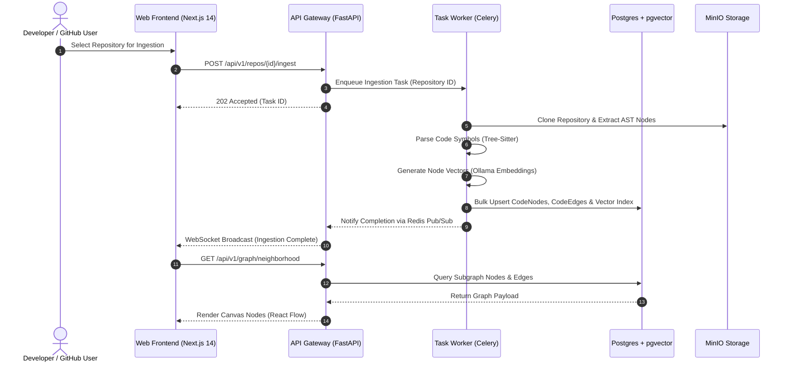
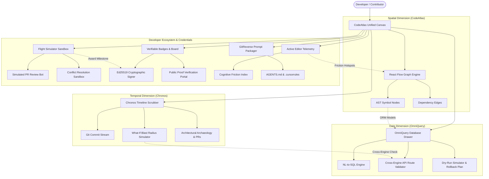

# Component Interaction Map

## System Component Overview

CodeAtlas is structured as an asynchronous micro-services architecture operating over a shared PostgreSQL (pgvector) datastore and Redis message broker.

## Core Subsystem Workflows

### 1. Ingestion Subsystem
- **Input**: GitHub App Webhook event or manual repository submission.
- **Process**: Celery worker clones sparse repository, executes Tree-Sitter parsing across supported languages (`.ts`, `.tsx`, `.py`, `.js`), extracts entity symbols (functions, classes, routes, models), and generates node embeddings.
- **Output**: Batch upsert into `code_nodes` and `code_edges` tables.

### 2. Issue Mapping Engine
- **Input**: GitHub issue title, body text, and comments.
- **Process**: TF-IDF keyword extraction combined with pgvector cosine similarity search over `code_nodes.embedding`. Graph propagation expands candidates to adjacent neighbor nodes.
- **Output**: Confidence-scored array of affected AST file paths, classes, and functions.

### 3. RAG & Natural Language Chat
- **Input**: User natural language query (e.g., "Where is authentication handled?").
- **Process**: Vector similarity retrieval against pgvector HNSW index → Top-K AST node context formatting → Ollama LLM prompt execution.
- **Output**: Streaming markdown response containing file citations.

### 4. Chronos Software Time Machine Subsystem
- **Input**: Temporal timeline scrub, historical commit diff request, or proposed what-if mutation.
- **Process**: Git commit log stream extraction correlated with AST syntax diffs and PR metadata. What-if mutations perform directed graph transitive closures from candidate nodes to calculate downstream caller blast radiuses.
- **Output**: Commit timeline with hotspot heatmaps, architectural archaeology provenance, and downstream impact reports.

### 5. OmniQuery Database Time Machine Subsystem
- **Input**: Selection of ORM model nodes on canvas or plain-English database query.
- **Process**: Model schema extraction (Prisma, SQLAlchemy, Django ORM) → Natural-language to SQL translation → Cross-referencing CodeAtlas dependency graph for breaking API endpoints → Sandboxed dry-run preview and automated rollback script generation.
- **Output**: Multi-stage preview, sandboxed row table, breaking code route alerts, and transactional execution records.

### 6. OpenSourceMapper Subsystem
- **Input**: GitHub issue selection or "Good First Issue" triage query.
- **Process**: Evaluates candidate node in-degree, out-degree, and transitive caller reach to compute the Contributor Isolation Score ($	ext{CIS}$). Synthesizes 3-step contributor blueprints (Understand ➔ Modify ➔ Verify) and extracts prerequisite architectural concepts.
- **Output**: Ranked issue recommendations, prerequisite checklists, and focused canvas subgraph views.

### 7. Active Telemetry Subsystem
- **Input**: Periodic editor heartbeats from local IDE extensions (VS Code, JetBrains, Neovim).
- **Process**: Ingests focus pulses every 120s via Redis stream buffer, associates file paths with AST nodes, and calculates the Cognitive Friction Index ($	ext{CFI}$) correlating focus duration, undo frequencies, and cyclomatic complexity.
- **Output**: Focus time heatmaps on canvas, personal privacy-first developer pulse stats, and repository frustration alerts.

### 8. GitReverse & AI Prompt Packager Subsystem
- **Input**: Subtree selection, repository root, or specified token budget.
- **Process**: AST traversal extracting public interfaces, boundary edges, and architectural conventions into optimized context payloads. Generates standardized `AGENTS.md`, `.cursorrules`, and `llms.txt`.
- **Output**: High-signal prompt artifacts ready for autonomous agents and external LLMs.

### 9. CodeAtlas Flight Simulator & Verifiable Badges Subsystem
- **Input**: Learner commands in virtual Git shell or simulated PR submission.
- **Process**: Executes in-browser virtual Git state operations, automated PR review bots, and merge conflict missions. Upon curriculum completion, generates canonical JSON credentials, cryptographically signs with Ed25519, and issues dynamic SVG badges.
- **Output**: Interactive learning environment, verifiable digital badges for GitHub profiles, and public verification portal with contribution replay.

