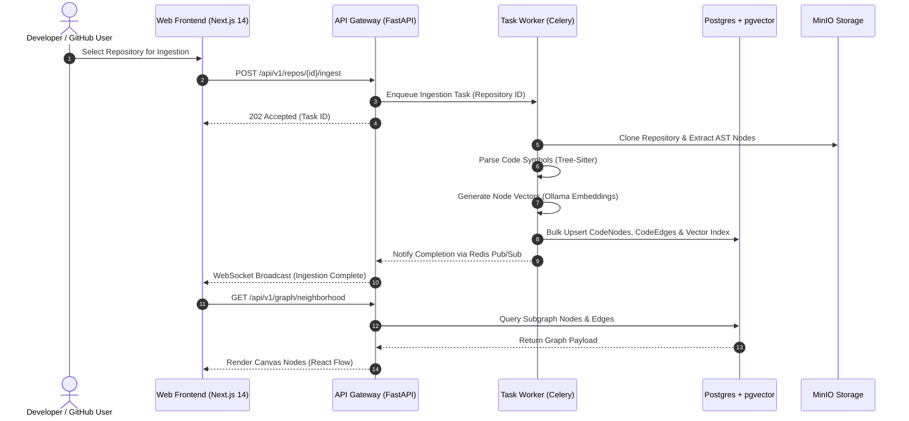

# Component Interaction Map

## System Component Overview

CodeAtlas is structured as an asynchronous micro-services architecture operating over a shared PostgreSQL (pgvector) datastore and Redis message broker.

## Core Subsystem Workflows

### 1. Ingestion Subsystem
- **Input**: GitHub App Webhook event or manual repository submission.
- **Process**: Celery worker clones sparse repository, executes Tree-Sitter parsing across supported languages (`.ts`, `.tsx`, `.py`, `.js`), extracts entity symbols (functions, classes, routes, models), and generates node embeddings.
- **Output**: Batch upsert into `code_nodes` and `code_edges` tables.

### 2. Issue Mapping Engine
- **Input**: GitHub issue title, body text, and comments.
- **Process**: TF-IDF keyword extraction combined with pgvector cosine similarity search over `code_nodes.embedding`. Graph propagation expands candidates to adjacent neighbor nodes.
- **Output**: Confidence-scored array of affected AST file paths, classes, and functions.

### 3. RAG & Natural Language Chat
- **Input**: User natural language query (e.g., "Where is authentication handled?").
- **Process**: Vector similarity retrieval against pgvector HNSW index → Top-K AST node context formatting → Ollama LLM prompt execution.
- **Output**: Streaming markdown response containing file citations.
