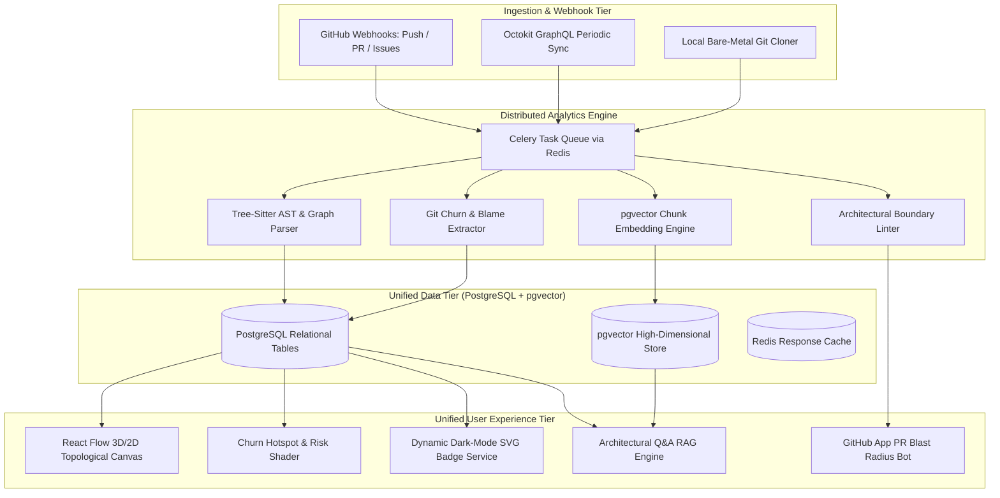
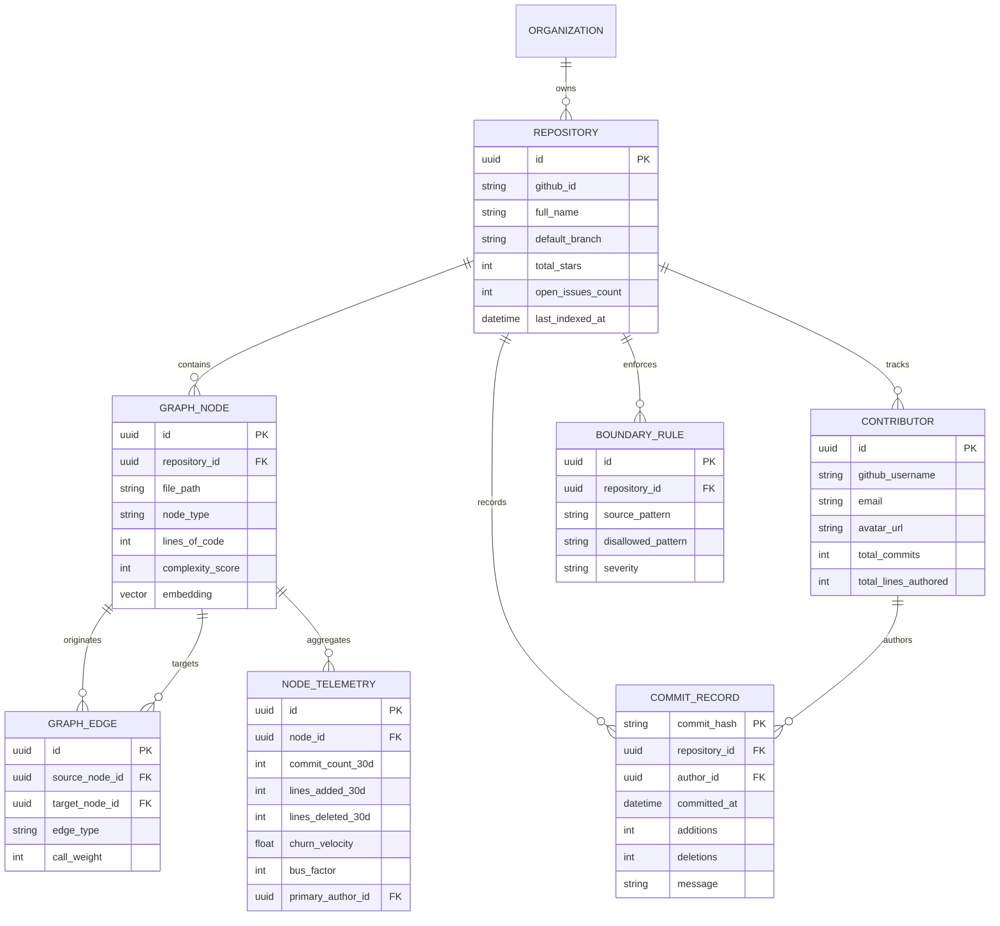

# CodeAtlas Prime: Unified Developer & Codebase Intelligence Platform
## Master Convergence Architecture, Competitive Teardown, $0 Operational Blueprint & Roadmap

---

## 1. Executive Summary & Convergence Thesis

Modern software engineering organizations suffer from an acute architectural disconnect between **spatial codebase topology** and **temporal developer telemetry**:

- **Spatial Blindness (The "What" & "Where")**: Traditional developer metric tools (e.g., GitWatcher, GitHub Insights, GitPrime, LinearB) measure activity: commit counts, lines of code, review latency, and DORA velocity. However, they are blind to the abstract syntax tree (AST), import dependencies, and call hierarchies. A commit refactoring 500 lines of CSS is measured with the same weight as 500 lines of critical payment encryption primitives.
- **Temporal Blindness (The "Who" & "When")**: Static code analyzers and architecture visualizers (e.g., CodeAtlas, Sourcegraph, Dependency Cruiser) map imports and vector embedding spaces, but operate in a historical vacuum. They cannot distinguish between stable legacy infrastructure untouched for two years and brittle code hotspots modified across 40 pull requests this month.

**CodeAtlas Prime** fuses **CodeAtlas** and **GitWatcher (GitPulse)** into a unified Engineering Intelligence & Architectural Observability Platform. It transforms static architecture graphs into a live, heatmapped digital twin of any software repository.

---

## 2. Competitive Landscape & Market Teardown

To ensure industry adoption, CodeAtlas Prime addresses the structural gaps across current market tools:

```
                      CodeScene
                (Behavioral Hotspots)
                      \         /
                       \       /
                        \     /
   LinearB / Swarmia --- ★ CODEATLAS PRIME ★ --- Sourcegraph / Cody
(PR & DORA Telemetry)   /     |     \            (Semantic Code Search)
                       /      |      \
                      /       |       \
                             / \
                    IcePanel / Archbee
                 (Interactive Architecture)
```

### Detailed Feature & Capability Matrix

| Feature / Dimension | CodeScene | Sourcegraph | LinearB / Swarmia | IcePanel | **CodeAtlas Prime (Unified)** |
|---|---|---|---|---|---|
| **Price Point** | $18–$30 / dev / mo | $19–$49 / dev / mo | $25–$40 / dev / mo | $15–$35 / editor / mo | **$0 Open-Source / Self-Hosted** |
| **AST Topology** | Partial (File-level) | Full AST / Symbols | None (Raw git metadata) | Manual diagrams | **Automated Tree-Sitter Graphs** |
| **Commit Churn Heatmaps** | Yes (Hotspots) | None | Yes (Aggregate velocity) | None | **Live Canvas Overlay (React Flow)** |
| **Issue-to-Code Mapping** | None | Search keywords only | None | None | **6-Signal Hybrid Ranker** |
| **PR Blast Radius Bot** | Limited | None | None | None | **Automated GitHub App Impact Bot** |
| **Architecture Linter** | None | None | None | None | **Configurable Boundary Enforcer** |
| **Bus Factor Risk Alerts** | Basic | None | Contributor count only | None | **Topological Single-Maintainer Silos** |
| **README Profile Badges** | None | None | None | None | **Dynamic SVG Architecture & Telemetry Cards** |
| **Privacy / Local Run** | Cloud / Enterprise | Cloud / Enterprise | Cloud Only | Cloud Only | **100% Local (Ollama + Docker Compose)** |

---

## 3. The 4 Enterprise Production Anchors (Industry Adoption Drivers)

To bridge the gap between an academic project and an industry-grade platform adopted by real development teams, CodeAtlas Prime introduces four high-ROI enterprise capabilities:

### 3.1 PR "Blast Radius" Bot (GitHub App Action)
When an engineer opens a Pull Request, the CodeAtlas Bot inspects the changed files, projects them onto the dependency graph, and comments with an actionable risk assessment:
```markdown
### 🌐 CodeAtlas Architectural Impact Report
- **Blast Radius**: 14 downstream services depend on modified file `apps/api/auth/session.py`.
- **Hotspot Risk**: ⚠️ High (`session.py` modified 28 times in 30 days; 2 regression bug issues linked).
- **Recommended Reviewers**:
  - `@kush05bhardwaj` (owns 74% of lines in affected call chain)
  - `@inkeskdozing` (primary maintainer of dependent `user_router.py`)
```

### 3.2 Architectural Boundary Enforcement (The "Architecture Linter")
Monorepos degrade into spaghetti architecture when engineers introduce illegal cross-package imports. CodeAtlas Prime checks incoming PRs against `codeatlas.config.json`:
```json
{
  "boundaries": [
    { "from": "apps/web/**", "disallow": "apps/api/**" },
    { "from": "packages/ui/**", "disallow": "packages/database/**" },
    { "from": "modules/billing/**", "allowOnly": ["modules/auth/**", "packages/shared/**"] }
  ]
}
```
If an illegal import edge is introduced, CodeAtlas fails CI immediately with an exact line-level diagnostic.

### 3.3 "Bus Factor" & Knowledge Silo Risk Analysis
Calculates component maintainer concentration to protect teams against engineer turnover:
$$\text{Bus Factor} = \left| \left\{ u \in \text{Authors} \;\middle|\; \frac{\text{LOC\_Churn}(u, v)}{\sum_{w} \text{LOC\_Churn}(w, v)} \ge 0.20 \right\} \right|$$
Nodes with a Bus Factor of 1 that also possess high degree centrality in the graph glow crimson on the canvas, notifying tech leads of severe knowledge silos before an engineer departs.

### 3.4 100% Privacy-First Local Engine (Self-Hosted Architecture)
Enterprises strictly prohibit sending proprietary source code to external cloud LLM APIs. CodeAtlas Prime supports:
- **Local AST parsing**: Local Tree-Sitter binaries.
- **Local vector embeddings**: `nomic-embed-text` or `all-MiniLM-L6-v2` served via Ollama or HuggingFace ONNX runtime.
- **BYOK (Bring Your Own Key)**: Browser-level client encryption for teams choosing cloud LLM backends.

---

## 4. Operational Economics: The $0 Free-Tier vs. SaaS Scaling Model

### 4.1 The $0 Free-Tier Operational Blueprint (Development & Open-Source)

The entire platform can be deployed and run at **$0 monthly cost** using standard developer tier allowances:

| Tier Layer | Service Provider | Allocation / Limits | Monthly Cost |
|---|---|---|---|
| **Frontend Web App** | Vercel Hobby / Cloudflare Pages | Unlimited bandwidth for personal/open-source; 100 builds/day | **$0.00** |
| **Relational & Vector DB** | Supabase Free / Neon Free | PostgreSQL 16 with `pgvector` enabled; 500 MB – 3 GB storage | **$0.00** |
| **Cache & Task Queue** | Upstash Serverless Redis | 10,000 commands / day (more than enough for webhook events) | **$0.00** |
| **Embedding Engine** | Local Ollama / Transformers.js | Runs directly on local CPU/GPU; zero API token costs | **$0.00** |
| **GitHub Data Stream** | GitHub GraphQL API | 5,000 free requests/hour per personal access token / GitHub App | **$0.00** |
| **AST / Git Parsing** | Local Bare-Metal / GitHub Actions | Tree-Sitter and `git log` run on standard compute cores | **$0.00** |
| **Total** | | | **$0.00 / mo** |

### 4.2 Production Scaling Tier (When Scaled to Hundreds of Repositories)

When hosting an enterprise SaaS tier supporting hundreds of active organizations:
- **Compute (Hetzner Cloud CPX31)**: 4 AMD vCPUs, 8 GB RAM, 160 GB NVMe ➔ **~$7.50 / month**.
- Runs Docker Compose with self-hosted PostgreSQL 16 + `pgvector`, Redis 7, Celery Worker, and FastAPI.
- Handles continuous webhook ingestion for up to 250 active repositories within a single instance.

---

## 5. End-to-End System Architecture



---

## 6. Unified Data Schema Model

Combining GitWatcher's telemetry tables with CodeAtlas's graph relations and vector embeddings:



---

## 7. Mathematical Formulation: 6-Signal Issue-to-Code Mapping

When a GitHub Issue $I$ is submitted, CodeAtlas Prime calculates the relevance score for each codebase file node $v \in V$:

$$\text{Score}(I, v) = \sum_{k=1}^{6} w_k \cdot \phi_k(I, v)$$

Where weights satisfy $\sum_{k=1}^6 w_k = 1.0$:

1. **Semantic Similarity ($\phi_1$)**:
   $$\phi_1(I, v) = \max_{c \in \text{Chunks}(v)} \frac{\mathbf{E}(I) \cdot \mathbf{E}(c)}{\|\mathbf{E}(I)\| \|\mathbf{E}(c)\|}$$
2. **Lexical Symbol Match ($\phi_2$)**:
   $$\phi_2(I, v) = \text{TrigramSimilarity}(\text{Tokens}(I), \text{Symbols}(v))$$
3. **Graph Centrality ($\phi_3$)**:
   $$\phi_3(v) = \text{NormalizedPageRank}(v)$$
4. **Topological Proximity ($\phi_4$)**:
   $$\phi_4(I, v) = \sum_{u \in \text{TopMatches}(I)} \frac{1}{1 + \text{ShortestPath}(u, v)}$$
5. **Historical Feedback Reinforcement ($\phi_5$)**:
   $$\phi_5(I, v) = \frac{\text{PositiveConfirmations}(v) + 1}{\text{PositiveConfirmations}(v) + \text{NegativeConfirmations}(v) + 2}$$
6. **Temporal Churn & Recency ($\phi_6$)**:
   $$\phi_6(v) = \ln\left(1 + \text{Commits}_{30d}(v)\right) \cdot \exp\left(-\frac{\Delta t_{\text{last\_modified}}}{\tau}\right)$$
   *(where $\tau = 14$ days half-life decay).*

---

## 8. 16-Week Phased Master Roadmap

```
Week:  1   2   3   4   5   6   7   8   9  10  11  12  13  14  15  16
       |---|---| Phase 1: Ingestion & Telemetry Unification
               |---|---|---| Phase 2: Churn Heatmap & Interactive Canvas
                           |---|---| Phase 3: 6-Signal Engine & PR Blast Radius Bot
                                   |---|---| Phase 4: Dynamic Badges & Architecture Linter
                                           |---|---| Phase 5: Bus Factor & Developer Portal
                                                   |---|---| Phase 6: Hardening & Capstone Release
```

### Phase 1: Ingestion & Telemetry Unification (Weeks 1–3)
- [ ] Initialize monorepo workspace (`apps/web`, `apps/api`, `packages/shared`, `packages/telemetry`).
- [ ] Migrate GitWatcher's Octokit GraphQL stream into CodeAtlas's Celery task pipeline.
- [ ] Implement bare-metal git log streaming (`git log --stat --follow`) running concurrently with Tree-Sitter AST parsing.
- [ ] Execute unified Alembic database migrations deploying the schema with `pgvector` indexing.

### Phase 2: Churn Heatmaps & Interactive Canvas (Weeks 4–7)
- [ ] Implement Canvas Display Modes in `@codeatlas/web` (React Flow):
  - *Structural Topology Mode*: Standard component dependencies and call paths.
  - *Churn Heatmap Mode*: Shaded nodes by commit velocity (Green ➔ Yellow ➔ Crimson).
  - *Ownership Mode*: Color-coded by primary maintainer.
- [ ] Develop the **Node Inspector Drawer**: Displays AST signature, imports, top 3 contributors, and recent blame history.

### Phase 3: 6-Signal Issue Intelligence & PR Blast Radius Bot (Weeks 8–10)
- [ ] Implement the 6-signal ranking algorithm incorporating temporal churn decay.
- [ ] Deploy the **CodeAtlas PR Blast Radius GitHub App**: Posts automated impact summaries and reviewer recommendations on pull requests.
- [ ] Build natural language repository query engine using RAG over combined AST graphs and git histories.

### Phase 4: Dynamic SVG Badges & Architecture Boundary Linter (Weeks 11–12)
- [ ] Port GitWatcher's `svg-card.js` into an Edge-compatible Next.js badge router (`/api/card/:repo` and `/api/card/:user`).
- [ ] Implement the **Architecture Boundary Linter** checking `codeatlas.config.json` rules in CI/CD pipelines.

### Phase 5: Bus Factor Risk Mapping & Developer Portal (Weeks 13–14)
- [ ] Build the Bus Factor analysis engine highlighting single-maintainer critical nodes.
- [ ] Provide personal developer portfolio dashboards showcasing architectural contributions and modularity ratings.

### Phase 6: Production Hardening, CI/CD & Academic Evaluation (Weeks 15–16)
- [ ] Complete unit and integration test coverage with Vitest and Playwright.
- [ ] Produce Docker Compose and Kubernetes Helm charts for local development and self-hosted enterprise deployment.
- [ ] Benchmark onboarding time reduction across 3 open-source monorepos (Target: 80% onboarding time reduction).