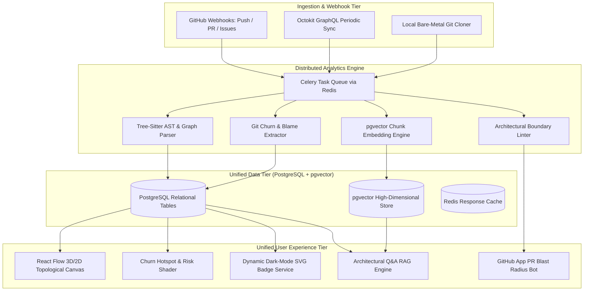
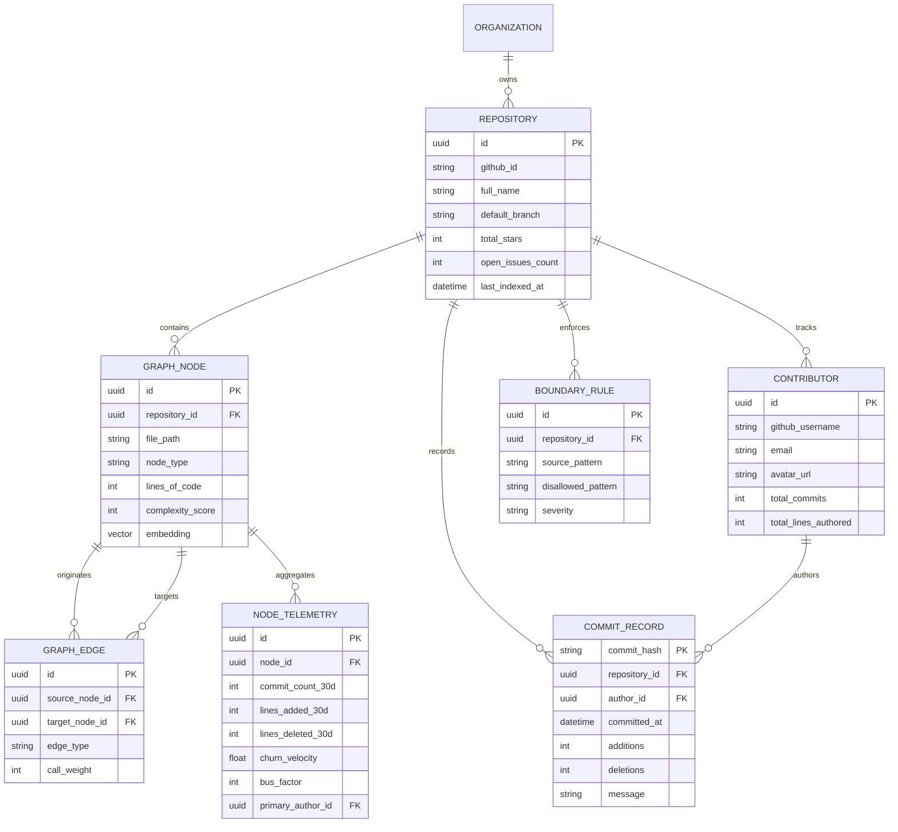

# CodeAtlas Prime: Unified Developer & Codebase Intelligence Platform
## Master Convergence Architecture, Competitive Teardown, $0 Operational Blueprint & Roadmap

---

## 1. Executive Summary & Convergence Thesis

Modern software engineering organizations suffer from an acute architectural disconnect between **spatial codebase topology** and **temporal developer telemetry**:

- **Spatial Blindness (The "What" & "Where")**: Traditional developer metric tools (e.g., GitWatcher, GitHub Insights, GitPrime, LinearB) measure activity: commit counts, lines of code, review latency, and DORA velocity. However, they are blind to the abstract syntax tree (AST), import dependencies, and call hierarchies. A commit refactoring 500 lines of CSS is measured with the same weight as 500 lines of critical payment encryption primitives.
- **Temporal Blindness (The "Who" & "When")**: Static code analyzers and architecture visualizers (e.g., CodeAtlas, Sourcegraph, Dependency Cruiser) map imports and vector embedding spaces, but operate in a historical vacuum. They cannot distinguish between stable legacy infrastructure untouched for two years and brittle code hotspots modified across 40 pull requests this month.

**CodeAtlas Prime** fuses **CodeAtlas** and **GitWatcher (GitPulse)** into a unified Engineering Intelligence & Architectural Observability Platform. It transforms static architecture graphs into a live, heatmapped digital twin of any software repository.

---

## 2. Competitive Landscape & Market Teardown

To ensure industry adoption, CodeAtlas Prime addresses the structural gaps across current market tools:

```
                      CodeScene
                (Behavioral Hotspots)
                      \         /
                       \       /
                        \     /
   LinearB / Swarmia --- ★ CODEATLAS PRIME ★ --- Sourcegraph / Cody
(PR & DORA Telemetry)   /     |     \            (Semantic Code Search)
                       /      |      \
                      /       |       \
                             / \
                    IcePanel / Archbee
                 (Interactive Architecture)
```

### Detailed Feature & Capability Matrix

| Feature / Dimension | CodeScene | Sourcegraph | LinearB / Swarmia | IcePanel | **CodeAtlas Prime (Unified)** |
|---|---|---|---|---|---|
| **Price Point** | $18–$30 / dev / mo | $19–$49 / dev / mo | $25–$40 / dev / mo | $15–$35 / editor / mo | **$0 Open-Source / Self-Hosted** |
| **AST Topology** | Partial (File-level) | Full AST / Symbols | None (Raw git metadata) | Manual diagrams | **Automated Tree-Sitter Graphs** |
| **Commit Churn Heatmaps** | Yes (Hotspots) | None | Yes (Aggregate velocity) | None | **Live Canvas Overlay (React Flow)** |
| **Issue-to-Code Mapping** | None | Search keywords only | None | None | **6-Signal Hybrid Ranker** |
| **PR Blast Radius Bot** | Limited | None | None | None | **Automated GitHub App Impact Bot** |
| **Architecture Linter** | None | None | None | None | **Configurable Boundary Enforcer** |
| **Bus Factor Risk Alerts** | Basic | None | Contributor count only | None | **Topological Single-Maintainer Silos** |
| **README Profile Badges** | None | None | None | None | **Dynamic SVG Architecture & Telemetry Cards** |
| **Privacy / Local Run** | Cloud / Enterprise | Cloud / Enterprise | Cloud Only | Cloud Only | **100% Local (Ollama + Docker Compose)** |

---

## 3. The 4 Enterprise Production Anchors (Industry Adoption Drivers)

To bridge the gap between an academic project and an industry-grade platform adopted by real development teams, CodeAtlas Prime introduces four high-ROI enterprise capabilities:

### 3.1 PR "Blast Radius" Bot (GitHub App Action)
When an engineer opens a Pull Request, the CodeAtlas Bot inspects the changed files, projects them onto the dependency graph, and comments with an actionable risk assessment:
```markdown
### 🌐 CodeAtlas Architectural Impact Report
- **Blast Radius**: 14 downstream services depend on modified file `apps/api/auth/session.py`.
- **Hotspot Risk**: ⚠️ High (`session.py` modified 28 times in 30 days; 2 regression bug issues linked).
- **Recommended Reviewers**:
  - `@kush05bhardwaj` (owns 74% of lines in affected call chain)
  - `@inkeskdozing` (primary maintainer of dependent `user_router.py`)
```

### 3.2 Architectural Boundary Enforcement (The "Architecture Linter")
Monorepos degrade into spaghetti architecture when engineers introduce illegal cross-package imports. CodeAtlas Prime checks incoming PRs against `codeatlas.config.json`:
```json
{
  "boundaries": [
    { "from": "apps/web/**", "disallow": "apps/api/**" },
    { "from": "packages/ui/**", "disallow": "packages/database/**" },
    { "from": "modules/billing/**", "allowOnly": ["modules/auth/**", "packages/shared/**"] }
  ]
}
```
If an illegal import edge is introduced, CodeAtlas fails CI immediately with an exact line-level diagnostic.

### 3.3 "Bus Factor" & Knowledge Silo Risk Analysis
Calculates component maintainer concentration to protect teams against engineer turnover:
$$\text{Bus Factor} = \left| \left\{ u \in \text{Authors} \;\middle|\; \frac{\text{LOC\_Churn}(u, v)}{\sum_{w} \text{LOC\_Churn}(w, v)} \ge 0.20 \right\} \right|$$
Nodes with a Bus Factor of 1 that also possess high degree centrality in the graph glow crimson on the canvas, notifying tech leads of severe knowledge silos before an engineer departs.

### 3.4 100% Privacy-First Local Engine (Self-Hosted Architecture)
Enterprises strictly prohibit sending proprietary source code to external cloud LLM APIs. CodeAtlas Prime supports:
- **Local AST parsing**: Local Tree-Sitter binaries.
- **Local vector embeddings**: `nomic-embed-text` or `all-MiniLM-L6-v2` served via Ollama or HuggingFace ONNX runtime.
- **BYOK (Bring Your Own Key)**: Browser-level client encryption for teams choosing cloud LLM backends.

### 3.5 Chronos (Software Time Machine & Archaeology Engine)
Static architecture graphs operate in a historical vacuum. Chronos introduces the temporal dimension into CodeAtlas:
- **Interactive Temporal Slider**: Scrub commit-by-commit or release-by-release to watch the React Flow architecture graph morph, identify module splits, circular import introductions, and technical debt accumulation.
- **Architectural Archaeology**: Grounded retrieval answering "Why did this design change?" by correlating AST diffs, commit blurs, author changes, and linked GitHub Pull Request metadata.
- **What-If AST Mutation Simulator**: Proactively simulates proposed deletions or signature mutations on any AST node, calculating downstream blast radius across callers and API routes before a developer branches.

### 3.6 OmniQuery (Conversational Database Time Machine & Sandboxed Operations)
Integrates operational database intelligence as a dedicated lens on CodeAtlas ORM/model nodes:
- **Natural-Language to SQL Engine**: Safely translates plain-English requirements into verifiable, optimized queries across relational schemas.
- **Strict Multi-Stage Safety Pipeline**: Enforces `Ask → Understand → Preview → Simulate → Approve → Run → Rollback` to guarantee zero accidental production data loss.
- **Codebase-to-Database Blast Radius Bridge**: When altering a table schema or column, OmniQuery instantly cross-references CodeAtlas AST call-sites, identifying every application router, service function, and query site that would break.
- **Automated Reversal & Sandbox**: Dry-runs transactions in an isolated rollback sandbox and automatically synthesizes reverse WAL rollback SQL scripts.

### 3.7 OpenSourceMapper (AST-Driven Contributor Blueprints)
Bridges high-level open-source issues with deep codebase topology to streamline new developer onboarding:
- **Subgraph Isolation Scoring**: Evaluates candidate GitHub issues by measuring the in-degree, out-degree, and transitive blast radius of the affected AST nodes, highlighting safe, low-blast "Good First Issues".
- **Interactive 3-Step Contributor Blueprints**: Synthesizes an actionable execution roadmap (`Understand Architecture → Implement Change → Verify with Tests`) for any selected issue.
- **Prerequisite Concept Checklist**: Identifies required codebase mental models and upstream design patterns before a contributor begins coding.

### 3.8 Active Telemetry (WakaTime-Style Focus Mapping & Cognitive Friction Index)
Correlates real-time developer editor focus duration with codebase architectural nodes:
- **WakaTime-Compatible Heartbeat Stream**: Ingests editor focus pulses from VS Code, JetBrains, and Neovim without logging keystrokes or source code content.
- **Cognitive Friction Index (CFI)**: Identifies architectural frustration hotspots where developers spend excessive active minutes producing minimal LOC or frequently triggering editor undos/reverts.
- **Privacy-First Team Analytics**: Aggregates developer pulse metrics with local client-side masking and opt-in team dashboards.

### 3.9 GitReverse (AST-to-Prompt & AI Context Packager)
Extracts and packages repository architecture into high-signal prompts for autonomous coding agents:
- **Hierarchical Token Budgeting**: Traverses the AST graph to assemble prompt contexts fitting strictly within specified LLM token budgets ($8\text{k}$, $32\text{k}$, $128\text{k}$, $1\text{M}$).
- **Automated Agent Artifacts**: Generates standardized project-level agent rules (`AGENTS.md`), editor instructions (`.cursorrules`), and documentation sitemaps (`llms.txt`).
- **Targeted Subgraph Exporter**: Packages selected components with their 1-hop dependencies and boundary interfaces for zero-hallucination external LLM refactoring.

### 3.10 CodeAtlas Flight Simulator (Interactive Git & PR Training Sandbox)
An in-browser virtual flight simulator for mastering Git workflows and monorepo mechanics:
- **In-Browser Virtual Git Shell**: Executes virtual `branch`, `rebase`, `commit`, and `checkout` commands against mock repositories with live DAG visualization.
- **Automated PR Bot Review**: Evaluates simulated pull requests against linting, typechecking, and test coverage rules with constructive, educational feedback.
- **Conflict Resolution Missions**: Safely injects upstream merge conflicts, training developers to inspect conflict markers and resolve differences without fear.

### 3.11 Holopin-Style Verifiable Credential Badges & Reputation Network
Dynamic, verifiable digital badges showcasing real engineering achievements on GitHub profile READMEs:
- **Dynamic Vector SVG Badges**: Generates responsive, cache-optimized SVG cards rendering user tiers, PR metrics, and blast radius ratings.
- **Ed25519 Cryptographic Signatures**: Signs credential payloads with asymmetric cryptographic keys to guarantee authenticity and prevent forgery.
- **Public Proof & Replay Portal**: Provides a public verification page (`/verify/{cert_id}`) that cryptographically validates signatures and renders an interactive replay of the verified contribution on the CodeAtlas graph.
- **Collectible Badge Board**: Offers an interactive hexagonal achievement showcase and single embeddable collection SVG for developer profiles.

---

## 4. Operational Economics: The $0 Free-Tier vs. SaaS Scaling Model

### 4.1 The $0 Free-Tier Operational Blueprint (Development & Open-Source)

The entire platform can be deployed and run at **$0 monthly cost** using standard developer tier allowances:

| Tier Layer | Service Provider | Allocation / Limits | Monthly Cost |
|---|---|---|---|
| **Frontend Web App** | Vercel Hobby / Cloudflare Pages | Unlimited bandwidth for personal/open-source; 100 builds/day | **$0.00** |
| **Relational & Vector DB** | Supabase Free / Neon Free | PostgreSQL 16 with `pgvector` enabled; 500 MB – 3 GB storage | **$0.00** |
| **Cache & Task Queue** | Upstash Serverless Redis | 10,000 commands / day (more than enough for webhook events) | **$0.00** |
| **Embedding Engine** | Local Ollama / Transformers.js | Runs directly on local CPU/GPU; zero API token costs | **$0.00** |
| **GitHub Data Stream** | GitHub GraphQL API | 5,000 free requests/hour per personal access token / GitHub App | **$0.00** |
| **AST / Git Parsing** | Local Bare-Metal / GitHub Actions | Tree-Sitter and `git log` run on standard compute cores | **$0.00** |
| **Total** | | | **$0.00 / mo** |

### 4.2 Production Scaling Tier (When Scaled to Hundreds of Repositories)

When hosting an enterprise SaaS tier supporting hundreds of active organizations:
- **Compute (Hetzner Cloud CPX31)**: 4 AMD vCPUs, 8 GB RAM, 160 GB NVMe ➔ **~$7.50 / month**.
- Runs Docker Compose with self-hosted PostgreSQL 16 + `pgvector`, Redis 7, Celery Worker, and FastAPI.
- Handles continuous webhook ingestion for up to 250 active repositories within a single instance.

---

## 5. End-to-End System Architecture



---

## 6. Unified Data Schema Model

Combining GitWatcher's telemetry tables with CodeAtlas's graph relations and vector embeddings:



---

## 7. Mathematical Formulation: 6-Signal Issue-to-Code Mapping

When a GitHub Issue $I$ is submitted, CodeAtlas Prime calculates the relevance score for each codebase file node $v \in V$:

$$\text{Score}(I, v) = \sum_{k=1}^{6} w_k \cdot \phi_k(I, v)$$

Where weights satisfy $\sum_{k=1}^6 w_k = 1.0$:

1. **Semantic Similarity ($\phi_1$)**:
   $$\phi_1(I, v) = \max_{c \in \text{Chunks}(v)} \frac{\mathbf{E}(I) \cdot \mathbf{E}(c)}{\|\mathbf{E}(I)\| \|\mathbf{E}(c)\|}$$
2. **Lexical Symbol Match ($\phi_2$)**:
   $$\phi_2(I, v) = \text{TrigramSimilarity}(\text{Tokens}(I), \text{Symbols}(v))$$
3. **Graph Centrality ($\phi_3$)**:
   $$\phi_3(v) = \text{NormalizedPageRank}(v)$$
4. **Topological Proximity ($\phi_4$)**:
   $$\phi_4(I, v) = \sum_{u \in \text{TopMatches}(I)} \frac{1}{1 + \text{ShortestPath}(u, v)}$$
5. **Historical Feedback Reinforcement ($\phi_5$)**:
   $$\phi_5(I, v) = \frac{\text{PositiveConfirmations}(v) + 1}{\text{PositiveConfirmations}(v) + \text{NegativeConfirmations}(v) + 2}$$
6. **Temporal Churn & Recency ($\phi_6$)**:
   $$\phi_6(v) = \ln\left(1 + \text{Commits}_{30d}(v)\right) \cdot \exp\left(-\frac{\Delta t_{\text{last\_modified}}}{\tau}\right)$$
   *(where $\tau = 14$ days half-life decay).*

---

## 8. 48-Week Phased Master Roadmap (Phases 1–13)

```mermaid
flowchart LR
    P1["P1: Ingestion & Telemetry"] --> P2["P2: Churn Heatmaps"]
    P2 --> P3["P3: 6-Signal & PR Bot"]
    P3 --> P4["P4: SVG Badges & Linter"]
    P4 --> P5["P5: Bus Factor & Portal"]
    P5 --> P6["P6: Flight Sim & Credentials"]
    P6 --> P7["P7: Multi-IDE Extensions"]
    P7 --> P8["P8: Autonomous SWE Agents"]
    P8 --> P9["P9: Enterprise Governance & Air-Gap"]
```



### Phase 1: Ingestion & Telemetry Unification (Weeks 1–3)
- [x] Initialize monorepo workspace (`apps/web`, `apps/api`, `packages/shared`, `packages/telemetry`).
- [x] Migrate GitWatcher's Octokit GraphQL stream into CodeAtlas's Celery task pipeline.
- [x] Implement bare-metal git log streaming (`git log --stat --follow`) running concurrently with Tree-Sitter AST parsing.
- [x] Execute unified Alembic database migrations deploying the schema with `pgvector` indexing.

### Phase 2: Churn Heatmaps & Interactive Canvas (Weeks 4–7)
- [x] Implement Canvas Display Modes in `@codeatlas/web` (React Flow):
  - *Structural Topology Mode*: Standard component dependencies and call paths.
  - *Churn Heatmap Mode*: Shaded nodes by commit velocity (Green ➔ Yellow ➔ Crimson).
  - *Ownership Mode*: Color-coded by primary maintainer.
- [x] Develop the **Node Inspector Drawer**: Displays AST signature, imports, top 3 contributors, and recent blame history.

### Phase 3: 6-Signal Issue Intelligence & PR Blast Radius Bot (Weeks 8–10)
- [x] Implement the 6-signal ranking algorithm incorporating temporal churn decay.
- [ ] Deploy the **CodeAtlas PR Blast Radius GitHub App**: Posts automated impact summaries and reviewer recommendations on pull requests.
- [x] Build natural language repository query engine using RAG over combined AST graphs and git histories.

### Phase 4: Dynamic SVG Badges & Architecture Boundary Linter (Weeks 11–12)
- [x] Port GitWatcher's `svg-card.js` into an Edge-compatible Next.js badge router (`/api/card/:repo` and `/api/card/:user`).
- [ ] Implement the **Architecture Boundary Linter** checking `codeatlas.config.json` rules in CI/CD pipelines.

### Phase 5: Bus Factor Risk Mapping & Developer Portal (Weeks 13–14)
- [ ] Build the Bus Factor analysis engine highlighting single-maintainer critical nodes.
- [ ] Provide personal developer portfolio dashboards showcasing architectural contributions and modularity ratings.

### Phase 6: Developer Flight Simulator, Active Telemetry & Verifiable Credential Ecosystem (Weeks 15–18)
- [x] **Chronos Engine & Timeline Scrubber**: Interactive commit progression ribbon, what-if AST refactor mutation simulator, and architectural archaeology provenance viewer.
- [x] **OmniQuery Schema Lens**: Conversational database operations, schema model discovery, code-to-database breaking change checker, and sandboxed rollback dry-runs.
- [ ] **OpenSourceMapper**: AST-driven "Good First Issue" triage by subgraph isolation, 3-step contributor execution blueprints, and prerequisite mental model checklists.
- [ ] **Active Editor Telemetry**: Local WakaTime-compatible heartbeat stream, AST node focus time mapping, and Cognitive Friction Index (CFI) hotspot alerts.
- [ ] **GitReverse Engine**: Hierarchical AST token budget optimizer, automated `AGENTS.md`, `.cursorrules`, and `llms.txt` generation.
- [ ] **CodeAtlas Flight Simulator**: In-browser virtual Git shell, simulated pull request bots, automated CI status checks, and merge conflict resolution challenges.
- [ ] **Holopin-Style Verifiable Badges**: Dynamic vector SVG badge generator, Ed25519 cryptographic digital signing, public verification portal, and viral hexagonal badge showcase.

### Phase 7: IDE Extensions, Micro-Workspaces & Cross-Monorepo Federation (Weeks 19–22)
- [ ] **VS Code & JetBrains Extensions**: LSP server with hover blast radius inspection and in-editor architectural diagnostics.
- [ ] **Neovim & Desktop Tauri Sidecar**: Low-latency Lua Treesitter telemetry plugin and Tauri Rust multi-threaded offline parser.
- [ ] **Offline SQLite Edge Cache**: Local database replication enabling 100% offline graph navigation and background delta sync.
- [ ] **Multi-Repo Federation & CodeAtlasQL**: Cross-repository microservice topology federation and custom AST query language.

### Phase 8: Autonomous SWE Agents, Code Repair & Benchmark Evaluation (Weeks 23–26)
- [ ] **SWE-bench Benchmark Harness**: Isolated Docker test evaluation harness running SWE-bench Lite and Full tasks.
- [ ] **Fault Localization (SBFL)**: Ochiai spectrum-based bug localization isolating root-cause AST nodes within Top-5 suspects.
- [ ] **Multi-Agent Orchestration**: Swarm collaboration (Planner, Coder, Reviewer) with automated reflection and self-repair loop.
- [ ] **Formal AST Verification**: Disallows hallucinated package imports and unauthorized module boundary breaches.

### Phase 9: Enterprise Governance, Security Compliance & Air-Gapped High Availability (Weeks 27–32)
- [ ] **100% Air-Gapped Production Helm Charts**: Complete Kubernetes deployment with pre-packaged container images and local model weights.
- [ ] **SOC 2 Type II Immutable Audit Logging**: SHA-256 Merkle-chained audit trails recording all access and modifications.
- [ ] **Enterprise SAML 2.0 / OIDC SSO & SCIM**: Corporate identity integration (Okta, Azure AD) with automated directory provisioning.
- [ ] **PostgreSQL Row-Level Security (RLS)**: Storage-level multi-tenant isolation guaranteeing zero cross-organization data leakage.
- [ ] **Disaster Recovery & HA Failover**: Cross-region streaming replication, Redis Sentinel cluster, and high-availability auto-scaling.


### Phase 10: Hyperscale Observability, Distributed Resilience & Stream Ingestion (Weeks 33–36)
- **OpenTelemetry Distributed Tracing**: Full W3C `traceparent` context propagation across API gateways, Celery worker nodes, and background tree-sitter parsers.
- **Distributed Concurrency & Rate Limiting**: Redis Cluster distributed token-bucket rate limiter with Lua atomic execution and SingleFlight request coalescing preventing cache stampedes.
- **Zero-Copy Memory-Mapped Streaming Parser**: Apache Arrow columnar buffers and POSIX `mmap` parsing multi-gigabyte source files with zero RAM duplication.
- **Kafka High-Throughput Webhook Ingestion**: 32-partition topic with partition key hashing (100k events/sec) and idempotent consumer groups with Exactly-Once Semantics (EOS).
- **eBPF & Landlock Kernel Sandboxing**: Linux kernel syscall filtering (`sys_enter_execve`, `sys_enter_connect`) isolating unprivileged AST subprocesses.
- **Kubernetes Resilience & HA**: KEDA `ScaledObject` autoscaling worker pools up to 64 pods, Pod Disruption Budgets (PDB), PostgreSQL 16 active-active logical replication, and WAL-G continuous archiving (RPO < 60s, RTO < 20m).

### Phase 11: WebGPU High-Performance Canvas & Real-Time CRDT Multi-User Collaboration (Weeks 37–40)
- **WebGPU Compute & Instanced Rendering**: WGSL compute shaders simulating 1,000,000+ nodes and edges in GPU VRAM with single-pass instanced draw calls (`drawIndexedIndirect`) at locked 120 FPS.
- **Rust/Wasm Physics Engines**: Multi-threaded Barnes-Hut $O(N \log N)$ and Fast Multipole Method (FMM) $O(N)$ spatial force solvers compiled to WebAssembly.
- **Topological Community Detection**: Client-side Louvain modularity clustering and Markov Cluster Algorithm (MCL) discovering microservice domain boundaries.
- **Hierarchical Edge Bundling (HEB)**: Dynamic cubic B-spline curves eliminating visual hairballs on dense dependency call graphs.
- **Real-Time Multi-User CRDT Co-Editing**: Yjs `Y.Map` and `Y.Array` state matrices synchronizing canvas edits over WebSockets with zero conflict divergence.
- **Collaborative Presence & Awareness**: Live cursor tracking, spotlight presenter follow mode, and spatial proximity audio/text pings.
- **Semantic Level-of-Detail (LoD0-LoD3)**: Smooth cross-fading zoom from macro galaxy domain bubbles down to function-level AST syntax trees.
- **Chronos 4D Temporal Shaders**: WebGL vertex shader interpolation morphing node coordinates and edge connections smoothly across Git commit timelines.

### Phase 12: Domain-Specific AI, Contrastive AST Embeddings & Local Neural Model Quantization (Weeks 41–44)
- **Relational GCN & Tree-LSTM**: Neural architecture modeling AST nodes and syntax relations (parent, child, data-flow, control-flow) into 768-d dense embeddings.
- **Self-Supervised Contrastive Training**: InfoNCE and Triplet Margin Loss pipelines trained on semantic code mutations (variable rename, loop unroll, statement reorder).
- **Fast Semantic Code Clone Detection**: Subtree cosine vector indexing in pgvector detecting Type 1–4 semantic clones with $> 89\%$ recall.
- **GGUF 4-Bit & 8-Bit Quantization**: Post-training quantization compiling PyTorch models into standalone $< 1.8\text{GB}$ binaries running locally on developer machines.
- **Multi-Platform Hardware Acceleration**: Apple Silicon Metal (MPS), NVIDIA CUDA/TensorRT, and WebGPU compute shaders with CPU INT4 fallback.
- **Multi-Modal Vision Architecture Parser**: Fine-tuned Vision Transformer (ViT) parsing whiteboard sketches and architecture diagrams into live CodeAtlas graph nodes.
- **Topological Code Smell Detectors**: Automated detection of God Classes ($WMC > 45$, $LCOM4 > 1$), Shotgun Surgery, and Tarjan SCC circular dependencies.
- **Autonomous AST Refactoring Engines**: Safe, comment-preserving formal AST rewriting via LibCST (Python), TS-Morph (TypeScript), and Syn/Quote (Rust).
- **Graph-Augmented LLM Prompts**: Synthesizer injecting 2-hop caller/callee AST context and enforcing caller contract verification.

### Phase 13: SCM Ecosystem Federation, CI/CD Native Quality Gates & Developer Platform API (Weeks 45–48)
- **Official GitHub Action Runner**: TypeScript action (`codeatlas/action@v1`) with native SARIF 2.1.0 report generation and PR check run blocking on architectural drift.
- **GitLab CI & Bitbucket Pipelines Integrations**: Official GitLab CI/CD component and Bitbucket Pipe with Code Insights reports and MR decorations.
- **Multi-SCM Depot Ingestion**: Connectors for GitLab Self-Managed, Bitbucket Data Center, Perforce Helix Core, Gerrit, and Azure DevOps Repos.
- **Public Developer GraphQL & REST APIs**: Apollo Federation v2 schema with DataLoader batching and REST API v2 with complete OpenAPI 3.1 specifications.
- **Client SDK Ecosystem**: Auto-generated strongly typed SDKs for TypeScript/Node.js, Python (asyncio), Go, and Rust.
- **Cryptographic Webhook Security**: HMAC-SHA256 signature verification and timestamp/nonce replay attack mitigation.
- **Architectural Policy Engine (OPA Rego)**: Embedded Open Policy Agent evaluating `codeatlas.policy.rego` rules against AST mutation graphs in CI.
- **Enterprise Project Tracking Sync**: Bi-directional issue and milestone synchronization with Jira, Linear, and Asana.
- **Standalone Static Docs Exporter**: Zero-server HTML/Wasm offline bundle containing complete architecture graph and WebGPU viewer.
- **Native CodeAtlas CLI**: Standalone binary in Go/Rust with interactive terminal TUI, graph visualizer, blast radius analyzer, and GitReverse prompt packager.
- **Golden Master Verification**: Final release script verifying all 500 engineering backlog issues and generating cryptographically signed release binaries.
